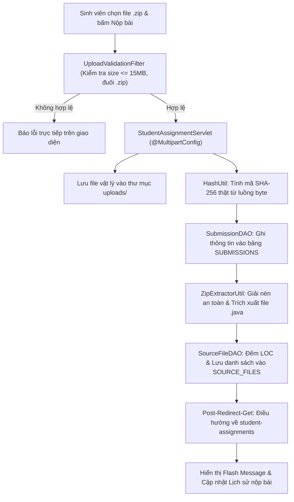
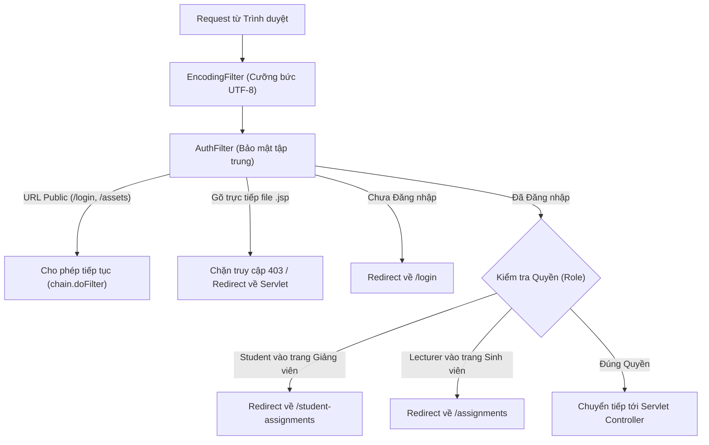

# 👥 KẾ HOẠCH PHÂN CHIA NHIỆM VỤ 5 THÀNH VIÊN - TUẦN 4, 5, 6
## ĐỒ ÁN: AITA - AI STATIC CODE ANALYSIS & AST OPTIMIZATION PORTAL
* **Môn học:** PRJ301 (Java Web Application - RBL Curriculum)
* **Nhóm thực hiện:** Nhóm 3 (DOMIXi) - 5 Thành viên
* **Mục tiêu cột mốc:** Hoàn thành 100% tiêu chí **Peer-Review 2 (Tuần 6)** theo chuẩn Rubric PRJ30x

---

## 📌 1. TỔNG QUAN CỘT MỐC TUẦN 4 - 6 (PEER-REVIEW 2)

Sau khi hoàn thành cột mốc Tuần 3 (Khởi tạo CSDL 10 bảng 3NF và CRUD bài tập `ASSIGNMENTS`), giai đoạn Tuần 4 - 6 là **giai đoạn bản lề** quyết định điểm số môn học, tập trung vào:
1. **Business Logic & Xử lý Artifact:** Chuyển từ dữ liệu mô phỏng sang luồng nộp bài vật lý thật. Tiếp nhận file `.zip`, băm SHA-256 thật từ luồng byte, giải nén ZIP an toàn và bóc tách danh sách file `.java` (đếm số dòng code LOC) nạp vào bảng `SUBMISSIONS` và `SOURCE_FILES`.
2. **Bảo mật Tầng Web Filter:** Làm chủ công nghệ Servlet Filter (tiêu chí trọng số 40% của Tuần 6) gồm xác thực phiên, phân quyền Giảng viên/Sinh viên, chặn truy cập trái phép trực tiếp vào các file `.jsp`, và kiểm tra an toàn tệp tải lên (`UploadValidationFilter`).
3. **Chuẩn hóa Clean Code MVC2:** Loại bỏ triệt để mã nhúng Java thô (Scriptlet `<% %>`) trên giao diện JSP, chuyển đổi 100% sang JSTL Core (`<c:forEach>`, `<c:if>`) và Expression Language (`${...}`).
4. **Bảo vệ Đồ án (Peer Defense):** Chuẩn bị bộ 14+ Test Case, slide thuyết trình và kịch bản vấn đáp bảo vệ đồ án theo phong cách École 42.

---

## 🎯 2. BẢNG PHÂN VAI VÀ MA TRẬN TRÁCH NHIỆM (5 THÀNH VIÊN)

Mỗi thành viên phụ trách một mảng kỹ thuật độc lập, chuyên sâu. Khi bảo vệ đồ án, từng bạn sẽ chứng minh được phần việc và dòng code cụ thể do chính mình triển khai:

| Thành viên | Vai trò đảm nhiệm | Mảng kỹ thuật chính | Các File Code / Tài liệu chịu trách nhiệm |
| :---: | :--- | :--- | :--- |
| **TV 1** | **Team Leader / Core Backend** | Luồng Upload File thật, MVC2 Controller, Lưu trữ vật lý & `SUBMISSIONS` DAO | `Submission.java`<br>`SubmissionDAO.java`<br>`StudentAssignmentServlet.java`<br>`LecturerSubmissionServlet.java` |
| **TV 2** | **Backend Logic & Artifact** | Thuật toán băm SHA-256 thật, Giải nén ZIP an toàn (chống Zip Slip) & Bóc tách mã nguồn | `HashUtil.java`<br>`ZipExtractorUtil.java`<br>`SourceFile.java`<br>`SourceFileDAO.java` |
| **TV 3** | **Security & Filter Layer** | Hệ thống Web Filter: Xác thực, Phân quyền Role, Chặn truy cập JSP & Thẩm định tệp upload | `EncodingFilter.java`<br>`AuthFilter.java`<br>`UploadValidationFilter.java`<br>Cấu hình `web.xml` |
| **TV 4** | **Frontend UI/UX & MVC View** | Giao diện Nộp bài, Bảng Lịch sử nộp bài SV, Dashboard bài nộp GV & Clean JSTL/EL | `student_assignments.jsp`<br>`lecturer_submissions.jsp`<br>CSS Dark/Modern UI<br>Flash Notifications |
| **TV 5** | **Database, QA Tester & Defense Lead** | Quản trị CSDL SQL Server, Chuẩn bị dữ liệu test, Soạn 14+ Test Case & Kịch bản vấn đáp | `AITA_Database.sql`<br>Bộ file test artifacts (`.zip`)<br>`TEST_REPORT_PEER_REVIEW_2.md`<br>Slide & Kịch bản bảo vệ |

---

## 📅 3. KẾ HOẠCH CHI TIẾT TỪNG THÀNH VIÊN THEO TUẦN

```
       TUẦN 4                          TUẦN 5                          TUẦN 6
 ┌─────────────────────┐         ┌─────────────────────┐         ┌─────────────────────┐
 │ TV1: Upload Servlet │         │ TV1: Lecturer View  │         │ TV1: Tối ưu MVC2    │
 │ TV2: SHA-256 Hash   │  ────►  │ TV2: Unpack & LOC   │  ────►  │ TV2: Xử lý Ngoại lệ │
 │ TV3: Filter Ma trận │         │ TV3: Upload Filter  │         │ TV3: AuthFilter     │
 │ TV4: Form Upload UI │         │ TV4: Lịch sử SV/GV  │         │ TV4: Clean JSTL/EL  │
 │ TV5: Database Setup │         │ TV5: 14+ Test Cases │         │ TV5: Slide & Demo   │
 └─────────────────────┘         └─────────────────────┘         └─────────────────────┘
```

---

### 👤 THÀNH VIÊN 1: TEAM LEADER / CORE BACKEND DEVELOPER
> **Sứ mệnh:** Xây dựng khung MVC2 cho module bài nộp, quản lý lưu trữ tệp vật lý và cung cấp API/DAO cho các thành viên khác tích hợp.

#### Tuần 4: Xây dựng Model & Servlet Upload bài nộp vật lý
- [ ] **Tạo Entity Model:** Viết lớp `com.fpt.aita.model.Submission.java` ánh xạ bảng `SUBMISSIONS` (các trường: `submissionId`, `studentId`, `assignmentId`, `filePath`, `sha256Hash`, `fileSize`, `submittedAt`, `status`).
- [ ] **Xây dựng DAO Lưu bài:** Viết `com.fpt.aita.dal.SubmissionDAO.java`:
  - Hàm `insertSubmission(Submission submission)`: Dùng `PreparedStatement` kèm cờ `Statement.RETURN_GENERATED_KEYS` để lấy lại `submission_id` tự tăng vừa tạo phục vụ việc lưu các file con.
- [ ] **Nâng cấp Servlet tiếp nhận File:** Cập nhật `StudentAssignmentServlet.java`:
  - Khai báo annotation `@MultipartConfig(maxFileSize = 15*1024*1024, maxRequestSize = 20*1024*1024)`.
  - Tiếp nhận tệp qua `request.getPart("submissionFile")`.
  - Thiết lập thư mục lưu trữ an toàn trên máy chủ: `uploads/submissions/{assignmentId}/`.
  - Ghi file `.zip` xuống ổ cứng và lấy đường dẫn lưu vào CSDL.

#### Tuần 5: Quản lý bài nộp phía Giảng viên & Tải file (Download)
- [ ] **Truy vấn danh sách bài nộp:** Viết hàm `getSubmissionsByAssignment(int assignmentId)` trong `SubmissionDAO.java` kết hợp JOIN với bảng `USERS` để lấy họ tên sinh viên.
- [ ] **Tạo Controller cho Giảng viên:** Viết `com.fpt.aita.controller.LecturerSubmissionServlet.java`:
  - Tiếp nhận `assignmentId` từ request của giảng viên.
  - Lấy danh sách bài nộp của sinh viên nộp cho đề bài đó và chuyển tiếp sang giao diện.
- [ ] **Tính năng Tải bài nộp:** Viết action tải file `.zip` về máy tính cho giảng viên (đọc tệp từ đường dẫn lưu trữ, thiết lập header `Content-Disposition: attachment; filename=...` và ghi ra `response.getOutputStream()`).

#### Tuần 6: Tối ưu mô hình MVC2 & Phối hợp tích hợp
- [ ] **Chuẩn hóa Post-Redirect-Get (PRG Pattern):** Rà soát tất cả các luồng submit form, đảm bảo người dùng F5 không bị nộp trùng bài hoặc gửi lại form POST.
- [ ] **Tích hợp liên tầng:** Phối hợp cùng TV2 kết nối hàm tính hash SHA-256 thật và hàm giải nén ZIP vào Servlet sau khi nhận file.
- [ ] **Tích hợp Filter:** Hỗ trợ TV3 test các bộ lọc bảo mật trên các Servlet do mình phụ trách.

---

### 👤 THÀNH VIÊN 2: BACKEND LOGIC & ARTIFACT PROCESSING
> **Sứ mệnh:** Xử lý cốt lõi kỹ thuật của đề tài AITA: băm SHA-256 từ luồng byte thật, giải nén tệp `.zip` an toàn và bóc tách các file `.java` lưu vào CSDL.

#### Tuần 4: Thuật toán Băm SHA-256 Thật & Chống Gian Lận
- [ ] **Xây dựng lớp tiện ích mã băm:** Tạo `com.fpt.aita.util.HashUtil.java`.
- [ ] **Viết hàm băm byte stream:**
  - Viết `public static String calculateSHA256(InputStream inputStream)`: Sử dụng `java.security.MessageDigest.getInstance("SHA-256")`.
  - Đọc dữ liệu theo bộ đệm byte `byte[] buffer = new byte[8192]` để tối ưu tốc độ xử lý cho file lớn.
  - Chuyển mảng byte kết quả sang chuỗi Hex 64 ký tự thường (`%02x`).
- [ ] **Thay thế mã giả (Mock):** Xóa bỏ hoàn toàn đoạn mã giả lập chuỗi hash ngẫu nhiên cũ trong `StudentAssignmentServlet.java`, thay thế bằng hàm gọi `HashUtil.calculateSHA256(filePart.getInputStream())`.
- [ ] **Phát hiện bài nộp trùng lặp:** Viết hàm `checkDuplicateHash(int assignmentId, String hash, int currentStudentId)` trong DAO: Nếu mã băm đã tồn tại ở bài nộp của sinh viên khác trong cùng bài tập, đánh dấu cờ cảnh báo nghi vấn sao chép mã nguồn.

#### Tuần 5: Tiện ích Giải nén ZIP & Bóc tách Mã nguồn Java
- [ ] **Xây dựng lớp tiện ích giải nén:** Tạo `com.fpt.aita.util.ZipExtractorUtil.java`:
  - Sử dụng `java.util.zip.ZipInputStream` để đọc từng entry trong file `.zip`.
  - **Phòng chống lỗ hổng Zip Slip (Bảo mật tối quan trọng):** Kiểm tra `targetFile.getCanonicalPath().startsWith(destDir.getCanonicalPath())` trước khi trích xuất file ra đĩa.
  - Giải nén bài làm vào thư mục: `uploads/extracted/{submissionId}/`.
- [ ] **Trích xuất danh sách file `.java`:**
  - Duyệt đệ quy toàn bộ thư mục vừa giải nén, chỉ lọc các file có phần mở rộng `.java`.
  - Đọc từng file để đếm số dòng code thực tế (LOC - Lines of Code).
- [ ] **Lưu thông tin tệp con:**
  - Tạo model `com.fpt.aita.model.SourceFile.java`.
  - Tạo `com.fpt.aita.dal.SourceFileDAO.java` với hàm `insertSourceFiles(List<SourceFile> files)` để lưu danh sách file `.java` vào bảng `SOURCE_FILES`.

#### Tuần 6: Xử lý Ngoại lệ & Tối ưu Tài nguyên
- [ ] **Bắt các trường hợp lỗi đặc biệt:**
  - File nén bị hỏng (Corrupted Zip) $\rightarrow$ Trả mã lỗi và thông báo cụ thể.
  - File zip không chứa bất kỳ file `.java` nào $\rightarrow$ Cảnh báo sinh viên kiểm tra lại cấu trúc thư mục trước khi nộp.
  - Xử lý dọn dẹp các luồng stream (`try-with-resources`) để tránh rò rỉ tài nguyên (Resource Leak).
- [ ] **Cung cấp dữ liệu cho Báo cáo:** Cung cấp thông tin số file Java và tổng LOC cho TV4 hiển thị lên bảng kết quả nộp bài.

---

### 👤 THÀNH VIÊN 3: SECURITY & FILTER LAYER (TIÊU CHÍ TRỌNG TÂM TUẦN 6)
> **Sứ mệnh:** Xây dựng kiến trúc bảo vệ hệ sinh thái Web Filter - chiếm 40% trọng số kỹ thuật của buổi Peer-Review 2.

#### Tuần 4: Chuẩn hóa Encoding & Thiết kế Ma trận Phân quyền
- [ ] **Hoàn thiện Bộ lọc Tiếng Việt:** Rà soát `com.fpt.aita.filter.EncodingFilter.java`, cấu hình chặn toàn bộ request và response với `UTF-8` trên url pattern `/*`.
- [ ] **Thiết kế Ma trận Phân quyền (URL Authorization Matrix):**
  - **Public URLs:** `/login`, `/logout`, `/assets/*`, `/index.html`.
  - **Student Only URLs:** `/student-assignments`, nộp bài POST, xem lịch sử cá nhân.
  - **Lecturer Only URLs:** `/assignments`, `/lecturer-submissions`, tải bài nộp.

#### Tuần 5: Bộ lọc Kiểm tra Tính Hợp lệ Tệp Nộp (`UploadValidationFilter`)
- [ ] **Xây dựng `UploadValidationFilter.java`:** Chặn trực tiếp trên URL tiếp nhận nộp bài:
  - Kiểm tra Header `Content-Length`: Nếu dung lượng vượt quá giới hạn 15MB, ngắt ngay request và trả thông báo lỗi mà không cần xử lý tiếp.
  - Kiểm tra MIME Type và phần mở rộng của tệp: Tệp bắt buộc phải có phần mở rộng `.zip` (hoặc `.java`).
  - **Chặn các tệp nguy hiểm (Malicious Files):** Từ chối ngay lập tức các tệp có đuôi `.exe`, `.sh`, `.jsp`, `.war`, `.bat` để ngăn chặn tấn công Remote Code Execution.

#### Tuần 6: Bộ lọc Xác thực & Bảo vệ Tập trung (`AuthFilter`)
- [ ] **Xây dựng `AuthFilter.java`:** Cấu hình áp dụng cho toàn bộ ứng dụng (`urlPatterns = {"/*"}`):
  - Kiểm tra `HttpSession`: Nếu chưa đăng nhập mà truy cập tài nguyên bảo mật $\rightarrow$ Điều hướng về trang `/login` kèm thông báo lỗi.
  - Kiểm tra Role:
    - Nếu tài khoản có vai trò `Student` cố ý gõ URL `/assignments` của giảng viên $\rightarrow$ Chuyển hướng an toàn về `/student-assignments`.
    - Nếu tài khoản có vai trò `Lecturer` truy cập URL dành riêng cho sinh viên $\rightarrow$ Chuyển hướng về `/assignments`.
- [ ] **Chặn Truy Cập Trực Tiếp Vào File `.jsp` (Bắt buộc theo chuẩn MVC2):**
  - Trong `AuthFilter`, nếu request URL kết thúc bằng `.jsp` (ví dụ `/student_assignments.jsp`, `/assignments.jsp`) $\rightarrow$ Từ chối hoặc gửi mã lỗi `403 Forbidden` / Chuyển hướng về Servlet tương ứng.
  - Đảm bảo người dùng **bắt buộc phải đi qua Controller (Servlet)** để lấy dữ liệu trước khi hiển thị View.

---

### 👤 THÀNH VIÊN 4: FRONTEND UI/UX & MVC VIEW DEVELOPER
> **Sứ mệnh:** Xây dựng giao diện tương tác chuyên nghiệp, hiện đại, trực quan và 100% tuân thủ nguyên tắc Clean JSP (không dùng Scriptlet Java).

#### Tuần 4: Nâng cấp Form Nộp Bài Phía Sinh Viên
- [ ] **Cập nhật Form Upload đa phần:**
  - Sửa form modal trong `student_assignments.jsp`: Thêm thuộc tính `enctype="multipart/form-data"` và `method="POST"`.
  - Thêm ô chọn file thực tế: `<input type="file" name="submissionFile" accept=".zip" required />`.
- [ ] **Trải nghiệm chọn file (Client-side UX):**
  - Viết JavaScript hiển thị tên file được chọn, tự động tính toán và hiển thị dung lượng (KB/MB) cho người dùng thấy trước khi bấm nút nộp.
  - Cảnh báo ngay trên giao diện nếu sinh viên chọn file vượt quá 15MB hoặc sai định dạng `.zip`.
- [ ] **Hộp thông báo nộp bài thành công (Flash Message):**
  - Thiết kế banner thông báo chuyên nghiệp: Hiển thị tên file đã nộp, dung lượng, mã băm SHA-256 rút gọn kèm nút **"Sao chép mã băm"**.

#### Tuần 5: Xây dựng Giao diện "Lịch sử Nộp bài" & Cổng Giảng viên
- [ ] **Khu vực Lịch sử Nộp bài Sinh viên:**
  - Bổ sung bảng bên dưới trang `student_assignments.jsp`: Hiển thị danh sách các lần nộp bài của chính sinh viên đang đăng nhập.
  - Các cột: Mã bài nộp, Tên bài tập, Tên file nộp, Mã SHA-256, Thời gian nộp, Số file Java bóc tách, Trạng thái.
- [ ] **Xây dựng Cổng Quản lý Bài nộp cho Giảng viên:**
  - Tạo file mới `src/main/webapp/lecturer_submissions.jsp`.
  - Hiển thị danh sách sinh viên đã nộp bài theo từng đề bài: Mã SV, Họ tên, Thời gian nộp, Mã băm SHA-256, Nút bấm **"Tải bài làm (.zip)"**.

#### Tuần 6: Chuẩn hóa Clean JSP & Tối ưu Responsive UI
- [ ] **Làm sạch mã nguồn JSP:**
  - Rà soát toàn bộ các file `.jsp`: **Tuyệt đối không dùng Scriptlet Java `<% ... %>` hay `<%= ... %>`**.
  - Chuyển đổi 100% logic hiển thị sang thẻ JSTL (`<c:forEach>`, `<c:if>`, `<c:choose>`) và biểu thức EL (`${assignment.title}`).
- [ ] **Đồng bộ Giao diện:** Đảm bảo bố cục giao diện hiển thị mượt mà trên cả màn hình Laptop và thiết bị di động, giữ vững tone màu Modern/Dark chuyên nghiệp của dự án AITA.

---

### 👤 THÀNH VIÊN 5: DATABASE, QA TESTER & DEFENSE LEAD
> **Sứ mệnh:** Giữ vững tính toàn vẹn dữ liệu, thiết lập bộ kịch bản kiểm thử chuẩn chỉnh và dẫn dắt phần thuyết trình bảo vệ đồ án trước giảng viên.

#### Tuần 4: Quản trị CSDL & Chuẩn bị Môi trường Kiểm thử
- [ ] **Kiểm tra Ràng buộc CSDL SQL Server:**
  - Kiểm tra bảng `SUBMISSIONS` và `SOURCE_FILES` trong file `AITA_Database.sql`.
  - Đảm bảo thiết lập đầy đủ khóa ngoại `FOREIGN KEY` kèm quy tắc toàn vẹn `ON DELETE CASCADE`.
- [ ] **Chuẩn bị Bộ tệp Kiểm thử mẫu (Test Artifacts):**
  - Tạo sẵn `Test_Valid_Project.zip`: Chứa cấu trúc project Java chuẩn (gồm 3 file `.java` mẫu) để test luồng nộp hợp lệ.
  - Tạo sẵn `Test_Duplicate_Code.zip`: Bản sao của file trên để test tính năng cảnh báo trùng mã băm SHA-256.
  - Tạo sẵn `Test_OverSize.zip`: Tệp có dung lượng > 15MB để test bộ lọc chặn dung lượng.
  - Tạo sẵn `Test_Malicious.zip`: Chứa file `.exe` hoặc file giả mạo để test bộ lọc an ninh.

#### Tuần 5: Xây dựng Bộ 14+ Test Case Chi tiết cho Peer-Review 2
- [ ] **Biên soạn tài liệu kiểm thử `TEST_REPORT_PEER_REVIEW_2.md` gồm 2 bảng trọng tâm:**
  - **Nhóm 1 (8 Test Case - Luồng Upload & Artifact):**
    1. Upload file `.zip` hợp lệ $\rightarrow$ Hệ thống lưu trữ thành công, sinh mã hash 64 ký tự.
    2. Upload file có dung lượng vượt quá 15MB $\rightarrow$ Bị chặn ngay lập tức, báo lỗi dung lượng.
    3. Upload file sai định dạng (`.pdf`, `.txt`) $\rightarrow$ Bị chặn, báo lỗi định dạng.
    4. Băm SHA-256 đối chiếu: So sánh mã băm hệ thống sinh ra với lệnh `sha256sum` trên máy thật $\rightarrow$ Khớp 100%.
    5. Giải nén ZIP an toàn: Trích xuất chính xác các file `.java` vào thư mục đích.
    6. Đếm số dòng code (LOC): Đối chiếu số dòng code thực tế với trường `loc` trong bảng `SOURCE_FILES`.
    7. Cảnh báo trùng lặp: Nộp 2 bài giống hệt nhau $\rightarrow$ Hệ thống cảnh báo trùng mã hash.
    8. Giảng viên tải bài nộp: Tải file `.zip` từ dashboard về máy $\rightarrow$ File nguyên vẹn, giải nén bình thường.
  - **Nhóm 2 (6 Test Case - Tầng Bảo mật Filter):**
    9. Truy cập khi chưa đăng nhập $\rightarrow$ Tự động điều hướng về trang `/login`.
    10. Tài khoản Sinh viên cố truy cập URL `/assignments` $\rightarrow$ Điều hướng về `/student-assignments`.
    11. Tài khoản Giảng viên cố truy cập URL của sinh viên $\rightarrow$ Điều hướng về `/assignments`.
    12. Gõ trực tiếp URL file JSP trên trình duyệt (ví dụ `/assignments.jsp`) $\rightarrow$ Bị chặn truy cập (403 Forbidden hoặc redirect).
    13. Bộ lọc UTF-8: Đặt tên đề bài và ghi chú có dấu tiếng Việt $\rightarrow$ Không bị lỗi font (`???`).
    14. Đăng xuất hệ thống $\rightarrow$ Session bị hủy hoàn toàn, bấm nút Back trên trình duyệt không vào lại được trang nội bộ.

#### Tuần 6: Slide Báo cáo, Kịch bản Demo & Dẫn dắt Buổi Vấn đáp
- [ ] **Thiết kế Slide Thuyết trình:** Chuẩn bị slide từ 8 - 10 trang bám sát Rubric PRJ30x (Tổng quan đề tài, Kiến trúc MVC2, Tầng Filter bảo mật, Cơ chế băm SHA-256 & giải nén tệp, Bảng kết quả kiểm thử).
- [ ] **Kịch bản Demo Thời gian thực:** Chuẩn bị sẵn kịch bản demo 5 phút không có độ trễ: Đăng nhập $\rightarrow$ Nộp bài $\rightarrow$ Xem mã hash $\rightarrow$ Mở SQL Server đối chứng bảng `SUBMISSIONS` và `SOURCE_FILES` $\rightarrow$ Đăng nhập Giảng viên tải bài.
- [ ] **Điều phối Vấn đáp Q&A:** Phân chia câu hỏi vấn đáp cho từng bạn trong nhóm, tổ chức buổi diễn tập (Mock Defense) trước khi lên lớp.

---

## 🏗️ 4. SƠ ĐỒ KIẾN TRÚC & LUỒNG HOẠT ĐỘNG HỆ THỐNG

### A. Luồng Nộp bài & Xử lý Artifact (Tuần 4 - 5)



### B. Luồng Bảo mật Tầng Web Filter (Tuần 6)



---

## 🎤 5. KỊCH BẢN VẤN ĐÁP BẢO VỆ ĐỒ ÁN (PEER-REVIEW 2 CHEAT-SHEET)

Khi Hội đồng Giảng viên hoặc Nhóm chấm chéo gọi từng bạn đứng lên chất vấn:

### 🗣️ Thành viên 1 (Leader / Core Backend):
> **Câu hỏi tiềm năng:** *"Em hãy trình bày cách thức tiếp nhận file upload trong Servlet và giải thích mô hình Post-Redirect-Get?"*  
> **Trả lời mẫu:**  
> *"Dạ thưa thầy/cô, trong `StudentAssignmentServlet`, em sử dụng annotation `@MultipartConfig` của Servlet 3.0+ để cho phép tiếp nhận dữ liệu `multipart/form-data`. Em sử dụng `request.getPart("submissionFile")` để trích xuất file vật lý và lưu trữ an toàn trên máy chủ.  
> Sau khi `SubmissionDAO` ghi nhận bài nộp thành công vào CSDL, em áp dụng mẫu thiết kế **Post-Redirect-Get (PRG Pattern)** bằng lệnh `response.sendRedirect("student-assignments")` thay vì dùng forward. Việc này đảm bảo nếu sinh viên bấm F5 refresh trình duyệt thì sẽ chỉ gửi request GET, hoàn toàn không bị nộp trùng lặp bài hay hiển thị cảnh báo gửi lại form của trình duyệt ạ."*

---

### 🗣️ Thành viên 2 (Backend Logic & Artifact):
> **Câu hỏi tiềm năng:** *"Tại sao hệ thống lại cần băm SHA-256? Em phòng chống tấn công Zip Slip như thế nào?"*  
> **Trả lời mẫu:**  
> *"Dạ thưa thầy/cô, mã băm SHA-256 là dấu vân tay kỹ thuật số của bài nộp. Trong lớp `HashUtil`, em sử dụng `MessageDigest.getInstance("SHA-256")` đọc trực tiếp qua luồng byte của file để sinh chuỗi băm 64 ký tự. Mã băm này giải quyết 2 bài toán cốt lõi: chứng minh tính toàn vẹn của mã nguồn (không bị chỉnh sửa sau khi nộp) và phát hiện hành vi sao chép bài nếu 2 sinh viên nộp cùng mã hash.  
> Về giải nén ZIP, khi dùng `ZipInputStream`, kẻ tấn công có thể chèn các ký tự `../` vào tên file để ghi đè ra ngoài thư mục đích (lỗ hổng Zip Slip). Trong lớp `ZipExtractorUtil`, trước khi ghi bất kỳ file nào ra đĩa, em luôn kiểm tra điều kiện: `targetFile.getCanonicalPath().startsWith(destDir.getCanonicalPath())`. Nếu vi phạm, hệ thống sẽ hủy bỏ giải nén ngay lập tức để bảo vệ server ạ."*

---

### 🗣️ Thành viên 3 (Security & Filter Layer):
> **Câu hỏi tiềm năng:** *"Filter trong Java Web hoạt động ra sao? Tại sao phải chặn người dùng truy cập trực tiếp vào các file .jsp?"*  
> **Trả lời mẫu:**  
> *"Dạ thưa thầy/cô, Servlet Filter hoạt động theo cơ chế đánh chặn (Interception), đứng trước Controller để xử lý request và đứng sau để xử lý response trước khi trả về client.  
> Em xây dựng `AuthFilter` quản lý xác thực tập trung giúp tránh việc phải lặp lại code kiểm tra `session != null` ở từng Servlet.  
> Đặc biệt, trong mô hình MVC2, tầng View (JSP) chỉ có nhiệm vụ hiển thị dữ liệu đã được Controller chuẩn bị sẵn qua `request.setAttribute`. Nếu người dùng gõ trực tiếp URL file `.jsp` (ví dụ `/assignments.jsp`), ứng dụng sẽ bị lỗi NullPointerException hoặc lộ giao diện trắng vì chưa có dữ liệu từ DAO. Do đó, `AuthFilter` của em sẽ chặn toàn bộ các request gõ thẳng vào đuôi `.jsp` và bắt buộc người dùng phải đi qua đúng Servlet điều hướng ạ."*

---

### 🗣️ Thành viên 4 (Frontend UI/UX):
> **Câu hỏi tiềm năng:** *"Tại sao trên file JSP không nên dùng Scriptlet `<% %>`? Em xử lý hiển thị dữ liệu như thế nào?"*  
> **Trả lời mẫu:**  
> *"Dạ thưa thầy/cô, việc nhúng mã Java thô Scriptlet `<% %>` vào file JSP vi phạm nghiêm trọng nguyên tắc phân tách trách nhiệm (Separation of Concerns) của mô hình MVC2, gây khó khăn cho việc bảo trì và dễ phát sinh lỗi cú pháp khi hiển thị.  
> Trong toàn bộ đồ án, em đã loại bỏ 100% Scriptlet và thay thế hoàn toàn bằng thư viện thẻ chuẩn **JSTL (JavaServer Pages Standard Tag Library)** và **Expression Language (EL)**. Em sử dụng `<c:forEach>` để duyệt danh sách bài nộp từ Servlet, `<c:if>` để kiểm tra trạng thái bài làm và `${submission.sha256Hash}` để hiển thị dữ liệu một cách an toàn, trong sáng và dễ bảo trì ạ."*

---

### 🗣️ Thành viên 5 (Database & QA Lead):
> **Câu hỏi tiềm năng:** *"Em hãy trình bày cấu trúc lưu trữ của 2 bảng `SUBMISSIONS` và `SOURCE_FILES` cùng bộ test case của nhóm?"*  
> **Trả lời mẫu:**  
> *"Dạ thưa thầy/cô, bảng `SUBMISSIONS` lưu trữ thông tin cấp cao của bài nộp (mã sinh viên, đường dẫn file zip, chuỗi SHA-256 64 ký tự, dung lượng và thời gian nộp). Khi bài nộp được giải nén, bảng `SOURCE_FILES` sẽ lưu chi tiết từng file mã nguồn con (`file_name`, `loc`) liên kết với `SUBMISSIONS` qua khóa ngoại `submission_id` với quy tắc `ON DELETE CASCADE`.  
> Em đã xây dựng bộ 14 Test Case bao phủ cả luồng hợp lệ (Positive) và luồng lỗi/bảo mật (Negative), bao gồm kiểm thử file quá dung lượng 15MB, kiểm thử chống leo thang thư mục, kiểm thử tính chuẩn xác của mã băm SHA-256 đối chiếu với công cụ hệ điều hành, và kiểm thử phân quyền Filter giữa Giảng viên và Sinh viên ạ."*

---

## 📊 6. BẢNG TIÊU CHÍ NGHIỆM THU (SPRINT DEFINITION OF DONE)

| Hạng mục | Tiêu chí Hoàn thành (DoD) | Người chịu trách nhiệm | Trạng thái |
| :--- | :--- | :---: | :---: |
| **Upload Servlet** | Tiếp nhận file zip, ghi xuống ổ đĩa, lưu bản ghi vào `SUBMISSIONS` | TV 1 | ⏳ Đang làm |
| **Lecturer View** | Giảng viên xem được danh sách bài nộp và tải file `.zip` về máy | TV 1 | ⏳ Đang làm |
| **SHA-256 Engine** | Băm file byte thật ra chuỗi 64 ký tự, cảnh báo nếu trùng bài | TV 2 | ⏳ Đang làm |
| **Zip Unpack & LOC** | Giải nén chống Zip Slip, bóc tách file `.java`, đếm LOC vào `SOURCE_FILES` | TV 2 | ⏳ Đang làm |
| **Upload Filter** | Chặn request > 15MB, chặn file độc hại, chỉ nhận `.zip` | TV 3 | ⏳ Đang làm |
| **Auth & JSP Filter** | Quản lý phiên, phân quyền Role và chặn gõ trực tiếp URL `.jsp` | TV 3 | ⏳ Đang làm |
| **Student UI** | Form upload đa phần, JS tính dung lượng, lịch sử nộp bài cá nhân | TV 4 | ⏳ Đang làm |
| **Clean MVC2 JSP** | 100% file JSP không có Scriptlet `<% %>`, dùng JSTL và EL | TV 4 | ⏳ Đang làm |
| **Database & Test Data** | DB liên kết 10 bảng toàn vẹn, 4 file zip mẫu kiểm thử biên | TV 5 | ⏳ Đang làm |
| **14+ Test Cases & Slide** | File báo cáo kiểm thử chi tiết, Slide báo cáo và kịch bản vấn đáp | TV 5 | ⏳ Đang làm |

---
*Tài liệu kế hoạch phục vụ chuẩn bị bảo vệ đồ án môn PRJ301 - Kì Fall 2026 - Đại học FPT.*
