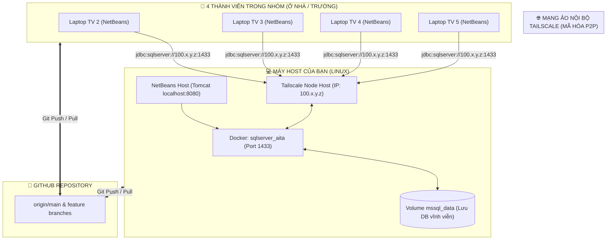

# 🚀 QUY TRÌNH ĐỒNG NHẤT DATABASE & CODE CHO NHÓM 5 NGƯỜI
## DỰ ÁN: AITA - AI STATIC CODE ANALYSIS PORTAL (PRJ301)
* **Nhóm thực hiện:** Nhóm 3 (DOMIXi)
* **Giải pháp cốt lõi:** **Tailscale P2P Mesh VPN + Docker Compose SQL Server + GitHub Flow**
* **Chi phí:** **0 VNĐ (100% Free)** - Không cần VPS, không cần thẻ ngân hàng, không cần email Edu.

---

## 🎯 1. TỔNG QUAN KIẾN TRÚC VẬN HÀNH



### Nguyên lý đồng nhất:
1. **Dữ liệu (Database):** Đồng bộ **thời gian thực (Real-time)**. Mọi thao tác thêm/sửa/xóa trên web của cả 5 bạn đều lưu trực tiếp vào 1 Database SQL Server duy nhất nằm trên máy Host qua mạng Tailscale.
2. **Mã nguồn (Source Code):** Đồng bộ **theo phiên làm việc (Git Flow)**. Code Java, JSP, CSS được commit và push lên GitHub, ai pull về máy người đó sẽ nhận đầy đủ tính năng mới nhất.

---

## ⚙️ 2. THIẾT LẬP BAN ĐẦU (CHỈ CẦN LÀM 1 LẦN DUY NHẤT)

### A. Dành cho BẠN (Host / Trưởng nhóm - Máy Linux)

#### Bước 1: Khởi động SQL Server bằng Docker Compose
Mở terminal trong thư mục project của bạn và chạy:
```bash
docker compose up -d
```
> Kiểm tra container đang chạy: `docker ps` (sẽ thấy `sqlserver_aita` đang mở cổng `0.0.0.0:1433->1433/tcp`).

#### Bước 2: Nạp CSDL ban đầu (Nếu chưa nạp)
Chạy script nạp database mẫu:
```bash
docker cp AITA_Database.sql sqlserver_aita:/tmp/AITA_Database.sql
docker exec -it sqlserver_aita /opt/mssql-tools18/bin/sqlcmd -S localhost -U sa -P "Thinhkhung@@123" -C -i /tmp/AITA_Database.sql
```

#### Bước 3: Cài đặt và bật Tailscale trên Linux
```bash
# Cài đặt Tailscale (nếu chưa có)
curl -fsSL https://tailscale.com/install.sh | sh

# Bật Tailscale và đăng nhập
sudo tailscale up
```
* Đăng nhập bằng tài khoản Google (tạo 1 tài khoản Gmail chung cho nhóm, ví dụ `group3.aita@gmail.com`).
* Lấy địa chỉ IP Tailscale của máy bạn:
```bash
tailscale ip -4
```
👉 *Ghi lại IP này, ví dụ:* `100.86.12.34`.

#### Bước 4: Mở tường lửa (Firewall) cho cổng Tailscale (Quan trọng)
Để 4 bạn kia kết nối được vào Docker port 1433 qua Tailscale:
```bash
sudo ufw allow in on tailscale0 to any port 1433
```
*(Hoặc nếu không dùng ufw thì Tailscale mặc định đã cho phép truy cập giữa các máy trong cùng mạng).*

---

### B. Dành cho 4 THÀNH VIÊN CÒN LẠI (Windows / Mac)

#### Bước 1: Cài đặt Tailscale
1. Tải Tailscale tại: [https://tailscale.com/download](https://tailscale.com/download).
2. Cài đặt và bấm **Log in** $\rightarrow$ Đăng nhập **cùng tài khoản Gmail chung** của nhóm.
3. Khi biểu tượng Tailscale hiện màu xanh (Connected) là thành công.

#### Bước 2: Kiểm tra kết nối đến máy Host
Mở Command Prompt (cmd) hoặc PowerShell trên máy các bạn, gõ:
```cmd
ping 100.86.12.34
```
*(Thay bằng IP Tailscale thật của máy Host. Nếu hiện `Reply from 100.86.12.34...` là thông mạng 100%).*

#### Bước 3: Cấu hình `DBContext.java` trong NetBeans
Trong file `DBContext.java`, giữ nguyên cấu hình chuẩn trỏ về IP của Host:
```java
String user = "sa";
String pass = "Thinhkhung@@123";
String host = "100.86.12.34"; // Điền IP Tailscale của máy Host
String url = "jdbc:sqlserver://" + host + ":1433;databaseName=AST_CodeAnalysisDB;encrypt=false;trustServerCertificate=true";
```
* Chạy file `DBContext.java` (Shift + F6): Hiện thông báo `===> KẾT NỐI DATABASE THÀNH CÔNG!` là xong.

---

## 🔄 3. QUY TRÌNH LÀM VIỆC HÀNG NGÀY (DAILY SPRINT WORKFLOW)

```
       BẮT ĐẦU BUỔI CODE                      TRONG BUỔI CODE                      KẾT THÚC BUỔI CODE
 ┌───────────────────────────┐         ┌───────────────────────────┐         ┌───────────────────────────┐
 │ 1. Host bật Docker & TS   │         │ 1. Cả 5 người mở NetBeans │         │ 1. Cả 5 người Git Push    │
 │ 2. Host báo: "DB Online!" │  ────►  │ 2. Chạy localhost:8080    │  ────►  │ 2. Cả nhóm Git Pull check │
 │ 3. Cả 5 người Git Pull    │         │ 3. Dữ liệu ghi về 1 DB    │         │ 3. Host tắt máy / Docker  │
 └───────────────────────────┘         └───────────────────────────┘         └───────────────────────────┘
```

### ☀️ BƯỚC 1: BẮT ĐẦU BUỔI LÀM VIỆC (CHECK-IN)
1. **Bạn Host:**
   * Mở máy tính lên.
   * Chạy lệnh bật database: `docker compose up -d`.
   * Kiểm tra Tailscale đang chạy.
   * Nhắn vào nhóm Zalo/Discord: *"Database đã Online, mọi người làm việc nhé!"*.
2. **Cả 5 thành viên (kể cả Host):**
   * Mở terminal trong thư mục dự án và kéo code mới nhất về:
     ```bash
     git pull origin main
     ```

### 💻 BƯỚC 2: TRONG KHI LÀM VIỆC (CODING & TESTING)
* Mỗi bạn mở NetBeans trên laptop của mình.
* Bấm **F6** chạy Tomcat trên `http://localhost:8080/`.
* Code module được phân công (TV1 làm upload, TV2 làm băm hash, TV3 làm filter, TV4 làm giao diện, TV5 test...).
* **Trải nghiệm thực tế:**
  * Bạn TV1 test nộp bài tập $\rightarrow$ Bài nộp được ghi vào SQL Server của Host.
  * Bạn TV4 ở máy khác bấm F5 trang Lịch sử nộp bài $\rightarrow$ Thấy ngay bài nộp của TV1 vừa nộp!
  * Bạn TV5 mở NetBeans Services $\rightarrow$ Thấy dữ liệu bảng `SUBMISSIONS` tăng lên theo thời gian thực.

### 🌙 BƯỚC 3: KẾT THÚC BUỔI LÀM VIỆC (CHECK-OUT & SYNC CODE)
1. **Tất cả các bạn hoàn thành task:**
   * Kiểm tra code chạy không lỗi compile.
   * Commit và đẩy code lên GitHub:
     ```bash
     git add .
     git commit -m "feat(module): hoan thanh chuc nang X cua TV..."
     git push origin main
     ```
   *(Hoặc push lên nhánh riêng của mình rồi tạo Pull Request).*
2. **Đồng nhất lần cuối:**
   * Cả nhóm gõ `git pull origin main` để chắc chắn máy ai cũng có code mới nhất của các bạn khác.
3. **Bạn Host kết thúc phiên:**
   * Bạn có thể tắt máy tính hoặc tắt Docker:
     ```bash
     docker compose stop
     ```
   * Dữ liệu không bao giờ bị mất vì đã được lưu trong Docker volume `mssql_data`. Buổi sau bật lại vẫn còn nguyên 100%.

---

## 🛡️ 4. QUY TẮC VÀNG TRÁNH CONFLICT GIT CHO CẢ NHÓM

1. **Quy tắc 1: Không tự ý đổi IP trong `DBContext.java`**  
   Cả 5 người thống nhất để nguyên IP Tailscale của Host (`100.86.12.34`). Ngay cả máy của Host khi trỏ vào IP Tailscale của chính mình thì Tailscale vẫn tự loopback về máy cực nhanh. Do đó, **tuyệt đối không bạn nào được đổi về `localhost` rồi push lên Git** làm ảnh hưởng người khác.

2. **Quy tắc 2: Phân chia file rõ ràng theo bảng phân công Tuần 4-5-6**  
   - TV 1: Chỉ chỉnh sửa `SubmissionDAO.java`, `StudentAssignmentServlet.java`.
   - TV 2: Chỉ chỉnh sửa `HashUtil.java`, `ZipExtractorUtil.java`, `SourceFileDAO.java`.
   - TV 3: Chỉ chỉnh sửa các file trong package `com.fpt.aita.filter.*`.
   - TV 4: Chỉ chỉnh sửa các file `.jsp`, CSS trong `src/main/webapp/`.
   - TV 5: Chỉnh sửa tài liệu `TEST_REPORT.md`, slide, file `.sql`.  
   *Khi mỗi người phụ trách các file riêng biệt, tỷ lệ bị xung đột code (Merge Conflict) bằng 0%!*

3. **Quy tắc 3: Luôn `git pull` trước khi bắt đầu viết code**  
   Trước khi bắt tay vào code bất kỳ tính năng nào, luôn chạy `git pull` để nhận code mới nhất từ đồng đội.

---

## 🔧 5. BẢNG XỬ LÝ SỰ CỐ NHANH (TROUBLESHOOTING)

| Hiện tượng lỗi | Nguyên nhân | Cách khắc phục ngay lập tức |
| :--- | :--- | :--- |
| **`Lỗi kết nối CSDL` trên máy thành viên** | 1. Host chưa bật Docker<br>2. Host chưa bật Tailscale<br>3. Thành viên chưa kết nối Tailscale | 1. Host chạy `docker compose up -d`<br>2. Cả 2 bên kiểm tra biểu tượng Tailscale màu xanh<br>3. Chạy `ping <IP_Host>` để kiểm tra thông mạng. |
| **Ping thông nhưng NetBeans báo timeout port 1433** | Tường lửa (Firewall) trên máy Host chặn cổng 1433 | Trên máy Host (Linux), chạy lệnh:<br>`sudo ufw allow 1433/tcp` hoặc tắt firewall tạm thời: `sudo ufw disable` |
| **Git báo `CONFLICT (content)` khi pull** | 2 người cùng sửa chung 1 dòng code trong 1 file | Mở file bị conflict, tìm đoạn `<<<<<<< HEAD` và `>>>>>>>`, trao đổi với bạn còn lại để chọn giữ lại code của ai, sau đó commit lại. |
| **Host cần reset lại CSDL về ban đầu** | Dữ liệu test bị rác trong lúc làm việc | Chạy lại lệnh nạp file `AITA_Database.sql` vào Docker container là CSDL được làm mới sạch sẽ. |

---

## 🎓 6. CHUẨN BỊ CHO BUỔI BẢO VỆ ĐỒ ÁN TRÊN LỚP (PEER-REVIEW)

1. **Khi đi thi / lên trường bảo vệ:**
   * Bạn Host đem laptop lên lớp, bật máy và chạy Docker.
   * Cả 5 bạn bật laptop, bật Tailscale (hoặc máy Host bật điểm phát sóng WiFi Hotspot cho 4 bạn cùng bắt vào nếu mạng trường bị chặn VPN).
   * Cả 5 máy cùng mở NetBeans demo mượt mà 100%.
2. **Xuất bản nộp bài cuối kỳ:**
   * Sau khi hoàn thiện đồ án, bạn Host chạy lệnh xuất CSDL ra file:
     ```bash
     docker exec sqlserver_aita /opt/mssql-tools18/bin/sqlcmd -S localhost -U sa -P "Thinhkhung@@123" -Q "BACKUP DATABASE AST_CodeAnalysisDB TO DISK = '/tmp/AITA_Backup.bak'"
     docker cp sqlserver_aita:/tmp/AITA_Backup.bak ./AITA_Backup.bak
     ```
   * Commit file backup và script `AITA_Database.sql` mới nhất lên GitHub để nộp cho giảng viên.

---
*Tài liệu quy trình nội bộ Nhóm 3 (DOMIXi) - Môn PRJ301 - Đại học FPT.*
