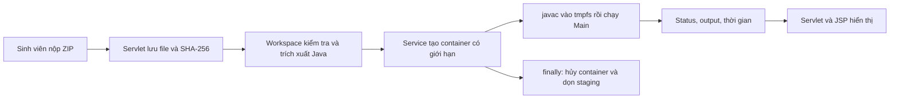

# Hướng dẫn báo cáo, giải thích code và demo Docker Sandbox

Cập nhật 2026-11-04: hệ thống đã có GradingService chấm điểm theo test case bên trên
sandbox; xem [hướng dẫn chấm điểm](TEST_CASE_GRADING.md). Những demo SUCCESS trong
tài liệu này là trạng thái thực thi của SandboxResult, tách khỏi ACCEPTED/WRONG_ANSWER
và điểm số của bộ chấm.

Tài liệu dành cho phần trình bày cá nhân khoảng 8–10 phút. Nếu chỉ có 5 phút,
nói phần mở đầu, luồng xử lý, ba demo bắt buộc và giới hạn hiện tại.
Các phần walkthrough/FAQ dùng để học trước hoặc trả lời vấn đáp.

## 1. Điều cần hiểu trước khi học lời nói

**Sandbox là nơi chạy thử code không tin cậy trong một môi trường bị giới hạn.**
Sinh viên vẫn có thể viết `while (true)`, gọi `Runtime.exec` hoặc mở socket.
Module không dựa vào việc tìm chuỗi nguy hiểm rồi cấm code; nó giới hạn nơi code
được chạy, những gì code nhìn thấy, tài nguyên được dùng và thời gian được sống.

Trong AITA hiện tại:

- Webapp nhận ZIP, kiểm tra/giải nén có giới hạn rồi đưa Java source vào container.
- Container dùng JDK 8 để biên dịch và chạy `Main`.
- Webapp nhận status, output, thời gian; không chạy Main trong JVM Tomcat.
- `SandboxResult.SUCCESS` chưa có nghĩa là đúng bài. GradingService so stdout với
  expected output và tính điểm riêng; kết quả đúng của grader là ACCEPTED.

Một ví dụ dễ nói: “Chương trình sinh viên là người được vào phòng thực hành.
Phòng này không có đường mạng ra ngoài, nguồn vào chỉ được đọc, tài nguyên có hạn,
và sau thời gian cho phép thì phải dừng.” Sau ví dụ, quay về cơ chế kỹ thuật bên dưới.

## 2. Sáu slide và lời thuyết trình có thể tập theo

| Slide | Thời gian | Nội dung trên slide |
| --- | --- | --- |
| 1 | 45 giây | Bài toán: thực thi untrusted code trong AITA |
| 2 | 60 giây | Luồng từ ZIP → service → container → kết quả |
| 3 | 75 giây | Cơ chế network, filesystem, CPU/RAM, timeout |
| 4 | 90 giây | Các file code và điểm kiểm soát chính |
| 5 | 3 phút | Hello → TLE → xóa file → mạng → inspect/cleanup |
| 6 | 45 giây | Kết quả kiểm thử, giới hạn và hướng mở rộng |

### Slide 1 — Vì sao phải có sandbox?

Nói:

> “Phần em phụ trách là Docker Sandbox cho hệ thống AITA. Khi sinh viên nộp ZIP,
> mã trong đó là untrusted code. Nếu chạy trực tiếp trên Tomcat, vòng lặp vô tận
> có thể chiếm tài nguyên, code có thể cố đọc/xóa file hoặc kết nối mạng ra ngoài.
> Vì vậy em tách quá trình biên dịch và thực thi sang container riêng, kèm các
> giới hạn bảo mật. Đây là phần bằng chứng cho tiêu chí Sandbox Compliance trong
> đặc tả Peer Review của nhóm.”

Không cần khẳng định mình đạt đủ 30% điểm: mức điểm do giảng viên đánh giá.

### Slide 2 — Hệ thống xử lý thế nào?



Nói:

> “Servlet chỉ điều phối và lưu thông tin bài nộp. SandboxWorkspace chuẩn bị
> source vào thư mục riêng. DockerSandboxService tạo container bằng ProcessBuilder,
> gắn source read-only, thu output và giám sát deadline. Khi xong hoặc lỗi, finally
> dọn container. Kết quả được đóng gói bằng SandboxResult và hiển thị trên JSP.”

### Slide 3 — Những lớp bảo vệ nào?

| Mối nguy | Cơ chế ở bản hiện tại | Cách giải thích |
| --- | --- | --- |
| Truy cập mạng ngoài | `--network none` | Container chỉ có loopback riêng |
| Đổi/xóa source | `/workspace:ro` | Bind mount chỉ đọc source của đúng bài |
| Sửa filesystem image | `--read-only` | Root filesystem cũng chỉ đọc |
| Cần ghi class/tệp tạm | `/tmp` tmpfs 32 MiB | Chỉ vùng tạm này được ghi, nằm trong giới hạn RAM |
| Nâng đặc quyền | non-root, drop ALL capabilities, no-new-privileges | Giảm quyền của tiến trình |
| Ngốn RAM | RAM 128 MiB, memory-swap 128 MiB | Không cộng thêm swap ngoài mức RAM |
| Chiếm CPU | `--cpus 0.5` | Quota bằng nửa một core |
| Vòng lặp vô tận | Deadline 5000 ms và force-remove | CPU quota không thay thế timeout |
| Fork/thread flood | PID limit 64 | Giới hạn cả tiến trình và thread |
| In output vô tận | Capture 64 KiB, dừng job, Docker log driver none | Giới hạn bộ nhớ thu output và tránh daemon ghi log vô hạn |
| ZIP nguy hiểm | Kiểm tra đường dẫn/số entry/dữ liệu giải nén | Bảo vệ host trước khi container chạy |

Nói:

> “Các lớp bảo vệ giải quyết những mối nguy khác nhau. Network none chặn đường
> mạng ngoài; mount read-only bảo vệ source; RAM và CPU quota giới hạn tài nguyên;
> timeout chặn thời gian chạy vô hạn. Không dùng một cờ để thay cho toàn bộ cơ chế.”

`--network none` vẫn có localhost **của container**, không phải localhost host.
Mô tả này khớp [tài liệu Docker về none network](https://docs.docker.com/engine/network/drivers/none/).
Ý nghĩa RAM/swap/CPU được đối chiếu với
[Docker resource constraints](https://docs.docker.com/engine/containers/resource_constraints/).

### Slide 4 — Mở những file nào để giải thích?

Mở sẵn trong IDE theo thứ tự, dùng tìm tên method để chuyển nhanh:

1. `docker/sandbox/Dockerfile`: JDK 8, tạo user, `USER sandboxuser`, entrypoint.
2. `docker/sandbox/run.sh`: javac → `/tmp/classes` → java → quy đổi mã thoát.
3. `DockerSandboxService.java`: `execute`, `createCommand`, `run`, `removeContainer`.
4. `SandboxWorkspace.java`: `extract`, `unpack`, `checkBudget`.
5. `SandboxResult.java`: status, output, thời gian, `isSuccess()`.
6. `CourseDetailServlet.java`: tìm `sandboxService.execute`.
7. `course_detail.jsp`: tìm `sandboxSubmissionResult` và `c:out`.

Nói ngắn trên slide:

> “Dockerfile và run.sh định nghĩa môi trường thực thi. Service quản lý vòng đời
> và tài nguyên container. Workspace xử lý ZIP an toàn. Result là dữ liệu kết quả.
> Servlet/JSP nối module với luồng nộp bài.”

### Slide 5 — Chuyển sang demo

> “Em sẽ chạy một bài bình thường làm đối chứng, sau đó thử vòng lặp vô tận,
> thao tác xóa source và kết nối mạng. Em cũng kiểm tra cấu hình Docker thực tế
> và xác nhận container được dọn sau demo.”

Dùng quy trình ở mục 3, không gõ lại source độc hại trong lúc trình bày.

### Slide 6 — Chốt phần trình bày

> “Bản hiện tại đã kiểm thử ZIP validation, Java 8 execution, TLE, filesystem,
> network, compiler/runtime error, output flood, heap OOM và cleanup. Sandbox
> giúp thực thi code với phạm vi tác động được giới hạn. Module hiện chưa so
> expected output để chấm điểm; đó là bước có thể bổ sung phía trên lớp thực thi này.”

Nếu được hỏi về độ an toàn tuyệt đối: container chia sẻ kernel với host; đây là
cấu hình sandbox cho phạm vi đồ án, không phải tuyên bố chống mọi container escape.

## 3. Chuẩn bị và chạy demo terminal

### Chuẩn bị trước ngày báo cáo

Đứng ở thư mục project trong terminal Linux:

```bash
cd /home/phambuuthinh/Downloads/PRJ301_AITAproject_GRoup3_DOMIXi
docker info
docker image inspect aita-sandbox:java8 --format '{{.Id}}'
./scripts/demo-sandbox.sh prepare
```

Nếu chưa có image, build trước buổi báo cáo:

```bash
docker build -t aita-sandbox:java8 docker/sandbox
```

Script tự tìm Maven trong PATH hoặc cache Maven đang có trên máy. Máy khác có thể đặt:

```bash
MAVEN_BIN=/duong/dan/apache-maven/bin/mvn ./scripts/demo-sandbox.sh prepare
```

`prepare` compile CLI demo tin cậy và tạo 7 ZIP nhỏ trong `target/sandbox-demo/`.
Source dễ đọc nằm trong `target/sandbox-demo/sources/<case>/Main.java`.
Không cần PostgreSQL hoặc Tomcat cho demo terminal; module thực thi vẫn là service
thật của project, không phải chương trình mô phỏng.

Lệnh `java ... SandboxDemo` trên host chạy **CLI điều phối tin cậy**. CLI gọi
`DockerSandboxService`, còn source sinh viên chỉ được compile/chạy trong Docker.
Không dùng `java Main` hoặc chạy trực tiếp file demo sinh viên trên host.

### Terminal B: quan sát container trong lúc Terminal A chạy TLE

Mở terminal thứ hai, cũng ở thư mục project:

```bash
watch -n 0.3 './scripts/demo-sandbox.sh inspect'
```

Giữ Terminal B ở cạnh Terminal A. Trước và sau job có thể thấy “No running sandbox
container”. Trong khoảng TLE 5 giây cần thấy:

```text
User=sandboxuser Network=none
RAM=134217728 MemorySwap=134217728 NanoCPUs=500000000
ReadOnlyRootfs=true AutoRemove=true PidsLimit=64
CapabilitiesDropped=[ALL] SecurityOpt=[no-new-privileges:true]
Mount=/workspace Writable=false
```

`134217728 = 128 × 1024 × 1024` byte; `500000000` NanoCPUs tương ứng `0.5` CPU.
Thứ tự/format security options có thể khác tùy Docker. Có thể chụp màn hình khi
container xuất hiện để dùng làm bằng chứng dự phòng. Ctrl+C dừng watch, không dừng Docker.

### Terminal A: demo 1 — chương trình bình thường

```bash
./scripts/demo-sandbox.sh hello
```

Cần thấy `Status: SUCCESS`, `HELLO_SANDBOX`, `Java: 1.8.0...`, `User: sandboxuser`,
và `Demo check: PASS`.

Nói:

> “Ca đầu tiên chứng minh luồng hợp lệ vẫn chạy được. Source được compile bằng
> Java 8 trong image và chạy dưới user sandboxuser.”

### Demo 2 — vòng lặp vô tận

Mở source `target/sandbox-demo/sources/tle/Main.java`, chỉ vào `while (true) { }`.

```bash
./scripts/demo-sandbox.sh tle
```

Cần thấy `TIME_LIMIT_EXCEEDED`, `isSuccess: false`, thời gian khoảng 5000 ms và PASS.
Output trống là bình thường vì chương trình không in gì.

Nói trước khi chạy:

> “Bài này không có điều kiện kết thúc. Em dự kiến service dừng nó khi quá deadline.”

Sau khi chạy:

> “Kết quả là TIME_LIMIT_EXCEEDED. Giới hạn 5 giây ở bản này gồm startup, compile
> và chạy main; không phải riêng CPU time. Sau đó finally force-remove container.
> Tổng thời gian lệnh có thể lớn hơn vì còn chuẩn bị và cleanup.”

Chỉ sang Terminal B: container đã xuất hiện với cờ đúng, rồi biến mất.

### Demo 3 — cố xóa source và ghi filesystem image

```bash
./scripts/demo-sandbox.sh files
```

Cần thấy:

```text
Status: SUCCESS
FILE_DELETION_BLOCKED
ROOTFS_WRITE_BLOCKED
DOCKER_SOCKET_ABSENT
Demo check: PASS
```

Đọc source: `Files.delete(Paths.get("/workspace/Main.java"))` nằm trong try/catch.
Nếu xóa thành công, code sẽ ném `AssertionError`. Nếu bị chặn, chương trình xác nhận
file vẫn tồn tại rồi in marker.

Nói:

> “Đây là chương trình kiểm tra lớp bảo vệ. Nó bắt IOException khi thao tác bị
> chặn nên có thể kết thúc thành công. SUCCESS ở đây nghĩa là chương trình test
> chạy xong, còn bằng chứng bảo vệ là marker bị chặn và mount Writable=false.”

Không nói “chặn tất cả file trong container”: vùng `/tmp` vẫn được ghi có giới hạn.
Không demo bằng cách thực sự xóa thư mục host.

### Demo 4 — cố kết nối mạng ngoài

```bash
./scripts/demo-sandbox.sh network
```

Cần thấy `SUCCESS`, `NETWORK_BLOCKED` và PASS. Chương trình thử TCP tới IP số
`1.1.1.1:443` với connect timeout, bắt IOException khi không kết nối được.

Nói:

> “Em dùng IP số để tránh nhầm DNS lỗi với mạng bị chặn. Source thử mở socket,
> còn Docker được cấu hình NetworkMode=none. Vì chương trình bắt lỗi dự kiến nên
> status của chương trình kiểm tra là SUCCESS.”

Chỉ marker chưa đủ chứng minh network isolation: kết hợp source test đã biết và
inspect cấu hình. Không khẳng định loopback nội bộ bị vô hiệu hóa.

### Demo phụ nếu còn thời gian

```bash
./scripts/demo-sandbox.sh compile
./scripts/demo-sandbox.sh zip-slip
./scripts/demo-sandbox.sh flood
```

| Ca | Dự kiến | Điểm cần nói |
| --- | --- | --- |
| `compile` | COMPILE_ERROR | Thiếu dấu `;`, compiler lỗi thì không chạy main |
| `zip-slip` | INVALID_SUBMISSION | Entry `../Main.java` bị từ chối trước Docker |
| `flood` | OUTPUT_LIMIT_EXCEEDED | In vô hạn cũng bị chặn; preview chỉ hiện 1600 ký tự |

`Execution time: 0 ms` ở ZIP không hợp lệ nghĩa là chưa bước vào pha chạy container.

Chạy cả bộ để tập hoặc ghi video:

```bash
./scripts/demo-sandbox.sh all
```

Mỗi ca so status với kỳ vọng và kiểm tra marker nếu cần. Nếu lệch, CLI trả exit khác 0
và script dừng. Log từng ca ở `target/sandbox-demo/results/<case>.txt`.

Cuối demo:

```bash
docker ps -a --filter label=aita.sandbox=true --format '{{.Names}} {{.Status}}'
```

Khi không có người khác chạy sandbox cùng lúc, cần không có dòng container nào.
Không dùng lệnh xóa hàng loạt container vì máy còn database/các project khác.

## 4. Demo trên giao diện web

Luồng web hiện đã tích hợp bộ chấm. Build image, chạy migration, deploy WAR mới,
bật PostgreSQL và dùng bài demo riêng có deadline tương lai.

1. Chạy `python3 scripts/prepare-grading-demo.py` để tạo các ZIP cộng hai số.
2. Giảng viên mở link Test case và thêm input/expected/weight theo
   [hướng dẫn chấm điểm](TEST_CASE_GRADING.md).
3. Sinh viên nộp `correct-sum.zip` để thấy 10.00, `hardcoded-five.zip` để thấy 2.00
   và `compile-error.zip` để thấy 0.00.
4. Kết quả lưu DB và mở lại được; test ẩn không đưa vào HTML cho sinh viên.
5. Giảng viên sửa barem và dùng Chấm lại để áp dụng cấu hình mới.

Dùng demo terminal ở mục 3 để trình bày riêng cơ chế TLE/file/network của sandbox;
những chương trình probe này không phải lời giải bài cộng hai số. Vẫn có thể quan sát
container trên Terminal B khi chạy grader. Demo web tạo bài nộp thật, nên dùng bài
riêng để không thay dữ liệu/deadline của bài học đang sử dụng.

## 5. Giải thích code chi tiết theo từng file

### 5.1 Dockerfile — chuẩn bị phòng thực thi

File: `docker/sandbox/Dockerfile`.

| Dòng lệnh | Giải thích để nói |
| --- | --- |
| `FROM eclipse-temurin:8-jdk-alpine` | JDK 8 có cả javac và java, image dựa Alpine |
| `addgroup`, `adduser` UID/GID 10001 | Tạo danh tính user ít quyền trong image |
| `COPY run.sh /opt/aita/run.sh` | Đưa script điều phối do nhóm kiểm soát vào image |
| `chmod 0555` | Script chỉ đọc/thực thi, không ghi |
| `USER sandboxuser` | Các process về sau mặc định không chạy root |
| `WORKDIR /workspace` | Nơi nhìn thấy source được mount vào |
| `ENTRYPOINT [...]` | Chạy script cố định của nhóm |
| `CMD ["Main"]` | Main class mặc định; service truyền tham số main class đã kiểm tra |

Dockerfile định nghĩa image. Giới hạn RAM/CPU/network nằm trong `createCommand`
ở service khi tạo **container**, không tự xuất hiện chỉ vì build image này.

### 5.2 run.sh — biên dịch rồi chạy trong container

File: `docker/sandbox/run.sh`.

```text
mkdir /tmp/classes
  → javac theo manifest nhóm tạo
  → compiler thất bại: exit 65
  → compiler thành công: java -cp /tmp/classes Main
  → main exit khác 0: wrapper exit 70
```

- `umask 077`: file mới tạo mặc định chỉ owner có quyền.
- `-d /tmp/classes`: ghi `.class` ra tmpfs, vì `/workspace` read-only.
- `@/workspace/.aita-sources.args`: danh sách Java source do Workspace sinh ra.
- `-proc:none`: không chạy annotation processor từ bài nộp.
- `-classpath /tmp/classes`: không thêm thư viện/application Tomcat vào bài sinh viên.
- `-Xmx48m`: heap tối đa 48 MiB; toàn container 128 MiB còn gồm metaspace,
  code cache, stack, native memory và tmpfs. Không đặt heap bằng hết RAM container.
- `"$1"`: truyền một main class đã validate; không dùng eval để chạy lệnh sinh viên.
- Runtime exit code bị quy về 70 để `System.exit(65)` trong Main không bị hiểu
  nhầm thành COMPILE_ERROR.

`noexec` trên tmpfs vẫn cho JVM đọc bytecode `.class`; đó không phải chạy một native
executable trực tiếp từ tmpfs. Script có sẵn nằm trên image, interpreter ở `/bin/sh`.

### 5.3 SandboxWorkspace — bảo vệ lúc giải nén trên host

File: `src/main/java/com/fpt/aita/service/SandboxWorkspace.java`.

`extract(Path archive)`:

1. Chỉ nhận regular file, không đi theo symlink của file ZIP đầu vào; giới hạn 50 MiB.
2. Tạo thư mục staging riêng bằng `Files.createTempDirectory`.
3. Gọi `unpack`; nếu lỗi thì thử dọn staging rồi ném exception cho service xử lý.

`unpack`:

- Duyệt ZIP tuần tự bằng `ZipInputStream`, không gọi script từ bài nộp.
- Giới hạn 1000 entry, 200 Java source, 16 MiB dữ liệu đã giải nén và deadline 5 giây.
- Tên entry phải thuộc tập ký tự hỗ trợ. Loại `/...`, `..`, backslash và tên có thể
  làm hỏng cú pháp argument file của javac.
- `sources.resolve(name).normalize()` tính đường dẫn đích chuẩn hóa.
- `target.startsWith(sources)` kiểm tra nó còn nằm trong staging.
- `seen.add(target)` từ chối hai entry trỏ cùng một đường dẫn sau normalize.
- Chỉ chép `.java`; file bỏ qua vẫn phải đọc và tính vào tổng byte giải nén để
  không bỏ lọt ZIP bomb nằm trong một file `.bin`.
- Metadata symlink không được dựng thành link, chỉ tạo file thường.
- Sinh manifest, đặt thư mục 0755 và source 0444 để user trong container đọc được.
- `close()` dùng FileVisitor xóa file trước, thư mục sau.

Vì giải nén diễn ra trước Docker, kiểm tra ZIP không thể giao hoàn toàn cho các cờ
container. Đây là một phần của ranh giới an toàn phía host.

### 5.4 DockerSandboxService — phần cần hiểu kỹ nhất

File: `src/main/java/com/fpt/aita/service/DockerSandboxService.java`.

**Các hằng và biến dùng chung**

- `TIMEOUT_MS = 5000`: budget cho pha create và pha start/compile/run, mỗi pha riêng.
- `OUTPUT_LIMIT_BYTES = 64 * 1024`: dung lượng raw output được giữ.
- `Semaphore SLOTS = new Semaphore(2)`: tối đa hai lời gọi service hoạt động trong webapp.
  Giới hạn từng container chưa đủ khi nhiều sinh viên nộp đồng thời.
- `CLEANUP_FAILED`: nếu không xác nhận container đã bị xóa thì khóa những lần sau,
  tránh tiếp tục tạo job khi không kiểm soát được tài nguyên còn sót.
- Tên container chứa UUID để không va chạm giữa các bài.

**execute(Path)**

Đọc main class server cấu hình, mặc định `Main`, rồi gọi overload với stdin rỗng.
Luồng upload hiện lấy main class và test input từ cấu hình assignment qua GradingService;
execute(Path) chỉ là API mặc định cho demo sandbox độc lập.

**execute(Path, String, byte[])**

1. Nếu hệ thống đang khóa do cleanup lỗi thì từ chối chạy.
2. Validate archive/main class/stdin. Main class chỉ nhận tên Java hợp lệ, không
   nhận `Main; rm ...` hoặc tùy chọn Docker từ sinh viên.
3. `tryAcquire()` lấy slot ngay; hết slot thì SANDBOX_BUSY, không đợi giữ thread.
4. Chuẩn bị workspace.
5. Tạo container trước bằng `docker create --rm ...`. Kết quả create phải là
   container ID 64 ký tự hex; output cảnh báo hoặc lỗi sẽ khiến không chạy tiếp.
6. Sau khi biết container, `docker start --attach --interactive` để chạy và thu output.
7. Ưu tiên output-limit/timeout trước khi phân loại exit code 0/65/70.
8. Trả `SandboxResult`.
9. `finally` luôn thử force-remove, dọn workspace khi container đã sạch, nhả slot,
   phục hồi interrupt flag khi cần.

Tại sao create + start? Chúng cho cùng loại runtime options như `docker run`,
nhưng service biết định danh container trước pha cần giám sát. Tiến trình Docker CLI
và container là hai đối tượng khác nhau.

**createCommand**

Trả về `List<String>` chứa executable và từng đối số riêng. Đây là nơi chỉ các cờ
bảo mật trong slide 3. `--pull never` yêu cầu build image sẵn để request không tải
image bất ngờ. Không có `--privileged`, không host networking và không mount socket.

**run**

```java
new ProcessBuilder(command).start();
```

`ProcessBuilder` chạy Docker CLI, không thực thi trực tiếp `Main.java` trên host.
Danh sách đối số tránh phải ghép thành `sh -c` với tên file/lệnh sinh viên.
Stdout và stderr được thu riêng: khi grader so đáp án chỉ dùng stdout, còn lỗi compiler/runtime
được giữ ở diagnostics. Tổng dung lượng hai stream vẫn có giới hạn chung.

Có ba thread I/O:

- Reader: `process.getInputStream()` để **đọc stdout của process**.
- Error reader: `process.getErrorStream()` để đọc stderr riêng.
- Writer: `process.getOutputStream()` để **ghi stdin cho process**, xong thì đóng
  stream để chương trình biết EOF, không chờ nhập từ bàn phím vô hạn.

Tên stream nhìn từ phía Java cha nên dễ nhầm. Đọc/ghi song song để pipe không đầy
gây deadlock; Java cũng nêu rủi ro này trong
[tài liệu Process](https://docs.oracle.com/javase/8/docs/api/java/lang/Process.html).

`waitFor(25, TimeUnit.MILLISECONDS)` chỉ chờ tối đa 25 ms ở **mỗi vòng kiểm tra**;
không có nghĩa timeout toàn bài là 25 ms. Sau mỗi lượt, service xét output limit
và so `System.nanoTime()` với deadline. Nano time dùng đo khoảng thời gian đơn điệu,
không phụ thuộc người dùng chỉnh giờ lịch.

Nếu cần dừng, `destroyForcibly()` xử lý CLI. Sau đó `finally` ở execute gọi
`docker rm --force` để xử lý container. Chỉ dừng CLI sẽ không đủ.

**BoundedOutput**

Giữ tối đa 64 KiB trong ByteArrayOutputStream. Reader đặt AtomicBoolean khi tràn;
vòng giám sát nhìn thấy cờ đó và dừng job. Method synchronized bảo vệ buffer khi
reader ghi và thread điều phối đọc. Decoder bỏ UTF-8 không hợp lệ hoặc bị cắt dở.

**removeContainer**

Xóa đúng tên container UUID của job, có timeout cleanup 2 giây. “No such container”
cũng hợp lệ vì `--rm` có thể đã xóa nó sau khi chạy xong. Nếu không xác nhận được
cleanup, trả lỗi và khóa sandbox để quản trị viên kiểm tra.

### 5.5 SandboxResult — dữ liệu kết quả

File: `src/main/java/com/fpt/aita/model/SandboxResult.java`.

- `Status`: enum tránh gõ nhầm chuỗi status giữa các lớp.
- `output`: stdout/stderr hoặc thông báo lỗi kiểm tra đầu vào/hạ tầng.
- `executionTimeMs`: wall-clock của pha start/compile/run được đo bởi service.
- `isSuccess()`: suy ra từ `status == SUCCESS`, không lưu một boolean riêng có thể lệch status.
- Các field final, khởi tạo bằng constructor; kết quả không thay đổi sau khi tạo.

Đừng nhầm TIME_LIMIT_EXCEEDED với COMPILE_ERROR hay SANDBOX_UNAVAILABLE.
Thiếu Docker/image là lỗi hạ tầng, không phải chương trình sinh viên sai.

### 5.6 Servlet/JSP — nối module với web

CourseDetailServlet lưu file/hash và enqueue ID bài ZIP. Worker của GradingQueueManager
lấy barem, kiểm tra file/hash, gọi GradingService rồi lưu điểm và từng kết quả.
GradingService gọi DockerSandboxService cho mỗi test với stdin riêng; đáp án nằm ở backend.

GradingServlet cung cấp trang quản lý test case cho chủ bài và trang kết quả có phân quyền.
JSP mới trong WEB-INF/views dùng c:out khi render dữ liệu; test ẩn được redacted ở backend.
Xem [TEST_CASE_GRADING.md](TEST_CASE_GRADING.md) khi trình bày logic chấm thường.

## 6. Các câu hỏi vấn đáp nên tập trả lời

**1. Sandbox khác antivirus hoặc static analysis ở đâu?**

“Static analysis đọc cấu trúc source; sandbox thực thi source trong môi trường
bị giới hạn. Hai cách có thể bổ trợ nhau. Module này phụ trách thực thi cách ly.”

**2. Docker có bảo đảm an toàn 100% không?**

“Không. Container dùng chung kernel host. Em giảm quyền và giới hạn tài nguyên,
không mount secret/socket vào container. Production cần đánh giá worker cách ly
và mô hình đe dọa rộng hơn.”

**3. Vì sao mount read-only nhưng javac vẫn chạy được?**

“javac đọc source từ `/workspace`, còn `.class` ghi sang `/tmp/classes` trên tmpfs.”

**4. Vì sao RAM 128 MiB mà heap chỉ 48 MiB?**

“RAM cgroup bao gồm nhiều thứ ngoài Java heap: metaspace, thread stack, native
memory và tmpfs. Đặt heap bằng 128 MiB có thể khiến cả JVM bị kill.”

**5. `--memory-swap 128m` có cho thêm 128 MiB swap không?**

“Không với cặp hiện tại. Memory-swap bằng memory nên không cho thêm swap ngoài
128 MiB RAM. Không nên giải thích thành tổng 256 MiB.”

**6. `--cpus 0.5` có nghĩa dùng nửa CPU toàn máy không?**

“Quota tương đương nửa một core, không phải 50% tổng mọi core của máy.”

**7. Có `--rm` rồi tại sao còn `docker rm --force`?**

“--rm xóa container sau khi dừng; nó không tự dừng vòng lặp vô tận. Timeout phải
cưỡng chế dừng, và finally còn xử lý nhánh lỗi/interrupt.”

**8. Tại sao không chỉ gọi `process.destroyForcibly()`?**

“Process đó là Docker CLI phía host. Container được Docker daemon quản lý riêng,
nên em phải hủy cả container theo tên.”

**9. Network none còn kết nối được localhost không?**

“Còn loopback bên trong container. Không có interface ra mạng ngoài; localhost
đó không trỏ tới Tomcat hoặc database trên host.”

**10. Ca file/mạng status SUCCESS có mâu thuẫn không?**

“Không. Chương trình test bắt lỗi dự kiến khi bị chặn rồi thoát 0. Chúng em đọc
marker, xem source probe và inspect Docker để xác nhận lớp bảo vệ.”

**11. Bài cho kết quả sai toán học nhưng exit 0 thì sao?**

“Sandbox vẫn trả SUCCESS về thực thi. GradingService sẽ so output với đáp án,
trả WRONG_ANSWER cho test sai và không cộng trọng số test đó.”

**12. Nhiều sinh viên nộp cùng lúc thì sao?**

“Worker dùng queue FIFO ở RAM, tối đa 100 job chờ. Sandbox còn có hai slot
để giới hạn số lần chạy. Chưa có hàng đợi bền vững qua restart.”

**13. 5 giây là thời gian chạy Main hay thời gian HTTP?**

“Là deadline cho pha start container, compile và chạy. Giải nén/create có budget
riêng, cleanup có thêm thời gian, nên HTTP hoặc lệnh demo có thể dài hơn 5 giây.”

**14. Exit 137 chắc chắn là thiếu RAM chứ?**

“Không đủ bằng chứng. Có nhiều nguyên nhân SIGKILL và container tự xóa làm mất
state inspect sau khi dừng. Bản này không gán mọi exit 137 thành MEMORY_LIMIT_EXCEEDED.”

**15. Nếu Tomcat chết hẳn trong khi Main chạy?**

“Deadline hiện do host service giám sát. Chưa có watchdog độc lập khi JVM chết
đột ngột; cần bổ sung worker/watchdog và quy trình xử lý orphan container.”

## 7. Lỗi dễ gặp khi demo và cách xử lý

| Hiện tượng | Cần kiểm tra |
| --- | --- |
| Không thấy `mvn` | Dùng script có tìm cache hoặc đặt MAVEN_BIN |
| SANDBOX_UNAVAILABLE | Docker daemon, quyền user, image `aita-sandbox:java8`; không chạy source trên host để thay thế |
| Docker báo không hỗ trợ memory/swap | Chỉnh môi trường Docker/cgroup trước, không bỏ cờ để demo qua |
| Bài hello bị TLE | Máy có tải lớn; giảm ứng dụng không cần thiết, thử lại; không âm thầm tăng 5 giây |
| ClassNotFoundException: Main | ZIP cần Main.java không package; package dùng cấu hình main class phía server |
| Chương trình đọc Scanner lỗi | Web demo dùng stdin rỗng; dùng các ZIP đã chuẩn bị không cần input |
| Web không có khung sandbox | Chưa deploy WAR mới, nộp file không phải ZIP, hoặc refresh đã xóa flash |
| Web báo hết deadline | Dùng bài demo riêng có deadline tương lai |
| Script chạy xong nhưng watch không có container | Job đã kết thúc; chạy TLE, quan sát trong khoảng 5 giây |
| Sandbox bị khóa do cleanup | Xem server log, kiểm tra/xóa đúng container còn sót; restart webapp sau khi khắc phục |

Chạy full suite trước buổi báo cáo:

```bash
/home/phambuuthinh/.cache/csd-tools/apache-maven-3.9.9/bin/mvn verify -Psandbox-it
```

Hai report: `target/surefire-reports/com.fpt.aita.service.SandboxWorkspaceTest.txt`
và `target/failsafe-reports/com.fpt.aita.service.DockerSandboxIT.txt`.
Riêng sandbox có 6 unit test + 11 Docker integration test. Bộ chấm bổ sung
15 unit + 4 Docker integration, tổng 36 test trong full suite. Script demo 7 ca
là bằng chứng trình bày riêng, không cộng chúng thành số JUnit test mới.

## 8. Checklist cuối trước khi đứng báo cáo

- [ ] Đã tải/build image trước; không chờ mạng tải image trong giờ trình bày.
- [ ] Đã chạy `./scripts/demo-sandbox.sh all` và các ca đều PASS.
- [ ] Đã mở hai terminal cùng thư mục project, Terminal B chạy watch.
- [ ] Đã mở sẵn code Service, Workspace, Dockerfile và run.sh trong IDE.
- [ ] Nếu demo web: WAR mới, PostgreSQL chạy, bài demo chưa hết hạn.
- [ ] Có ảnh/log dự phòng và biết log là bằng chứng lượt chạy trước.
- [ ] Nói đúng ba ý: SUCCESS chưa phải đúng đáp án; timeout gồm compile; network none còn loopback.
- [ ] Kết thúc kiểm tra container đã dọn, không xóa nhầm database/container khác.

Tài liệu vận hành: [DOCKER_SANDBOX.md](DOCKER_SANDBOX.md).
Biên bản kiểm tra tích hợp trước đó: [SANDBOX_VERIFICATION.md](SANDBOX_VERIFICATION.md).
