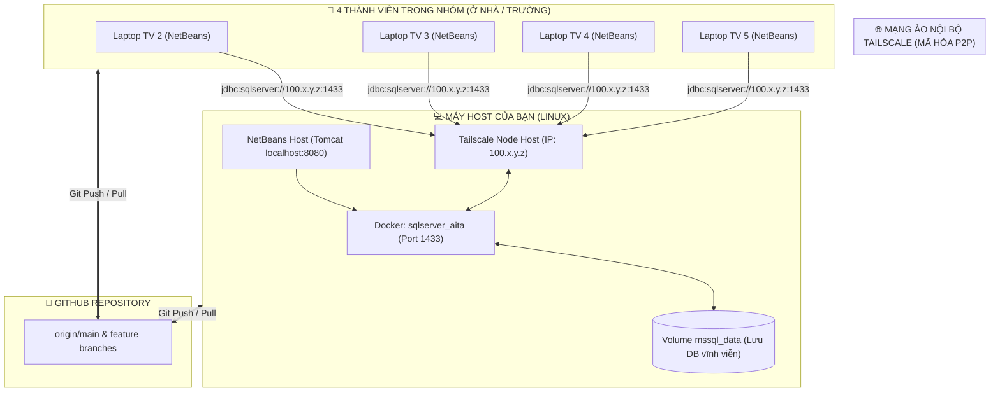

This file is a merged representation of the entire codebase, combined into a single document by Repomix.

<file_summary>
This section contains a summary of this file.

<purpose>
This file contains a packed representation of the entire repository's contents.
It is designed to be easily consumable by AI systems for analysis, code review,
or other automated processes.
</purpose>

<file_format>
The content is organized as follows:
1. This summary section
2. Repository information
3. Directory structure
4. Repository files (if enabled)
5. Multiple file entries, each consisting of:
  - File path as an attribute
  - Full contents of the file
</file_format>

<usage_guidelines>
- This file should be treated as read-only. Any changes should be made to the
  original repository files, not this packed version.
- When processing this file, use the file path to distinguish
  between different files in the repository.
- Be aware that this file may contain sensitive information. Handle it with
  the same level of security as you would the original repository.
</usage_guidelines>

<notes>
- Some files may have been excluded based on .gitignore rules and Repomix's configuration
- Binary files are not included in this packed representation. Please refer to the Repository Structure section for a complete list of file paths, including binary files
- Files matching patterns in .gitignore are excluded
- Files matching default ignore patterns are excluded
- Files are sorted by Git change count (files with more changes are at the bottom)
</notes>

</file_summary>

<directory_structure>
diagram/
  ERD.drawio
  UsecaseDiagram.drawio
plan/
  GIAI_THICH_CODE_CHI_TIET_TV2.md
  implementation_plan.md
  PHAN_CHIA_CONG_VIEC_EDUNEXT_PORTAL.md
  PHAN_CONG_CONG_VIEC_TUAN_4_5_6.md
  PLAN_TUAN_3_AITA.md
  QUY_TRINH_DONG_NHAT_DATA_VA_CODE_TAILSCALE.md
rules/
  PRJ30x_Project_Evaluation_Rubric.docx
  RBL PRJ301 Project.docx
src/
  main/
    java/
      com/
        fpt/
          aita/
            controller/
              AssignmentServlet.java
              CourseDetailServlet.java
              HomeServlet.java
              LoginServlet.java
              RegisterServlet.java
              StudentAssignmentServlet.java
            dal/
              AssignmentDAO.java
              CourseDAO.java
              DBContext.java
              SubmissionDAO.java
              UserDAO.java
            filter/
              AuthFilter.java
              EncodingFilter.java
            model/
              Assignment.java
              Course.java
              Submission.java
              User.java
            util/
              PasswordUtil.java
            TestLogin.java
    resources/
      META-INF/
        persistence.xml
    webapp/
      META-INF/
        context.xml
      uploads/
        submissions/
          .gitkeep
      WEB-INF/
        beans.xml
        web.xml
      assignments.jsp
      course_detail.jsp
      home.jsp
      index.html
      login.jsp
      register.jsp
      student_assignments.jsp
  test/
    java/
      com/
        fpt/
          aita/
            test/
              AssignmentDAOTest.java
              DemoMenuApp.java
.$ERD.drawio.bkp
.gitignore
AITA_Database.sql
docker-compose.yml
nb-configuration.xml
pom.xml
README.md
setup_database.sh
</directory_structure>

<files>
This section contains the contents of the repository's files.

<file path="diagram/ERD.drawio">
<mxfile host="Electron">
  <diagram name="Page-1" id="FKRYkqqpAJnp4g5U8vTC">
    <mxGraphModel dx="1198" dy="722" grid="1" gridSize="10" guides="1" tooltips="1" connect="1" arrows="1" fold="1" page="1" pageScale="1" pageWidth="850" pageHeight="1100" math="0" shadow="0">
      <root>
        <mxCell id="0" />
        <mxCell id="1" parent="0" />
        <UserObject label="" mermaidData="{&#xa;  &quot;data&quot;: &quot;erDiagram\n    CLASSES {\n        int class_id PK\n        varchar class_code UK\n        nvarchar class_name\n    }\n    USERS {\n        int user_id PK\n        varchar username UK\n        varchar password_hash\n        nvarchar full_name\n        varchar role\n    }\n    USER_CLASS {\n        int user_id PK,FK\n        int class_id PK,FK\n    }\n    ASSIGNMENTS {\n        int assignment_id PK\n        int lecturer_id FK\n        nvarchar title\n        nvarchar description\n        datetime created_at\n    }\n    SUBMISSIONS {\n        int submission_id PK\n        int student_id FK\n        int assignment_id FK\n        varchar file_path\n        varchar sha256_hash\n        int file_size\n        datetime submitted_at\n        varchar status\n    }\n    SOURCE_FILES {\n        int file_id PK\n        int submission_id FK\n        varchar file_name\n        varchar file_type\n        int loc\n    }\n    METHODS {\n        int method_id PK\n        int file_id FK\n        varchar method_name\n        int start_line\n        int end_line\n        int loop_depth\n        int cyclomatic_complexity\n        varchar estimated_complexity\n        bit is_recursive\n    }\n    RULES {\n        int rule_id PK\n        varchar rule_code UK\n        varchar category\n        nvarchar name\n        int weight\n        bit enabled\n    }\n    ISSUES {\n        int issue_id PK\n        int file_id FK\n        int method_id FK\n        int rule_id FK\n        int line_number\n        varchar severity\n        nvarchar message\n        nvarchar ai_explanation\n    }\n    ANALYSIS_REPORTS {\n        int report_id PK\n        int submission_id FK,UK\n        int quality_score\n        int total_issues\n        datetime created_at\n    }\n    AI_OPTIMIZATIONS {\n        int optimization_id PK\n        int method_id FK\n        nvarchar original_code\n        nvarchar optimized_code\n        nvarchar explanation\n        datetime created_at\n    }\n\n    USERS ||--o{ USER_CLASS : \&quot;tham gia / phu trach\&quot;\n    CLASSES ||--o{ USER_CLASS : \&quot;co thanh vien\&quot;\n    USERS ||--o{ ASSIGNMENTS : \&quot;lecturer_id - tao de bai\&quot;\n    USERS ||--o{ SUBMISSIONS : \&quot;student_id - nop bai\&quot;\n    ASSIGNMENTS ||--o{ SUBMISSIONS : \&quot;co cac bai nop\&quot;\n    SUBMISSIONS ||--o{ SOURCE_FILES : \&quot;giai nen ra file .java\&quot;\n    SOURCE_FILES ||--o{ METHODS : \&quot;boc tach ham AST\&quot;\n    SOURCE_FILES ||--o{ ISSUES : \&quot;file_id - chua loi\&quot;\n    METHODS ||--o{ ISSUES : \&quot;method_id - loi trong ham\&quot;\n    RULES ||--o{ ISSUES : \&quot;rule_id - theo bo luat\&quot;\n    SUBMISSIONS ||--|| ANALYSIS_REPORTS : \&quot;1 bai nop - 1 bao cao\&quot;\n    METHODS ||--o{ AI_OPTIMIZATIONS : \&quot;de xuat toi uu\&quot;\n&quot;,&#xa;  &quot;config&quot;: null&#xa;}" id="CiZThyXxx5hTNYxlv4ja-1">
          <mxCell connectable="0" parent="1" style="group;transparentBounds=1;editIcon=1;lockedGroup=0;groupPadding=10;" vertex="1">
            <mxGeometry as="geometry" />
          </mxCell>
        </UserObject>
        <UserObject label="CLASSES" mermaidId="n:CLASSES" mermaidBaseStyle="shape=table;startSize=43;container=1;collapsible=0;childLayout=tableLayout;fixedRows=1;rowLines=1;fontSize=16;fontFamily=Trebuchet MS,Verdana,Arial,sans-serif;strokeWidth=1;align=center;resizeLast=1;html=1;fillColor=light-dark(#ECECFF,#1f2020);strokeColor=light-dark(#9370DB,#cccccc);fontColor=light-dark(#333333,#cccccc);" mermaidBaseValue="CLASSES" id="CiZThyXxx5hTNYxlv4ja-2">
          <mxCell parent="CiZThyXxx5hTNYxlv4ja-1" style="shape=table;startSize=43;container=1;collapsible=0;childLayout=tableLayout;fixedRows=1;rowLines=1;fontSize=16;fontFamily=Trebuchet MS,Verdana,Arial,sans-serif;strokeWidth=1;align=center;resizeLast=1;html=1;fillColor=light-dark(#ECECFF,#1f2020);strokeColor=light-dark(#9370DB,#cccccc);fontColor=light-dark(#333333,#cccccc);" vertex="1">
            <mxGeometry height="172" width="240" x="140" y="73" as="geometry" />
          </mxCell>
        </UserObject>
        <mxCell id="CiZThyXxx5hTNYxlv4ja-3" parent="CiZThyXxx5hTNYxlv4ja-2" style="shape=tableRow;horizontal=0;startSize=0;swimlaneHead=0;swimlaneBody=1;fillColor=light-dark(#ffffff,#1f2020);strokeColor=inherit;strokeWidth=1;collapsible=0;dropTarget=0;points=[[0,0.5],[1,0.5]];portConstraint=eastwest;top=0;left=0;right=0;bottom=0;" vertex="1">
          <mxGeometry height="43" width="240" y="43" as="geometry" />
        </mxCell>
        <mxCell id="CiZThyXxx5hTNYxlv4ja-4" parent="CiZThyXxx5hTNYxlv4ja-3" style="shape=partialRectangle;connectable=0;fillColor=none;strokeColor=light-dark(#9370DB,#cccccc);strokeWidth=1;fontColor=light-dark(#333333,#cccccc);fontFamily=Trebuchet MS,Verdana,Arial,sans-serif;top=1;left=1;bottom=1;right=1;align=left;spacingLeft=8;overflow=hidden;fontSize=16;" value="int" vertex="1">
          <mxGeometry height="43" width="88" as="geometry">
            <mxRectangle height="43" width="88" as="alternateBounds" />
          </mxGeometry>
        </mxCell>
        <mxCell id="CiZThyXxx5hTNYxlv4ja-5" parent="CiZThyXxx5hTNYxlv4ja-3" style="shape=partialRectangle;connectable=0;fillColor=none;strokeColor=light-dark(#9370DB,#cccccc);strokeWidth=1;fontColor=light-dark(#333333,#cccccc);fontFamily=Trebuchet MS,Verdana,Arial,sans-serif;top=1;left=1;bottom=1;right=1;align=left;spacingLeft=8;overflow=hidden;fontSize=16;" value="class_id" vertex="1">
          <mxGeometry height="43" width="107" x="88" as="geometry">
            <mxRectangle height="43" width="107" as="alternateBounds" />
          </mxGeometry>
        </mxCell>
        <mxCell id="CiZThyXxx5hTNYxlv4ja-6" parent="CiZThyXxx5hTNYxlv4ja-3" style="shape=partialRectangle;connectable=0;fillColor=none;strokeColor=light-dark(#9370DB,#cccccc);strokeWidth=1;fontColor=light-dark(#333333,#cccccc);fontFamily=Trebuchet MS,Verdana,Arial,sans-serif;top=1;left=1;bottom=1;right=1;align=left;spacingLeft=8;overflow=hidden;fontSize=16;" value="PK" vertex="1">
          <mxGeometry height="43" width="45" x="195" as="geometry">
            <mxRectangle height="43" width="45" as="alternateBounds" />
          </mxGeometry>
        </mxCell>
        <mxCell id="CiZThyXxx5hTNYxlv4ja-7" parent="CiZThyXxx5hTNYxlv4ja-2" style="shape=tableRow;horizontal=0;startSize=0;swimlaneHead=0;swimlaneBody=1;fillColor=light-dark(#F1F1FF,#1f2020);strokeColor=inherit;strokeWidth=1;collapsible=0;dropTarget=0;points=[[0,0.5],[1,0.5]];portConstraint=eastwest;top=0;left=0;right=0;bottom=0;" vertex="1">
          <mxGeometry height="43" width="240" y="86" as="geometry" />
        </mxCell>
        <mxCell id="CiZThyXxx5hTNYxlv4ja-8" parent="CiZThyXxx5hTNYxlv4ja-7" style="shape=partialRectangle;connectable=0;fillColor=none;strokeColor=light-dark(#9370DB,#cccccc);strokeWidth=1;fontColor=light-dark(#333333,#cccccc);fontFamily=Trebuchet MS,Verdana,Arial,sans-serif;top=1;left=1;bottom=1;right=1;align=left;spacingLeft=8;overflow=hidden;fontSize=16;" value="varchar" vertex="1">
          <mxGeometry height="43" width="88" as="geometry">
            <mxRectangle height="43" width="88" as="alternateBounds" />
          </mxGeometry>
        </mxCell>
        <mxCell id="CiZThyXxx5hTNYxlv4ja-9" parent="CiZThyXxx5hTNYxlv4ja-7" style="shape=partialRectangle;connectable=0;fillColor=none;strokeColor=light-dark(#9370DB,#cccccc);strokeWidth=1;fontColor=light-dark(#333333,#cccccc);fontFamily=Trebuchet MS,Verdana,Arial,sans-serif;top=1;left=1;bottom=1;right=1;align=left;spacingLeft=8;overflow=hidden;fontSize=16;" value="class_code" vertex="1">
          <mxGeometry height="43" width="107" x="88" as="geometry">
            <mxRectangle height="43" width="107" as="alternateBounds" />
          </mxGeometry>
        </mxCell>
        <mxCell id="CiZThyXxx5hTNYxlv4ja-10" parent="CiZThyXxx5hTNYxlv4ja-7" style="shape=partialRectangle;connectable=0;fillColor=none;strokeColor=light-dark(#9370DB,#cccccc);strokeWidth=1;fontColor=light-dark(#333333,#cccccc);fontFamily=Trebuchet MS,Verdana,Arial,sans-serif;top=1;left=1;bottom=1;right=1;align=left;spacingLeft=8;overflow=hidden;fontSize=16;" value="UK" vertex="1">
          <mxGeometry height="43" width="45" x="195" as="geometry">
            <mxRectangle height="43" width="45" as="alternateBounds" />
          </mxGeometry>
        </mxCell>
        <mxCell id="CiZThyXxx5hTNYxlv4ja-11" parent="CiZThyXxx5hTNYxlv4ja-2" style="shape=tableRow;horizontal=0;startSize=0;swimlaneHead=0;swimlaneBody=1;fillColor=light-dark(#ffffff,#1f2020);strokeColor=inherit;strokeWidth=1;collapsible=0;dropTarget=0;points=[[0,0.5],[1,0.5]];portConstraint=eastwest;top=0;left=0;right=0;bottom=0;" vertex="1">
          <mxGeometry height="43" width="240" y="129" as="geometry" />
        </mxCell>
        <mxCell id="CiZThyXxx5hTNYxlv4ja-12" parent="CiZThyXxx5hTNYxlv4ja-11" style="shape=partialRectangle;connectable=0;fillColor=none;strokeColor=light-dark(#9370DB,#cccccc);strokeWidth=1;fontColor=light-dark(#333333,#cccccc);fontFamily=Trebuchet MS,Verdana,Arial,sans-serif;top=1;left=1;bottom=1;right=1;align=left;spacingLeft=8;overflow=hidden;fontSize=16;" value="nvarchar" vertex="1">
          <mxGeometry height="43" width="88" as="geometry">
            <mxRectangle height="43" width="88" as="alternateBounds" />
          </mxGeometry>
        </mxCell>
        <mxCell id="CiZThyXxx5hTNYxlv4ja-13" parent="CiZThyXxx5hTNYxlv4ja-11" style="shape=partialRectangle;connectable=0;fillColor=none;strokeColor=light-dark(#9370DB,#cccccc);strokeWidth=1;fontColor=light-dark(#333333,#cccccc);fontFamily=Trebuchet MS,Verdana,Arial,sans-serif;top=1;left=1;bottom=1;right=1;align=left;spacingLeft=8;overflow=hidden;fontSize=16;" value="class_name" vertex="1">
          <mxGeometry height="43" width="107" x="88" as="geometry">
            <mxRectangle height="43" width="107" as="alternateBounds" />
          </mxGeometry>
        </mxCell>
        <mxCell id="CiZThyXxx5hTNYxlv4ja-14" parent="CiZThyXxx5hTNYxlv4ja-11" style="shape=partialRectangle;connectable=0;fillColor=none;strokeColor=light-dark(#9370DB,#cccccc);strokeWidth=1;fontColor=light-dark(#333333,#cccccc);fontFamily=Trebuchet MS,Verdana,Arial,sans-serif;top=1;left=1;bottom=1;right=1;align=left;spacingLeft=8;overflow=hidden;fontSize=16;" value="" vertex="1">
          <mxGeometry height="43" width="45" x="195" as="geometry">
            <mxRectangle height="43" width="45" as="alternateBounds" />
          </mxGeometry>
        </mxCell>
        <UserObject label="USERS" mermaidId="n:USERS" mermaidBaseStyle="shape=table;startSize=43;container=1;collapsible=0;childLayout=tableLayout;fixedRows=1;rowLines=1;fontSize=16;fontFamily=Trebuchet MS,Verdana,Arial,sans-serif;strokeWidth=1;align=center;resizeLast=1;html=1;fillColor=light-dark(#ECECFF,#1f2020);strokeColor=light-dark(#9370DB,#cccccc);fontColor=light-dark(#333333,#cccccc);" mermaidBaseValue="USERS" id="CiZThyXxx5hTNYxlv4ja-15">
          <mxCell parent="CiZThyXxx5hTNYxlv4ja-1" style="shape=table;startSize=43;container=1;collapsible=0;childLayout=tableLayout;fixedRows=1;rowLines=1;fontSize=16;fontFamily=Trebuchet MS,Verdana,Arial,sans-serif;strokeWidth=1;align=center;resizeLast=1;html=1;fillColor=light-dark(#ECECFF,#1f2020);strokeColor=light-dark(#9370DB,#cccccc);fontColor=light-dark(#333333,#cccccc);" vertex="1">
            <mxGeometry height="258" width="265" x="528" y="30" as="geometry" />
          </mxCell>
        </UserObject>
        <mxCell id="CiZThyXxx5hTNYxlv4ja-16" parent="CiZThyXxx5hTNYxlv4ja-15" style="shape=tableRow;horizontal=0;startSize=0;swimlaneHead=0;swimlaneBody=1;fillColor=light-dark(#ffffff,#1f2020);strokeColor=inherit;strokeWidth=1;collapsible=0;dropTarget=0;points=[[0,0.5],[1,0.5]];portConstraint=eastwest;top=0;left=0;right=0;bottom=0;" vertex="1">
          <mxGeometry height="43" width="265" y="43" as="geometry" />
        </mxCell>
        <mxCell id="CiZThyXxx5hTNYxlv4ja-17" parent="CiZThyXxx5hTNYxlv4ja-16" style="shape=partialRectangle;connectable=0;fillColor=none;strokeColor=light-dark(#9370DB,#cccccc);strokeWidth=1;fontColor=light-dark(#333333,#cccccc);fontFamily=Trebuchet MS,Verdana,Arial,sans-serif;top=1;left=1;bottom=1;right=1;align=left;spacingLeft=8;overflow=hidden;fontSize=16;" value="int" vertex="1">
          <mxGeometry height="43" width="88" as="geometry">
            <mxRectangle height="43" width="88" as="alternateBounds" />
          </mxGeometry>
        </mxCell>
        <mxCell id="CiZThyXxx5hTNYxlv4ja-18" parent="CiZThyXxx5hTNYxlv4ja-16" style="shape=partialRectangle;connectable=0;fillColor=none;strokeColor=light-dark(#9370DB,#cccccc);strokeWidth=1;fontColor=light-dark(#333333,#cccccc);fontFamily=Trebuchet MS,Verdana,Arial,sans-serif;top=1;left=1;bottom=1;right=1;align=left;spacingLeft=8;overflow=hidden;fontSize=16;" value="user_id" vertex="1">
          <mxGeometry height="43" width="132" x="88" as="geometry">
            <mxRectangle height="43" width="132" as="alternateBounds" />
          </mxGeometry>
        </mxCell>
        <mxCell id="CiZThyXxx5hTNYxlv4ja-19" parent="CiZThyXxx5hTNYxlv4ja-16" style="shape=partialRectangle;connectable=0;fillColor=none;strokeColor=light-dark(#9370DB,#cccccc);strokeWidth=1;fontColor=light-dark(#333333,#cccccc);fontFamily=Trebuchet MS,Verdana,Arial,sans-serif;top=1;left=1;bottom=1;right=1;align=left;spacingLeft=8;overflow=hidden;fontSize=16;" value="PK" vertex="1">
          <mxGeometry height="43" width="45" x="220" as="geometry">
            <mxRectangle height="43" width="45" as="alternateBounds" />
          </mxGeometry>
        </mxCell>
        <mxCell id="CiZThyXxx5hTNYxlv4ja-20" parent="CiZThyXxx5hTNYxlv4ja-15" style="shape=tableRow;horizontal=0;startSize=0;swimlaneHead=0;swimlaneBody=1;fillColor=light-dark(#F1F1FF,#1f2020);strokeColor=inherit;strokeWidth=1;collapsible=0;dropTarget=0;points=[[0,0.5],[1,0.5]];portConstraint=eastwest;top=0;left=0;right=0;bottom=0;" vertex="1">
          <mxGeometry height="43" width="265" y="86" as="geometry" />
        </mxCell>
        <mxCell id="CiZThyXxx5hTNYxlv4ja-21" parent="CiZThyXxx5hTNYxlv4ja-20" style="shape=partialRectangle;connectable=0;fillColor=none;strokeColor=light-dark(#9370DB,#cccccc);strokeWidth=1;fontColor=light-dark(#333333,#cccccc);fontFamily=Trebuchet MS,Verdana,Arial,sans-serif;top=1;left=1;bottom=1;right=1;align=left;spacingLeft=8;overflow=hidden;fontSize=16;" value="varchar" vertex="1">
          <mxGeometry height="43" width="88" as="geometry">
            <mxRectangle height="43" width="88" as="alternateBounds" />
          </mxGeometry>
        </mxCell>
        <mxCell id="CiZThyXxx5hTNYxlv4ja-22" parent="CiZThyXxx5hTNYxlv4ja-20" style="shape=partialRectangle;connectable=0;fillColor=none;strokeColor=light-dark(#9370DB,#cccccc);strokeWidth=1;fontColor=light-dark(#333333,#cccccc);fontFamily=Trebuchet MS,Verdana,Arial,sans-serif;top=1;left=1;bottom=1;right=1;align=left;spacingLeft=8;overflow=hidden;fontSize=16;" value="username" vertex="1">
          <mxGeometry height="43" width="132" x="88" as="geometry">
            <mxRectangle height="43" width="132" as="alternateBounds" />
          </mxGeometry>
        </mxCell>
        <mxCell id="CiZThyXxx5hTNYxlv4ja-23" parent="CiZThyXxx5hTNYxlv4ja-20" style="shape=partialRectangle;connectable=0;fillColor=none;strokeColor=light-dark(#9370DB,#cccccc);strokeWidth=1;fontColor=light-dark(#333333,#cccccc);fontFamily=Trebuchet MS,Verdana,Arial,sans-serif;top=1;left=1;bottom=1;right=1;align=left;spacingLeft=8;overflow=hidden;fontSize=16;" value="UK" vertex="1">
          <mxGeometry height="43" width="45" x="220" as="geometry">
            <mxRectangle height="43" width="45" as="alternateBounds" />
          </mxGeometry>
        </mxCell>
        <mxCell id="CiZThyXxx5hTNYxlv4ja-24" parent="CiZThyXxx5hTNYxlv4ja-15" style="shape=tableRow;horizontal=0;startSize=0;swimlaneHead=0;swimlaneBody=1;fillColor=light-dark(#ffffff,#1f2020);strokeColor=inherit;strokeWidth=1;collapsible=0;dropTarget=0;points=[[0,0.5],[1,0.5]];portConstraint=eastwest;top=0;left=0;right=0;bottom=0;" vertex="1">
          <mxGeometry height="43" width="265" y="129" as="geometry" />
        </mxCell>
        <mxCell id="CiZThyXxx5hTNYxlv4ja-25" parent="CiZThyXxx5hTNYxlv4ja-24" style="shape=partialRectangle;connectable=0;fillColor=none;strokeColor=light-dark(#9370DB,#cccccc);strokeWidth=1;fontColor=light-dark(#333333,#cccccc);fontFamily=Trebuchet MS,Verdana,Arial,sans-serif;top=1;left=1;bottom=1;right=1;align=left;spacingLeft=8;overflow=hidden;fontSize=16;" value="varchar" vertex="1">
          <mxGeometry height="43" width="88" as="geometry">
            <mxRectangle height="43" width="88" as="alternateBounds" />
          </mxGeometry>
        </mxCell>
        <mxCell id="CiZThyXxx5hTNYxlv4ja-26" parent="CiZThyXxx5hTNYxlv4ja-24" style="shape=partialRectangle;connectable=0;fillColor=none;strokeColor=light-dark(#9370DB,#cccccc);strokeWidth=1;fontColor=light-dark(#333333,#cccccc);fontFamily=Trebuchet MS,Verdana,Arial,sans-serif;top=1;left=1;bottom=1;right=1;align=left;spacingLeft=8;overflow=hidden;fontSize=16;" value="password_hash" vertex="1">
          <mxGeometry height="43" width="132" x="88" as="geometry">
            <mxRectangle height="43" width="132" as="alternateBounds" />
          </mxGeometry>
        </mxCell>
        <mxCell id="CiZThyXxx5hTNYxlv4ja-27" parent="CiZThyXxx5hTNYxlv4ja-24" style="shape=partialRectangle;connectable=0;fillColor=none;strokeColor=light-dark(#9370DB,#cccccc);strokeWidth=1;fontColor=light-dark(#333333,#cccccc);fontFamily=Trebuchet MS,Verdana,Arial,sans-serif;top=1;left=1;bottom=1;right=1;align=left;spacingLeft=8;overflow=hidden;fontSize=16;" value="" vertex="1">
          <mxGeometry height="43" width="45" x="220" as="geometry">
            <mxRectangle height="43" width="45" as="alternateBounds" />
          </mxGeometry>
        </mxCell>
        <mxCell id="CiZThyXxx5hTNYxlv4ja-28" parent="CiZThyXxx5hTNYxlv4ja-15" style="shape=tableRow;horizontal=0;startSize=0;swimlaneHead=0;swimlaneBody=1;fillColor=light-dark(#F1F1FF,#1f2020);strokeColor=inherit;strokeWidth=1;collapsible=0;dropTarget=0;points=[[0,0.5],[1,0.5]];portConstraint=eastwest;top=0;left=0;right=0;bottom=0;" vertex="1">
          <mxGeometry height="43" width="265" y="172" as="geometry" />
        </mxCell>
        <mxCell id="CiZThyXxx5hTNYxlv4ja-29" parent="CiZThyXxx5hTNYxlv4ja-28" style="shape=partialRectangle;connectable=0;fillColor=none;strokeColor=light-dark(#9370DB,#cccccc);strokeWidth=1;fontColor=light-dark(#333333,#cccccc);fontFamily=Trebuchet MS,Verdana,Arial,sans-serif;top=1;left=1;bottom=1;right=1;align=left;spacingLeft=8;overflow=hidden;fontSize=16;" value="nvarchar" vertex="1">
          <mxGeometry height="43" width="88" as="geometry">
            <mxRectangle height="43" width="88" as="alternateBounds" />
          </mxGeometry>
        </mxCell>
        <mxCell id="CiZThyXxx5hTNYxlv4ja-30" parent="CiZThyXxx5hTNYxlv4ja-28" style="shape=partialRectangle;connectable=0;fillColor=none;strokeColor=light-dark(#9370DB,#cccccc);strokeWidth=1;fontColor=light-dark(#333333,#cccccc);fontFamily=Trebuchet MS,Verdana,Arial,sans-serif;top=1;left=1;bottom=1;right=1;align=left;spacingLeft=8;overflow=hidden;fontSize=16;" value="full_name" vertex="1">
          <mxGeometry height="43" width="132" x="88" as="geometry">
            <mxRectangle height="43" width="132" as="alternateBounds" />
          </mxGeometry>
        </mxCell>
        <mxCell id="CiZThyXxx5hTNYxlv4ja-31" parent="CiZThyXxx5hTNYxlv4ja-28" style="shape=partialRectangle;connectable=0;fillColor=none;strokeColor=light-dark(#9370DB,#cccccc);strokeWidth=1;fontColor=light-dark(#333333,#cccccc);fontFamily=Trebuchet MS,Verdana,Arial,sans-serif;top=1;left=1;bottom=1;right=1;align=left;spacingLeft=8;overflow=hidden;fontSize=16;" value="" vertex="1">
          <mxGeometry height="43" width="45" x="220" as="geometry">
            <mxRectangle height="43" width="45" as="alternateBounds" />
          </mxGeometry>
        </mxCell>
        <mxCell id="CiZThyXxx5hTNYxlv4ja-32" parent="CiZThyXxx5hTNYxlv4ja-15" style="shape=tableRow;horizontal=0;startSize=0;swimlaneHead=0;swimlaneBody=1;fillColor=light-dark(#ffffff,#1f2020);strokeColor=inherit;strokeWidth=1;collapsible=0;dropTarget=0;points=[[0,0.5],[1,0.5]];portConstraint=eastwest;top=0;left=0;right=0;bottom=0;" vertex="1">
          <mxGeometry height="43" width="265" y="215" as="geometry" />
        </mxCell>
        <mxCell id="CiZThyXxx5hTNYxlv4ja-33" parent="CiZThyXxx5hTNYxlv4ja-32" style="shape=partialRectangle;connectable=0;fillColor=none;strokeColor=light-dark(#9370DB,#cccccc);strokeWidth=1;fontColor=light-dark(#333333,#cccccc);fontFamily=Trebuchet MS,Verdana,Arial,sans-serif;top=1;left=1;bottom=1;right=1;align=left;spacingLeft=8;overflow=hidden;fontSize=16;" value="varchar" vertex="1">
          <mxGeometry height="43" width="88" as="geometry">
            <mxRectangle height="43" width="88" as="alternateBounds" />
          </mxGeometry>
        </mxCell>
        <mxCell id="CiZThyXxx5hTNYxlv4ja-34" parent="CiZThyXxx5hTNYxlv4ja-32" style="shape=partialRectangle;connectable=0;fillColor=none;strokeColor=light-dark(#9370DB,#cccccc);strokeWidth=1;fontColor=light-dark(#333333,#cccccc);fontFamily=Trebuchet MS,Verdana,Arial,sans-serif;top=1;left=1;bottom=1;right=1;align=left;spacingLeft=8;overflow=hidden;fontSize=16;" value="role" vertex="1">
          <mxGeometry height="43" width="132" x="88" as="geometry">
            <mxRectangle height="43" width="132" as="alternateBounds" />
          </mxGeometry>
        </mxCell>
        <mxCell id="CiZThyXxx5hTNYxlv4ja-35" parent="CiZThyXxx5hTNYxlv4ja-32" style="shape=partialRectangle;connectable=0;fillColor=none;strokeColor=light-dark(#9370DB,#cccccc);strokeWidth=1;fontColor=light-dark(#333333,#cccccc);fontFamily=Trebuchet MS,Verdana,Arial,sans-serif;top=1;left=1;bottom=1;right=1;align=left;spacingLeft=8;overflow=hidden;fontSize=16;" value="" vertex="1">
          <mxGeometry height="43" width="45" x="220" as="geometry">
            <mxRectangle height="43" width="45" as="alternateBounds" />
          </mxGeometry>
        </mxCell>
        <UserObject label="USER_CLASS" mermaidId="n:USER_CLASS" mermaidBaseStyle="shape=table;startSize=43;container=1;collapsible=0;childLayout=tableLayout;fixedRows=1;rowLines=1;fontSize=16;fontFamily=Trebuchet MS,Verdana,Arial,sans-serif;strokeWidth=1;align=center;resizeLast=1;html=1;fillColor=light-dark(#ECECFF,#1f2020);strokeColor=light-dark(#9370DB,#cccccc);fontColor=light-dark(#333333,#cccccc);" mermaidBaseValue="USER_CLASS" id="CiZThyXxx5hTNYxlv4ja-36">
          <mxCell parent="CiZThyXxx5hTNYxlv4ja-1" style="shape=table;startSize=43;container=1;collapsible=0;childLayout=tableLayout;fixedRows=1;rowLines=1;fontSize=16;fontFamily=Trebuchet MS,Verdana,Arial,sans-serif;strokeWidth=1;align=center;resizeLast=1;html=1;fillColor=light-dark(#ECECFF,#1f2020);strokeColor=light-dark(#9370DB,#cccccc);fontColor=light-dark(#333333,#cccccc);" vertex="1">
            <mxGeometry height="129" width="193" x="240" y="472" as="geometry" />
          </mxCell>
        </UserObject>
        <mxCell id="CiZThyXxx5hTNYxlv4ja-37" parent="CiZThyXxx5hTNYxlv4ja-36" style="shape=tableRow;horizontal=0;startSize=0;swimlaneHead=0;swimlaneBody=1;fillColor=light-dark(#ffffff,#1f2020);strokeColor=inherit;strokeWidth=1;collapsible=0;dropTarget=0;points=[[0,0.5],[1,0.5]];portConstraint=eastwest;top=0;left=0;right=0;bottom=0;" vertex="1">
          <mxGeometry height="43" width="193" y="43" as="geometry" />
        </mxCell>
        <mxCell id="CiZThyXxx5hTNYxlv4ja-38" parent="CiZThyXxx5hTNYxlv4ja-37" style="shape=partialRectangle;connectable=0;fillColor=none;strokeColor=light-dark(#9370DB,#cccccc);strokeWidth=1;fontColor=light-dark(#333333,#cccccc);fontFamily=Trebuchet MS,Verdana,Arial,sans-serif;top=1;left=1;bottom=1;right=1;align=left;spacingLeft=8;overflow=hidden;fontSize=16;" value="int" vertex="1">
          <mxGeometry height="43" width="45" as="geometry">
            <mxRectangle height="43" width="45" as="alternateBounds" />
          </mxGeometry>
        </mxCell>
        <mxCell id="CiZThyXxx5hTNYxlv4ja-39" parent="CiZThyXxx5hTNYxlv4ja-37" style="shape=partialRectangle;connectable=0;fillColor=none;strokeColor=light-dark(#9370DB,#cccccc);strokeWidth=1;fontColor=light-dark(#333333,#cccccc);fontFamily=Trebuchet MS,Verdana,Arial,sans-serif;top=1;left=1;bottom=1;right=1;align=left;spacingLeft=8;overflow=hidden;fontSize=16;" value="user_id" vertex="1">
          <mxGeometry height="43" width="81" x="45" as="geometry">
            <mxRectangle height="43" width="81" as="alternateBounds" />
          </mxGeometry>
        </mxCell>
        <mxCell id="CiZThyXxx5hTNYxlv4ja-40" parent="CiZThyXxx5hTNYxlv4ja-37" style="shape=partialRectangle;connectable=0;fillColor=none;strokeColor=light-dark(#9370DB,#cccccc);strokeWidth=1;fontColor=light-dark(#333333,#cccccc);fontFamily=Trebuchet MS,Verdana,Arial,sans-serif;top=1;left=1;bottom=1;right=1;align=left;spacingLeft=8;overflow=hidden;fontSize=16;" value="PK,FK" vertex="1">
          <mxGeometry height="43" width="67" x="126" as="geometry">
            <mxRectangle height="43" width="67" as="alternateBounds" />
          </mxGeometry>
        </mxCell>
        <mxCell id="CiZThyXxx5hTNYxlv4ja-41" parent="CiZThyXxx5hTNYxlv4ja-36" style="shape=tableRow;horizontal=0;startSize=0;swimlaneHead=0;swimlaneBody=1;fillColor=light-dark(#F1F1FF,#1f2020);strokeColor=inherit;strokeWidth=1;collapsible=0;dropTarget=0;points=[[0,0.5],[1,0.5]];portConstraint=eastwest;top=0;left=0;right=0;bottom=0;" vertex="1">
          <mxGeometry height="43" width="193" y="86" as="geometry" />
        </mxCell>
        <mxCell id="CiZThyXxx5hTNYxlv4ja-42" parent="CiZThyXxx5hTNYxlv4ja-41" style="shape=partialRectangle;connectable=0;fillColor=none;strokeColor=light-dark(#9370DB,#cccccc);strokeWidth=1;fontColor=light-dark(#333333,#cccccc);fontFamily=Trebuchet MS,Verdana,Arial,sans-serif;top=1;left=1;bottom=1;right=1;align=left;spacingLeft=8;overflow=hidden;fontSize=16;" value="int" vertex="1">
          <mxGeometry height="43" width="45" as="geometry">
            <mxRectangle height="43" width="45" as="alternateBounds" />
          </mxGeometry>
        </mxCell>
        <mxCell id="CiZThyXxx5hTNYxlv4ja-43" parent="CiZThyXxx5hTNYxlv4ja-41" style="shape=partialRectangle;connectable=0;fillColor=none;strokeColor=light-dark(#9370DB,#cccccc);strokeWidth=1;fontColor=light-dark(#333333,#cccccc);fontFamily=Trebuchet MS,Verdana,Arial,sans-serif;top=1;left=1;bottom=1;right=1;align=left;spacingLeft=8;overflow=hidden;fontSize=16;" value="class_id" vertex="1">
          <mxGeometry height="43" width="81" x="45" as="geometry">
            <mxRectangle height="43" width="81" as="alternateBounds" />
          </mxGeometry>
        </mxCell>
        <mxCell id="CiZThyXxx5hTNYxlv4ja-44" parent="CiZThyXxx5hTNYxlv4ja-41" style="shape=partialRectangle;connectable=0;fillColor=none;strokeColor=light-dark(#9370DB,#cccccc);strokeWidth=1;fontColor=light-dark(#333333,#cccccc);fontFamily=Trebuchet MS,Verdana,Arial,sans-serif;top=1;left=1;bottom=1;right=1;align=left;spacingLeft=8;overflow=hidden;fontSize=16;" value="PK,FK" vertex="1">
          <mxGeometry height="43" width="67" x="126" as="geometry">
            <mxRectangle height="43" width="67" as="alternateBounds" />
          </mxGeometry>
        </mxCell>
        <UserObject label="ASSIGNMENTS" mermaidId="n:ASSIGNMENTS" mermaidBaseStyle="shape=table;startSize=43;container=1;collapsible=0;childLayout=tableLayout;fixedRows=1;rowLines=1;fontSize=16;fontFamily=Trebuchet MS,Verdana,Arial,sans-serif;strokeWidth=1;align=center;resizeLast=1;html=1;fillColor=light-dark(#ECECFF,#1f2020);strokeColor=light-dark(#9370DB,#cccccc);fontColor=light-dark(#333333,#cccccc);" mermaidBaseValue="ASSIGNMENTS" id="CiZThyXxx5hTNYxlv4ja-45">
          <mxCell parent="CiZThyXxx5hTNYxlv4ja-1" style="shape=table;startSize=43;container=1;collapsible=0;childLayout=tableLayout;fixedRows=1;rowLines=1;fontSize=16;fontFamily=Trebuchet MS,Verdana,Arial,sans-serif;strokeWidth=1;align=center;resizeLast=1;html=1;fillColor=light-dark(#ECECFF,#1f2020);strokeColor=light-dark(#9370DB,#cccccc);fontColor=light-dark(#333333,#cccccc);" vertex="1">
            <mxGeometry height="258" width="260" x="540" y="407.5" as="geometry" />
          </mxCell>
        </UserObject>
        <mxCell id="CiZThyXxx5hTNYxlv4ja-46" parent="CiZThyXxx5hTNYxlv4ja-45" style="shape=tableRow;horizontal=0;startSize=0;swimlaneHead=0;swimlaneBody=1;fillColor=light-dark(#ffffff,#1f2020);strokeColor=inherit;strokeWidth=1;collapsible=0;dropTarget=0;points=[[0,0.5],[1,0.5]];portConstraint=eastwest;top=0;left=0;right=0;bottom=0;" vertex="1">
          <mxGeometry height="43" width="260" y="43" as="geometry" />
        </mxCell>
        <mxCell id="CiZThyXxx5hTNYxlv4ja-47" parent="CiZThyXxx5hTNYxlv4ja-46" style="shape=partialRectangle;connectable=0;fillColor=none;strokeColor=light-dark(#9370DB,#cccccc);strokeWidth=1;fontColor=light-dark(#333333,#cccccc);fontFamily=Trebuchet MS,Verdana,Arial,sans-serif;top=1;left=1;bottom=1;right=1;align=left;spacingLeft=8;overflow=hidden;fontSize=16;" value="int" vertex="1">
          <mxGeometry height="43" width="90" as="geometry">
            <mxRectangle height="43" width="90" as="alternateBounds" />
          </mxGeometry>
        </mxCell>
        <mxCell id="CiZThyXxx5hTNYxlv4ja-48" parent="CiZThyXxx5hTNYxlv4ja-46" style="shape=partialRectangle;connectable=0;fillColor=none;strokeColor=light-dark(#9370DB,#cccccc);strokeWidth=1;fontColor=light-dark(#333333,#cccccc);fontFamily=Trebuchet MS,Verdana,Arial,sans-serif;top=1;left=1;bottom=1;right=1;align=left;spacingLeft=8;overflow=hidden;fontSize=16;" value="assignment_id" vertex="1">
          <mxGeometry height="43" width="127" x="90" as="geometry">
            <mxRectangle height="43" width="127" as="alternateBounds" />
          </mxGeometry>
        </mxCell>
        <mxCell id="CiZThyXxx5hTNYxlv4ja-49" parent="CiZThyXxx5hTNYxlv4ja-46" style="shape=partialRectangle;connectable=0;fillColor=none;strokeColor=light-dark(#9370DB,#cccccc);strokeWidth=1;fontColor=light-dark(#333333,#cccccc);fontFamily=Trebuchet MS,Verdana,Arial,sans-serif;top=1;left=1;bottom=1;right=1;align=left;spacingLeft=8;overflow=hidden;fontSize=16;" value="PK" vertex="1">
          <mxGeometry height="43" width="43" x="217" as="geometry">
            <mxRectangle height="43" width="43" as="alternateBounds" />
          </mxGeometry>
        </mxCell>
        <mxCell id="CiZThyXxx5hTNYxlv4ja-50" parent="CiZThyXxx5hTNYxlv4ja-45" style="shape=tableRow;horizontal=0;startSize=0;swimlaneHead=0;swimlaneBody=1;fillColor=light-dark(#F1F1FF,#1f2020);strokeColor=inherit;strokeWidth=1;collapsible=0;dropTarget=0;points=[[0,0.5],[1,0.5]];portConstraint=eastwest;top=0;left=0;right=0;bottom=0;" vertex="1">
          <mxGeometry height="43" width="260" y="86" as="geometry" />
        </mxCell>
        <mxCell id="CiZThyXxx5hTNYxlv4ja-51" parent="CiZThyXxx5hTNYxlv4ja-50" style="shape=partialRectangle;connectable=0;fillColor=none;strokeColor=light-dark(#9370DB,#cccccc);strokeWidth=1;fontColor=light-dark(#333333,#cccccc);fontFamily=Trebuchet MS,Verdana,Arial,sans-serif;top=1;left=1;bottom=1;right=1;align=left;spacingLeft=8;overflow=hidden;fontSize=16;" value="int" vertex="1">
          <mxGeometry height="43" width="90" as="geometry">
            <mxRectangle height="43" width="90" as="alternateBounds" />
          </mxGeometry>
        </mxCell>
        <mxCell id="CiZThyXxx5hTNYxlv4ja-52" parent="CiZThyXxx5hTNYxlv4ja-50" style="shape=partialRectangle;connectable=0;fillColor=none;strokeColor=light-dark(#9370DB,#cccccc);strokeWidth=1;fontColor=light-dark(#333333,#cccccc);fontFamily=Trebuchet MS,Verdana,Arial,sans-serif;top=1;left=1;bottom=1;right=1;align=left;spacingLeft=8;overflow=hidden;fontSize=16;" value="lecturer_id" vertex="1">
          <mxGeometry height="43" width="127" x="90" as="geometry">
            <mxRectangle height="43" width="127" as="alternateBounds" />
          </mxGeometry>
        </mxCell>
        <mxCell id="CiZThyXxx5hTNYxlv4ja-53" parent="CiZThyXxx5hTNYxlv4ja-50" style="shape=partialRectangle;connectable=0;fillColor=none;strokeColor=light-dark(#9370DB,#cccccc);strokeWidth=1;fontColor=light-dark(#333333,#cccccc);fontFamily=Trebuchet MS,Verdana,Arial,sans-serif;top=1;left=1;bottom=1;right=1;align=left;spacingLeft=8;overflow=hidden;fontSize=16;" value="FK" vertex="1">
          <mxGeometry height="43" width="43" x="217" as="geometry">
            <mxRectangle height="43" width="43" as="alternateBounds" />
          </mxGeometry>
        </mxCell>
        <mxCell id="CiZThyXxx5hTNYxlv4ja-54" parent="CiZThyXxx5hTNYxlv4ja-45" style="shape=tableRow;horizontal=0;startSize=0;swimlaneHead=0;swimlaneBody=1;fillColor=light-dark(#ffffff,#1f2020);strokeColor=inherit;strokeWidth=1;collapsible=0;dropTarget=0;points=[[0,0.5],[1,0.5]];portConstraint=eastwest;top=0;left=0;right=0;bottom=0;" vertex="1">
          <mxGeometry height="43" width="260" y="129" as="geometry" />
        </mxCell>
        <mxCell id="CiZThyXxx5hTNYxlv4ja-55" parent="CiZThyXxx5hTNYxlv4ja-54" style="shape=partialRectangle;connectable=0;fillColor=none;strokeColor=light-dark(#9370DB,#cccccc);strokeWidth=1;fontColor=light-dark(#333333,#cccccc);fontFamily=Trebuchet MS,Verdana,Arial,sans-serif;top=1;left=1;bottom=1;right=1;align=left;spacingLeft=8;overflow=hidden;fontSize=16;" value="nvarchar" vertex="1">
          <mxGeometry height="43" width="90" as="geometry">
            <mxRectangle height="43" width="90" as="alternateBounds" />
          </mxGeometry>
        </mxCell>
        <mxCell id="CiZThyXxx5hTNYxlv4ja-56" parent="CiZThyXxx5hTNYxlv4ja-54" style="shape=partialRectangle;connectable=0;fillColor=none;strokeColor=light-dark(#9370DB,#cccccc);strokeWidth=1;fontColor=light-dark(#333333,#cccccc);fontFamily=Trebuchet MS,Verdana,Arial,sans-serif;top=1;left=1;bottom=1;right=1;align=left;spacingLeft=8;overflow=hidden;fontSize=16;" value="title" vertex="1">
          <mxGeometry height="43" width="127" x="90" as="geometry">
            <mxRectangle height="43" width="127" as="alternateBounds" />
          </mxGeometry>
        </mxCell>
        <mxCell id="CiZThyXxx5hTNYxlv4ja-57" parent="CiZThyXxx5hTNYxlv4ja-54" style="shape=partialRectangle;connectable=0;fillColor=none;strokeColor=light-dark(#9370DB,#cccccc);strokeWidth=1;fontColor=light-dark(#333333,#cccccc);fontFamily=Trebuchet MS,Verdana,Arial,sans-serif;top=1;left=1;bottom=1;right=1;align=left;spacingLeft=8;overflow=hidden;fontSize=16;" value="" vertex="1">
          <mxGeometry height="43" width="43" x="217" as="geometry">
            <mxRectangle height="43" width="43" as="alternateBounds" />
          </mxGeometry>
        </mxCell>
        <mxCell id="CiZThyXxx5hTNYxlv4ja-58" parent="CiZThyXxx5hTNYxlv4ja-45" style="shape=tableRow;horizontal=0;startSize=0;swimlaneHead=0;swimlaneBody=1;fillColor=light-dark(#F1F1FF,#1f2020);strokeColor=inherit;strokeWidth=1;collapsible=0;dropTarget=0;points=[[0,0.5],[1,0.5]];portConstraint=eastwest;top=0;left=0;right=0;bottom=0;" vertex="1">
          <mxGeometry height="43" width="260" y="172" as="geometry" />
        </mxCell>
        <mxCell id="CiZThyXxx5hTNYxlv4ja-59" parent="CiZThyXxx5hTNYxlv4ja-58" style="shape=partialRectangle;connectable=0;fillColor=none;strokeColor=light-dark(#9370DB,#cccccc);strokeWidth=1;fontColor=light-dark(#333333,#cccccc);fontFamily=Trebuchet MS,Verdana,Arial,sans-serif;top=1;left=1;bottom=1;right=1;align=left;spacingLeft=8;overflow=hidden;fontSize=16;" value="nvarchar" vertex="1">
          <mxGeometry height="43" width="90" as="geometry">
            <mxRectangle height="43" width="90" as="alternateBounds" />
          </mxGeometry>
        </mxCell>
        <mxCell id="CiZThyXxx5hTNYxlv4ja-60" parent="CiZThyXxx5hTNYxlv4ja-58" style="shape=partialRectangle;connectable=0;fillColor=none;strokeColor=light-dark(#9370DB,#cccccc);strokeWidth=1;fontColor=light-dark(#333333,#cccccc);fontFamily=Trebuchet MS,Verdana,Arial,sans-serif;top=1;left=1;bottom=1;right=1;align=left;spacingLeft=8;overflow=hidden;fontSize=16;" value="description" vertex="1">
          <mxGeometry height="43" width="127" x="90" as="geometry">
            <mxRectangle height="43" width="127" as="alternateBounds" />
          </mxGeometry>
        </mxCell>
        <mxCell id="CiZThyXxx5hTNYxlv4ja-61" parent="CiZThyXxx5hTNYxlv4ja-58" style="shape=partialRectangle;connectable=0;fillColor=none;strokeColor=light-dark(#9370DB,#cccccc);strokeWidth=1;fontColor=light-dark(#333333,#cccccc);fontFamily=Trebuchet MS,Verdana,Arial,sans-serif;top=1;left=1;bottom=1;right=1;align=left;spacingLeft=8;overflow=hidden;fontSize=16;" value="" vertex="1">
          <mxGeometry height="43" width="43" x="217" as="geometry">
            <mxRectangle height="43" width="43" as="alternateBounds" />
          </mxGeometry>
        </mxCell>
        <mxCell id="CiZThyXxx5hTNYxlv4ja-62" parent="CiZThyXxx5hTNYxlv4ja-45" style="shape=tableRow;horizontal=0;startSize=0;swimlaneHead=0;swimlaneBody=1;fillColor=light-dark(#ffffff,#1f2020);strokeColor=inherit;strokeWidth=1;collapsible=0;dropTarget=0;points=[[0,0.5],[1,0.5]];portConstraint=eastwest;top=0;left=0;right=0;bottom=0;" vertex="1">
          <mxGeometry height="43" width="260" y="215" as="geometry" />
        </mxCell>
        <mxCell id="CiZThyXxx5hTNYxlv4ja-63" parent="CiZThyXxx5hTNYxlv4ja-62" style="shape=partialRectangle;connectable=0;fillColor=none;strokeColor=light-dark(#9370DB,#cccccc);strokeWidth=1;fontColor=light-dark(#333333,#cccccc);fontFamily=Trebuchet MS,Verdana,Arial,sans-serif;top=1;left=1;bottom=1;right=1;align=left;spacingLeft=8;overflow=hidden;fontSize=16;" value="datetime" vertex="1">
          <mxGeometry height="43" width="90" as="geometry">
            <mxRectangle height="43" width="90" as="alternateBounds" />
          </mxGeometry>
        </mxCell>
        <mxCell id="CiZThyXxx5hTNYxlv4ja-64" parent="CiZThyXxx5hTNYxlv4ja-62" style="shape=partialRectangle;connectable=0;fillColor=none;strokeColor=light-dark(#9370DB,#cccccc);strokeWidth=1;fontColor=light-dark(#333333,#cccccc);fontFamily=Trebuchet MS,Verdana,Arial,sans-serif;top=1;left=1;bottom=1;right=1;align=left;spacingLeft=8;overflow=hidden;fontSize=16;" value="created_at" vertex="1">
          <mxGeometry height="43" width="127" x="90" as="geometry">
            <mxRectangle height="43" width="127" as="alternateBounds" />
          </mxGeometry>
        </mxCell>
        <mxCell id="CiZThyXxx5hTNYxlv4ja-65" parent="CiZThyXxx5hTNYxlv4ja-62" style="shape=partialRectangle;connectable=0;fillColor=none;strokeColor=light-dark(#9370DB,#cccccc);strokeWidth=1;fontColor=light-dark(#333333,#cccccc);fontFamily=Trebuchet MS,Verdana,Arial,sans-serif;top=1;left=1;bottom=1;right=1;align=left;spacingLeft=8;overflow=hidden;fontSize=16;" value="" vertex="1">
          <mxGeometry height="43" width="43" x="217" as="geometry">
            <mxRectangle height="43" width="43" as="alternateBounds" />
          </mxGeometry>
        </mxCell>
        <UserObject label="SUBMISSIONS" mermaidId="n:SUBMISSIONS" mermaidBaseStyle="shape=table;startSize=43;container=1;collapsible=0;childLayout=tableLayout;fixedRows=1;rowLines=1;fontSize=16;fontFamily=Trebuchet MS,Verdana,Arial,sans-serif;strokeWidth=1;align=center;resizeLast=1;html=1;fillColor=light-dark(#ECECFF,#1f2020);strokeColor=light-dark(#9370DB,#cccccc);fontColor=light-dark(#333333,#cccccc);" mermaidBaseValue="SUBMISSIONS" id="CiZThyXxx5hTNYxlv4ja-66">
          <mxCell parent="CiZThyXxx5hTNYxlv4ja-1" style="shape=table;startSize=43;container=1;collapsible=0;childLayout=tableLayout;fixedRows=1;rowLines=1;fontSize=16;fontFamily=Trebuchet MS,Verdana,Arial,sans-serif;strokeWidth=1;align=center;resizeLast=1;html=1;fillColor=light-dark(#ECECFF,#1f2020);strokeColor=light-dark(#9370DB,#cccccc);fontColor=light-dark(#333333,#cccccc);" vertex="1">
            <mxGeometry height="387" width="260" x="747" y="784" as="geometry" />
          </mxCell>
        </UserObject>
        <mxCell id="CiZThyXxx5hTNYxlv4ja-67" parent="CiZThyXxx5hTNYxlv4ja-66" style="shape=tableRow;horizontal=0;startSize=0;swimlaneHead=0;swimlaneBody=1;fillColor=light-dark(#ffffff,#1f2020);strokeColor=inherit;strokeWidth=1;collapsible=0;dropTarget=0;points=[[0,0.5],[1,0.5]];portConstraint=eastwest;top=0;left=0;right=0;bottom=0;" vertex="1">
          <mxGeometry height="43" width="260" y="43" as="geometry" />
        </mxCell>
        <mxCell id="CiZThyXxx5hTNYxlv4ja-68" parent="CiZThyXxx5hTNYxlv4ja-67" style="shape=partialRectangle;connectable=0;fillColor=none;strokeColor=light-dark(#9370DB,#cccccc);strokeWidth=1;fontColor=light-dark(#333333,#cccccc);fontFamily=Trebuchet MS,Verdana,Arial,sans-serif;top=1;left=1;bottom=1;right=1;align=left;spacingLeft=8;overflow=hidden;fontSize=16;" value="int" vertex="1">
          <mxGeometry height="43" width="90" as="geometry">
            <mxRectangle height="43" width="90" as="alternateBounds" />
          </mxGeometry>
        </mxCell>
        <mxCell id="CiZThyXxx5hTNYxlv4ja-69" parent="CiZThyXxx5hTNYxlv4ja-67" style="shape=partialRectangle;connectable=0;fillColor=none;strokeColor=light-dark(#9370DB,#cccccc);strokeWidth=1;fontColor=light-dark(#333333,#cccccc);fontFamily=Trebuchet MS,Verdana,Arial,sans-serif;top=1;left=1;bottom=1;right=1;align=left;spacingLeft=8;overflow=hidden;fontSize=16;" value="submission_id" vertex="1">
          <mxGeometry height="43" width="127" x="90" as="geometry">
            <mxRectangle height="43" width="127" as="alternateBounds" />
          </mxGeometry>
        </mxCell>
        <mxCell id="CiZThyXxx5hTNYxlv4ja-70" parent="CiZThyXxx5hTNYxlv4ja-67" style="shape=partialRectangle;connectable=0;fillColor=none;strokeColor=light-dark(#9370DB,#cccccc);strokeWidth=1;fontColor=light-dark(#333333,#cccccc);fontFamily=Trebuchet MS,Verdana,Arial,sans-serif;top=1;left=1;bottom=1;right=1;align=left;spacingLeft=8;overflow=hidden;fontSize=16;" value="PK" vertex="1">
          <mxGeometry height="43" width="43" x="217" as="geometry">
            <mxRectangle height="43" width="43" as="alternateBounds" />
          </mxGeometry>
        </mxCell>
        <mxCell id="CiZThyXxx5hTNYxlv4ja-71" parent="CiZThyXxx5hTNYxlv4ja-66" style="shape=tableRow;horizontal=0;startSize=0;swimlaneHead=0;swimlaneBody=1;fillColor=light-dark(#F1F1FF,#1f2020);strokeColor=inherit;strokeWidth=1;collapsible=0;dropTarget=0;points=[[0,0.5],[1,0.5]];portConstraint=eastwest;top=0;left=0;right=0;bottom=0;" vertex="1">
          <mxGeometry height="43" width="260" y="86" as="geometry" />
        </mxCell>
        <mxCell id="CiZThyXxx5hTNYxlv4ja-72" parent="CiZThyXxx5hTNYxlv4ja-71" style="shape=partialRectangle;connectable=0;fillColor=none;strokeColor=light-dark(#9370DB,#cccccc);strokeWidth=1;fontColor=light-dark(#333333,#cccccc);fontFamily=Trebuchet MS,Verdana,Arial,sans-serif;top=1;left=1;bottom=1;right=1;align=left;spacingLeft=8;overflow=hidden;fontSize=16;" value="int" vertex="1">
          <mxGeometry height="43" width="90" as="geometry">
            <mxRectangle height="43" width="90" as="alternateBounds" />
          </mxGeometry>
        </mxCell>
        <mxCell id="CiZThyXxx5hTNYxlv4ja-73" parent="CiZThyXxx5hTNYxlv4ja-71" style="shape=partialRectangle;connectable=0;fillColor=none;strokeColor=light-dark(#9370DB,#cccccc);strokeWidth=1;fontColor=light-dark(#333333,#cccccc);fontFamily=Trebuchet MS,Verdana,Arial,sans-serif;top=1;left=1;bottom=1;right=1;align=left;spacingLeft=8;overflow=hidden;fontSize=16;" value="student_id" vertex="1">
          <mxGeometry height="43" width="127" x="90" as="geometry">
            <mxRectangle height="43" width="127" as="alternateBounds" />
          </mxGeometry>
        </mxCell>
        <mxCell id="CiZThyXxx5hTNYxlv4ja-74" parent="CiZThyXxx5hTNYxlv4ja-71" style="shape=partialRectangle;connectable=0;fillColor=none;strokeColor=light-dark(#9370DB,#cccccc);strokeWidth=1;fontColor=light-dark(#333333,#cccccc);fontFamily=Trebuchet MS,Verdana,Arial,sans-serif;top=1;left=1;bottom=1;right=1;align=left;spacingLeft=8;overflow=hidden;fontSize=16;" value="FK" vertex="1">
          <mxGeometry height="43" width="43" x="217" as="geometry">
            <mxRectangle height="43" width="43" as="alternateBounds" />
          </mxGeometry>
        </mxCell>
        <mxCell id="CiZThyXxx5hTNYxlv4ja-75" parent="CiZThyXxx5hTNYxlv4ja-66" style="shape=tableRow;horizontal=0;startSize=0;swimlaneHead=0;swimlaneBody=1;fillColor=light-dark(#ffffff,#1f2020);strokeColor=inherit;strokeWidth=1;collapsible=0;dropTarget=0;points=[[0,0.5],[1,0.5]];portConstraint=eastwest;top=0;left=0;right=0;bottom=0;" vertex="1">
          <mxGeometry height="43" width="260" y="129" as="geometry" />
        </mxCell>
        <mxCell id="CiZThyXxx5hTNYxlv4ja-76" parent="CiZThyXxx5hTNYxlv4ja-75" style="shape=partialRectangle;connectable=0;fillColor=none;strokeColor=light-dark(#9370DB,#cccccc);strokeWidth=1;fontColor=light-dark(#333333,#cccccc);fontFamily=Trebuchet MS,Verdana,Arial,sans-serif;top=1;left=1;bottom=1;right=1;align=left;spacingLeft=8;overflow=hidden;fontSize=16;" value="int" vertex="1">
          <mxGeometry height="43" width="90" as="geometry">
            <mxRectangle height="43" width="90" as="alternateBounds" />
          </mxGeometry>
        </mxCell>
        <mxCell id="CiZThyXxx5hTNYxlv4ja-77" parent="CiZThyXxx5hTNYxlv4ja-75" style="shape=partialRectangle;connectable=0;fillColor=none;strokeColor=light-dark(#9370DB,#cccccc);strokeWidth=1;fontColor=light-dark(#333333,#cccccc);fontFamily=Trebuchet MS,Verdana,Arial,sans-serif;top=1;left=1;bottom=1;right=1;align=left;spacingLeft=8;overflow=hidden;fontSize=16;" value="assignment_id" vertex="1">
          <mxGeometry height="43" width="127" x="90" as="geometry">
            <mxRectangle height="43" width="127" as="alternateBounds" />
          </mxGeometry>
        </mxCell>
        <mxCell id="CiZThyXxx5hTNYxlv4ja-78" parent="CiZThyXxx5hTNYxlv4ja-75" style="shape=partialRectangle;connectable=0;fillColor=none;strokeColor=light-dark(#9370DB,#cccccc);strokeWidth=1;fontColor=light-dark(#333333,#cccccc);fontFamily=Trebuchet MS,Verdana,Arial,sans-serif;top=1;left=1;bottom=1;right=1;align=left;spacingLeft=8;overflow=hidden;fontSize=16;" value="FK" vertex="1">
          <mxGeometry height="43" width="43" x="217" as="geometry">
            <mxRectangle height="43" width="43" as="alternateBounds" />
          </mxGeometry>
        </mxCell>
        <mxCell id="CiZThyXxx5hTNYxlv4ja-79" parent="CiZThyXxx5hTNYxlv4ja-66" style="shape=tableRow;horizontal=0;startSize=0;swimlaneHead=0;swimlaneBody=1;fillColor=light-dark(#F1F1FF,#1f2020);strokeColor=inherit;strokeWidth=1;collapsible=0;dropTarget=0;points=[[0,0.5],[1,0.5]];portConstraint=eastwest;top=0;left=0;right=0;bottom=0;" vertex="1">
          <mxGeometry height="43" width="260" y="172" as="geometry" />
        </mxCell>
        <mxCell id="CiZThyXxx5hTNYxlv4ja-80" parent="CiZThyXxx5hTNYxlv4ja-79" style="shape=partialRectangle;connectable=0;fillColor=none;strokeColor=light-dark(#9370DB,#cccccc);strokeWidth=1;fontColor=light-dark(#333333,#cccccc);fontFamily=Trebuchet MS,Verdana,Arial,sans-serif;top=1;left=1;bottom=1;right=1;align=left;spacingLeft=8;overflow=hidden;fontSize=16;" value="varchar" vertex="1">
          <mxGeometry height="43" width="90" as="geometry">
            <mxRectangle height="43" width="90" as="alternateBounds" />
          </mxGeometry>
        </mxCell>
        <mxCell id="CiZThyXxx5hTNYxlv4ja-81" parent="CiZThyXxx5hTNYxlv4ja-79" style="shape=partialRectangle;connectable=0;fillColor=none;strokeColor=light-dark(#9370DB,#cccccc);strokeWidth=1;fontColor=light-dark(#333333,#cccccc);fontFamily=Trebuchet MS,Verdana,Arial,sans-serif;top=1;left=1;bottom=1;right=1;align=left;spacingLeft=8;overflow=hidden;fontSize=16;" value="file_path" vertex="1">
          <mxGeometry height="43" width="127" x="90" as="geometry">
            <mxRectangle height="43" width="127" as="alternateBounds" />
          </mxGeometry>
        </mxCell>
        <mxCell id="CiZThyXxx5hTNYxlv4ja-82" parent="CiZThyXxx5hTNYxlv4ja-79" style="shape=partialRectangle;connectable=0;fillColor=none;strokeColor=light-dark(#9370DB,#cccccc);strokeWidth=1;fontColor=light-dark(#333333,#cccccc);fontFamily=Trebuchet MS,Verdana,Arial,sans-serif;top=1;left=1;bottom=1;right=1;align=left;spacingLeft=8;overflow=hidden;fontSize=16;" value="" vertex="1">
          <mxGeometry height="43" width="43" x="217" as="geometry">
            <mxRectangle height="43" width="43" as="alternateBounds" />
          </mxGeometry>
        </mxCell>
        <mxCell id="CiZThyXxx5hTNYxlv4ja-83" parent="CiZThyXxx5hTNYxlv4ja-66" style="shape=tableRow;horizontal=0;startSize=0;swimlaneHead=0;swimlaneBody=1;fillColor=light-dark(#ffffff,#1f2020);strokeColor=inherit;strokeWidth=1;collapsible=0;dropTarget=0;points=[[0,0.5],[1,0.5]];portConstraint=eastwest;top=0;left=0;right=0;bottom=0;" vertex="1">
          <mxGeometry height="43" width="260" y="215" as="geometry" />
        </mxCell>
        <mxCell id="CiZThyXxx5hTNYxlv4ja-84" parent="CiZThyXxx5hTNYxlv4ja-83" style="shape=partialRectangle;connectable=0;fillColor=none;strokeColor=light-dark(#9370DB,#cccccc);strokeWidth=1;fontColor=light-dark(#333333,#cccccc);fontFamily=Trebuchet MS,Verdana,Arial,sans-serif;top=1;left=1;bottom=1;right=1;align=left;spacingLeft=8;overflow=hidden;fontSize=16;" value="varchar" vertex="1">
          <mxGeometry height="43" width="90" as="geometry">
            <mxRectangle height="43" width="90" as="alternateBounds" />
          </mxGeometry>
        </mxCell>
        <mxCell id="CiZThyXxx5hTNYxlv4ja-85" parent="CiZThyXxx5hTNYxlv4ja-83" style="shape=partialRectangle;connectable=0;fillColor=none;strokeColor=light-dark(#9370DB,#cccccc);strokeWidth=1;fontColor=light-dark(#333333,#cccccc);fontFamily=Trebuchet MS,Verdana,Arial,sans-serif;top=1;left=1;bottom=1;right=1;align=left;spacingLeft=8;overflow=hidden;fontSize=16;" value="sha256_hash" vertex="1">
          <mxGeometry height="43" width="127" x="90" as="geometry">
            <mxRectangle height="43" width="127" as="alternateBounds" />
          </mxGeometry>
        </mxCell>
        <mxCell id="CiZThyXxx5hTNYxlv4ja-86" parent="CiZThyXxx5hTNYxlv4ja-83" style="shape=partialRectangle;connectable=0;fillColor=none;strokeColor=light-dark(#9370DB,#cccccc);strokeWidth=1;fontColor=light-dark(#333333,#cccccc);fontFamily=Trebuchet MS,Verdana,Arial,sans-serif;top=1;left=1;bottom=1;right=1;align=left;spacingLeft=8;overflow=hidden;fontSize=16;" value="" vertex="1">
          <mxGeometry height="43" width="43" x="217" as="geometry">
            <mxRectangle height="43" width="43" as="alternateBounds" />
          </mxGeometry>
        </mxCell>
        <mxCell id="CiZThyXxx5hTNYxlv4ja-87" parent="CiZThyXxx5hTNYxlv4ja-66" style="shape=tableRow;horizontal=0;startSize=0;swimlaneHead=0;swimlaneBody=1;fillColor=light-dark(#F1F1FF,#1f2020);strokeColor=inherit;strokeWidth=1;collapsible=0;dropTarget=0;points=[[0,0.5],[1,0.5]];portConstraint=eastwest;top=0;left=0;right=0;bottom=0;" vertex="1">
          <mxGeometry height="43" width="260" y="258" as="geometry" />
        </mxCell>
        <mxCell id="CiZThyXxx5hTNYxlv4ja-88" parent="CiZThyXxx5hTNYxlv4ja-87" style="shape=partialRectangle;connectable=0;fillColor=none;strokeColor=light-dark(#9370DB,#cccccc);strokeWidth=1;fontColor=light-dark(#333333,#cccccc);fontFamily=Trebuchet MS,Verdana,Arial,sans-serif;top=1;left=1;bottom=1;right=1;align=left;spacingLeft=8;overflow=hidden;fontSize=16;" value="int" vertex="1">
          <mxGeometry height="43" width="90" as="geometry">
            <mxRectangle height="43" width="90" as="alternateBounds" />
          </mxGeometry>
        </mxCell>
        <mxCell id="CiZThyXxx5hTNYxlv4ja-89" parent="CiZThyXxx5hTNYxlv4ja-87" style="shape=partialRectangle;connectable=0;fillColor=none;strokeColor=light-dark(#9370DB,#cccccc);strokeWidth=1;fontColor=light-dark(#333333,#cccccc);fontFamily=Trebuchet MS,Verdana,Arial,sans-serif;top=1;left=1;bottom=1;right=1;align=left;spacingLeft=8;overflow=hidden;fontSize=16;" value="file_size" vertex="1">
          <mxGeometry height="43" width="127" x="90" as="geometry">
            <mxRectangle height="43" width="127" as="alternateBounds" />
          </mxGeometry>
        </mxCell>
        <mxCell id="CiZThyXxx5hTNYxlv4ja-90" parent="CiZThyXxx5hTNYxlv4ja-87" style="shape=partialRectangle;connectable=0;fillColor=none;strokeColor=light-dark(#9370DB,#cccccc);strokeWidth=1;fontColor=light-dark(#333333,#cccccc);fontFamily=Trebuchet MS,Verdana,Arial,sans-serif;top=1;left=1;bottom=1;right=1;align=left;spacingLeft=8;overflow=hidden;fontSize=16;" value="" vertex="1">
          <mxGeometry height="43" width="43" x="217" as="geometry">
            <mxRectangle height="43" width="43" as="alternateBounds" />
          </mxGeometry>
        </mxCell>
        <mxCell id="CiZThyXxx5hTNYxlv4ja-91" parent="CiZThyXxx5hTNYxlv4ja-66" style="shape=tableRow;horizontal=0;startSize=0;swimlaneHead=0;swimlaneBody=1;fillColor=light-dark(#ffffff,#1f2020);strokeColor=inherit;strokeWidth=1;collapsible=0;dropTarget=0;points=[[0,0.5],[1,0.5]];portConstraint=eastwest;top=0;left=0;right=0;bottom=0;" vertex="1">
          <mxGeometry height="43" width="260" y="301" as="geometry" />
        </mxCell>
        <mxCell id="CiZThyXxx5hTNYxlv4ja-92" parent="CiZThyXxx5hTNYxlv4ja-91" style="shape=partialRectangle;connectable=0;fillColor=none;strokeColor=light-dark(#9370DB,#cccccc);strokeWidth=1;fontColor=light-dark(#333333,#cccccc);fontFamily=Trebuchet MS,Verdana,Arial,sans-serif;top=1;left=1;bottom=1;right=1;align=left;spacingLeft=8;overflow=hidden;fontSize=16;" value="datetime" vertex="1">
          <mxGeometry height="43" width="90" as="geometry">
            <mxRectangle height="43" width="90" as="alternateBounds" />
          </mxGeometry>
        </mxCell>
        <mxCell id="CiZThyXxx5hTNYxlv4ja-93" parent="CiZThyXxx5hTNYxlv4ja-91" style="shape=partialRectangle;connectable=0;fillColor=none;strokeColor=light-dark(#9370DB,#cccccc);strokeWidth=1;fontColor=light-dark(#333333,#cccccc);fontFamily=Trebuchet MS,Verdana,Arial,sans-serif;top=1;left=1;bottom=1;right=1;align=left;spacingLeft=8;overflow=hidden;fontSize=16;" value="submitted_at" vertex="1">
          <mxGeometry height="43" width="127" x="90" as="geometry">
            <mxRectangle height="43" width="127" as="alternateBounds" />
          </mxGeometry>
        </mxCell>
        <mxCell id="CiZThyXxx5hTNYxlv4ja-94" parent="CiZThyXxx5hTNYxlv4ja-91" style="shape=partialRectangle;connectable=0;fillColor=none;strokeColor=light-dark(#9370DB,#cccccc);strokeWidth=1;fontColor=light-dark(#333333,#cccccc);fontFamily=Trebuchet MS,Verdana,Arial,sans-serif;top=1;left=1;bottom=1;right=1;align=left;spacingLeft=8;overflow=hidden;fontSize=16;" value="" vertex="1">
          <mxGeometry height="43" width="43" x="217" as="geometry">
            <mxRectangle height="43" width="43" as="alternateBounds" />
          </mxGeometry>
        </mxCell>
        <mxCell id="CiZThyXxx5hTNYxlv4ja-95" parent="CiZThyXxx5hTNYxlv4ja-66" style="shape=tableRow;horizontal=0;startSize=0;swimlaneHead=0;swimlaneBody=1;fillColor=light-dark(#F1F1FF,#1f2020);strokeColor=inherit;strokeWidth=1;collapsible=0;dropTarget=0;points=[[0,0.5],[1,0.5]];portConstraint=eastwest;top=0;left=0;right=0;bottom=0;" vertex="1">
          <mxGeometry height="43" width="260" y="344" as="geometry" />
        </mxCell>
        <mxCell id="CiZThyXxx5hTNYxlv4ja-96" parent="CiZThyXxx5hTNYxlv4ja-95" style="shape=partialRectangle;connectable=0;fillColor=none;strokeColor=light-dark(#9370DB,#cccccc);strokeWidth=1;fontColor=light-dark(#333333,#cccccc);fontFamily=Trebuchet MS,Verdana,Arial,sans-serif;top=1;left=1;bottom=1;right=1;align=left;spacingLeft=8;overflow=hidden;fontSize=16;" value="varchar" vertex="1">
          <mxGeometry height="43" width="90" as="geometry">
            <mxRectangle height="43" width="90" as="alternateBounds" />
          </mxGeometry>
        </mxCell>
        <mxCell id="CiZThyXxx5hTNYxlv4ja-97" parent="CiZThyXxx5hTNYxlv4ja-95" style="shape=partialRectangle;connectable=0;fillColor=none;strokeColor=light-dark(#9370DB,#cccccc);strokeWidth=1;fontColor=light-dark(#333333,#cccccc);fontFamily=Trebuchet MS,Verdana,Arial,sans-serif;top=1;left=1;bottom=1;right=1;align=left;spacingLeft=8;overflow=hidden;fontSize=16;" value="status" vertex="1">
          <mxGeometry height="43" width="127" x="90" as="geometry">
            <mxRectangle height="43" width="127" as="alternateBounds" />
          </mxGeometry>
        </mxCell>
        <mxCell id="CiZThyXxx5hTNYxlv4ja-98" parent="CiZThyXxx5hTNYxlv4ja-95" style="shape=partialRectangle;connectable=0;fillColor=none;strokeColor=light-dark(#9370DB,#cccccc);strokeWidth=1;fontColor=light-dark(#333333,#cccccc);fontFamily=Trebuchet MS,Verdana,Arial,sans-serif;top=1;left=1;bottom=1;right=1;align=left;spacingLeft=8;overflow=hidden;fontSize=16;" value="" vertex="1">
          <mxGeometry height="43" width="43" x="217" as="geometry">
            <mxRectangle height="43" width="43" as="alternateBounds" />
          </mxGeometry>
        </mxCell>
        <UserObject label="SOURCE_FILES" mermaidId="n:SOURCE_FILES" mermaidBaseStyle="shape=table;startSize=43;container=1;collapsible=0;childLayout=tableLayout;fixedRows=1;rowLines=1;fontSize=16;fontFamily=Trebuchet MS,Verdana,Arial,sans-serif;strokeWidth=1;align=center;resizeLast=1;html=1;fillColor=light-dark(#ECECFF,#1f2020);strokeColor=light-dark(#9370DB,#cccccc);fontColor=light-dark(#333333,#cccccc);" mermaidBaseValue="SOURCE_FILES" id="CiZThyXxx5hTNYxlv4ja-99">
          <mxCell parent="CiZThyXxx5hTNYxlv4ja-1" style="shape=table;startSize=43;container=1;collapsible=0;childLayout=tableLayout;fixedRows=1;rowLines=1;fontSize=16;fontFamily=Trebuchet MS,Verdana,Arial,sans-serif;strokeWidth=1;align=center;resizeLast=1;html=1;fillColor=light-dark(#ECECFF,#1f2020);strokeColor=light-dark(#9370DB,#cccccc);fontColor=light-dark(#333333,#cccccc);" vertex="1">
            <mxGeometry height="258" width="246" x="582" y="1290" as="geometry" />
          </mxCell>
        </UserObject>
        <mxCell id="CiZThyXxx5hTNYxlv4ja-100" parent="CiZThyXxx5hTNYxlv4ja-99" style="shape=tableRow;horizontal=0;startSize=0;swimlaneHead=0;swimlaneBody=1;fillColor=light-dark(#ffffff,#1f2020);strokeColor=inherit;strokeWidth=1;collapsible=0;dropTarget=0;points=[[0,0.5],[1,0.5]];portConstraint=eastwest;top=0;left=0;right=0;bottom=0;" vertex="1">
          <mxGeometry height="43" width="246" y="43" as="geometry" />
        </mxCell>
        <mxCell id="CiZThyXxx5hTNYxlv4ja-101" parent="CiZThyXxx5hTNYxlv4ja-100" style="shape=partialRectangle;connectable=0;fillColor=none;strokeColor=light-dark(#9370DB,#cccccc);strokeWidth=1;fontColor=light-dark(#333333,#cccccc);fontFamily=Trebuchet MS,Verdana,Arial,sans-serif;top=1;left=1;bottom=1;right=1;align=left;spacingLeft=8;overflow=hidden;fontSize=16;" value="int" vertex="1">
          <mxGeometry height="43" width="79" as="geometry">
            <mxRectangle height="43" width="79" as="alternateBounds" />
          </mxGeometry>
        </mxCell>
        <mxCell id="CiZThyXxx5hTNYxlv4ja-102" parent="CiZThyXxx5hTNYxlv4ja-100" style="shape=partialRectangle;connectable=0;fillColor=none;strokeColor=light-dark(#9370DB,#cccccc);strokeWidth=1;fontColor=light-dark(#333333,#cccccc);fontFamily=Trebuchet MS,Verdana,Arial,sans-serif;top=1;left=1;bottom=1;right=1;align=left;spacingLeft=8;overflow=hidden;fontSize=16;" value="file_id" vertex="1">
          <mxGeometry height="43" width="124" x="79" as="geometry">
            <mxRectangle height="43" width="124" as="alternateBounds" />
          </mxGeometry>
        </mxCell>
        <mxCell id="CiZThyXxx5hTNYxlv4ja-103" parent="CiZThyXxx5hTNYxlv4ja-100" style="shape=partialRectangle;connectable=0;fillColor=none;strokeColor=light-dark(#9370DB,#cccccc);strokeWidth=1;fontColor=light-dark(#333333,#cccccc);fontFamily=Trebuchet MS,Verdana,Arial,sans-serif;top=1;left=1;bottom=1;right=1;align=left;spacingLeft=8;overflow=hidden;fontSize=16;" value="PK" vertex="1">
          <mxGeometry height="43" width="43" x="203" as="geometry">
            <mxRectangle height="43" width="43" as="alternateBounds" />
          </mxGeometry>
        </mxCell>
        <mxCell id="CiZThyXxx5hTNYxlv4ja-104" parent="CiZThyXxx5hTNYxlv4ja-99" style="shape=tableRow;horizontal=0;startSize=0;swimlaneHead=0;swimlaneBody=1;fillColor=light-dark(#F1F1FF,#1f2020);strokeColor=inherit;strokeWidth=1;collapsible=0;dropTarget=0;points=[[0,0.5],[1,0.5]];portConstraint=eastwest;top=0;left=0;right=0;bottom=0;" vertex="1">
          <mxGeometry height="43" width="246" y="86" as="geometry" />
        </mxCell>
        <mxCell id="CiZThyXxx5hTNYxlv4ja-105" parent="CiZThyXxx5hTNYxlv4ja-104" style="shape=partialRectangle;connectable=0;fillColor=none;strokeColor=light-dark(#9370DB,#cccccc);strokeWidth=1;fontColor=light-dark(#333333,#cccccc);fontFamily=Trebuchet MS,Verdana,Arial,sans-serif;top=1;left=1;bottom=1;right=1;align=left;spacingLeft=8;overflow=hidden;fontSize=16;" value="int" vertex="1">
          <mxGeometry height="43" width="79" as="geometry">
            <mxRectangle height="43" width="79" as="alternateBounds" />
          </mxGeometry>
        </mxCell>
        <mxCell id="CiZThyXxx5hTNYxlv4ja-106" parent="CiZThyXxx5hTNYxlv4ja-104" style="shape=partialRectangle;connectable=0;fillColor=none;strokeColor=light-dark(#9370DB,#cccccc);strokeWidth=1;fontColor=light-dark(#333333,#cccccc);fontFamily=Trebuchet MS,Verdana,Arial,sans-serif;top=1;left=1;bottom=1;right=1;align=left;spacingLeft=8;overflow=hidden;fontSize=16;" value="submission_id" vertex="1">
          <mxGeometry height="43" width="124" x="79" as="geometry">
            <mxRectangle height="43" width="124" as="alternateBounds" />
          </mxGeometry>
        </mxCell>
        <mxCell id="CiZThyXxx5hTNYxlv4ja-107" parent="CiZThyXxx5hTNYxlv4ja-104" style="shape=partialRectangle;connectable=0;fillColor=none;strokeColor=light-dark(#9370DB,#cccccc);strokeWidth=1;fontColor=light-dark(#333333,#cccccc);fontFamily=Trebuchet MS,Verdana,Arial,sans-serif;top=1;left=1;bottom=1;right=1;align=left;spacingLeft=8;overflow=hidden;fontSize=16;" value="FK" vertex="1">
          <mxGeometry height="43" width="43" x="203" as="geometry">
            <mxRectangle height="43" width="43" as="alternateBounds" />
          </mxGeometry>
        </mxCell>
        <mxCell id="CiZThyXxx5hTNYxlv4ja-108" parent="CiZThyXxx5hTNYxlv4ja-99" style="shape=tableRow;horizontal=0;startSize=0;swimlaneHead=0;swimlaneBody=1;fillColor=light-dark(#ffffff,#1f2020);strokeColor=inherit;strokeWidth=1;collapsible=0;dropTarget=0;points=[[0,0.5],[1,0.5]];portConstraint=eastwest;top=0;left=0;right=0;bottom=0;" vertex="1">
          <mxGeometry height="43" width="246" y="129" as="geometry" />
        </mxCell>
        <mxCell id="CiZThyXxx5hTNYxlv4ja-109" parent="CiZThyXxx5hTNYxlv4ja-108" style="shape=partialRectangle;connectable=0;fillColor=none;strokeColor=light-dark(#9370DB,#cccccc);strokeWidth=1;fontColor=light-dark(#333333,#cccccc);fontFamily=Trebuchet MS,Verdana,Arial,sans-serif;top=1;left=1;bottom=1;right=1;align=left;spacingLeft=8;overflow=hidden;fontSize=16;" value="varchar" vertex="1">
          <mxGeometry height="43" width="79" as="geometry">
            <mxRectangle height="43" width="79" as="alternateBounds" />
          </mxGeometry>
        </mxCell>
        <mxCell id="CiZThyXxx5hTNYxlv4ja-110" parent="CiZThyXxx5hTNYxlv4ja-108" style="shape=partialRectangle;connectable=0;fillColor=none;strokeColor=light-dark(#9370DB,#cccccc);strokeWidth=1;fontColor=light-dark(#333333,#cccccc);fontFamily=Trebuchet MS,Verdana,Arial,sans-serif;top=1;left=1;bottom=1;right=1;align=left;spacingLeft=8;overflow=hidden;fontSize=16;" value="file_name" vertex="1">
          <mxGeometry height="43" width="124" x="79" as="geometry">
            <mxRectangle height="43" width="124" as="alternateBounds" />
          </mxGeometry>
        </mxCell>
        <mxCell id="CiZThyXxx5hTNYxlv4ja-111" parent="CiZThyXxx5hTNYxlv4ja-108" style="shape=partialRectangle;connectable=0;fillColor=none;strokeColor=light-dark(#9370DB,#cccccc);strokeWidth=1;fontColor=light-dark(#333333,#cccccc);fontFamily=Trebuchet MS,Verdana,Arial,sans-serif;top=1;left=1;bottom=1;right=1;align=left;spacingLeft=8;overflow=hidden;fontSize=16;" value="" vertex="1">
          <mxGeometry height="43" width="43" x="203" as="geometry">
            <mxRectangle height="43" width="43" as="alternateBounds" />
          </mxGeometry>
        </mxCell>
        <mxCell id="CiZThyXxx5hTNYxlv4ja-112" parent="CiZThyXxx5hTNYxlv4ja-99" style="shape=tableRow;horizontal=0;startSize=0;swimlaneHead=0;swimlaneBody=1;fillColor=light-dark(#F1F1FF,#1f2020);strokeColor=inherit;strokeWidth=1;collapsible=0;dropTarget=0;points=[[0,0.5],[1,0.5]];portConstraint=eastwest;top=0;left=0;right=0;bottom=0;" vertex="1">
          <mxGeometry height="43" width="246" y="172" as="geometry" />
        </mxCell>
        <mxCell id="CiZThyXxx5hTNYxlv4ja-113" parent="CiZThyXxx5hTNYxlv4ja-112" style="shape=partialRectangle;connectable=0;fillColor=none;strokeColor=light-dark(#9370DB,#cccccc);strokeWidth=1;fontColor=light-dark(#333333,#cccccc);fontFamily=Trebuchet MS,Verdana,Arial,sans-serif;top=1;left=1;bottom=1;right=1;align=left;spacingLeft=8;overflow=hidden;fontSize=16;" value="varchar" vertex="1">
          <mxGeometry height="43" width="79" as="geometry">
            <mxRectangle height="43" width="79" as="alternateBounds" />
          </mxGeometry>
        </mxCell>
        <mxCell id="CiZThyXxx5hTNYxlv4ja-114" parent="CiZThyXxx5hTNYxlv4ja-112" style="shape=partialRectangle;connectable=0;fillColor=none;strokeColor=light-dark(#9370DB,#cccccc);strokeWidth=1;fontColor=light-dark(#333333,#cccccc);fontFamily=Trebuchet MS,Verdana,Arial,sans-serif;top=1;left=1;bottom=1;right=1;align=left;spacingLeft=8;overflow=hidden;fontSize=16;" value="file_type" vertex="1">
          <mxGeometry height="43" width="124" x="79" as="geometry">
            <mxRectangle height="43" width="124" as="alternateBounds" />
          </mxGeometry>
        </mxCell>
        <mxCell id="CiZThyXxx5hTNYxlv4ja-115" parent="CiZThyXxx5hTNYxlv4ja-112" style="shape=partialRectangle;connectable=0;fillColor=none;strokeColor=light-dark(#9370DB,#cccccc);strokeWidth=1;fontColor=light-dark(#333333,#cccccc);fontFamily=Trebuchet MS,Verdana,Arial,sans-serif;top=1;left=1;bottom=1;right=1;align=left;spacingLeft=8;overflow=hidden;fontSize=16;" value="" vertex="1">
          <mxGeometry height="43" width="43" x="203" as="geometry">
            <mxRectangle height="43" width="43" as="alternateBounds" />
          </mxGeometry>
        </mxCell>
        <mxCell id="CiZThyXxx5hTNYxlv4ja-116" parent="CiZThyXxx5hTNYxlv4ja-99" style="shape=tableRow;horizontal=0;startSize=0;swimlaneHead=0;swimlaneBody=1;fillColor=light-dark(#ffffff,#1f2020);strokeColor=inherit;strokeWidth=1;collapsible=0;dropTarget=0;points=[[0,0.5],[1,0.5]];portConstraint=eastwest;top=0;left=0;right=0;bottom=0;" vertex="1">
          <mxGeometry height="43" width="246" y="215" as="geometry" />
        </mxCell>
        <mxCell id="CiZThyXxx5hTNYxlv4ja-117" parent="CiZThyXxx5hTNYxlv4ja-116" style="shape=partialRectangle;connectable=0;fillColor=none;strokeColor=light-dark(#9370DB,#cccccc);strokeWidth=1;fontColor=light-dark(#333333,#cccccc);fontFamily=Trebuchet MS,Verdana,Arial,sans-serif;top=1;left=1;bottom=1;right=1;align=left;spacingLeft=8;overflow=hidden;fontSize=16;" value="int" vertex="1">
          <mxGeometry height="43" width="79" as="geometry">
            <mxRectangle height="43" width="79" as="alternateBounds" />
          </mxGeometry>
        </mxCell>
        <mxCell id="CiZThyXxx5hTNYxlv4ja-118" parent="CiZThyXxx5hTNYxlv4ja-116" style="shape=partialRectangle;connectable=0;fillColor=none;strokeColor=light-dark(#9370DB,#cccccc);strokeWidth=1;fontColor=light-dark(#333333,#cccccc);fontFamily=Trebuchet MS,Verdana,Arial,sans-serif;top=1;left=1;bottom=1;right=1;align=left;spacingLeft=8;overflow=hidden;fontSize=16;" value="loc" vertex="1">
          <mxGeometry height="43" width="124" x="79" as="geometry">
            <mxRectangle height="43" width="124" as="alternateBounds" />
          </mxGeometry>
        </mxCell>
        <mxCell id="CiZThyXxx5hTNYxlv4ja-119" parent="CiZThyXxx5hTNYxlv4ja-116" style="shape=partialRectangle;connectable=0;fillColor=none;strokeColor=light-dark(#9370DB,#cccccc);strokeWidth=1;fontColor=light-dark(#333333,#cccccc);fontFamily=Trebuchet MS,Verdana,Arial,sans-serif;top=1;left=1;bottom=1;right=1;align=left;spacingLeft=8;overflow=hidden;fontSize=16;" value="" vertex="1">
          <mxGeometry height="43" width="43" x="203" as="geometry">
            <mxRectangle height="43" width="43" as="alternateBounds" />
          </mxGeometry>
        </mxCell>
        <UserObject label="METHODS" mermaidId="n:METHODS" mermaidBaseStyle="shape=table;startSize=43;container=1;collapsible=0;childLayout=tableLayout;fixedRows=1;rowLines=1;fontSize=16;fontFamily=Trebuchet MS,Verdana,Arial,sans-serif;strokeWidth=1;align=center;resizeLast=1;html=1;fillColor=light-dark(#ECECFF,#1f2020);strokeColor=light-dark(#9370DB,#cccccc);fontColor=light-dark(#333333,#cccccc);" mermaidBaseValue="METHODS" id="CiZThyXxx5hTNYxlv4ja-120">
          <mxCell parent="CiZThyXxx5hTNYxlv4ja-1" style="shape=table;startSize=43;container=1;collapsible=0;childLayout=tableLayout;fixedRows=1;rowLines=1;fontSize=16;fontFamily=Trebuchet MS,Verdana,Arial,sans-serif;strokeWidth=1;align=center;resizeLast=1;html=1;fillColor=light-dark(#ECECFF,#1f2020);strokeColor=light-dark(#9370DB,#cccccc);fontColor=light-dark(#333333,#cccccc);" vertex="1">
            <mxGeometry height="430" width="312" x="172" y="1667" as="geometry" />
          </mxCell>
        </UserObject>
        <mxCell id="CiZThyXxx5hTNYxlv4ja-121" parent="CiZThyXxx5hTNYxlv4ja-120" style="shape=tableRow;horizontal=0;startSize=0;swimlaneHead=0;swimlaneBody=1;fillColor=light-dark(#ffffff,#1f2020);strokeColor=inherit;strokeWidth=1;collapsible=0;dropTarget=0;points=[[0,0.5],[1,0.5]];portConstraint=eastwest;top=0;left=0;right=0;bottom=0;" vertex="1">
          <mxGeometry height="43" width="312" y="43" as="geometry" />
        </mxCell>
        <mxCell id="CiZThyXxx5hTNYxlv4ja-122" parent="CiZThyXxx5hTNYxlv4ja-121" style="shape=partialRectangle;connectable=0;fillColor=none;strokeColor=light-dark(#9370DB,#cccccc);strokeWidth=1;fontColor=light-dark(#333333,#cccccc);fontFamily=Trebuchet MS,Verdana,Arial,sans-serif;top=1;left=1;bottom=1;right=1;align=left;spacingLeft=8;overflow=hidden;fontSize=16;" value="int" vertex="1">
          <mxGeometry height="43" width="79" as="geometry">
            <mxRectangle height="43" width="79" as="alternateBounds" />
          </mxGeometry>
        </mxCell>
        <mxCell id="CiZThyXxx5hTNYxlv4ja-123" parent="CiZThyXxx5hTNYxlv4ja-121" style="shape=partialRectangle;connectable=0;fillColor=none;strokeColor=light-dark(#9370DB,#cccccc);strokeWidth=1;fontColor=light-dark(#333333,#cccccc);fontFamily=Trebuchet MS,Verdana,Arial,sans-serif;top=1;left=1;bottom=1;right=1;align=left;spacingLeft=8;overflow=hidden;fontSize=16;" value="method_id" vertex="1">
          <mxGeometry height="43" width="190" x="79" as="geometry">
            <mxRectangle height="43" width="190" as="alternateBounds" />
          </mxGeometry>
        </mxCell>
        <mxCell id="CiZThyXxx5hTNYxlv4ja-124" parent="CiZThyXxx5hTNYxlv4ja-121" style="shape=partialRectangle;connectable=0;fillColor=none;strokeColor=light-dark(#9370DB,#cccccc);strokeWidth=1;fontColor=light-dark(#333333,#cccccc);fontFamily=Trebuchet MS,Verdana,Arial,sans-serif;top=1;left=1;bottom=1;right=1;align=left;spacingLeft=8;overflow=hidden;fontSize=16;" value="PK" vertex="1">
          <mxGeometry height="43" width="43" x="269" as="geometry">
            <mxRectangle height="43" width="43" as="alternateBounds" />
          </mxGeometry>
        </mxCell>
        <mxCell id="CiZThyXxx5hTNYxlv4ja-125" parent="CiZThyXxx5hTNYxlv4ja-120" style="shape=tableRow;horizontal=0;startSize=0;swimlaneHead=0;swimlaneBody=1;fillColor=light-dark(#F1F1FF,#1f2020);strokeColor=inherit;strokeWidth=1;collapsible=0;dropTarget=0;points=[[0,0.5],[1,0.5]];portConstraint=eastwest;top=0;left=0;right=0;bottom=0;" vertex="1">
          <mxGeometry height="43" width="312" y="86" as="geometry" />
        </mxCell>
        <mxCell id="CiZThyXxx5hTNYxlv4ja-126" parent="CiZThyXxx5hTNYxlv4ja-125" style="shape=partialRectangle;connectable=0;fillColor=none;strokeColor=light-dark(#9370DB,#cccccc);strokeWidth=1;fontColor=light-dark(#333333,#cccccc);fontFamily=Trebuchet MS,Verdana,Arial,sans-serif;top=1;left=1;bottom=1;right=1;align=left;spacingLeft=8;overflow=hidden;fontSize=16;" value="int" vertex="1">
          <mxGeometry height="43" width="79" as="geometry">
            <mxRectangle height="43" width="79" as="alternateBounds" />
          </mxGeometry>
        </mxCell>
        <mxCell id="CiZThyXxx5hTNYxlv4ja-127" parent="CiZThyXxx5hTNYxlv4ja-125" style="shape=partialRectangle;connectable=0;fillColor=none;strokeColor=light-dark(#9370DB,#cccccc);strokeWidth=1;fontColor=light-dark(#333333,#cccccc);fontFamily=Trebuchet MS,Verdana,Arial,sans-serif;top=1;left=1;bottom=1;right=1;align=left;spacingLeft=8;overflow=hidden;fontSize=16;" value="file_id" vertex="1">
          <mxGeometry height="43" width="190" x="79" as="geometry">
            <mxRectangle height="43" width="190" as="alternateBounds" />
          </mxGeometry>
        </mxCell>
        <mxCell id="CiZThyXxx5hTNYxlv4ja-128" parent="CiZThyXxx5hTNYxlv4ja-125" style="shape=partialRectangle;connectable=0;fillColor=none;strokeColor=light-dark(#9370DB,#cccccc);strokeWidth=1;fontColor=light-dark(#333333,#cccccc);fontFamily=Trebuchet MS,Verdana,Arial,sans-serif;top=1;left=1;bottom=1;right=1;align=left;spacingLeft=8;overflow=hidden;fontSize=16;" value="FK" vertex="1">
          <mxGeometry height="43" width="43" x="269" as="geometry">
            <mxRectangle height="43" width="43" as="alternateBounds" />
          </mxGeometry>
        </mxCell>
        <mxCell id="CiZThyXxx5hTNYxlv4ja-129" parent="CiZThyXxx5hTNYxlv4ja-120" style="shape=tableRow;horizontal=0;startSize=0;swimlaneHead=0;swimlaneBody=1;fillColor=light-dark(#ffffff,#1f2020);strokeColor=inherit;strokeWidth=1;collapsible=0;dropTarget=0;points=[[0,0.5],[1,0.5]];portConstraint=eastwest;top=0;left=0;right=0;bottom=0;" vertex="1">
          <mxGeometry height="43" width="312" y="129" as="geometry" />
        </mxCell>
        <mxCell id="CiZThyXxx5hTNYxlv4ja-130" parent="CiZThyXxx5hTNYxlv4ja-129" style="shape=partialRectangle;connectable=0;fillColor=none;strokeColor=light-dark(#9370DB,#cccccc);strokeWidth=1;fontColor=light-dark(#333333,#cccccc);fontFamily=Trebuchet MS,Verdana,Arial,sans-serif;top=1;left=1;bottom=1;right=1;align=left;spacingLeft=8;overflow=hidden;fontSize=16;" value="varchar" vertex="1">
          <mxGeometry height="43" width="79" as="geometry">
            <mxRectangle height="43" width="79" as="alternateBounds" />
          </mxGeometry>
        </mxCell>
        <mxCell id="CiZThyXxx5hTNYxlv4ja-131" parent="CiZThyXxx5hTNYxlv4ja-129" style="shape=partialRectangle;connectable=0;fillColor=none;strokeColor=light-dark(#9370DB,#cccccc);strokeWidth=1;fontColor=light-dark(#333333,#cccccc);fontFamily=Trebuchet MS,Verdana,Arial,sans-serif;top=1;left=1;bottom=1;right=1;align=left;spacingLeft=8;overflow=hidden;fontSize=16;" value="method_name" vertex="1">
          <mxGeometry height="43" width="190" x="79" as="geometry">
            <mxRectangle height="43" width="190" as="alternateBounds" />
          </mxGeometry>
        </mxCell>
        <mxCell id="CiZThyXxx5hTNYxlv4ja-132" parent="CiZThyXxx5hTNYxlv4ja-129" style="shape=partialRectangle;connectable=0;fillColor=none;strokeColor=light-dark(#9370DB,#cccccc);strokeWidth=1;fontColor=light-dark(#333333,#cccccc);fontFamily=Trebuchet MS,Verdana,Arial,sans-serif;top=1;left=1;bottom=1;right=1;align=left;spacingLeft=8;overflow=hidden;fontSize=16;" value="" vertex="1">
          <mxGeometry height="43" width="43" x="269" as="geometry">
            <mxRectangle height="43" width="43" as="alternateBounds" />
          </mxGeometry>
        </mxCell>
        <mxCell id="CiZThyXxx5hTNYxlv4ja-133" parent="CiZThyXxx5hTNYxlv4ja-120" style="shape=tableRow;horizontal=0;startSize=0;swimlaneHead=0;swimlaneBody=1;fillColor=light-dark(#F1F1FF,#1f2020);strokeColor=inherit;strokeWidth=1;collapsible=0;dropTarget=0;points=[[0,0.5],[1,0.5]];portConstraint=eastwest;top=0;left=0;right=0;bottom=0;" vertex="1">
          <mxGeometry height="43" width="312" y="172" as="geometry" />
        </mxCell>
        <mxCell id="CiZThyXxx5hTNYxlv4ja-134" parent="CiZThyXxx5hTNYxlv4ja-133" style="shape=partialRectangle;connectable=0;fillColor=none;strokeColor=light-dark(#9370DB,#cccccc);strokeWidth=1;fontColor=light-dark(#333333,#cccccc);fontFamily=Trebuchet MS,Verdana,Arial,sans-serif;top=1;left=1;bottom=1;right=1;align=left;spacingLeft=8;overflow=hidden;fontSize=16;" value="int" vertex="1">
          <mxGeometry height="43" width="79" as="geometry">
            <mxRectangle height="43" width="79" as="alternateBounds" />
          </mxGeometry>
        </mxCell>
        <mxCell id="CiZThyXxx5hTNYxlv4ja-135" parent="CiZThyXxx5hTNYxlv4ja-133" style="shape=partialRectangle;connectable=0;fillColor=none;strokeColor=light-dark(#9370DB,#cccccc);strokeWidth=1;fontColor=light-dark(#333333,#cccccc);fontFamily=Trebuchet MS,Verdana,Arial,sans-serif;top=1;left=1;bottom=1;right=1;align=left;spacingLeft=8;overflow=hidden;fontSize=16;" value="start_line" vertex="1">
          <mxGeometry height="43" width="190" x="79" as="geometry">
            <mxRectangle height="43" width="190" as="alternateBounds" />
          </mxGeometry>
        </mxCell>
        <mxCell id="CiZThyXxx5hTNYxlv4ja-136" parent="CiZThyXxx5hTNYxlv4ja-133" style="shape=partialRectangle;connectable=0;fillColor=none;strokeColor=light-dark(#9370DB,#cccccc);strokeWidth=1;fontColor=light-dark(#333333,#cccccc);fontFamily=Trebuchet MS,Verdana,Arial,sans-serif;top=1;left=1;bottom=1;right=1;align=left;spacingLeft=8;overflow=hidden;fontSize=16;" value="" vertex="1">
          <mxGeometry height="43" width="43" x="269" as="geometry">
            <mxRectangle height="43" width="43" as="alternateBounds" />
          </mxGeometry>
        </mxCell>
        <mxCell id="CiZThyXxx5hTNYxlv4ja-137" parent="CiZThyXxx5hTNYxlv4ja-120" style="shape=tableRow;horizontal=0;startSize=0;swimlaneHead=0;swimlaneBody=1;fillColor=light-dark(#ffffff,#1f2020);strokeColor=inherit;strokeWidth=1;collapsible=0;dropTarget=0;points=[[0,0.5],[1,0.5]];portConstraint=eastwest;top=0;left=0;right=0;bottom=0;" vertex="1">
          <mxGeometry height="43" width="312" y="215" as="geometry" />
        </mxCell>
        <mxCell id="CiZThyXxx5hTNYxlv4ja-138" parent="CiZThyXxx5hTNYxlv4ja-137" style="shape=partialRectangle;connectable=0;fillColor=none;strokeColor=light-dark(#9370DB,#cccccc);strokeWidth=1;fontColor=light-dark(#333333,#cccccc);fontFamily=Trebuchet MS,Verdana,Arial,sans-serif;top=1;left=1;bottom=1;right=1;align=left;spacingLeft=8;overflow=hidden;fontSize=16;" value="int" vertex="1">
          <mxGeometry height="43" width="79" as="geometry">
            <mxRectangle height="43" width="79" as="alternateBounds" />
          </mxGeometry>
        </mxCell>
        <mxCell id="CiZThyXxx5hTNYxlv4ja-139" parent="CiZThyXxx5hTNYxlv4ja-137" style="shape=partialRectangle;connectable=0;fillColor=none;strokeColor=light-dark(#9370DB,#cccccc);strokeWidth=1;fontColor=light-dark(#333333,#cccccc);fontFamily=Trebuchet MS,Verdana,Arial,sans-serif;top=1;left=1;bottom=1;right=1;align=left;spacingLeft=8;overflow=hidden;fontSize=16;" value="end_line" vertex="1">
          <mxGeometry height="43" width="190" x="79" as="geometry">
            <mxRectangle height="43" width="190" as="alternateBounds" />
          </mxGeometry>
        </mxCell>
        <mxCell id="CiZThyXxx5hTNYxlv4ja-140" parent="CiZThyXxx5hTNYxlv4ja-137" style="shape=partialRectangle;connectable=0;fillColor=none;strokeColor=light-dark(#9370DB,#cccccc);strokeWidth=1;fontColor=light-dark(#333333,#cccccc);fontFamily=Trebuchet MS,Verdana,Arial,sans-serif;top=1;left=1;bottom=1;right=1;align=left;spacingLeft=8;overflow=hidden;fontSize=16;" value="" vertex="1">
          <mxGeometry height="43" width="43" x="269" as="geometry">
            <mxRectangle height="43" width="43" as="alternateBounds" />
          </mxGeometry>
        </mxCell>
        <mxCell id="CiZThyXxx5hTNYxlv4ja-141" parent="CiZThyXxx5hTNYxlv4ja-120" style="shape=tableRow;horizontal=0;startSize=0;swimlaneHead=0;swimlaneBody=1;fillColor=light-dark(#F1F1FF,#1f2020);strokeColor=inherit;strokeWidth=1;collapsible=0;dropTarget=0;points=[[0,0.5],[1,0.5]];portConstraint=eastwest;top=0;left=0;right=0;bottom=0;" vertex="1">
          <mxGeometry height="43" width="312" y="258" as="geometry" />
        </mxCell>
        <mxCell id="CiZThyXxx5hTNYxlv4ja-142" parent="CiZThyXxx5hTNYxlv4ja-141" style="shape=partialRectangle;connectable=0;fillColor=none;strokeColor=light-dark(#9370DB,#cccccc);strokeWidth=1;fontColor=light-dark(#333333,#cccccc);fontFamily=Trebuchet MS,Verdana,Arial,sans-serif;top=1;left=1;bottom=1;right=1;align=left;spacingLeft=8;overflow=hidden;fontSize=16;" value="int" vertex="1">
          <mxGeometry height="43" width="79" as="geometry">
            <mxRectangle height="43" width="79" as="alternateBounds" />
          </mxGeometry>
        </mxCell>
        <mxCell id="CiZThyXxx5hTNYxlv4ja-143" parent="CiZThyXxx5hTNYxlv4ja-141" style="shape=partialRectangle;connectable=0;fillColor=none;strokeColor=light-dark(#9370DB,#cccccc);strokeWidth=1;fontColor=light-dark(#333333,#cccccc);fontFamily=Trebuchet MS,Verdana,Arial,sans-serif;top=1;left=1;bottom=1;right=1;align=left;spacingLeft=8;overflow=hidden;fontSize=16;" value="loop_depth" vertex="1">
          <mxGeometry height="43" width="190" x="79" as="geometry">
            <mxRectangle height="43" width="190" as="alternateBounds" />
          </mxGeometry>
        </mxCell>
        <mxCell id="CiZThyXxx5hTNYxlv4ja-144" parent="CiZThyXxx5hTNYxlv4ja-141" style="shape=partialRectangle;connectable=0;fillColor=none;strokeColor=light-dark(#9370DB,#cccccc);strokeWidth=1;fontColor=light-dark(#333333,#cccccc);fontFamily=Trebuchet MS,Verdana,Arial,sans-serif;top=1;left=1;bottom=1;right=1;align=left;spacingLeft=8;overflow=hidden;fontSize=16;" value="" vertex="1">
          <mxGeometry height="43" width="43" x="269" as="geometry">
            <mxRectangle height="43" width="43" as="alternateBounds" />
          </mxGeometry>
        </mxCell>
        <mxCell id="CiZThyXxx5hTNYxlv4ja-145" parent="CiZThyXxx5hTNYxlv4ja-120" style="shape=tableRow;horizontal=0;startSize=0;swimlaneHead=0;swimlaneBody=1;fillColor=light-dark(#ffffff,#1f2020);strokeColor=inherit;strokeWidth=1;collapsible=0;dropTarget=0;points=[[0,0.5],[1,0.5]];portConstraint=eastwest;top=0;left=0;right=0;bottom=0;" vertex="1">
          <mxGeometry height="43" width="312" y="301" as="geometry" />
        </mxCell>
        <mxCell id="CiZThyXxx5hTNYxlv4ja-146" parent="CiZThyXxx5hTNYxlv4ja-145" style="shape=partialRectangle;connectable=0;fillColor=none;strokeColor=light-dark(#9370DB,#cccccc);strokeWidth=1;fontColor=light-dark(#333333,#cccccc);fontFamily=Trebuchet MS,Verdana,Arial,sans-serif;top=1;left=1;bottom=1;right=1;align=left;spacingLeft=8;overflow=hidden;fontSize=16;" value="int" vertex="1">
          <mxGeometry height="43" width="79" as="geometry">
            <mxRectangle height="43" width="79" as="alternateBounds" />
          </mxGeometry>
        </mxCell>
        <mxCell id="CiZThyXxx5hTNYxlv4ja-147" parent="CiZThyXxx5hTNYxlv4ja-145" style="shape=partialRectangle;connectable=0;fillColor=none;strokeColor=light-dark(#9370DB,#cccccc);strokeWidth=1;fontColor=light-dark(#333333,#cccccc);fontFamily=Trebuchet MS,Verdana,Arial,sans-serif;top=1;left=1;bottom=1;right=1;align=left;spacingLeft=8;overflow=hidden;fontSize=16;" value="cyclomatic_complexity" vertex="1">
          <mxGeometry height="43" width="190" x="79" as="geometry">
            <mxRectangle height="43" width="190" as="alternateBounds" />
          </mxGeometry>
        </mxCell>
        <mxCell id="CiZThyXxx5hTNYxlv4ja-148" parent="CiZThyXxx5hTNYxlv4ja-145" style="shape=partialRectangle;connectable=0;fillColor=none;strokeColor=light-dark(#9370DB,#cccccc);strokeWidth=1;fontColor=light-dark(#333333,#cccccc);fontFamily=Trebuchet MS,Verdana,Arial,sans-serif;top=1;left=1;bottom=1;right=1;align=left;spacingLeft=8;overflow=hidden;fontSize=16;" value="" vertex="1">
          <mxGeometry height="43" width="43" x="269" as="geometry">
            <mxRectangle height="43" width="43" as="alternateBounds" />
          </mxGeometry>
        </mxCell>
        <mxCell id="CiZThyXxx5hTNYxlv4ja-149" parent="CiZThyXxx5hTNYxlv4ja-120" style="shape=tableRow;horizontal=0;startSize=0;swimlaneHead=0;swimlaneBody=1;fillColor=light-dark(#F1F1FF,#1f2020);strokeColor=inherit;strokeWidth=1;collapsible=0;dropTarget=0;points=[[0,0.5],[1,0.5]];portConstraint=eastwest;top=0;left=0;right=0;bottom=0;" vertex="1">
          <mxGeometry height="43" width="312" y="344" as="geometry" />
        </mxCell>
        <mxCell id="CiZThyXxx5hTNYxlv4ja-150" parent="CiZThyXxx5hTNYxlv4ja-149" style="shape=partialRectangle;connectable=0;fillColor=none;strokeColor=light-dark(#9370DB,#cccccc);strokeWidth=1;fontColor=light-dark(#333333,#cccccc);fontFamily=Trebuchet MS,Verdana,Arial,sans-serif;top=1;left=1;bottom=1;right=1;align=left;spacingLeft=8;overflow=hidden;fontSize=16;" value="varchar" vertex="1">
          <mxGeometry height="43" width="79" as="geometry">
            <mxRectangle height="43" width="79" as="alternateBounds" />
          </mxGeometry>
        </mxCell>
        <mxCell id="CiZThyXxx5hTNYxlv4ja-151" parent="CiZThyXxx5hTNYxlv4ja-149" style="shape=partialRectangle;connectable=0;fillColor=none;strokeColor=light-dark(#9370DB,#cccccc);strokeWidth=1;fontColor=light-dark(#333333,#cccccc);fontFamily=Trebuchet MS,Verdana,Arial,sans-serif;top=1;left=1;bottom=1;right=1;align=left;spacingLeft=8;overflow=hidden;fontSize=16;" value="estimated_complexity" vertex="1">
          <mxGeometry height="43" width="190" x="79" as="geometry">
            <mxRectangle height="43" width="190" as="alternateBounds" />
          </mxGeometry>
        </mxCell>
        <mxCell id="CiZThyXxx5hTNYxlv4ja-152" parent="CiZThyXxx5hTNYxlv4ja-149" style="shape=partialRectangle;connectable=0;fillColor=none;strokeColor=light-dark(#9370DB,#cccccc);strokeWidth=1;fontColor=light-dark(#333333,#cccccc);fontFamily=Trebuchet MS,Verdana,Arial,sans-serif;top=1;left=1;bottom=1;right=1;align=left;spacingLeft=8;overflow=hidden;fontSize=16;" value="" vertex="1">
          <mxGeometry height="43" width="43" x="269" as="geometry">
            <mxRectangle height="43" width="43" as="alternateBounds" />
          </mxGeometry>
        </mxCell>
        <mxCell id="CiZThyXxx5hTNYxlv4ja-153" parent="CiZThyXxx5hTNYxlv4ja-120" style="shape=tableRow;horizontal=0;startSize=0;swimlaneHead=0;swimlaneBody=1;fillColor=light-dark(#ffffff,#1f2020);strokeColor=inherit;strokeWidth=1;collapsible=0;dropTarget=0;points=[[0,0.5],[1,0.5]];portConstraint=eastwest;top=0;left=0;right=0;bottom=0;" vertex="1">
          <mxGeometry height="43" width="312" y="387" as="geometry" />
        </mxCell>
        <mxCell id="CiZThyXxx5hTNYxlv4ja-154" parent="CiZThyXxx5hTNYxlv4ja-153" style="shape=partialRectangle;connectable=0;fillColor=none;strokeColor=light-dark(#9370DB,#cccccc);strokeWidth=1;fontColor=light-dark(#333333,#cccccc);fontFamily=Trebuchet MS,Verdana,Arial,sans-serif;top=1;left=1;bottom=1;right=1;align=left;spacingLeft=8;overflow=hidden;fontSize=16;" value="bit" vertex="1">
          <mxGeometry height="43" width="79" as="geometry">
            <mxRectangle height="43" width="79" as="alternateBounds" />
          </mxGeometry>
        </mxCell>
        <mxCell id="CiZThyXxx5hTNYxlv4ja-155" parent="CiZThyXxx5hTNYxlv4ja-153" style="shape=partialRectangle;connectable=0;fillColor=none;strokeColor=light-dark(#9370DB,#cccccc);strokeWidth=1;fontColor=light-dark(#333333,#cccccc);fontFamily=Trebuchet MS,Verdana,Arial,sans-serif;top=1;left=1;bottom=1;right=1;align=left;spacingLeft=8;overflow=hidden;fontSize=16;" value="is_recursive" vertex="1">
          <mxGeometry height="43" width="190" x="79" as="geometry">
            <mxRectangle height="43" width="190" as="alternateBounds" />
          </mxGeometry>
        </mxCell>
        <mxCell id="CiZThyXxx5hTNYxlv4ja-156" parent="CiZThyXxx5hTNYxlv4ja-153" style="shape=partialRectangle;connectable=0;fillColor=none;strokeColor=light-dark(#9370DB,#cccccc);strokeWidth=1;fontColor=light-dark(#333333,#cccccc);fontFamily=Trebuchet MS,Verdana,Arial,sans-serif;top=1;left=1;bottom=1;right=1;align=left;spacingLeft=8;overflow=hidden;fontSize=16;" value="" vertex="1">
          <mxGeometry height="43" width="43" x="269" as="geometry">
            <mxRectangle height="43" width="43" as="alternateBounds" />
          </mxGeometry>
        </mxCell>
        <UserObject label="RULES" mermaidId="n:RULES" mermaidBaseStyle="shape=table;startSize=43;container=1;collapsible=0;childLayout=tableLayout;fixedRows=1;rowLines=1;fontSize=16;fontFamily=Trebuchet MS,Verdana,Arial,sans-serif;strokeWidth=1;align=center;resizeLast=1;html=1;fillColor=light-dark(#ECECFF,#1f2020);strokeColor=light-dark(#9370DB,#cccccc);fontColor=light-dark(#333333,#cccccc);" mermaidBaseValue="RULES" id="CiZThyXxx5hTNYxlv4ja-157">
          <mxCell parent="CiZThyXxx5hTNYxlv4ja-1" style="shape=table;startSize=43;container=1;collapsible=0;childLayout=tableLayout;fixedRows=1;rowLines=1;fontSize=16;fontFamily=Trebuchet MS,Verdana,Arial,sans-serif;strokeWidth=1;align=center;resizeLast=1;html=1;fillColor=light-dark(#ECECFF,#1f2020);strokeColor=light-dark(#9370DB,#cccccc);fontColor=light-dark(#333333,#cccccc);" vertex="1">
            <mxGeometry height="301" width="229" x="870" y="1720" as="geometry" />
          </mxCell>
        </UserObject>
        <mxCell id="CiZThyXxx5hTNYxlv4ja-158" parent="CiZThyXxx5hTNYxlv4ja-157" style="shape=tableRow;horizontal=0;startSize=0;swimlaneHead=0;swimlaneBody=1;fillColor=light-dark(#ffffff,#1f2020);strokeColor=inherit;strokeWidth=1;collapsible=0;dropTarget=0;points=[[0,0.5],[1,0.5]];portConstraint=eastwest;top=0;left=0;right=0;bottom=0;" vertex="1">
          <mxGeometry height="43" width="229" y="43" as="geometry" />
        </mxCell>
        <mxCell id="CiZThyXxx5hTNYxlv4ja-159" parent="CiZThyXxx5hTNYxlv4ja-158" style="shape=partialRectangle;connectable=0;fillColor=none;strokeColor=light-dark(#9370DB,#cccccc);strokeWidth=1;fontColor=light-dark(#333333,#cccccc);fontFamily=Trebuchet MS,Verdana,Arial,sans-serif;top=1;left=1;bottom=1;right=1;align=left;spacingLeft=8;overflow=hidden;fontSize=16;" value="int" vertex="1">
          <mxGeometry height="43" width="88" as="geometry">
            <mxRectangle height="43" width="88" as="alternateBounds" />
          </mxGeometry>
        </mxCell>
        <mxCell id="CiZThyXxx5hTNYxlv4ja-160" parent="CiZThyXxx5hTNYxlv4ja-158" style="shape=partialRectangle;connectable=0;fillColor=none;strokeColor=light-dark(#9370DB,#cccccc);strokeWidth=1;fontColor=light-dark(#333333,#cccccc);fontFamily=Trebuchet MS,Verdana,Arial,sans-serif;top=1;left=1;bottom=1;right=1;align=left;spacingLeft=8;overflow=hidden;fontSize=16;" value="rule_id" vertex="1">
          <mxGeometry height="43" width="96" x="88" as="geometry">
            <mxRectangle height="43" width="96" as="alternateBounds" />
          </mxGeometry>
        </mxCell>
        <mxCell id="CiZThyXxx5hTNYxlv4ja-161" parent="CiZThyXxx5hTNYxlv4ja-158" style="shape=partialRectangle;connectable=0;fillColor=none;strokeColor=light-dark(#9370DB,#cccccc);strokeWidth=1;fontColor=light-dark(#333333,#cccccc);fontFamily=Trebuchet MS,Verdana,Arial,sans-serif;top=1;left=1;bottom=1;right=1;align=left;spacingLeft=8;overflow=hidden;fontSize=16;" value="PK" vertex="1">
          <mxGeometry height="43" width="45" x="184" as="geometry">
            <mxRectangle height="43" width="45" as="alternateBounds" />
          </mxGeometry>
        </mxCell>
        <mxCell id="CiZThyXxx5hTNYxlv4ja-162" parent="CiZThyXxx5hTNYxlv4ja-157" style="shape=tableRow;horizontal=0;startSize=0;swimlaneHead=0;swimlaneBody=1;fillColor=light-dark(#F1F1FF,#1f2020);strokeColor=inherit;strokeWidth=1;collapsible=0;dropTarget=0;points=[[0,0.5],[1,0.5]];portConstraint=eastwest;top=0;left=0;right=0;bottom=0;" vertex="1">
          <mxGeometry height="43" width="229" y="86" as="geometry" />
        </mxCell>
        <mxCell id="CiZThyXxx5hTNYxlv4ja-163" parent="CiZThyXxx5hTNYxlv4ja-162" style="shape=partialRectangle;connectable=0;fillColor=none;strokeColor=light-dark(#9370DB,#cccccc);strokeWidth=1;fontColor=light-dark(#333333,#cccccc);fontFamily=Trebuchet MS,Verdana,Arial,sans-serif;top=1;left=1;bottom=1;right=1;align=left;spacingLeft=8;overflow=hidden;fontSize=16;" value="varchar" vertex="1">
          <mxGeometry height="43" width="88" as="geometry">
            <mxRectangle height="43" width="88" as="alternateBounds" />
          </mxGeometry>
        </mxCell>
        <mxCell id="CiZThyXxx5hTNYxlv4ja-164" parent="CiZThyXxx5hTNYxlv4ja-162" style="shape=partialRectangle;connectable=0;fillColor=none;strokeColor=light-dark(#9370DB,#cccccc);strokeWidth=1;fontColor=light-dark(#333333,#cccccc);fontFamily=Trebuchet MS,Verdana,Arial,sans-serif;top=1;left=1;bottom=1;right=1;align=left;spacingLeft=8;overflow=hidden;fontSize=16;" value="rule_code" vertex="1">
          <mxGeometry height="43" width="96" x="88" as="geometry">
            <mxRectangle height="43" width="96" as="alternateBounds" />
          </mxGeometry>
        </mxCell>
        <mxCell id="CiZThyXxx5hTNYxlv4ja-165" parent="CiZThyXxx5hTNYxlv4ja-162" style="shape=partialRectangle;connectable=0;fillColor=none;strokeColor=light-dark(#9370DB,#cccccc);strokeWidth=1;fontColor=light-dark(#333333,#cccccc);fontFamily=Trebuchet MS,Verdana,Arial,sans-serif;top=1;left=1;bottom=1;right=1;align=left;spacingLeft=8;overflow=hidden;fontSize=16;" value="UK" vertex="1">
          <mxGeometry height="43" width="45" x="184" as="geometry">
            <mxRectangle height="43" width="45" as="alternateBounds" />
          </mxGeometry>
        </mxCell>
        <mxCell id="CiZThyXxx5hTNYxlv4ja-166" parent="CiZThyXxx5hTNYxlv4ja-157" style="shape=tableRow;horizontal=0;startSize=0;swimlaneHead=0;swimlaneBody=1;fillColor=light-dark(#ffffff,#1f2020);strokeColor=inherit;strokeWidth=1;collapsible=0;dropTarget=0;points=[[0,0.5],[1,0.5]];portConstraint=eastwest;top=0;left=0;right=0;bottom=0;" vertex="1">
          <mxGeometry height="43" width="229" y="129" as="geometry" />
        </mxCell>
        <mxCell id="CiZThyXxx5hTNYxlv4ja-167" parent="CiZThyXxx5hTNYxlv4ja-166" style="shape=partialRectangle;connectable=0;fillColor=none;strokeColor=light-dark(#9370DB,#cccccc);strokeWidth=1;fontColor=light-dark(#333333,#cccccc);fontFamily=Trebuchet MS,Verdana,Arial,sans-serif;top=1;left=1;bottom=1;right=1;align=left;spacingLeft=8;overflow=hidden;fontSize=16;" value="varchar" vertex="1">
          <mxGeometry height="43" width="88" as="geometry">
            <mxRectangle height="43" width="88" as="alternateBounds" />
          </mxGeometry>
        </mxCell>
        <mxCell id="CiZThyXxx5hTNYxlv4ja-168" parent="CiZThyXxx5hTNYxlv4ja-166" style="shape=partialRectangle;connectable=0;fillColor=none;strokeColor=light-dark(#9370DB,#cccccc);strokeWidth=1;fontColor=light-dark(#333333,#cccccc);fontFamily=Trebuchet MS,Verdana,Arial,sans-serif;top=1;left=1;bottom=1;right=1;align=left;spacingLeft=8;overflow=hidden;fontSize=16;" value="category" vertex="1">
          <mxGeometry height="43" width="96" x="88" as="geometry">
            <mxRectangle height="43" width="96" as="alternateBounds" />
          </mxGeometry>
        </mxCell>
        <mxCell id="CiZThyXxx5hTNYxlv4ja-169" parent="CiZThyXxx5hTNYxlv4ja-166" style="shape=partialRectangle;connectable=0;fillColor=none;strokeColor=light-dark(#9370DB,#cccccc);strokeWidth=1;fontColor=light-dark(#333333,#cccccc);fontFamily=Trebuchet MS,Verdana,Arial,sans-serif;top=1;left=1;bottom=1;right=1;align=left;spacingLeft=8;overflow=hidden;fontSize=16;" value="" vertex="1">
          <mxGeometry height="43" width="45" x="184" as="geometry">
            <mxRectangle height="43" width="45" as="alternateBounds" />
          </mxGeometry>
        </mxCell>
        <mxCell id="CiZThyXxx5hTNYxlv4ja-170" parent="CiZThyXxx5hTNYxlv4ja-157" style="shape=tableRow;horizontal=0;startSize=0;swimlaneHead=0;swimlaneBody=1;fillColor=light-dark(#F1F1FF,#1f2020);strokeColor=inherit;strokeWidth=1;collapsible=0;dropTarget=0;points=[[0,0.5],[1,0.5]];portConstraint=eastwest;top=0;left=0;right=0;bottom=0;" vertex="1">
          <mxGeometry height="43" width="229" y="172" as="geometry" />
        </mxCell>
        <mxCell id="CiZThyXxx5hTNYxlv4ja-171" parent="CiZThyXxx5hTNYxlv4ja-170" style="shape=partialRectangle;connectable=0;fillColor=none;strokeColor=light-dark(#9370DB,#cccccc);strokeWidth=1;fontColor=light-dark(#333333,#cccccc);fontFamily=Trebuchet MS,Verdana,Arial,sans-serif;top=1;left=1;bottom=1;right=1;align=left;spacingLeft=8;overflow=hidden;fontSize=16;" value="nvarchar" vertex="1">
          <mxGeometry height="43" width="88" as="geometry">
            <mxRectangle height="43" width="88" as="alternateBounds" />
          </mxGeometry>
        </mxCell>
        <mxCell id="CiZThyXxx5hTNYxlv4ja-172" parent="CiZThyXxx5hTNYxlv4ja-170" style="shape=partialRectangle;connectable=0;fillColor=none;strokeColor=light-dark(#9370DB,#cccccc);strokeWidth=1;fontColor=light-dark(#333333,#cccccc);fontFamily=Trebuchet MS,Verdana,Arial,sans-serif;top=1;left=1;bottom=1;right=1;align=left;spacingLeft=8;overflow=hidden;fontSize=16;" value="name" vertex="1">
          <mxGeometry height="43" width="96" x="88" as="geometry">
            <mxRectangle height="43" width="96" as="alternateBounds" />
          </mxGeometry>
        </mxCell>
        <mxCell id="CiZThyXxx5hTNYxlv4ja-173" parent="CiZThyXxx5hTNYxlv4ja-170" style="shape=partialRectangle;connectable=0;fillColor=none;strokeColor=light-dark(#9370DB,#cccccc);strokeWidth=1;fontColor=light-dark(#333333,#cccccc);fontFamily=Trebuchet MS,Verdana,Arial,sans-serif;top=1;left=1;bottom=1;right=1;align=left;spacingLeft=8;overflow=hidden;fontSize=16;" value="" vertex="1">
          <mxGeometry height="43" width="45" x="184" as="geometry">
            <mxRectangle height="43" width="45" as="alternateBounds" />
          </mxGeometry>
        </mxCell>
        <mxCell id="CiZThyXxx5hTNYxlv4ja-174" parent="CiZThyXxx5hTNYxlv4ja-157" style="shape=tableRow;horizontal=0;startSize=0;swimlaneHead=0;swimlaneBody=1;fillColor=light-dark(#ffffff,#1f2020);strokeColor=inherit;strokeWidth=1;collapsible=0;dropTarget=0;points=[[0,0.5],[1,0.5]];portConstraint=eastwest;top=0;left=0;right=0;bottom=0;" vertex="1">
          <mxGeometry height="43" width="229" y="215" as="geometry" />
        </mxCell>
        <mxCell id="CiZThyXxx5hTNYxlv4ja-175" parent="CiZThyXxx5hTNYxlv4ja-174" style="shape=partialRectangle;connectable=0;fillColor=none;strokeColor=light-dark(#9370DB,#cccccc);strokeWidth=1;fontColor=light-dark(#333333,#cccccc);fontFamily=Trebuchet MS,Verdana,Arial,sans-serif;top=1;left=1;bottom=1;right=1;align=left;spacingLeft=8;overflow=hidden;fontSize=16;" value="int" vertex="1">
          <mxGeometry height="43" width="88" as="geometry">
            <mxRectangle height="43" width="88" as="alternateBounds" />
          </mxGeometry>
        </mxCell>
        <mxCell id="CiZThyXxx5hTNYxlv4ja-176" parent="CiZThyXxx5hTNYxlv4ja-174" style="shape=partialRectangle;connectable=0;fillColor=none;strokeColor=light-dark(#9370DB,#cccccc);strokeWidth=1;fontColor=light-dark(#333333,#cccccc);fontFamily=Trebuchet MS,Verdana,Arial,sans-serif;top=1;left=1;bottom=1;right=1;align=left;spacingLeft=8;overflow=hidden;fontSize=16;" value="weight" vertex="1">
          <mxGeometry height="43" width="96" x="88" as="geometry">
            <mxRectangle height="43" width="96" as="alternateBounds" />
          </mxGeometry>
        </mxCell>
        <mxCell id="CiZThyXxx5hTNYxlv4ja-177" parent="CiZThyXxx5hTNYxlv4ja-174" style="shape=partialRectangle;connectable=0;fillColor=none;strokeColor=light-dark(#9370DB,#cccccc);strokeWidth=1;fontColor=light-dark(#333333,#cccccc);fontFamily=Trebuchet MS,Verdana,Arial,sans-serif;top=1;left=1;bottom=1;right=1;align=left;spacingLeft=8;overflow=hidden;fontSize=16;" value="" vertex="1">
          <mxGeometry height="43" width="45" x="184" as="geometry">
            <mxRectangle height="43" width="45" as="alternateBounds" />
          </mxGeometry>
        </mxCell>
        <mxCell id="CiZThyXxx5hTNYxlv4ja-178" parent="CiZThyXxx5hTNYxlv4ja-157" style="shape=tableRow;horizontal=0;startSize=0;swimlaneHead=0;swimlaneBody=1;fillColor=light-dark(#F1F1FF,#1f2020);strokeColor=inherit;strokeWidth=1;collapsible=0;dropTarget=0;points=[[0,0.5],[1,0.5]];portConstraint=eastwest;top=0;left=0;right=0;bottom=0;" vertex="1">
          <mxGeometry height="43" width="229" y="258" as="geometry" />
        </mxCell>
        <mxCell id="CiZThyXxx5hTNYxlv4ja-179" parent="CiZThyXxx5hTNYxlv4ja-178" style="shape=partialRectangle;connectable=0;fillColor=none;strokeColor=light-dark(#9370DB,#cccccc);strokeWidth=1;fontColor=light-dark(#333333,#cccccc);fontFamily=Trebuchet MS,Verdana,Arial,sans-serif;top=1;left=1;bottom=1;right=1;align=left;spacingLeft=8;overflow=hidden;fontSize=16;" value="bit" vertex="1">
          <mxGeometry height="43" width="88" as="geometry">
            <mxRectangle height="43" width="88" as="alternateBounds" />
          </mxGeometry>
        </mxCell>
        <mxCell id="CiZThyXxx5hTNYxlv4ja-180" parent="CiZThyXxx5hTNYxlv4ja-178" style="shape=partialRectangle;connectable=0;fillColor=none;strokeColor=light-dark(#9370DB,#cccccc);strokeWidth=1;fontColor=light-dark(#333333,#cccccc);fontFamily=Trebuchet MS,Verdana,Arial,sans-serif;top=1;left=1;bottom=1;right=1;align=left;spacingLeft=8;overflow=hidden;fontSize=16;" value="enabled" vertex="1">
          <mxGeometry height="43" width="96" x="88" as="geometry">
            <mxRectangle height="43" width="96" as="alternateBounds" />
          </mxGeometry>
        </mxCell>
        <mxCell id="CiZThyXxx5hTNYxlv4ja-181" parent="CiZThyXxx5hTNYxlv4ja-178" style="shape=partialRectangle;connectable=0;fillColor=none;strokeColor=light-dark(#9370DB,#cccccc);strokeWidth=1;fontColor=light-dark(#333333,#cccccc);fontFamily=Trebuchet MS,Verdana,Arial,sans-serif;top=1;left=1;bottom=1;right=1;align=left;spacingLeft=8;overflow=hidden;fontSize=16;" value="" vertex="1">
          <mxGeometry height="43" width="45" x="184" as="geometry">
            <mxRectangle height="43" width="45" as="alternateBounds" />
          </mxGeometry>
        </mxCell>
        <UserObject label="ISSUES" mermaidId="n:ISSUES" mermaidBaseStyle="shape=table;startSize=43;container=1;collapsible=0;childLayout=tableLayout;fixedRows=1;rowLines=1;fontSize=16;fontFamily=Trebuchet MS,Verdana,Arial,sans-serif;strokeWidth=1;align=center;resizeLast=1;html=1;fillColor=light-dark(#ECECFF,#1f2020);strokeColor=light-dark(#9370DB,#cccccc);fontColor=light-dark(#333333,#cccccc);" mermaidBaseValue="ISSUES" id="CiZThyXxx5hTNYxlv4ja-182">
          <mxCell parent="CiZThyXxx5hTNYxlv4ja-1" style="shape=table;startSize=43;container=1;collapsible=0;childLayout=tableLayout;fixedRows=1;rowLines=1;fontSize=16;fontFamily=Trebuchet MS,Verdana,Arial,sans-serif;strokeWidth=1;align=center;resizeLast=1;html=1;fillColor=light-dark(#ECECFF,#1f2020);strokeColor=light-dark(#9370DB,#cccccc);fontColor=light-dark(#333333,#cccccc);" vertex="1">
            <mxGeometry height="387" width="262" x="490" y="2216" as="geometry" />
          </mxCell>
        </UserObject>
        <mxCell id="CiZThyXxx5hTNYxlv4ja-183" parent="CiZThyXxx5hTNYxlv4ja-182" style="shape=tableRow;horizontal=0;startSize=0;swimlaneHead=0;swimlaneBody=1;fillColor=light-dark(#ffffff,#1f2020);strokeColor=inherit;strokeWidth=1;collapsible=0;dropTarget=0;points=[[0,0.5],[1,0.5]];portConstraint=eastwest;top=0;left=0;right=0;bottom=0;" vertex="1">
          <mxGeometry height="43" width="262" y="43" as="geometry" />
        </mxCell>
        <mxCell id="CiZThyXxx5hTNYxlv4ja-184" parent="CiZThyXxx5hTNYxlv4ja-183" style="shape=partialRectangle;connectable=0;fillColor=none;strokeColor=light-dark(#9370DB,#cccccc);strokeWidth=1;fontColor=light-dark(#333333,#cccccc);fontFamily=Trebuchet MS,Verdana,Arial,sans-serif;top=1;left=1;bottom=1;right=1;align=left;spacingLeft=8;overflow=hidden;fontSize=16;" value="int" vertex="1">
          <mxGeometry height="43" width="88" as="geometry">
            <mxRectangle height="43" width="88" as="alternateBounds" />
          </mxGeometry>
        </mxCell>
        <mxCell id="CiZThyXxx5hTNYxlv4ja-185" parent="CiZThyXxx5hTNYxlv4ja-183" style="shape=partialRectangle;connectable=0;fillColor=none;strokeColor=light-dark(#9370DB,#cccccc);strokeWidth=1;fontColor=light-dark(#333333,#cccccc);fontFamily=Trebuchet MS,Verdana,Arial,sans-serif;top=1;left=1;bottom=1;right=1;align=left;spacingLeft=8;overflow=hidden;fontSize=16;" value="issue_id" vertex="1">
          <mxGeometry height="43" width="131" x="88" as="geometry">
            <mxRectangle height="43" width="131" as="alternateBounds" />
          </mxGeometry>
        </mxCell>
        <mxCell id="CiZThyXxx5hTNYxlv4ja-186" parent="CiZThyXxx5hTNYxlv4ja-183" style="shape=partialRectangle;connectable=0;fillColor=none;strokeColor=light-dark(#9370DB,#cccccc);strokeWidth=1;fontColor=light-dark(#333333,#cccccc);fontFamily=Trebuchet MS,Verdana,Arial,sans-serif;top=1;left=1;bottom=1;right=1;align=left;spacingLeft=8;overflow=hidden;fontSize=16;" value="PK" vertex="1">
          <mxGeometry height="43" width="43" x="219" as="geometry">
            <mxRectangle height="43" width="43" as="alternateBounds" />
          </mxGeometry>
        </mxCell>
        <mxCell id="CiZThyXxx5hTNYxlv4ja-187" parent="CiZThyXxx5hTNYxlv4ja-182" style="shape=tableRow;horizontal=0;startSize=0;swimlaneHead=0;swimlaneBody=1;fillColor=light-dark(#F1F1FF,#1f2020);strokeColor=inherit;strokeWidth=1;collapsible=0;dropTarget=0;points=[[0,0.5],[1,0.5]];portConstraint=eastwest;top=0;left=0;right=0;bottom=0;" vertex="1">
          <mxGeometry height="43" width="262" y="86" as="geometry" />
        </mxCell>
        <mxCell id="CiZThyXxx5hTNYxlv4ja-188" parent="CiZThyXxx5hTNYxlv4ja-187" style="shape=partialRectangle;connectable=0;fillColor=none;strokeColor=light-dark(#9370DB,#cccccc);strokeWidth=1;fontColor=light-dark(#333333,#cccccc);fontFamily=Trebuchet MS,Verdana,Arial,sans-serif;top=1;left=1;bottom=1;right=1;align=left;spacingLeft=8;overflow=hidden;fontSize=16;" value="int" vertex="1">
          <mxGeometry height="43" width="88" as="geometry">
            <mxRectangle height="43" width="88" as="alternateBounds" />
          </mxGeometry>
        </mxCell>
        <mxCell id="CiZThyXxx5hTNYxlv4ja-189" parent="CiZThyXxx5hTNYxlv4ja-187" style="shape=partialRectangle;connectable=0;fillColor=none;strokeColor=light-dark(#9370DB,#cccccc);strokeWidth=1;fontColor=light-dark(#333333,#cccccc);fontFamily=Trebuchet MS,Verdana,Arial,sans-serif;top=1;left=1;bottom=1;right=1;align=left;spacingLeft=8;overflow=hidden;fontSize=16;" value="file_id" vertex="1">
          <mxGeometry height="43" width="131" x="88" as="geometry">
            <mxRectangle height="43" width="131" as="alternateBounds" />
          </mxGeometry>
        </mxCell>
        <mxCell id="CiZThyXxx5hTNYxlv4ja-190" parent="CiZThyXxx5hTNYxlv4ja-187" style="shape=partialRectangle;connectable=0;fillColor=none;strokeColor=light-dark(#9370DB,#cccccc);strokeWidth=1;fontColor=light-dark(#333333,#cccccc);fontFamily=Trebuchet MS,Verdana,Arial,sans-serif;top=1;left=1;bottom=1;right=1;align=left;spacingLeft=8;overflow=hidden;fontSize=16;" value="FK" vertex="1">
          <mxGeometry height="43" width="43" x="219" as="geometry">
            <mxRectangle height="43" width="43" as="alternateBounds" />
          </mxGeometry>
        </mxCell>
        <mxCell id="CiZThyXxx5hTNYxlv4ja-191" parent="CiZThyXxx5hTNYxlv4ja-182" style="shape=tableRow;horizontal=0;startSize=0;swimlaneHead=0;swimlaneBody=1;fillColor=light-dark(#ffffff,#1f2020);strokeColor=inherit;strokeWidth=1;collapsible=0;dropTarget=0;points=[[0,0.5],[1,0.5]];portConstraint=eastwest;top=0;left=0;right=0;bottom=0;" vertex="1">
          <mxGeometry height="43" width="262" y="129" as="geometry" />
        </mxCell>
        <mxCell id="CiZThyXxx5hTNYxlv4ja-192" parent="CiZThyXxx5hTNYxlv4ja-191" style="shape=partialRectangle;connectable=0;fillColor=none;strokeColor=light-dark(#9370DB,#cccccc);strokeWidth=1;fontColor=light-dark(#333333,#cccccc);fontFamily=Trebuchet MS,Verdana,Arial,sans-serif;top=1;left=1;bottom=1;right=1;align=left;spacingLeft=8;overflow=hidden;fontSize=16;" value="int" vertex="1">
          <mxGeometry height="43" width="88" as="geometry">
            <mxRectangle height="43" width="88" as="alternateBounds" />
          </mxGeometry>
        </mxCell>
        <mxCell id="CiZThyXxx5hTNYxlv4ja-193" parent="CiZThyXxx5hTNYxlv4ja-191" style="shape=partialRectangle;connectable=0;fillColor=none;strokeColor=light-dark(#9370DB,#cccccc);strokeWidth=1;fontColor=light-dark(#333333,#cccccc);fontFamily=Trebuchet MS,Verdana,Arial,sans-serif;top=1;left=1;bottom=1;right=1;align=left;spacingLeft=8;overflow=hidden;fontSize=16;" value="method_id" vertex="1">
          <mxGeometry height="43" width="131" x="88" as="geometry">
            <mxRectangle height="43" width="131" as="alternateBounds" />
          </mxGeometry>
        </mxCell>
        <mxCell id="CiZThyXxx5hTNYxlv4ja-194" parent="CiZThyXxx5hTNYxlv4ja-191" style="shape=partialRectangle;connectable=0;fillColor=none;strokeColor=light-dark(#9370DB,#cccccc);strokeWidth=1;fontColor=light-dark(#333333,#cccccc);fontFamily=Trebuchet MS,Verdana,Arial,sans-serif;top=1;left=1;bottom=1;right=1;align=left;spacingLeft=8;overflow=hidden;fontSize=16;" value="FK" vertex="1">
          <mxGeometry height="43" width="43" x="219" as="geometry">
            <mxRectangle height="43" width="43" as="alternateBounds" />
          </mxGeometry>
        </mxCell>
        <mxCell id="CiZThyXxx5hTNYxlv4ja-195" parent="CiZThyXxx5hTNYxlv4ja-182" style="shape=tableRow;horizontal=0;startSize=0;swimlaneHead=0;swimlaneBody=1;fillColor=light-dark(#F1F1FF,#1f2020);strokeColor=inherit;strokeWidth=1;collapsible=0;dropTarget=0;points=[[0,0.5],[1,0.5]];portConstraint=eastwest;top=0;left=0;right=0;bottom=0;" vertex="1">
          <mxGeometry height="43" width="262" y="172" as="geometry" />
        </mxCell>
        <mxCell id="CiZThyXxx5hTNYxlv4ja-196" parent="CiZThyXxx5hTNYxlv4ja-195" style="shape=partialRectangle;connectable=0;fillColor=none;strokeColor=light-dark(#9370DB,#cccccc);strokeWidth=1;fontColor=light-dark(#333333,#cccccc);fontFamily=Trebuchet MS,Verdana,Arial,sans-serif;top=1;left=1;bottom=1;right=1;align=left;spacingLeft=8;overflow=hidden;fontSize=16;" value="int" vertex="1">
          <mxGeometry height="43" width="88" as="geometry">
            <mxRectangle height="43" width="88" as="alternateBounds" />
          </mxGeometry>
        </mxCell>
        <mxCell id="CiZThyXxx5hTNYxlv4ja-197" parent="CiZThyXxx5hTNYxlv4ja-195" style="shape=partialRectangle;connectable=0;fillColor=none;strokeColor=light-dark(#9370DB,#cccccc);strokeWidth=1;fontColor=light-dark(#333333,#cccccc);fontFamily=Trebuchet MS,Verdana,Arial,sans-serif;top=1;left=1;bottom=1;right=1;align=left;spacingLeft=8;overflow=hidden;fontSize=16;" value="rule_id" vertex="1">
          <mxGeometry height="43" width="131" x="88" as="geometry">
            <mxRectangle height="43" width="131" as="alternateBounds" />
          </mxGeometry>
        </mxCell>
        <mxCell id="CiZThyXxx5hTNYxlv4ja-198" parent="CiZThyXxx5hTNYxlv4ja-195" style="shape=partialRectangle;connectable=0;fillColor=none;strokeColor=light-dark(#9370DB,#cccccc);strokeWidth=1;fontColor=light-dark(#333333,#cccccc);fontFamily=Trebuchet MS,Verdana,Arial,sans-serif;top=1;left=1;bottom=1;right=1;align=left;spacingLeft=8;overflow=hidden;fontSize=16;" value="FK" vertex="1">
          <mxGeometry height="43" width="43" x="219" as="geometry">
            <mxRectangle height="43" width="43" as="alternateBounds" />
          </mxGeometry>
        </mxCell>
        <mxCell id="CiZThyXxx5hTNYxlv4ja-199" parent="CiZThyXxx5hTNYxlv4ja-182" style="shape=tableRow;horizontal=0;startSize=0;swimlaneHead=0;swimlaneBody=1;fillColor=light-dark(#ffffff,#1f2020);strokeColor=inherit;strokeWidth=1;collapsible=0;dropTarget=0;points=[[0,0.5],[1,0.5]];portConstraint=eastwest;top=0;left=0;right=0;bottom=0;" vertex="1">
          <mxGeometry height="43" width="262" y="215" as="geometry" />
        </mxCell>
        <mxCell id="CiZThyXxx5hTNYxlv4ja-200" parent="CiZThyXxx5hTNYxlv4ja-199" style="shape=partialRectangle;connectable=0;fillColor=none;strokeColor=light-dark(#9370DB,#cccccc);strokeWidth=1;fontColor=light-dark(#333333,#cccccc);fontFamily=Trebuchet MS,Verdana,Arial,sans-serif;top=1;left=1;bottom=1;right=1;align=left;spacingLeft=8;overflow=hidden;fontSize=16;" value="int" vertex="1">
          <mxGeometry height="43" width="88" as="geometry">
            <mxRectangle height="43" width="88" as="alternateBounds" />
          </mxGeometry>
        </mxCell>
        <mxCell id="CiZThyXxx5hTNYxlv4ja-201" parent="CiZThyXxx5hTNYxlv4ja-199" style="shape=partialRectangle;connectable=0;fillColor=none;strokeColor=light-dark(#9370DB,#cccccc);strokeWidth=1;fontColor=light-dark(#333333,#cccccc);fontFamily=Trebuchet MS,Verdana,Arial,sans-serif;top=1;left=1;bottom=1;right=1;align=left;spacingLeft=8;overflow=hidden;fontSize=16;" value="line_number" vertex="1">
          <mxGeometry height="43" width="131" x="88" as="geometry">
            <mxRectangle height="43" width="131" as="alternateBounds" />
          </mxGeometry>
        </mxCell>
        <mxCell id="CiZThyXxx5hTNYxlv4ja-202" parent="CiZThyXxx5hTNYxlv4ja-199" style="shape=partialRectangle;connectable=0;fillColor=none;strokeColor=light-dark(#9370DB,#cccccc);strokeWidth=1;fontColor=light-dark(#333333,#cccccc);fontFamily=Trebuchet MS,Verdana,Arial,sans-serif;top=1;left=1;bottom=1;right=1;align=left;spacingLeft=8;overflow=hidden;fontSize=16;" value="" vertex="1">
          <mxGeometry height="43" width="43" x="219" as="geometry">
            <mxRectangle height="43" width="43" as="alternateBounds" />
          </mxGeometry>
        </mxCell>
        <mxCell id="CiZThyXxx5hTNYxlv4ja-203" parent="CiZThyXxx5hTNYxlv4ja-182" style="shape=tableRow;horizontal=0;startSize=0;swimlaneHead=0;swimlaneBody=1;fillColor=light-dark(#F1F1FF,#1f2020);strokeColor=inherit;strokeWidth=1;collapsible=0;dropTarget=0;points=[[0,0.5],[1,0.5]];portConstraint=eastwest;top=0;left=0;right=0;bottom=0;" vertex="1">
          <mxGeometry height="43" width="262" y="258" as="geometry" />
        </mxCell>
        <mxCell id="CiZThyXxx5hTNYxlv4ja-204" parent="CiZThyXxx5hTNYxlv4ja-203" style="shape=partialRectangle;connectable=0;fillColor=none;strokeColor=light-dark(#9370DB,#cccccc);strokeWidth=1;fontColor=light-dark(#333333,#cccccc);fontFamily=Trebuchet MS,Verdana,Arial,sans-serif;top=1;left=1;bottom=1;right=1;align=left;spacingLeft=8;overflow=hidden;fontSize=16;" value="varchar" vertex="1">
          <mxGeometry height="43" width="88" as="geometry">
            <mxRectangle height="43" width="88" as="alternateBounds" />
          </mxGeometry>
        </mxCell>
        <mxCell id="CiZThyXxx5hTNYxlv4ja-205" parent="CiZThyXxx5hTNYxlv4ja-203" style="shape=partialRectangle;connectable=0;fillColor=none;strokeColor=light-dark(#9370DB,#cccccc);strokeWidth=1;fontColor=light-dark(#333333,#cccccc);fontFamily=Trebuchet MS,Verdana,Arial,sans-serif;top=1;left=1;bottom=1;right=1;align=left;spacingLeft=8;overflow=hidden;fontSize=16;" value="severity" vertex="1">
          <mxGeometry height="43" width="131" x="88" as="geometry">
            <mxRectangle height="43" width="131" as="alternateBounds" />
          </mxGeometry>
        </mxCell>
        <mxCell id="CiZThyXxx5hTNYxlv4ja-206" parent="CiZThyXxx5hTNYxlv4ja-203" style="shape=partialRectangle;connectable=0;fillColor=none;strokeColor=light-dark(#9370DB,#cccccc);strokeWidth=1;fontColor=light-dark(#333333,#cccccc);fontFamily=Trebuchet MS,Verdana,Arial,sans-serif;top=1;left=1;bottom=1;right=1;align=left;spacingLeft=8;overflow=hidden;fontSize=16;" value="" vertex="1">
          <mxGeometry height="43" width="43" x="219" as="geometry">
            <mxRectangle height="43" width="43" as="alternateBounds" />
          </mxGeometry>
        </mxCell>
        <mxCell id="CiZThyXxx5hTNYxlv4ja-207" parent="CiZThyXxx5hTNYxlv4ja-182" style="shape=tableRow;horizontal=0;startSize=0;swimlaneHead=0;swimlaneBody=1;fillColor=light-dark(#ffffff,#1f2020);strokeColor=inherit;strokeWidth=1;collapsible=0;dropTarget=0;points=[[0,0.5],[1,0.5]];portConstraint=eastwest;top=0;left=0;right=0;bottom=0;" vertex="1">
          <mxGeometry height="43" width="262" y="301" as="geometry" />
        </mxCell>
        <mxCell id="CiZThyXxx5hTNYxlv4ja-208" parent="CiZThyXxx5hTNYxlv4ja-207" style="shape=partialRectangle;connectable=0;fillColor=none;strokeColor=light-dark(#9370DB,#cccccc);strokeWidth=1;fontColor=light-dark(#333333,#cccccc);fontFamily=Trebuchet MS,Verdana,Arial,sans-serif;top=1;left=1;bottom=1;right=1;align=left;spacingLeft=8;overflow=hidden;fontSize=16;" value="nvarchar" vertex="1">
          <mxGeometry height="43" width="88" as="geometry">
            <mxRectangle height="43" width="88" as="alternateBounds" />
          </mxGeometry>
        </mxCell>
        <mxCell id="CiZThyXxx5hTNYxlv4ja-209" parent="CiZThyXxx5hTNYxlv4ja-207" style="shape=partialRectangle;connectable=0;fillColor=none;strokeColor=light-dark(#9370DB,#cccccc);strokeWidth=1;fontColor=light-dark(#333333,#cccccc);fontFamily=Trebuchet MS,Verdana,Arial,sans-serif;top=1;left=1;bottom=1;right=1;align=left;spacingLeft=8;overflow=hidden;fontSize=16;" value="message" vertex="1">
          <mxGeometry height="43" width="131" x="88" as="geometry">
            <mxRectangle height="43" width="131" as="alternateBounds" />
          </mxGeometry>
        </mxCell>
        <mxCell id="CiZThyXxx5hTNYxlv4ja-210" parent="CiZThyXxx5hTNYxlv4ja-207" style="shape=partialRectangle;connectable=0;fillColor=none;strokeColor=light-dark(#9370DB,#cccccc);strokeWidth=1;fontColor=light-dark(#333333,#cccccc);fontFamily=Trebuchet MS,Verdana,Arial,sans-serif;top=1;left=1;bottom=1;right=1;align=left;spacingLeft=8;overflow=hidden;fontSize=16;" value="" vertex="1">
          <mxGeometry height="43" width="43" x="219" as="geometry">
            <mxRectangle height="43" width="43" as="alternateBounds" />
          </mxGeometry>
        </mxCell>
        <mxCell id="CiZThyXxx5hTNYxlv4ja-211" parent="CiZThyXxx5hTNYxlv4ja-182" style="shape=tableRow;horizontal=0;startSize=0;swimlaneHead=0;swimlaneBody=1;fillColor=light-dark(#F1F1FF,#1f2020);strokeColor=inherit;strokeWidth=1;collapsible=0;dropTarget=0;points=[[0,0.5],[1,0.5]];portConstraint=eastwest;top=0;left=0;right=0;bottom=0;" vertex="1">
          <mxGeometry height="43" width="262" y="344" as="geometry" />
        </mxCell>
        <mxCell id="CiZThyXxx5hTNYxlv4ja-212" parent="CiZThyXxx5hTNYxlv4ja-211" style="shape=partialRectangle;connectable=0;fillColor=none;strokeColor=light-dark(#9370DB,#cccccc);strokeWidth=1;fontColor=light-dark(#333333,#cccccc);fontFamily=Trebuchet MS,Verdana,Arial,sans-serif;top=1;left=1;bottom=1;right=1;align=left;spacingLeft=8;overflow=hidden;fontSize=16;" value="nvarchar" vertex="1">
          <mxGeometry height="43" width="88" as="geometry">
            <mxRectangle height="43" width="88" as="alternateBounds" />
          </mxGeometry>
        </mxCell>
        <mxCell id="CiZThyXxx5hTNYxlv4ja-213" parent="CiZThyXxx5hTNYxlv4ja-211" style="shape=partialRectangle;connectable=0;fillColor=none;strokeColor=light-dark(#9370DB,#cccccc);strokeWidth=1;fontColor=light-dark(#333333,#cccccc);fontFamily=Trebuchet MS,Verdana,Arial,sans-serif;top=1;left=1;bottom=1;right=1;align=left;spacingLeft=8;overflow=hidden;fontSize=16;" value="ai_explanation" vertex="1">
          <mxGeometry height="43" width="131" x="88" as="geometry">
            <mxRectangle height="43" width="131" as="alternateBounds" />
          </mxGeometry>
        </mxCell>
        <mxCell id="CiZThyXxx5hTNYxlv4ja-214" parent="CiZThyXxx5hTNYxlv4ja-211" style="shape=partialRectangle;connectable=0;fillColor=none;strokeColor=light-dark(#9370DB,#cccccc);strokeWidth=1;fontColor=light-dark(#333333,#cccccc);fontFamily=Trebuchet MS,Verdana,Arial,sans-serif;top=1;left=1;bottom=1;right=1;align=left;spacingLeft=8;overflow=hidden;fontSize=16;" value="" vertex="1">
          <mxGeometry height="43" width="43" x="219" as="geometry">
            <mxRectangle height="43" width="43" as="alternateBounds" />
          </mxGeometry>
        </mxCell>
        <UserObject label="ANALYSIS_REPORTS" mermaidId="n:ANALYSIS_REPORTS" mermaidBaseStyle="shape=table;startSize=43;container=1;collapsible=0;childLayout=tableLayout;fixedRows=1;rowLines=1;fontSize=16;fontFamily=Trebuchet MS,Verdana,Arial,sans-serif;strokeWidth=1;align=center;resizeLast=1;html=1;fillColor=light-dark(#ECECFF,#1f2020);strokeColor=light-dark(#9370DB,#cccccc);fontColor=light-dark(#333333,#cccccc);" mermaidBaseValue="ANALYSIS_REPORTS" id="CiZThyXxx5hTNYxlv4ja-215">
          <mxCell parent="CiZThyXxx5hTNYxlv4ja-1" style="shape=table;startSize=43;container=1;collapsible=0;childLayout=tableLayout;fixedRows=1;rowLines=1;fontSize=16;fontFamily=Trebuchet MS,Verdana,Arial,sans-serif;strokeWidth=1;align=center;resizeLast=1;html=1;fillColor=light-dark(#ECECFF,#1f2020);strokeColor=light-dark(#9370DB,#cccccc);fontColor=light-dark(#333333,#cccccc);" vertex="1">
            <mxGeometry height="258" width="282" x="908" y="1290" as="geometry" />
          </mxCell>
        </UserObject>
        <mxCell id="CiZThyXxx5hTNYxlv4ja-216" parent="CiZThyXxx5hTNYxlv4ja-215" style="shape=tableRow;horizontal=0;startSize=0;swimlaneHead=0;swimlaneBody=1;fillColor=light-dark(#ffffff,#1f2020);strokeColor=inherit;strokeWidth=1;collapsible=0;dropTarget=0;points=[[0,0.5],[1,0.5]];portConstraint=eastwest;top=0;left=0;right=0;bottom=0;" vertex="1">
          <mxGeometry height="43" width="282" y="43" as="geometry" />
        </mxCell>
        <mxCell id="CiZThyXxx5hTNYxlv4ja-217" parent="CiZThyXxx5hTNYxlv4ja-216" style="shape=partialRectangle;connectable=0;fillColor=none;strokeColor=light-dark(#9370DB,#cccccc);strokeWidth=1;fontColor=light-dark(#333333,#cccccc);fontFamily=Trebuchet MS,Verdana,Arial,sans-serif;top=1;left=1;bottom=1;right=1;align=left;spacingLeft=8;overflow=hidden;fontSize=16;" value="int" vertex="1">
          <mxGeometry height="43" width="90" as="geometry">
            <mxRectangle height="43" width="90" as="alternateBounds" />
          </mxGeometry>
        </mxCell>
        <mxCell id="CiZThyXxx5hTNYxlv4ja-218" parent="CiZThyXxx5hTNYxlv4ja-216" style="shape=partialRectangle;connectable=0;fillColor=none;strokeColor=light-dark(#9370DB,#cccccc);strokeWidth=1;fontColor=light-dark(#333333,#cccccc);fontFamily=Trebuchet MS,Verdana,Arial,sans-serif;top=1;left=1;bottom=1;right=1;align=left;spacingLeft=8;overflow=hidden;fontSize=16;" value="report_id" vertex="1">
          <mxGeometry height="43" width="124" x="90" as="geometry">
            <mxRectangle height="43" width="124" as="alternateBounds" />
          </mxGeometry>
        </mxCell>
        <mxCell id="CiZThyXxx5hTNYxlv4ja-219" parent="CiZThyXxx5hTNYxlv4ja-216" style="shape=partialRectangle;connectable=0;fillColor=none;strokeColor=light-dark(#9370DB,#cccccc);strokeWidth=1;fontColor=light-dark(#333333,#cccccc);fontFamily=Trebuchet MS,Verdana,Arial,sans-serif;top=1;left=1;bottom=1;right=1;align=left;spacingLeft=8;overflow=hidden;fontSize=16;" value="PK" vertex="1">
          <mxGeometry height="43" width="68" x="214" as="geometry">
            <mxRectangle height="43" width="68" as="alternateBounds" />
          </mxGeometry>
        </mxCell>
        <mxCell id="CiZThyXxx5hTNYxlv4ja-220" parent="CiZThyXxx5hTNYxlv4ja-215" style="shape=tableRow;horizontal=0;startSize=0;swimlaneHead=0;swimlaneBody=1;fillColor=light-dark(#F1F1FF,#1f2020);strokeColor=inherit;strokeWidth=1;collapsible=0;dropTarget=0;points=[[0,0.5],[1,0.5]];portConstraint=eastwest;top=0;left=0;right=0;bottom=0;" vertex="1">
          <mxGeometry height="43" width="282" y="86" as="geometry" />
        </mxCell>
        <mxCell id="CiZThyXxx5hTNYxlv4ja-221" parent="CiZThyXxx5hTNYxlv4ja-220" style="shape=partialRectangle;connectable=0;fillColor=none;strokeColor=light-dark(#9370DB,#cccccc);strokeWidth=1;fontColor=light-dark(#333333,#cccccc);fontFamily=Trebuchet MS,Verdana,Arial,sans-serif;top=1;left=1;bottom=1;right=1;align=left;spacingLeft=8;overflow=hidden;fontSize=16;" value="int" vertex="1">
          <mxGeometry height="43" width="90" as="geometry">
            <mxRectangle height="43" width="90" as="alternateBounds" />
          </mxGeometry>
        </mxCell>
        <mxCell id="CiZThyXxx5hTNYxlv4ja-222" parent="CiZThyXxx5hTNYxlv4ja-220" style="shape=partialRectangle;connectable=0;fillColor=none;strokeColor=light-dark(#9370DB,#cccccc);strokeWidth=1;fontColor=light-dark(#333333,#cccccc);fontFamily=Trebuchet MS,Verdana,Arial,sans-serif;top=1;left=1;bottom=1;right=1;align=left;spacingLeft=8;overflow=hidden;fontSize=16;" value="submission_id" vertex="1">
          <mxGeometry height="43" width="124" x="90" as="geometry">
            <mxRectangle height="43" width="124" as="alternateBounds" />
          </mxGeometry>
        </mxCell>
        <mxCell id="CiZThyXxx5hTNYxlv4ja-223" parent="CiZThyXxx5hTNYxlv4ja-220" style="shape=partialRectangle;connectable=0;fillColor=none;strokeColor=light-dark(#9370DB,#cccccc);strokeWidth=1;fontColor=light-dark(#333333,#cccccc);fontFamily=Trebuchet MS,Verdana,Arial,sans-serif;top=1;left=1;bottom=1;right=1;align=left;spacingLeft=8;overflow=hidden;fontSize=16;" value="FK,UK" vertex="1">
          <mxGeometry height="43" width="68" x="214" as="geometry">
            <mxRectangle height="43" width="68" as="alternateBounds" />
          </mxGeometry>
        </mxCell>
        <mxCell id="CiZThyXxx5hTNYxlv4ja-224" parent="CiZThyXxx5hTNYxlv4ja-215" style="shape=tableRow;horizontal=0;startSize=0;swimlaneHead=0;swimlaneBody=1;fillColor=light-dark(#ffffff,#1f2020);strokeColor=inherit;strokeWidth=1;collapsible=0;dropTarget=0;points=[[0,0.5],[1,0.5]];portConstraint=eastwest;top=0;left=0;right=0;bottom=0;" vertex="1">
          <mxGeometry height="43" width="282" y="129" as="geometry" />
        </mxCell>
        <mxCell id="CiZThyXxx5hTNYxlv4ja-225" parent="CiZThyXxx5hTNYxlv4ja-224" style="shape=partialRectangle;connectable=0;fillColor=none;strokeColor=light-dark(#9370DB,#cccccc);strokeWidth=1;fontColor=light-dark(#333333,#cccccc);fontFamily=Trebuchet MS,Verdana,Arial,sans-serif;top=1;left=1;bottom=1;right=1;align=left;spacingLeft=8;overflow=hidden;fontSize=16;" value="int" vertex="1">
          <mxGeometry height="43" width="90" as="geometry">
            <mxRectangle height="43" width="90" as="alternateBounds" />
          </mxGeometry>
        </mxCell>
        <mxCell id="CiZThyXxx5hTNYxlv4ja-226" parent="CiZThyXxx5hTNYxlv4ja-224" style="shape=partialRectangle;connectable=0;fillColor=none;strokeColor=light-dark(#9370DB,#cccccc);strokeWidth=1;fontColor=light-dark(#333333,#cccccc);fontFamily=Trebuchet MS,Verdana,Arial,sans-serif;top=1;left=1;bottom=1;right=1;align=left;spacingLeft=8;overflow=hidden;fontSize=16;" value="quality_score" vertex="1">
          <mxGeometry height="43" width="124" x="90" as="geometry">
            <mxRectangle height="43" width="124" as="alternateBounds" />
          </mxGeometry>
        </mxCell>
        <mxCell id="CiZThyXxx5hTNYxlv4ja-227" parent="CiZThyXxx5hTNYxlv4ja-224" style="shape=partialRectangle;connectable=0;fillColor=none;strokeColor=light-dark(#9370DB,#cccccc);strokeWidth=1;fontColor=light-dark(#333333,#cccccc);fontFamily=Trebuchet MS,Verdana,Arial,sans-serif;top=1;left=1;bottom=1;right=1;align=left;spacingLeft=8;overflow=hidden;fontSize=16;" value="" vertex="1">
          <mxGeometry height="43" width="68" x="214" as="geometry">
            <mxRectangle height="43" width="68" as="alternateBounds" />
          </mxGeometry>
        </mxCell>
        <mxCell id="CiZThyXxx5hTNYxlv4ja-228" parent="CiZThyXxx5hTNYxlv4ja-215" style="shape=tableRow;horizontal=0;startSize=0;swimlaneHead=0;swimlaneBody=1;fillColor=light-dark(#F1F1FF,#1f2020);strokeColor=inherit;strokeWidth=1;collapsible=0;dropTarget=0;points=[[0,0.5],[1,0.5]];portConstraint=eastwest;top=0;left=0;right=0;bottom=0;" vertex="1">
          <mxGeometry height="43" width="282" y="172" as="geometry" />
        </mxCell>
        <mxCell id="CiZThyXxx5hTNYxlv4ja-229" parent="CiZThyXxx5hTNYxlv4ja-228" style="shape=partialRectangle;connectable=0;fillColor=none;strokeColor=light-dark(#9370DB,#cccccc);strokeWidth=1;fontColor=light-dark(#333333,#cccccc);fontFamily=Trebuchet MS,Verdana,Arial,sans-serif;top=1;left=1;bottom=1;right=1;align=left;spacingLeft=8;overflow=hidden;fontSize=16;" value="int" vertex="1">
          <mxGeometry height="43" width="90" as="geometry">
            <mxRectangle height="43" width="90" as="alternateBounds" />
          </mxGeometry>
        </mxCell>
        <mxCell id="CiZThyXxx5hTNYxlv4ja-230" parent="CiZThyXxx5hTNYxlv4ja-228" style="shape=partialRectangle;connectable=0;fillColor=none;strokeColor=light-dark(#9370DB,#cccccc);strokeWidth=1;fontColor=light-dark(#333333,#cccccc);fontFamily=Trebuchet MS,Verdana,Arial,sans-serif;top=1;left=1;bottom=1;right=1;align=left;spacingLeft=8;overflow=hidden;fontSize=16;" value="total_issues" vertex="1">
          <mxGeometry height="43" width="124" x="90" as="geometry">
            <mxRectangle height="43" width="124" as="alternateBounds" />
          </mxGeometry>
        </mxCell>
        <mxCell id="CiZThyXxx5hTNYxlv4ja-231" parent="CiZThyXxx5hTNYxlv4ja-228" style="shape=partialRectangle;connectable=0;fillColor=none;strokeColor=light-dark(#9370DB,#cccccc);strokeWidth=1;fontColor=light-dark(#333333,#cccccc);fontFamily=Trebuchet MS,Verdana,Arial,sans-serif;top=1;left=1;bottom=1;right=1;align=left;spacingLeft=8;overflow=hidden;fontSize=16;" value="" vertex="1">
          <mxGeometry height="43" width="68" x="214" as="geometry">
            <mxRectangle height="43" width="68" as="alternateBounds" />
          </mxGeometry>
        </mxCell>
        <mxCell id="CiZThyXxx5hTNYxlv4ja-232" parent="CiZThyXxx5hTNYxlv4ja-215" style="shape=tableRow;horizontal=0;startSize=0;swimlaneHead=0;swimlaneBody=1;fillColor=light-dark(#ffffff,#1f2020);strokeColor=inherit;strokeWidth=1;collapsible=0;dropTarget=0;points=[[0,0.5],[1,0.5]];portConstraint=eastwest;top=0;left=0;right=0;bottom=0;" vertex="1">
          <mxGeometry height="43" width="282" y="215" as="geometry" />
        </mxCell>
        <mxCell id="CiZThyXxx5hTNYxlv4ja-233" parent="CiZThyXxx5hTNYxlv4ja-232" style="shape=partialRectangle;connectable=0;fillColor=none;strokeColor=light-dark(#9370DB,#cccccc);strokeWidth=1;fontColor=light-dark(#333333,#cccccc);fontFamily=Trebuchet MS,Verdana,Arial,sans-serif;top=1;left=1;bottom=1;right=1;align=left;spacingLeft=8;overflow=hidden;fontSize=16;" value="datetime" vertex="1">
          <mxGeometry height="43" width="90" as="geometry">
            <mxRectangle height="43" width="90" as="alternateBounds" />
          </mxGeometry>
        </mxCell>
        <mxCell id="CiZThyXxx5hTNYxlv4ja-234" parent="CiZThyXxx5hTNYxlv4ja-232" style="shape=partialRectangle;connectable=0;fillColor=none;strokeColor=light-dark(#9370DB,#cccccc);strokeWidth=1;fontColor=light-dark(#333333,#cccccc);fontFamily=Trebuchet MS,Verdana,Arial,sans-serif;top=1;left=1;bottom=1;right=1;align=left;spacingLeft=8;overflow=hidden;fontSize=16;" value="created_at" vertex="1">
          <mxGeometry height="43" width="124" x="90" as="geometry">
            <mxRectangle height="43" width="124" as="alternateBounds" />
          </mxGeometry>
        </mxCell>
        <mxCell id="CiZThyXxx5hTNYxlv4ja-235" parent="CiZThyXxx5hTNYxlv4ja-232" style="shape=partialRectangle;connectable=0;fillColor=none;strokeColor=light-dark(#9370DB,#cccccc);strokeWidth=1;fontColor=light-dark(#333333,#cccccc);fontFamily=Trebuchet MS,Verdana,Arial,sans-serif;top=1;left=1;bottom=1;right=1;align=left;spacingLeft=8;overflow=hidden;fontSize=16;" value="" vertex="1">
          <mxGeometry height="43" width="68" x="214" as="geometry">
            <mxRectangle height="43" width="68" as="alternateBounds" />
          </mxGeometry>
        </mxCell>
        <UserObject label="AI_OPTIMIZATIONS" mermaidId="n:AI_OPTIMIZATIONS" mermaidBaseStyle="shape=table;startSize=43;container=1;collapsible=0;childLayout=tableLayout;fixedRows=1;rowLines=1;fontSize=16;fontFamily=Trebuchet MS,Verdana,Arial,sans-serif;strokeWidth=1;align=center;resizeLast=1;html=1;fillColor=light-dark(#ECECFF,#1f2020);strokeColor=light-dark(#9370DB,#cccccc);fontColor=light-dark(#333333,#cccccc);" mermaidBaseValue="AI_OPTIMIZATIONS" id="CiZThyXxx5hTNYxlv4ja-236">
          <mxCell parent="CiZThyXxx5hTNYxlv4ja-1" style="shape=table;startSize=43;container=1;collapsible=0;childLayout=tableLayout;fixedRows=1;rowLines=1;fontSize=16;fontFamily=Trebuchet MS,Verdana,Arial,sans-serif;strokeWidth=1;align=center;resizeLast=1;html=1;fillColor=light-dark(#ECECFF,#1f2020);strokeColor=light-dark(#9370DB,#cccccc);fontColor=light-dark(#333333,#cccccc);" vertex="1">
            <mxGeometry height="301" width="272" x="20" y="2259" as="geometry" />
          </mxCell>
        </UserObject>
        <mxCell id="CiZThyXxx5hTNYxlv4ja-237" parent="CiZThyXxx5hTNYxlv4ja-236" style="shape=tableRow;horizontal=0;startSize=0;swimlaneHead=0;swimlaneBody=1;fillColor=light-dark(#ffffff,#1f2020);strokeColor=inherit;strokeWidth=1;collapsible=0;dropTarget=0;points=[[0,0.5],[1,0.5]];portConstraint=eastwest;top=0;left=0;right=0;bottom=0;" vertex="1">
          <mxGeometry height="43" width="272" y="43" as="geometry" />
        </mxCell>
        <mxCell id="CiZThyXxx5hTNYxlv4ja-238" parent="CiZThyXxx5hTNYxlv4ja-237" style="shape=partialRectangle;connectable=0;fillColor=none;strokeColor=light-dark(#9370DB,#cccccc);strokeWidth=1;fontColor=light-dark(#333333,#cccccc);fontFamily=Trebuchet MS,Verdana,Arial,sans-serif;top=1;left=1;bottom=1;right=1;align=left;spacingLeft=8;overflow=hidden;fontSize=16;" value="int" vertex="1">
          <mxGeometry height="43" width="90" as="geometry">
            <mxRectangle height="43" width="90" as="alternateBounds" />
          </mxGeometry>
        </mxCell>
        <mxCell id="CiZThyXxx5hTNYxlv4ja-239" parent="CiZThyXxx5hTNYxlv4ja-237" style="shape=partialRectangle;connectable=0;fillColor=none;strokeColor=light-dark(#9370DB,#cccccc);strokeWidth=1;fontColor=light-dark(#333333,#cccccc);fontFamily=Trebuchet MS,Verdana,Arial,sans-serif;top=1;left=1;bottom=1;right=1;align=left;spacingLeft=8;overflow=hidden;fontSize=16;" value="optimization_id" vertex="1">
          <mxGeometry height="43" width="139" x="90" as="geometry">
            <mxRectangle height="43" width="139" as="alternateBounds" />
          </mxGeometry>
        </mxCell>
        <mxCell id="CiZThyXxx5hTNYxlv4ja-240" parent="CiZThyXxx5hTNYxlv4ja-237" style="shape=partialRectangle;connectable=0;fillColor=none;strokeColor=light-dark(#9370DB,#cccccc);strokeWidth=1;fontColor=light-dark(#333333,#cccccc);fontFamily=Trebuchet MS,Verdana,Arial,sans-serif;top=1;left=1;bottom=1;right=1;align=left;spacingLeft=8;overflow=hidden;fontSize=16;" value="PK" vertex="1">
          <mxGeometry height="43" width="43" x="229" as="geometry">
            <mxRectangle height="43" width="43" as="alternateBounds" />
          </mxGeometry>
        </mxCell>
        <mxCell id="CiZThyXxx5hTNYxlv4ja-241" parent="CiZThyXxx5hTNYxlv4ja-236" style="shape=tableRow;horizontal=0;startSize=0;swimlaneHead=0;swimlaneBody=1;fillColor=light-dark(#F1F1FF,#1f2020);strokeColor=inherit;strokeWidth=1;collapsible=0;dropTarget=0;points=[[0,0.5],[1,0.5]];portConstraint=eastwest;top=0;left=0;right=0;bottom=0;" vertex="1">
          <mxGeometry height="43" width="272" y="86" as="geometry" />
        </mxCell>
        <mxCell id="CiZThyXxx5hTNYxlv4ja-242" parent="CiZThyXxx5hTNYxlv4ja-241" style="shape=partialRectangle;connectable=0;fillColor=none;strokeColor=light-dark(#9370DB,#cccccc);strokeWidth=1;fontColor=light-dark(#333333,#cccccc);fontFamily=Trebuchet MS,Verdana,Arial,sans-serif;top=1;left=1;bottom=1;right=1;align=left;spacingLeft=8;overflow=hidden;fontSize=16;" value="int" vertex="1">
          <mxGeometry height="43" width="90" as="geometry">
            <mxRectangle height="43" width="90" as="alternateBounds" />
          </mxGeometry>
        </mxCell>
        <mxCell id="CiZThyXxx5hTNYxlv4ja-243" parent="CiZThyXxx5hTNYxlv4ja-241" style="shape=partialRectangle;connectable=0;fillColor=none;strokeColor=light-dark(#9370DB,#cccccc);strokeWidth=1;fontColor=light-dark(#333333,#cccccc);fontFamily=Trebuchet MS,Verdana,Arial,sans-serif;top=1;left=1;bottom=1;right=1;align=left;spacingLeft=8;overflow=hidden;fontSize=16;" value="method_id" vertex="1">
          <mxGeometry height="43" width="139" x="90" as="geometry">
            <mxRectangle height="43" width="139" as="alternateBounds" />
          </mxGeometry>
        </mxCell>
        <mxCell id="CiZThyXxx5hTNYxlv4ja-244" parent="CiZThyXxx5hTNYxlv4ja-241" style="shape=partialRectangle;connectable=0;fillColor=none;strokeColor=light-dark(#9370DB,#cccccc);strokeWidth=1;fontColor=light-dark(#333333,#cccccc);fontFamily=Trebuchet MS,Verdana,Arial,sans-serif;top=1;left=1;bottom=1;right=1;align=left;spacingLeft=8;overflow=hidden;fontSize=16;" value="FK" vertex="1">
          <mxGeometry height="43" width="43" x="229" as="geometry">
            <mxRectangle height="43" width="43" as="alternateBounds" />
          </mxGeometry>
        </mxCell>
        <mxCell id="CiZThyXxx5hTNYxlv4ja-245" parent="CiZThyXxx5hTNYxlv4ja-236" style="shape=tableRow;horizontal=0;startSize=0;swimlaneHead=0;swimlaneBody=1;fillColor=light-dark(#ffffff,#1f2020);strokeColor=inherit;strokeWidth=1;collapsible=0;dropTarget=0;points=[[0,0.5],[1,0.5]];portConstraint=eastwest;top=0;left=0;right=0;bottom=0;" vertex="1">
          <mxGeometry height="43" width="272" y="129" as="geometry" />
        </mxCell>
        <mxCell id="CiZThyXxx5hTNYxlv4ja-246" parent="CiZThyXxx5hTNYxlv4ja-245" style="shape=partialRectangle;connectable=0;fillColor=none;strokeColor=light-dark(#9370DB,#cccccc);strokeWidth=1;fontColor=light-dark(#333333,#cccccc);fontFamily=Trebuchet MS,Verdana,Arial,sans-serif;top=1;left=1;bottom=1;right=1;align=left;spacingLeft=8;overflow=hidden;fontSize=16;" value="nvarchar" vertex="1">
          <mxGeometry height="43" width="90" as="geometry">
            <mxRectangle height="43" width="90" as="alternateBounds" />
          </mxGeometry>
        </mxCell>
        <mxCell id="CiZThyXxx5hTNYxlv4ja-247" parent="CiZThyXxx5hTNYxlv4ja-245" style="shape=partialRectangle;connectable=0;fillColor=none;strokeColor=light-dark(#9370DB,#cccccc);strokeWidth=1;fontColor=light-dark(#333333,#cccccc);fontFamily=Trebuchet MS,Verdana,Arial,sans-serif;top=1;left=1;bottom=1;right=1;align=left;spacingLeft=8;overflow=hidden;fontSize=16;" value="original_code" vertex="1">
          <mxGeometry height="43" width="139" x="90" as="geometry">
            <mxRectangle height="43" width="139" as="alternateBounds" />
          </mxGeometry>
        </mxCell>
        <mxCell id="CiZThyXxx5hTNYxlv4ja-248" parent="CiZThyXxx5hTNYxlv4ja-245" style="shape=partialRectangle;connectable=0;fillColor=none;strokeColor=light-dark(#9370DB,#cccccc);strokeWidth=1;fontColor=light-dark(#333333,#cccccc);fontFamily=Trebuchet MS,Verdana,Arial,sans-serif;top=1;left=1;bottom=1;right=1;align=left;spacingLeft=8;overflow=hidden;fontSize=16;" value="" vertex="1">
          <mxGeometry height="43" width="43" x="229" as="geometry">
            <mxRectangle height="43" width="43" as="alternateBounds" />
          </mxGeometry>
        </mxCell>
        <mxCell id="CiZThyXxx5hTNYxlv4ja-249" parent="CiZThyXxx5hTNYxlv4ja-236" style="shape=tableRow;horizontal=0;startSize=0;swimlaneHead=0;swimlaneBody=1;fillColor=light-dark(#F1F1FF,#1f2020);strokeColor=inherit;strokeWidth=1;collapsible=0;dropTarget=0;points=[[0,0.5],[1,0.5]];portConstraint=eastwest;top=0;left=0;right=0;bottom=0;" vertex="1">
          <mxGeometry height="43" width="272" y="172" as="geometry" />
        </mxCell>
        <mxCell id="CiZThyXxx5hTNYxlv4ja-250" parent="CiZThyXxx5hTNYxlv4ja-249" style="shape=partialRectangle;connectable=0;fillColor=none;strokeColor=light-dark(#9370DB,#cccccc);strokeWidth=1;fontColor=light-dark(#333333,#cccccc);fontFamily=Trebuchet MS,Verdana,Arial,sans-serif;top=1;left=1;bottom=1;right=1;align=left;spacingLeft=8;overflow=hidden;fontSize=16;" value="nvarchar" vertex="1">
          <mxGeometry height="43" width="90" as="geometry">
            <mxRectangle height="43" width="90" as="alternateBounds" />
          </mxGeometry>
        </mxCell>
        <mxCell id="CiZThyXxx5hTNYxlv4ja-251" parent="CiZThyXxx5hTNYxlv4ja-249" style="shape=partialRectangle;connectable=0;fillColor=none;strokeColor=light-dark(#9370DB,#cccccc);strokeWidth=1;fontColor=light-dark(#333333,#cccccc);fontFamily=Trebuchet MS,Verdana,Arial,sans-serif;top=1;left=1;bottom=1;right=1;align=left;spacingLeft=8;overflow=hidden;fontSize=16;" value="optimized_code" vertex="1">
          <mxGeometry height="43" width="139" x="90" as="geometry">
            <mxRectangle height="43" width="139" as="alternateBounds" />
          </mxGeometry>
        </mxCell>
        <mxCell id="CiZThyXxx5hTNYxlv4ja-252" parent="CiZThyXxx5hTNYxlv4ja-249" style="shape=partialRectangle;connectable=0;fillColor=none;strokeColor=light-dark(#9370DB,#cccccc);strokeWidth=1;fontColor=light-dark(#333333,#cccccc);fontFamily=Trebuchet MS,Verdana,Arial,sans-serif;top=1;left=1;bottom=1;right=1;align=left;spacingLeft=8;overflow=hidden;fontSize=16;" value="" vertex="1">
          <mxGeometry height="43" width="43" x="229" as="geometry">
            <mxRectangle height="43" width="43" as="alternateBounds" />
          </mxGeometry>
        </mxCell>
        <mxCell id="CiZThyXxx5hTNYxlv4ja-253" parent="CiZThyXxx5hTNYxlv4ja-236" style="shape=tableRow;horizontal=0;startSize=0;swimlaneHead=0;swimlaneBody=1;fillColor=light-dark(#ffffff,#1f2020);strokeColor=inherit;strokeWidth=1;collapsible=0;dropTarget=0;points=[[0,0.5],[1,0.5]];portConstraint=eastwest;top=0;left=0;right=0;bottom=0;" vertex="1">
          <mxGeometry height="43" width="272" y="215" as="geometry" />
        </mxCell>
        <mxCell id="CiZThyXxx5hTNYxlv4ja-254" parent="CiZThyXxx5hTNYxlv4ja-253" style="shape=partialRectangle;connectable=0;fillColor=none;strokeColor=light-dark(#9370DB,#cccccc);strokeWidth=1;fontColor=light-dark(#333333,#cccccc);fontFamily=Trebuchet MS,Verdana,Arial,sans-serif;top=1;left=1;bottom=1;right=1;align=left;spacingLeft=8;overflow=hidden;fontSize=16;" value="nvarchar" vertex="1">
          <mxGeometry height="43" width="90" as="geometry">
            <mxRectangle height="43" width="90" as="alternateBounds" />
          </mxGeometry>
        </mxCell>
        <mxCell id="CiZThyXxx5hTNYxlv4ja-255" parent="CiZThyXxx5hTNYxlv4ja-253" style="shape=partialRectangle;connectable=0;fillColor=none;strokeColor=light-dark(#9370DB,#cccccc);strokeWidth=1;fontColor=light-dark(#333333,#cccccc);fontFamily=Trebuchet MS,Verdana,Arial,sans-serif;top=1;left=1;bottom=1;right=1;align=left;spacingLeft=8;overflow=hidden;fontSize=16;" value="explanation" vertex="1">
          <mxGeometry height="43" width="139" x="90" as="geometry">
            <mxRectangle height="43" width="139" as="alternateBounds" />
          </mxGeometry>
        </mxCell>
        <mxCell id="CiZThyXxx5hTNYxlv4ja-256" parent="CiZThyXxx5hTNYxlv4ja-253" style="shape=partialRectangle;connectable=0;fillColor=none;strokeColor=light-dark(#9370DB,#cccccc);strokeWidth=1;fontColor=light-dark(#333333,#cccccc);fontFamily=Trebuchet MS,Verdana,Arial,sans-serif;top=1;left=1;bottom=1;right=1;align=left;spacingLeft=8;overflow=hidden;fontSize=16;" value="" vertex="1">
          <mxGeometry height="43" width="43" x="229" as="geometry">
            <mxRectangle height="43" width="43" as="alternateBounds" />
          </mxGeometry>
        </mxCell>
        <mxCell id="CiZThyXxx5hTNYxlv4ja-257" parent="CiZThyXxx5hTNYxlv4ja-236" style="shape=tableRow;horizontal=0;startSize=0;swimlaneHead=0;swimlaneBody=1;fillColor=light-dark(#F1F1FF,#1f2020);strokeColor=inherit;strokeWidth=1;collapsible=0;dropTarget=0;points=[[0,0.5],[1,0.5]];portConstraint=eastwest;top=0;left=0;right=0;bottom=0;" vertex="1">
          <mxGeometry height="43" width="272" y="258" as="geometry" />
        </mxCell>
        <mxCell id="CiZThyXxx5hTNYxlv4ja-258" parent="CiZThyXxx5hTNYxlv4ja-257" style="shape=partialRectangle;connectable=0;fillColor=none;strokeColor=light-dark(#9370DB,#cccccc);strokeWidth=1;fontColor=light-dark(#333333,#cccccc);fontFamily=Trebuchet MS,Verdana,Arial,sans-serif;top=1;left=1;bottom=1;right=1;align=left;spacingLeft=8;overflow=hidden;fontSize=16;" value="datetime" vertex="1">
          <mxGeometry height="43" width="90" as="geometry">
            <mxRectangle height="43" width="90" as="alternateBounds" />
          </mxGeometry>
        </mxCell>
        <mxCell id="CiZThyXxx5hTNYxlv4ja-259" parent="CiZThyXxx5hTNYxlv4ja-257" style="shape=partialRectangle;connectable=0;fillColor=none;strokeColor=light-dark(#9370DB,#cccccc);strokeWidth=1;fontColor=light-dark(#333333,#cccccc);fontFamily=Trebuchet MS,Verdana,Arial,sans-serif;top=1;left=1;bottom=1;right=1;align=left;spacingLeft=8;overflow=hidden;fontSize=16;" value="created_at" vertex="1">
          <mxGeometry height="43" width="139" x="90" as="geometry">
            <mxRectangle height="43" width="139" as="alternateBounds" />
          </mxGeometry>
        </mxCell>
        <mxCell id="CiZThyXxx5hTNYxlv4ja-260" parent="CiZThyXxx5hTNYxlv4ja-257" style="shape=partialRectangle;connectable=0;fillColor=none;strokeColor=light-dark(#9370DB,#cccccc);strokeWidth=1;fontColor=light-dark(#333333,#cccccc);fontFamily=Trebuchet MS,Verdana,Arial,sans-serif;top=1;left=1;bottom=1;right=1;align=left;spacingLeft=8;overflow=hidden;fontSize=16;" value="" vertex="1">
          <mxGeometry height="43" width="43" x="229" as="geometry">
            <mxRectangle height="43" width="43" as="alternateBounds" />
          </mxGeometry>
        </mxCell>
        <UserObject label="&quot;tham gia / phu trach&quot;" mermaidId="e:USERS-&gt;USER_CLASS#0" mermaidBaseStyle="curved=1;startArrow=ERmandOne;startSize=14;endArrow=ERzeroToMany;endSize=14;strokeColor=light-dark(#333333,#cccccc);strokeWidth=1;html=1;fontSize=14;labelBackgroundColor=light-dark(#F8FFEC4D,#2a2a2a4D);fontFamily=Trebuchet MS,Verdana,Arial,sans-serif;fontColor=light-dark(#333333,#cccccc);exitX=0.16;exitY=1;entryX=0.84;entryY=0;" mermaidBaseValue="&quot;tham gia / phu trach&quot;" id="CiZThyXxx5hTNYxlv4ja-261">
          <mxCell edge="1" parent="CiZThyXxx5hTNYxlv4ja-1" source="CiZThyXxx5hTNYxlv4ja-15" style="curved=1;startArrow=ERmandOne;startSize=14;endArrow=ERzeroToMany;endSize=14;strokeColor=light-dark(#333333,#cccccc);strokeWidth=1;html=1;fontSize=14;labelBackgroundColor=light-dark(#F8FFEC4D,#2a2a2a4D);fontFamily=Trebuchet MS,Verdana,Arial,sans-serif;fontColor=light-dark(#333333,#cccccc);exitX=0.16;exitY=1;entryX=0.84;entryY=0;rounded=0;" target="CiZThyXxx5hTNYxlv4ja-36">
            <mxGeometry relative="1" as="geometry">
              <Array as="points">
                <mxPoint x="402" y="380" />
              </Array>
            </mxGeometry>
          </mxCell>
        </UserObject>
        <UserObject label="&quot;co thanh vien&quot;" mermaidId="e:CLASSES-&gt;USER_CLASS#0" mermaidBaseStyle="curved=1;startArrow=ERmandOne;startSize=14;endArrow=ERzeroToMany;endSize=14;strokeColor=light-dark(#333333,#cccccc);strokeWidth=1;html=1;fontSize=14;labelBackgroundColor=light-dark(#F8FFEC4D,#2a2a2a4D);fontFamily=Trebuchet MS,Verdana,Arial,sans-serif;fontColor=light-dark(#333333,#cccccc);exitX=0.5;exitY=1;entryX=0.16;entryY=0;" mermaidBaseValue="&quot;co thanh vien&quot;" id="CiZThyXxx5hTNYxlv4ja-262">
          <mxCell edge="1" parent="CiZThyXxx5hTNYxlv4ja-1" source="CiZThyXxx5hTNYxlv4ja-2" style="curved=1;startArrow=ERmandOne;startSize=14;endArrow=ERzeroToMany;endSize=14;strokeColor=light-dark(#333333,#cccccc);strokeWidth=1;html=1;fontSize=14;labelBackgroundColor=light-dark(#F8FFEC4D,#2a2a2a4D);fontFamily=Trebuchet MS,Verdana,Arial,sans-serif;fontColor=light-dark(#333333,#cccccc);exitX=0.5;exitY=1;entryX=0.16;entryY=0;rounded=0;" target="CiZThyXxx5hTNYxlv4ja-36">
            <mxGeometry relative="1" as="geometry">
              <Array as="points">
                <mxPoint x="260" y="359" />
              </Array>
            </mxGeometry>
          </mxCell>
        </UserObject>
        <UserObject label="&quot;lecturer_id - tao de bai&quot;" mermaidId="e:USERS-&gt;ASSIGNMENTS#0" mermaidBaseStyle="curved=1;startArrow=ERmandOne;startSize=14;endArrow=ERzeroToMany;endSize=14;strokeColor=light-dark(#333333,#cccccc);strokeWidth=1;html=1;fontSize=14;labelBackgroundColor=light-dark(#F8FFEC4D,#2a2a2a4D);fontFamily=Trebuchet MS,Verdana,Arial,sans-serif;fontColor=light-dark(#333333,#cccccc);exitX=0.84;exitY=1;entryX=0.5;entryY=0;" mermaidBaseValue="&quot;lecturer_id - tao de bai&quot;" id="CiZThyXxx5hTNYxlv4ja-263">
          <mxCell edge="1" parent="CiZThyXxx5hTNYxlv4ja-1" source="CiZThyXxx5hTNYxlv4ja-32" style="curved=1;startArrow=ERmandOne;startSize=14;endArrow=ERzeroToMany;endSize=14;strokeColor=light-dark(#333333,#cccccc);strokeWidth=1;html=1;fontSize=14;labelBackgroundColor=light-dark(#F8FFEC4D,#2a2a2a4D);fontFamily=Trebuchet MS,Verdana,Arial,sans-serif;fontColor=light-dark(#333333,#cccccc);exitX=0.636;exitY=0.986;entryX=0.5;entryY=0;rounded=0;exitDx=0;exitDy=0;exitPerimeter=0;entryDx=0;entryDy=0;" target="CiZThyXxx5hTNYxlv4ja-45">
            <mxGeometry relative="1" as="geometry">
              <Array as="points">
                <mxPoint x="730" y="320" />
              </Array>
            </mxGeometry>
          </mxCell>
        </UserObject>
        <UserObject label="&quot;student_id - nop bai&quot;" mermaidId="e:USERS-&gt;SUBMISSIONS#0" mermaidBaseStyle="curved=1;startArrow=ERmandOne;startSize=14;endArrow=ERzeroToMany;endSize=14;strokeColor=light-dark(#333333,#cccccc);strokeWidth=1;html=1;fontSize=14;labelBackgroundColor=light-dark(#F8FFEC4D,#2a2a2a4D);fontFamily=Trebuchet MS,Verdana,Arial,sans-serif;fontColor=light-dark(#333333,#cccccc);exitX=0.84;exitY=1;entryX=0.16;entryY=0;" mermaidBaseValue="&quot;student_id - nop bai&quot;" id="CiZThyXxx5hTNYxlv4ja-264">
          <mxCell edge="1" parent="CiZThyXxx5hTNYxlv4ja-1" source="CiZThyXxx5hTNYxlv4ja-32" style="curved=1;startArrow=ERmandOne;startSize=14;endArrow=ERzeroToMany;endSize=14;strokeColor=light-dark(#333333,#cccccc);strokeWidth=1;html=1;fontSize=14;labelBackgroundColor=light-dark(#F8FFEC4D,#2a2a2a4D);fontFamily=Trebuchet MS,Verdana,Arial,sans-serif;fontColor=light-dark(#333333,#cccccc);exitX=1;exitY=0.5;entryX=0.16;entryY=0;rounded=0;exitDx=0;exitDy=0;">
            <mxGeometry relative="1" as="geometry">
              <Array as="points">
                <mxPoint x="870" y="320.5" />
                <mxPoint x="890" y="428.5" />
                <mxPoint x="908.4" y="536.5" />
              </Array>
              <mxPoint x="869.9999999999999" y="288.4999999999999" as="sourcePoint" />
              <mxPoint x="907.9999999999999" y="784.5" as="targetPoint" />
            </mxGeometry>
          </mxCell>
        </UserObject>
        <UserObject label="&quot;co cac bai nop&quot;" mermaidId="e:ASSIGNMENTS-&gt;SUBMISSIONS#0" mermaidBaseStyle="curved=1;startArrow=ERmandOne;startSize=14;endArrow=ERzeroToMany;endSize=14;strokeColor=light-dark(#333333,#cccccc);strokeWidth=1;html=1;fontSize=14;labelBackgroundColor=light-dark(#F8FFEC4D,#2a2a2a4D);fontFamily=Trebuchet MS,Verdana,Arial,sans-serif;fontColor=light-dark(#333333,#cccccc);exitX=0.5;exitY=1;entryX=0.16;entryY=0;" mermaidBaseValue="&quot;co cac bai nop&quot;" id="CiZThyXxx5hTNYxlv4ja-265">
          <mxCell edge="1" parent="CiZThyXxx5hTNYxlv4ja-1" source="CiZThyXxx5hTNYxlv4ja-45" style="curved=1;startArrow=ERmandOne;startSize=14;endArrow=ERzeroToMany;endSize=14;strokeColor=light-dark(#333333,#cccccc);strokeWidth=1;html=1;fontSize=14;labelBackgroundColor=light-dark(#F8FFEC4D,#2a2a2a4D);fontFamily=Trebuchet MS,Verdana,Arial,sans-serif;fontColor=light-dark(#333333,#cccccc);exitX=0.5;exitY=1;entryX=0.204;entryY=0;rounded=0;entryDx=0;entryDy=0;entryPerimeter=0;" target="CiZThyXxx5hTNYxlv4ja-66">
            <mxGeometry relative="1" as="geometry">
              <Array as="points">
                <mxPoint x="748" y="725" />
              </Array>
            </mxGeometry>
          </mxCell>
        </UserObject>
        <UserObject label="&quot;giai nen ra file .java&quot;" mermaidId="e:SUBMISSIONS-&gt;SOURCE_FILES#0" mermaidBaseStyle="curved=1;startArrow=ERmandOne;startSize=14;endArrow=ERzeroToMany;endSize=14;strokeColor=light-dark(#333333,#cccccc);strokeWidth=1;html=1;fontSize=14;labelBackgroundColor=light-dark(#F8FFEC4D,#2a2a2a4D);fontFamily=Trebuchet MS,Verdana,Arial,sans-serif;fontColor=light-dark(#333333,#cccccc);exitX=0.16;exitY=1;entryX=0.5;entryY=0;" mermaidBaseValue="&quot;giai nen ra file .java&quot;" id="CiZThyXxx5hTNYxlv4ja-266">
          <mxCell edge="1" parent="CiZThyXxx5hTNYxlv4ja-1" source="CiZThyXxx5hTNYxlv4ja-66" style="curved=1;startArrow=ERmandOne;startSize=14;endArrow=ERzeroToMany;endSize=14;strokeColor=light-dark(#333333,#cccccc);strokeWidth=1;html=1;fontSize=14;labelBackgroundColor=light-dark(#F8FFEC4D,#2a2a2a4D);fontFamily=Trebuchet MS,Verdana,Arial,sans-serif;fontColor=light-dark(#333333,#cccccc);exitX=0.16;exitY=1;entryX=0.5;entryY=0;rounded=0;" target="CiZThyXxx5hTNYxlv4ja-99">
            <mxGeometry relative="1" as="geometry">
              <Array as="points">
                <mxPoint x="705" y="1231" />
              </Array>
            </mxGeometry>
          </mxCell>
        </UserObject>
        <UserObject label="&quot;boc tach ham AST&quot;" mermaidId="e:SOURCE_FILES-&gt;METHODS#0" mermaidBaseStyle="curved=1;startArrow=ERmandOne;startSize=14;endArrow=ERzeroToMany;endSize=14;strokeColor=light-dark(#333333,#cccccc);strokeWidth=1;html=1;fontSize=14;labelBackgroundColor=light-dark(#F8FFEC4D,#2a2a2a4D);fontFamily=Trebuchet MS,Verdana,Arial,sans-serif;fontColor=light-dark(#333333,#cccccc);exitX=0.16;exitY=1;entryX=0.5;entryY=0;" mermaidBaseValue="&quot;boc tach ham AST&quot;" id="CiZThyXxx5hTNYxlv4ja-267">
          <mxCell edge="1" parent="CiZThyXxx5hTNYxlv4ja-1" source="CiZThyXxx5hTNYxlv4ja-99" style="curved=1;startArrow=ERmandOne;startSize=14;endArrow=ERzeroToMany;endSize=14;strokeColor=light-dark(#333333,#cccccc);strokeWidth=1;html=1;fontSize=14;labelBackgroundColor=light-dark(#F8FFEC4D,#2a2a2a4D);fontFamily=Trebuchet MS,Verdana,Arial,sans-serif;fontColor=light-dark(#333333,#cccccc);exitX=0.16;exitY=1;entryX=0.5;entryY=0;rounded=0;" target="CiZThyXxx5hTNYxlv4ja-120">
            <mxGeometry relative="1" as="geometry">
              <Array as="points">
                <mxPoint x="328" y="1608" />
              </Array>
            </mxGeometry>
          </mxCell>
        </UserObject>
        <UserObject label="&quot;file_id - chua loi&quot;" mermaidId="e:SOURCE_FILES-&gt;ISSUES#0" mermaidBaseStyle="curved=1;startArrow=ERmandOne;startSize=14;endArrow=ERzeroToMany;endSize=14;strokeColor=light-dark(#333333,#cccccc);strokeWidth=1;html=1;fontSize=14;labelBackgroundColor=light-dark(#F8FFEC4D,#2a2a2a4D);fontFamily=Trebuchet MS,Verdana,Arial,sans-serif;fontColor=light-dark(#333333,#cccccc);exitX=0.16;exitY=1;entryX=0.84;entryY=0;" mermaidBaseValue="&quot;file_id - chua loi&quot;" id="CiZThyXxx5hTNYxlv4ja-268">
          <mxCell edge="1" parent="CiZThyXxx5hTNYxlv4ja-1" source="CiZThyXxx5hTNYxlv4ja-116" style="curved=1;startArrow=ERmandOne;startSize=14;endArrow=ERzeroToMany;endSize=14;strokeColor=light-dark(#333333,#cccccc);strokeWidth=1;html=1;fontSize=14;labelBackgroundColor=light-dark(#F8FFEC4D,#2a2a2a4D);fontFamily=Trebuchet MS,Verdana,Arial,sans-serif;fontColor=light-dark(#333333,#cccccc);entryX=0.84;entryY=0;rounded=0;">
            <mxGeometry relative="1" as="geometry">
              <Array as="points">
                <mxPoint x="638.64" y="1882" />
              </Array>
              <mxPoint x="549.9999999999997" y="1548" as="sourcePoint" />
              <mxPoint x="638.7199999999999" y="2216" as="targetPoint" />
            </mxGeometry>
          </mxCell>
        </UserObject>
        <UserObject label="&quot;method_id - loi trong ham&quot;" mermaidId="e:METHODS-&gt;ISSUES#0" mermaidBaseStyle="curved=1;startArrow=ERmandOne;startSize=14;endArrow=ERzeroToMany;endSize=14;strokeColor=light-dark(#333333,#cccccc);strokeWidth=1;html=1;fontSize=14;labelBackgroundColor=light-dark(#F8FFEC4D,#2a2a2a4D);fontFamily=Trebuchet MS,Verdana,Arial,sans-serif;fontColor=light-dark(#333333,#cccccc);exitX=0.84;exitY=1;entryX=0.16;entryY=0;" mermaidBaseValue="&quot;method_id - loi trong ham&quot;" id="CiZThyXxx5hTNYxlv4ja-269">
          <mxCell edge="1" parent="CiZThyXxx5hTNYxlv4ja-1" source="CiZThyXxx5hTNYxlv4ja-120" style="curved=1;startArrow=ERmandOne;startSize=14;endArrow=ERzeroToMany;endSize=14;strokeColor=light-dark(#333333,#cccccc);strokeWidth=1;html=1;fontSize=14;labelBackgroundColor=light-dark(#F8FFEC4D,#2a2a2a4D);fontFamily=Trebuchet MS,Verdana,Arial,sans-serif;fontColor=light-dark(#333333,#cccccc);exitX=0.84;exitY=1;entryX=0.16;entryY=0;rounded=0;" target="CiZThyXxx5hTNYxlv4ja-182">
            <mxGeometry relative="1" as="geometry">
              <Array as="points">
                <mxPoint x="532" y="2157" />
              </Array>
            </mxGeometry>
          </mxCell>
        </UserObject>
        <UserObject label="&quot;rule_id - theo bo luat&quot;" mermaidId="e:RULES-&gt;ISSUES#0" mermaidBaseStyle="curved=1;startArrow=ERmandOne;startSize=14;endArrow=ERzeroToMany;endSize=14;strokeColor=light-dark(#333333,#cccccc);strokeWidth=1;html=1;fontSize=14;labelBackgroundColor=light-dark(#F8FFEC4D,#2a2a2a4D);fontFamily=Trebuchet MS,Verdana,Arial,sans-serif;fontColor=light-dark(#333333,#cccccc);exitX=0.5;exitY=1;entryX=0.84;entryY=0;" mermaidBaseValue="&quot;rule_id - theo bo luat&quot;" id="CiZThyXxx5hTNYxlv4ja-270">
          <mxCell edge="1" parent="CiZThyXxx5hTNYxlv4ja-1" source="CiZThyXxx5hTNYxlv4ja-157" style="curved=1;startArrow=ERmandOne;startSize=14;endArrow=ERzeroToMany;endSize=14;strokeColor=light-dark(#333333,#cccccc);strokeWidth=1;html=1;fontSize=14;labelBackgroundColor=light-dark(#F8FFEC4D,#2a2a2a4D);fontFamily=Trebuchet MS,Verdana,Arial,sans-serif;fontColor=light-dark(#333333,#cccccc);exitX=0.5;exitY=1;rounded=0;" target="CiZThyXxx5hTNYxlv4ja-182">
            <mxGeometry relative="1" as="geometry">
              <Array as="points">
                <mxPoint x="679" y="2125" />
              </Array>
              <mxPoint x="750" y="2210" as="targetPoint" />
            </mxGeometry>
          </mxCell>
        </UserObject>
        <UserObject label="&quot;1 bai nop - 1 bao cao&quot;" mermaidId="e:SUBMISSIONS-&gt;ANALYSIS_REPORTS#0" mermaidBaseStyle="curved=1;startArrow=ERmandOne;startSize=14;endArrow=ERmandOne;endSize=14;strokeColor=light-dark(#333333,#cccccc);strokeWidth=1;html=1;fontSize=14;labelBackgroundColor=light-dark(#F8FFEC4D,#2a2a2a4D);fontFamily=Trebuchet MS,Verdana,Arial,sans-serif;fontColor=light-dark(#333333,#cccccc);exitX=0.84;exitY=1;entryX=0.5;entryY=0;" mermaidBaseValue="&quot;1 bai nop - 1 bao cao&quot;" id="CiZThyXxx5hTNYxlv4ja-271">
          <mxCell edge="1" parent="CiZThyXxx5hTNYxlv4ja-1" source="CiZThyXxx5hTNYxlv4ja-66" style="curved=1;startArrow=ERmandOne;startSize=14;endArrow=ERmandOne;endSize=14;strokeColor=light-dark(#333333,#cccccc);strokeWidth=1;html=1;fontSize=14;labelBackgroundColor=light-dark(#F8FFEC4D,#2a2a2a4D);fontFamily=Trebuchet MS,Verdana,Arial,sans-serif;fontColor=light-dark(#333333,#cccccc);exitX=0.84;exitY=1;entryX=0.5;entryY=0;rounded=0;" target="CiZThyXxx5hTNYxlv4ja-215">
            <mxGeometry relative="1" as="geometry">
              <Array as="points">
                <mxPoint x="1049" y="1231" />
              </Array>
            </mxGeometry>
          </mxCell>
        </UserObject>
        <UserObject label="&quot;de xuat toi uu&quot;" mermaidId="e:METHODS-&gt;AI_OPTIMIZATIONS#0" mermaidBaseStyle="curved=1;startArrow=ERmandOne;startSize=14;endArrow=ERzeroToMany;endSize=14;strokeColor=light-dark(#333333,#cccccc);strokeWidth=1;html=1;fontSize=14;labelBackgroundColor=light-dark(#F8FFEC4D,#2a2a2a4D);fontFamily=Trebuchet MS,Verdana,Arial,sans-serif;fontColor=light-dark(#333333,#cccccc);exitX=0.16;exitY=1;entryX=0.5;entryY=0;" mermaidBaseValue="&quot;de xuat toi uu&quot;" id="CiZThyXxx5hTNYxlv4ja-272">
          <mxCell edge="1" parent="CiZThyXxx5hTNYxlv4ja-1" source="CiZThyXxx5hTNYxlv4ja-120" style="curved=1;startArrow=ERmandOne;startSize=14;endArrow=ERzeroToMany;endSize=14;strokeColor=light-dark(#333333,#cccccc);strokeWidth=1;html=1;fontSize=14;labelBackgroundColor=light-dark(#F8FFEC4D,#2a2a2a4D);fontFamily=Trebuchet MS,Verdana,Arial,sans-serif;fontColor=light-dark(#333333,#cccccc);exitX=0.16;exitY=1;entryX=0.5;entryY=0;rounded=0;" target="CiZThyXxx5hTNYxlv4ja-236">
            <mxGeometry relative="1" as="geometry">
              <Array as="points">
                <mxPoint x="156" y="2178" />
              </Array>
            </mxGeometry>
          </mxCell>
        </UserObject>
      </root>
    </mxGraphModel>
  </diagram>
</mxfile>
</file>

<file path="diagram/UsecaseDiagram.drawio">
<mxfile host="Electron">
  <diagram name="Page-1" id="5S3DcSsAeQl_CmI9LPlF">
    <mxGraphModel dx="1047" dy="648" grid="1" gridSize="10" guides="1" tooltips="1" connect="1" arrows="1" fold="1" page="1" pageScale="1" pageWidth="827" pageHeight="1169" math="0" shadow="0">
      <root>
        <mxCell id="0" />
        <mxCell id="1" parent="0" />
        <mxCell id="IUG4IgEZHnL2GdCe9k-f-1" parent="1" style="shape=umlActor;verticalLabelPosition=bottom;verticalAlign=top;html=1;" value="Student" vertex="1">
          <mxGeometry height="60" width="30" x="130" y="120" as="geometry" />
        </mxCell>
        <mxCell id="IUG4IgEZHnL2GdCe9k-f-2" parent="1" style="shape=umlActor;verticalLabelPosition=bottom;verticalAlign=top;html=1;" value="Teacher" vertex="1">
          <mxGeometry height="60" width="30" x="150" y="340" as="geometry" />
        </mxCell>
        <mxCell id="IUG4IgEZHnL2GdCe9k-f-3" parent="1" style="shape=umlActor;verticalLabelPosition=bottom;verticalAlign=top;html=1;" value="&lt;div&gt;JavaParser&lt;/div&gt;" vertex="1">
          <mxGeometry height="60" width="30" x="150" y="475" as="geometry" />
        </mxCell>
        <mxCell id="IUG4IgEZHnL2GdCe9k-f-5" parent="1" style="shape=umlFrame;whiteSpace=wrap;html=1;pointerEvents=0;" value="&lt;span dir=&quot;LTR&quot; style=&quot;mso-spacerun:&#39;yes&#39;;font-family:Arial;mso-fareast-font-family:宋体;&lt;br/&gt;font-size:10.5000pt;mso-font-kerning:1.0000pt;&quot;&gt;AITA&lt;/span&gt;" vertex="1">
          <mxGeometry height="1020" width="670" x="250" y="40" as="geometry" />
        </mxCell>
        <mxCell id="IUG4IgEZHnL2GdCe9k-f-6" parent="1" style="ellipse;whiteSpace=wrap;html=1;" value="Log in &amp;amp; Set Permissions" vertex="1">
          <mxGeometry height="70" width="140" x="370" y="90" as="geometry" />
        </mxCell>
        <mxCell id="IUG4IgEZHnL2GdCe9k-f-7" parent="1" style="ellipse;whiteSpace=wrap;html=1;" value="SHA-256 verification" vertex="1">
          <mxGeometry height="70" width="140" x="370" y="190" as="geometry" />
        </mxCell>
        <mxCell id="IUG4IgEZHnL2GdCe9k-f-8" parent="1" style="ellipse;whiteSpace=wrap;html=1;" value="AST analysis" vertex="1">
          <mxGeometry height="70" width="140" x="380" y="280" as="geometry" />
        </mxCell>
        <mxCell id="IUG4IgEZHnL2GdCe9k-f-9" parent="1" style="ellipse;whiteSpace=wrap;html=1;" value="Complexity" vertex="1">
          <mxGeometry height="70" width="140" x="710" y="190" as="geometry" />
        </mxCell>
        <mxCell id="IUG4IgEZHnL2GdCe9k-f-10" parent="1" style="ellipse;whiteSpace=wrap;html=1;" value="AI Explains the Error" vertex="1">
          <mxGeometry height="70" width="140" x="750" y="730" as="geometry" />
        </mxCell>
        <mxCell id="IUG4IgEZHnL2GdCe9k-f-11" parent="1" style="ellipse;whiteSpace=wrap;html=1;" value="Optimized AI" vertex="1">
          <mxGeometry height="70" width="140" x="560" y="770" as="geometry" />
        </mxCell>
        <mxCell id="IUG4IgEZHnL2GdCe9k-f-12" parent="1" style="ellipse;whiteSpace=wrap;html=1;" value="Calculate quality score" vertex="1">
          <mxGeometry height="70" width="140" x="520" y="440" as="geometry" />
        </mxCell>
        <mxCell id="IUG4IgEZHnL2GdCe9k-f-13" parent="1" style="ellipse;whiteSpace=wrap;html=1;" value="MVC2 &amp;amp; Security" vertex="1">
          <mxGeometry height="70" width="140" x="770" y="290" as="geometry" />
        </mxCell>
        <mxCell id="IUG4IgEZHnL2GdCe9k-f-14" parent="1" style="ellipse;whiteSpace=wrap;html=1;" value="Dashboard" vertex="1">
          <mxGeometry height="70" width="140" x="280" y="930" as="geometry" />
        </mxCell>
        <mxCell id="IUG4IgEZHnL2GdCe9k-f-15" parent="1" style="ellipse;whiteSpace=wrap;html=1;" value="Report" vertex="1">
          <mxGeometry height="70" width="140" x="400" y="850" as="geometry" />
        </mxCell>
        <mxCell id="IUG4IgEZHnL2GdCe9k-f-18" edge="1" parent="1" source="IUG4IgEZHnL2GdCe9k-f-1" style="html=1;endArrow=none;elbow=vertical;rounded=0;exitX=0.5;exitY=0.5;exitDx=0;exitDy=0;exitPerimeter=0;entryX=0;entryY=0.5;entryDx=0;entryDy=0;" target="IUG4IgEZHnL2GdCe9k-f-6" value="">
          <mxGeometry relative="1" width="160" as="geometry">
            <mxPoint x="190" y="190" as="sourcePoint" />
            <mxPoint x="355.00000000000296" y="125" as="targetPoint" />
          </mxGeometry>
        </mxCell>
        <mxCell id="IUG4IgEZHnL2GdCe9k-f-20" edge="1" parent="1" source="IUG4IgEZHnL2GdCe9k-f-1" style="html=1;endArrow=none;elbow=vertical;rounded=0;exitX=0.5;exitY=0.5;exitDx=0;exitDy=0;exitPerimeter=0;entryX=0;entryY=0.5;entryDx=0;entryDy=0;" target="IUG4IgEZHnL2GdCe9k-f-7" value="">
          <mxGeometry relative="1" width="160" as="geometry">
            <mxPoint x="280" y="240" as="sourcePoint" />
            <mxPoint x="445" y="175" as="targetPoint" />
          </mxGeometry>
        </mxCell>
        <mxCell id="IUG4IgEZHnL2GdCe9k-f-21" edge="1" parent="1" source="IUG4IgEZHnL2GdCe9k-f-1" style="html=1;endArrow=none;elbow=vertical;rounded=0;exitX=0.5;exitY=0.5;exitDx=0;exitDy=0;exitPerimeter=0;entryX=0;entryY=0.5;entryDx=0;entryDy=0;" target="IUG4IgEZHnL2GdCe9k-f-11" value="">
          <mxGeometry relative="1" width="160" as="geometry">
            <mxPoint x="310" y="365" as="sourcePoint" />
            <mxPoint x="475" y="300" as="targetPoint" />
          </mxGeometry>
        </mxCell>
        <mxCell id="IUG4IgEZHnL2GdCe9k-f-22" edge="1" parent="1" source="IUG4IgEZHnL2GdCe9k-f-1" style="html=1;endArrow=none;elbow=vertical;rounded=0;exitX=0.5;exitY=0.5;exitDx=0;exitDy=0;exitPerimeter=0;entryX=0;entryY=0.5;entryDx=0;entryDy=0;" target="IUG4IgEZHnL2GdCe9k-f-10" value="">
          <mxGeometry relative="1" width="160" as="geometry">
            <mxPoint x="290" y="530" as="sourcePoint" />
            <mxPoint x="465" y="1015" as="targetPoint" />
          </mxGeometry>
        </mxCell>
        <mxCell id="IUG4IgEZHnL2GdCe9k-f-23" edge="1" parent="1" source="IUG4IgEZHnL2GdCe9k-f-1" style="html=1;endArrow=none;elbow=vertical;rounded=0;entryX=0;entryY=0.5;entryDx=0;entryDy=0;exitX=0.5;exitY=0.5;exitDx=0;exitDy=0;exitPerimeter=0;" target="IUG4IgEZHnL2GdCe9k-f-15" value="">
          <mxGeometry relative="1" width="160" as="geometry">
            <mxPoint x="210" y="200" as="sourcePoint" />
            <mxPoint x="325" y="1145" as="targetPoint" />
          </mxGeometry>
        </mxCell>
        <mxCell id="IUG4IgEZHnL2GdCe9k-f-25" edge="1" parent="1" source="IUG4IgEZHnL2GdCe9k-f-2" style="html=1;endArrow=none;elbow=vertical;rounded=0;exitX=0.5;exitY=0.5;exitDx=0;exitDy=0;exitPerimeter=0;entryX=0;entryY=0.5;entryDx=0;entryDy=0;" target="IUG4IgEZHnL2GdCe9k-f-6" value="">
          <mxGeometry relative="1" width="160" as="geometry">
            <mxPoint x="330" y="365" as="sourcePoint" />
            <mxPoint x="495" y="300" as="targetPoint" />
          </mxGeometry>
        </mxCell>
        <mxCell id="IUG4IgEZHnL2GdCe9k-f-26" edge="1" parent="1" source="IUG4IgEZHnL2GdCe9k-f-2" style="html=1;endArrow=none;elbow=vertical;rounded=0;exitX=0.5;exitY=0.5;exitDx=0;exitDy=0;exitPerimeter=0;entryX=0;entryY=0.5;entryDx=0;entryDy=0;" target="IUG4IgEZHnL2GdCe9k-f-14" value="">
          <mxGeometry relative="1" width="160" as="geometry">
            <mxPoint x="350" y="505" as="sourcePoint" />
            <mxPoint x="515" y="440" as="targetPoint" />
          </mxGeometry>
        </mxCell>
        <mxCell id="IUG4IgEZHnL2GdCe9k-f-27" parent="1" style="shape=umlActor;verticalLabelPosition=bottom;verticalAlign=top;html=1;" value="&lt;div&gt;AI API&lt;/div&gt;" vertex="1">
          <mxGeometry height="60" width="30" x="150" y="650" as="geometry" />
        </mxCell>
        <mxCell id="IUG4IgEZHnL2GdCe9k-f-29" edge="1" parent="1" source="IUG4IgEZHnL2GdCe9k-f-3" style="html=1;endArrow=none;elbow=vertical;rounded=0;exitX=0.5;exitY=0.5;exitDx=0;exitDy=0;exitPerimeter=0;entryX=0;entryY=0.5;entryDx=0;entryDy=0;" target="IUG4IgEZHnL2GdCe9k-f-8" value="">
          <mxGeometry relative="1" width="160" as="geometry">
            <mxPoint x="310" y="345" as="sourcePoint" />
            <mxPoint x="475" y="280" as="targetPoint" />
          </mxGeometry>
        </mxCell>
        <mxCell id="IUG4IgEZHnL2GdCe9k-f-30" edge="1" parent="1" source="IUG4IgEZHnL2GdCe9k-f-27" style="html=1;endArrow=none;elbow=vertical;rounded=0;exitX=0.5;exitY=0.5;exitDx=0;exitDy=0;exitPerimeter=0;entryX=0;entryY=0.5;entryDx=0;entryDy=0;" target="IUG4IgEZHnL2GdCe9k-f-11" value="">
          <mxGeometry relative="1" width="160" as="geometry">
            <mxPoint x="300" y="385" as="sourcePoint" />
            <mxPoint x="465" y="320" as="targetPoint" />
          </mxGeometry>
        </mxCell>
        <mxCell id="IUG4IgEZHnL2GdCe9k-f-31" edge="1" parent="1" source="IUG4IgEZHnL2GdCe9k-f-27" style="html=1;endArrow=none;elbow=vertical;rounded=0;exitX=0.5;exitY=0.5;exitDx=0;exitDy=0;exitPerimeter=0;entryX=0;entryY=0.5;entryDx=0;entryDy=0;" target="IUG4IgEZHnL2GdCe9k-f-10" value="">
          <mxGeometry relative="1" width="160" as="geometry">
            <mxPoint x="370" y="475" as="sourcePoint" />
            <mxPoint x="535" y="410" as="targetPoint" />
          </mxGeometry>
        </mxCell>
        <mxCell id="IUG4IgEZHnL2GdCe9k-f-35" edge="1" parent="1" source="IUG4IgEZHnL2GdCe9k-f-9" style="html=1;verticalAlign=bottom;labelBackgroundColor=none;endArrow=open;endFill=0;dashed=1;rounded=0;entryX=0.944;entryY=0.802;entryDx=0;entryDy=0;entryPerimeter=0;exitX=0;exitY=0.5;exitDx=0;exitDy=0;" target="IUG4IgEZHnL2GdCe9k-f-8" value="&amp;lt;&amp;lt;include&amp;gt;&amp;gt;">
          <mxGeometry relative="1" width="160" as="geometry">
            <mxPoint x="330" y="410" as="sourcePoint" />
            <mxPoint x="490" y="410" as="targetPoint" />
          </mxGeometry>
        </mxCell>
        <mxCell id="IUG4IgEZHnL2GdCe9k-f-36" edge="1" parent="1" source="IUG4IgEZHnL2GdCe9k-f-13" style="html=1;verticalAlign=bottom;labelBackgroundColor=none;endArrow=open;endFill=0;dashed=1;rounded=0;entryX=1;entryY=1;entryDx=0;entryDy=0;exitX=0;exitY=0.5;exitDx=0;exitDy=0;" target="IUG4IgEZHnL2GdCe9k-f-8" value="&amp;lt;&amp;lt;include&amp;gt;&amp;gt;">
          <mxGeometry relative="1" width="160" as="geometry">
            <mxPoint x="628" y="499" as="sourcePoint" />
            <mxPoint x="530" y="450" as="targetPoint" />
          </mxGeometry>
        </mxCell>
        <mxCell id="IUG4IgEZHnL2GdCe9k-f-37" edge="1" parent="1" source="IUG4IgEZHnL2GdCe9k-f-12" style="html=1;verticalAlign=bottom;labelBackgroundColor=none;endArrow=open;endFill=0;dashed=1;rounded=0;entryX=0;entryY=1;entryDx=0;entryDy=0;exitX=1;exitY=0.5;exitDx=0;exitDy=0;" target="IUG4IgEZHnL2GdCe9k-f-9" value="&amp;lt;&amp;lt;include&amp;gt;&amp;gt;">
          <mxGeometry relative="1" width="160" as="geometry">
            <mxPoint x="500" y="620" as="sourcePoint" />
            <mxPoint x="400" y="450" as="targetPoint" />
          </mxGeometry>
        </mxCell>
        <mxCell id="IUG4IgEZHnL2GdCe9k-f-38" edge="1" parent="1" source="IUG4IgEZHnL2GdCe9k-f-12" style="html=1;verticalAlign=bottom;labelBackgroundColor=none;endArrow=open;endFill=0;dashed=1;rounded=0;exitX=1;exitY=0.5;exitDx=0;exitDy=0;entryX=0.436;entryY=1;entryDx=0;entryDy=0;entryPerimeter=0;" target="IUG4IgEZHnL2GdCe9k-f-13" value="&amp;lt;&amp;lt;include&amp;gt;&amp;gt;">
          <mxGeometry relative="1" width="160" as="geometry">
            <mxPoint x="680" y="785" as="sourcePoint" />
            <mxPoint x="750" y="595" as="targetPoint" />
          </mxGeometry>
        </mxCell>
        <mxCell id="IUG4IgEZHnL2GdCe9k-f-41" edge="1" parent="1" source="IUG4IgEZHnL2GdCe9k-f-15" style="html=1;verticalAlign=bottom;labelBackgroundColor=none;endArrow=open;endFill=0;dashed=1;rounded=0;entryX=0;entryY=1;entryDx=0;entryDy=0;exitX=0.5;exitY=0;exitDx=0;exitDy=0;" target="IUG4IgEZHnL2GdCe9k-f-12" value="&amp;lt;&amp;lt;include&amp;gt;&amp;gt;">
          <mxGeometry relative="1" width="160" as="geometry">
            <mxPoint x="808" y="679" as="sourcePoint" />
            <mxPoint x="700" y="670" as="targetPoint" />
          </mxGeometry>
        </mxCell>
        <mxCell id="IUG4IgEZHnL2GdCe9k-f-42" edge="1" parent="1" source="IUG4IgEZHnL2GdCe9k-f-14" style="html=1;verticalAlign=bottom;labelBackgroundColor=none;endArrow=open;endFill=0;dashed=1;rounded=0;entryX=0;entryY=0.5;entryDx=0;entryDy=0;exitX=0.5;exitY=0;exitDx=0;exitDy=0;" target="IUG4IgEZHnL2GdCe9k-f-12" value="&amp;lt;&amp;lt;include&amp;gt;&amp;gt;">
          <mxGeometry relative="1" width="160" as="geometry">
            <mxPoint x="768" y="829" as="sourcePoint" />
            <mxPoint x="660" y="820" as="targetPoint" />
          </mxGeometry>
        </mxCell>
        <mxCell id="lHEgWAoW-JO-rrS4F2QU-1" edge="1" parent="1" source="IUG4IgEZHnL2GdCe9k-f-11" style="html=1;verticalAlign=bottom;labelBackgroundColor=none;endArrow=open;endFill=0;dashed=1;rounded=0;entryX=0.5;entryY=1;entryDx=0;entryDy=0;exitX=0.5;exitY=0;exitDx=0;exitDy=0;" target="IUG4IgEZHnL2GdCe9k-f-12" value="&amp;lt;&amp;lt;extend&amp;gt;&amp;gt;">
          <mxGeometry relative="1" width="160" as="geometry">
            <mxPoint x="300" y="540" as="sourcePoint" />
            <mxPoint x="460" y="540" as="targetPoint" />
          </mxGeometry>
        </mxCell>
        <mxCell id="lHEgWAoW-JO-rrS4F2QU-2" edge="1" parent="1" source="IUG4IgEZHnL2GdCe9k-f-10" style="html=1;verticalAlign=bottom;labelBackgroundColor=none;endArrow=open;endFill=0;dashed=1;rounded=0;entryX=1;entryY=1;entryDx=0;entryDy=0;exitX=0.5;exitY=0;exitDx=0;exitDy=0;" target="IUG4IgEZHnL2GdCe9k-f-12" value="&amp;lt;&amp;lt;extend&amp;gt;&amp;gt;">
          <mxGeometry relative="1" width="160" as="geometry">
            <mxPoint x="770" y="810" as="sourcePoint" />
            <mxPoint x="730" y="550" as="targetPoint" />
          </mxGeometry>
        </mxCell>
      </root>
    </mxGraphModel>
  </diagram>
</mxfile>
</file>

<file path="plan/GIAI_THICH_CODE_CHI_TIET_TV2.md">
# 📖 TÀI LIỆU GIẢI THÍCH CHI TIẾT TỪNG DÒNG CODE DÀNH CHO THÀNH VIÊN 2
## DỰ ÁN: AITA EDUNEXT PORTAL (PRJ301 - JAVA WEB APPLICATION)

Tài liệu này được biên soạn đặc biệt cho **Thành viên số 2**, giải thích chi tiết **từng dòng code**, **tại sao lại viết như vậy**, và **cách trả lời khi giảng viên chỉ tay vào màn hình hỏi vấn đáp**.

---

# PHẦN 1: TẦNG MODEL - FILE `Course.java`
*Đường dẫn:* `src/main/java/com/fpt/aita/model/Course.java`  
*Vai trò trong MVC:* **Model (JavaBean / POJO)** - Đại diện cho một thực thể Môn học trong hệ thống, dùng để đóng gói và vận chuyển dữ liệu giữa Database và Giao diện.

```java
1:  package com.fpt.aita.model;
2:  
3:  public class Course {
4:      private int courseId;
5:      private String courseCode;
6:      private String courseName;
7:      private String description;
8:      private String badge;
9:      private int totalSlots;
10: 
11:     public Course() {
12:     }
13: 
14:     public Course(int courseId, String courseCode, String courseName, String description, String badge, int totalSlots) {
15:         this.courseId = courseId;
16:         this.courseCode = courseCode;
17:         this.courseName = courseName;
18:         this.description = description;
19:         this.badge = badge;
20:         this.totalSlots = totalSlots;
21:     }
22: 
23:     public int getCourseId() { return courseId; }
24:     public void setCourseId(int courseId) { this.courseId = courseId; }
25: 
26:     public String getCourseCode() { return courseCode; }
27:     public void setCourseCode(String courseCode) { this.courseCode = courseCode; }
28: 
29:     public String getCourseName() { return courseName; }
30:     public void setCourseName(String courseName) { this.courseName = courseName; }
31: 
32:     public String getDescription() { return description; }
33:     public void setDescription(String description) { this.description = description; }
34: 
35:     public String getBadge() { return badge; }
36:     public void setBadge(String badge) { this.badge = badge; }
37: 
38:     public int getTotalSlots() { return totalSlots; }
39:     public void setTotalSlots(int totalSlots) { this.totalSlots = totalSlots; }
40: }
```

### 🔍 Giải thích chi tiết từng dòng:

* **Dòng 1: `package com.fpt.aita.model;`**
  * *Ý nghĩa:* Khai báo gói (package) chứa class này. 
  * *Tại sao dùng:* Tuân thủ quy chuẩn cấu trúc mã nguồn của Java EE và mô hình MVC2. Mọi thực thể đại diện cho dữ liệu đều phải nằm trong package `.model`.
* **Dòng 3: `public class Course {`**
  * *Ý nghĩa:* Khai báo một lớp công khai tên là `Course`.
  * *Tại sao dùng:* Từ khóa `public` giúp các class ở package khác (như `CourseDAO` ở `.dal`, `HomeServlet` ở `.controller`, hoặc file JSP ở tầng View) có thể truy cập và sử dụng được.
* **Dòng 4 - 9: Các thuộc tính `private ...;`**
  * `private int courseId;` $\rightarrow$ Khóa chính (Primary Key) định danh môn học trong CSDL.
  * `private String courseCode;` $\rightarrow$ Mã môn (ví dụ: `PRJ301`, `CSD201`).
  * `private String courseName;` $\rightarrow$ Tên đầy đủ của môn học (ví dụ: *Java Web Application*).
  * `private String description;` $\rightarrow$ Đoạn giới thiệu ngắn về nội dung môn.
  * `private String badge;` $\rightarrow$ Nhãn phân loại môn học trên EduNext (ví dụ: `TECH`, `CORE`, `BASIC`).
  * `private int totalSlots;` $\rightarrow$ Tổng số buổi học theo khung đào tạo (mặc định 20 slots).
  * *Tại sao dùng `private`?* Đây là nguyên lý **Đóng gói (Encapsulation)** của hướng đối tượng (OOP). Giấu các biến này để bên ngoài không tự tiện sửa đổi giá trị lung tung mà bắt buộc phải thông qua các phương thức Getter/Setter hợp lệ.
* **Dòng 11 - 12: `public Course() {}`**
  * *Ý nghĩa:* Hàm khởi tạo không tham số (No-argument Constructor).
  * *Tại sao bắt buộc phải có?* Tiêu chuẩn JavaBean và các framework (JSP, JSTL, Hibernate/JPA) khi khởi tạo đối tượng tự động đều bắt buộc class phải có constructor rỗng, nếu thiếu có thể văng lỗi `InstantiationException`.
* **Dòng 14 - 21: `public Course(int courseId, ...)`**
  * *Ý nghĩa:* Hàm khởi tạo đầy đủ tham số (Parameterized Constructor).
  * *Tại sao dùng:* Dùng trong tầng DAO khi đọc dữ liệu từ câu lệnh SQL `ResultSet`, chỉ cần gọi `new Course(...)` truyền toàn bộ cột vào 1 dòng duy nhất là có ngay đối tượng hoàn chỉnh.
  * Từ khóa `this.courseId = courseId;`: Phân biệt giữa biến thành viên của class (`this.courseId`) và tham số truyền vào hàm (`courseId`).
* **Dòng 23 - 39: Các cặp `get...()` và `set...()`**
  * *Getter:* Trả về giá trị của thuộc tính.
  * *Setter:* Cập nhật giá trị mới cho thuộc tính.
  * *Tại sao dùng:* Đây là cầu nối để Expression Language (EL) trên file JSP hoạt động. Khi trên file JSP bạn viết `${c.courseName}`, thực chất Tomcat đang tự động gọi hàm `c.getCourseName()` của class này!

---

# PHẦN 2: TẦNG DAO - FILE `CourseDAO.java`
*Đường dẫn:* `src/main/java/com/fpt/aita/dal/CourseDAO.java`  
*Vai trò trong MVC:* **DAO (Data Access Object)** - Chuyên trách việc kết nối CSDL, thực thi câu lệnh SQL và chuyển đổi dữ liệu SQL thô thành các đối tượng Java.

```java
1:  package com.fpt.aita.dal;
2:  
3:  import com.fpt.aita.model.Course;
4:  import java.sql.PreparedStatement;
5:  import java.sql.ResultSet;
6:  import java.util.ArrayList;
7:  import java.util.List;
8:  
9:  public class CourseDAO extends DBContext {
```

### 🔍 Giải thích dòng 1 - 9 (Khai báo & Kế thừa):
* **Dòng 3 - 7: Các lệnh `import`:**
  * `import com.fpt.aita.model.Course;`: Nhập class `Course` ở tầng Model vào để sử dụng.
  * `import java.sql.PreparedStatement;`: Thư viện JDBC thực thi truy vấn tham số hóa an toàn.
  * `import java.sql.ResultSet;`: Đối tượng chứa bảng kết quả trả về từ câu lệnh `SELECT`.
  * `import java.util.List; import java.util.ArrayList;`: Danh sách động để lưu nhiều môn học.
* **Dòng 9: `public class CourseDAO extends DBContext {`**
  * *Tại sao `extends DBContext`?* `DBContext` là lớp cha nắm giữ đối tượng `connection` (kết nối tới SQL Server). Kế thừa `DBContext` giúp `CourseDAO` sử dụng ngay biến `connection` có sẵn mà không cần phải viết lại code kết nối driver hay cấu hình mật khẩu sa/localhost.

---

### 🔍 Hàm 1: `getAllCourses()` - Lấy danh sách 4 môn học

```java
11:     public List<Course> getAllCourses() {
12:         List<Course> list = new ArrayList<>();
13:         String sql = "SELECT course_id, course_code, course_name, description, badge, total_slots FROM COURSES ORDER BY course_id ASC";
14:         try {
15:             PreparedStatement ps = connection.prepareStatement(sql);
16:             ResultSet rs = ps.executeQuery();
17:             while (rs.next()) {
18:                 list.add(new Course(
19:                     rs.getInt("course_id"),
20:                     rs.getString("course_code"),
21:                     rs.getString("course_name"),
22:                     rs.getString("description"),
23:                     rs.getString("badge"),
24:                     rs.getInt("total_slots")
25:                 ));
26:             }
27:         } catch (Exception e) {
28:             e.printStackTrace();
29:         }
30:         return list;
31:     }
```

* **Dòng 11: `public List<Course> getAllCourses()`**
  * Kiểu trả về là `List<Course>`: Trả về một danh sách các đối tượng môn học. Dùng `List` (Interface) thay vì `ArrayList` cụ thể để tuân thủ nguyên tắc *Programming to an Interface*.
* **Dòng 12: `List<Course> list = new ArrayList<>();`**
  * Khởi tạo một danh sách rỗng ban đầu. Nếu trong CSDL không có môn nào thì vẫn trả về list rỗng (size = 0) chứ không bao giờ trả về `null` (tránh lỗi `NullPointerException` ở tầng trên).
* **Dòng 13: `String sql = "SELECT ... FROM COURSES ORDER BY course_id ASC";`**
  * Câu lệnh SQL tường minh liệt kê chính xác các cột cần lấy, sắp xếp tăng dần theo `course_id`. Tuyệt đối không dùng `SELECT *` vì nếu thứ tự cột trong DB bị thay đổi thì code sẽ bị lỗi.
* **Dòng 14: `try {`**
  * Bọc khối lệnh vào `try-catch` để xử lý ngoại lệ `SQLException` nếu CSDL bị mất kết nối, server chết hoặc sai cú pháp bảng.
* **Dòng 15: `PreparedStatement ps = connection.prepareStatement(sql);`**
  * *Tại sao dùng `PreparedStatement` thay vì `Statement`?* Đây là tiêu chí ăn điểm lớn nhất của PRJ301! `PreparedStatement` được biên dịch sẵn trên CSDL, tăng tốc độ truy vấn và quan trọng nhất là **chống triệt để lỗ hổng SQL Injection**.
* **Dòng 16: `ResultSet rs = ps.executeQuery();`**
  * Gọi hàm `executeQuery()` để chạy câu lệnh `SELECT`. Kết quả trả về là con trỏ `ResultSet` đứng trước dòng đầu tiên của bảng dữ liệu.
* **Dòng 17: `while (rs.next()) {`**
  * Hàm `rs.next()` di chuyển con trỏ xuống từng dòng tiếp theo trong bảng kết quả. Nếu còn dòng dữ liệu thì trả về `true` (chạy tiếp vòng lặp), nếu hết thì trả về `false` (kết thúc lặp).
* **Dòng 18 - 25: `list.add(new Course(...));`**
  * Bóc tách dữ liệu từng cột theo tên cột:
    * `rs.getInt("course_id")`: Lấy giá trị số nguyên.
    * `rs.getString("course_code")`: Lấy giá trị chuỗi văn bản.
  * Đóng gói vào đối tượng `Course` mới và nạp vào danh sách `list`.
* **Dòng 28: `e.printStackTrace();`**
  * In chi tiết lỗi ra console của NetBeans nếu có sự cố để lập trình viên dễ debug.
* **Dòng 30: `return list;`**
  * Trả danh sách môn học đã nạp đầy đủ về cho Servlet.

---

### 🔍 Hàm 2: `getCourseById(int id)` - Tìm môn học theo ID

```java
33:     public Course getCourseById(int id) {
34:         String sql = "SELECT course_id, course_code, course_name, description, badge, total_slots FROM COURSES WHERE course_id = ?";
35:         try {
36:             PreparedStatement ps = connection.prepareStatement(sql);
37:             ps.setInt(1, id);
38:             ResultSet rs = ps.executeQuery();
39:             if (rs.next()) {
40:                 return new Course(
41:                     rs.getInt("course_id"),
42:                     rs.getString("course_code"),
43:                     rs.getString("course_name"),
44:                     rs.getString("description"),
45:                     rs.getString("badge"),
46:                     rs.getInt("total_slots")
47:                 );
48:             }
49:         } catch (Exception e) {
50:             e.printStackTrace();
51:         }
52:         return null;
53:     }
```

* **Dòng 34: `WHERE course_id = ?`**
  * Dấu hỏi chấm `?` là một **Placeholder (giá trị giữ chỗ)**.
* **Dòng 37: `ps.setInt(1, id);`**
  * *Tại sao dùng cái này?* Thay vì cộng chuỗi `"WHERE course_id = " + id`, ta dùng `setInt(1, id)` để JDBC tự động kiểm tra kiểu dữ liệu và escape an toàn. Số `1` đại diện cho dấu hỏi chấm thứ nhất trong câu lệnh SQL.
* **Dòng 39: `if (rs.next()) {`**
  * Vì `course_id` là khóa chính (Primary Key), kết quả tìm được tối đa chỉ có 1 bản ghi duy nhất, do đó dùng `if` thay vì `while`.
* **Dòng 52: `return null;`**
  * Nếu không tìm thấy môn học nào khớp với ID (ví dụ truyền ID = 99999), hàm trả về `null`.

---

### 🔍 Hàm 3: `searchCourses(String keyword)` - Tìm kiếm môn học

```java
55:     public List<Course> searchCourses(String keyword) {
56:         List<Course> list = new ArrayList<>();
57:         String sql = "SELECT course_id, course_code, course_name, description, badge, total_slots FROM COURSES "
58:                    + "WHERE course_code LIKE ? OR course_name LIKE ?";
59:         try {
60:             PreparedStatement ps = connection.prepareStatement(sql);
61:             String term = "%" + keyword + "%";
62:             ps.setString(1, term);
63:             ps.setString(2, term);
64:             ResultSet rs = ps.executeQuery();
65:             while (rs.next()) {
66:                 list.add(new Course(...));
67:             }
68:         } catch (Exception e) {
69:             e.printStackTrace();
70:         }
71:         return list;
72:     }
```

* **Dòng 58: `WHERE course_code LIKE ? OR course_name LIKE ?`**
  * Tìm kiếm linh hoạt: Người dùng có thể gõ mã môn (ví dụ `PRJ`) hoặc tên môn (ví dụ `Web`) thì đều tìm ra được.
* **Dòng 61: `String term = "%" + keyword + "%";`**
  * Ký tự `%` trong SQL biểu thị tìm kiếm tương đối (chứa từ khóa ở bất kỳ vị trí nào: đầu, giữa, cuối).
* **Dòng 62 - 63: `ps.setString(1, term); ps.setString(2, term);`**
  * Gán từ khóa tìm kiếm an toàn vào cả 2 dấu hỏi chấm.

---

# PHẦN 3: TẦNG CONTROLLER - FILE `HomeServlet.java`
*Đường dẫn:* `src/main/java/com/fpt/aita/controller/HomeServlet.java`  
*Vai trò trong MVC:* **Controller** - Trực tiếp tiếp nhận request từ trình duyệt, kiểm tra xác thực phiên (Session), gọi DAO lấy dữ liệu và điều hướng tới View (`home.jsp`).

```java
1:  package com.fpt.aita.controller;
2:  
3:  import com.fpt.aita.dal.CourseDAO;
4:  import com.fpt.aita.model.Course;
5:  import com.fpt.aita.model.User;
6:  import java.io.IOException;
7:  import java.util.List;
8:  import javax.servlet.ServletException;
9:  import javax.servlet.annotation.WebServlet;
10: import javax.servlet.http.HttpServlet;
11: import javax.servlet.http.HttpServletRequest;
12: import javax.servlet.http.HttpServletResponse;
13: import javax.servlet.http.HttpSession;
14: 
15: @WebServlet(name = "HomeServlet", urlPatterns = {"/home", "/courses"})
16: public class HomeServlet extends HttpServlet {
17: 
18:     private CourseDAO courseDAO = new CourseDAO();
```

### 🔍 Giải thích dòng 15 - 18:
* **Dòng 15: `@WebServlet(name = "HomeServlet", urlPatterns = {"/home", "/courses"})`**
  * *Tại sao dùng annotation này?* Đây là chuẩn Servlet 3.0+. Nó giúp cấu hình ánh xạ đường dẫn URL trực tiếp trong code Java mà không cần phải khai báo thủ công lằng nhằng trong file `web.xml`. Người dùng gõ `/home` hoặc `/courses` trên trình duyệt thì Servlet này đều tiếp nhận.
* **Dòng 16: `public class HomeServlet extends HttpServlet`**
  * Bắt buộc kế thừa `HttpServlet` để class này có thể hoạt động như một Web Controller, có khả năng xử lý các giao thức HTTP (GET, POST).
* **Dòng 18: `private CourseDAO courseDAO = new CourseDAO();`**
  * Khởi tạo đối tượng DAO dùng chung cho toàn bộ Servlet để truy xuất CSDL môn học.

---

### 🔍 Phương thức `doGet()` - Xử lý hiển thị trang chủ

```java
20:     @Override
21:     protected void doGet(HttpServletRequest request, HttpServletResponse response)
22:             throws ServletException, IOException {
23:         HttpSession session = request.getSession();
24:         User currentUser = (User) session.getAttribute("currentUser");
25: 
26:         // 1. Kiểm tra trạng thái đăng nhập
27:         if (currentUser == null) {
28:             response.sendRedirect("login");
29:             return;
30:         }
31: 
32:         // 2. Xử lý tìm kiếm nếu có
33:         String search = request.getParameter("search");
34:         List<Course> list;
35:         if (search != null && !search.trim().isEmpty()) {
36:             list = courseDAO.searchCourses(search.trim());
37:         } else {
38:             list = courseDAO.getAllCourses();
39:         }
40: 
41:         // 3. Đóng gói dữ liệu sang View
42:         request.setAttribute("courseList", list);
43:         request.setAttribute("searchKeyword", search);
44: 
45:         // 4. Chuyển tiếp tới giao diện home.jsp
46:         request.getRequestDispatcher("home.jsp").forward(request, response);
47:     }
48: }
```

* **Dòng 20 - 22: `protected void doGet(...)`**
  * Xử lý request dạng `GET` khi người dùng truy cập trang web bằng cách gõ URL hoặc bấm vào liên kết link.
* **Dòng 23: `HttpSession session = request.getSession();`**
  * Lấy phiên làm việc hiện tại của trình duyệt người dùng.
* **Dòng 24: `User currentUser = (User) session.getAttribute("currentUser");`**
  * Ép kiểu lấy đối tượng người dùng đang đăng nhập từ Session ra.
* **Dòng 27 - 30: `if (currentUser == null) { response.sendRedirect("login"); return; }`**
  * *Tại sao phải kiểm tra?* Đây là logic bảo mật quan trọng: Nếu người dùng chưa đăng nhập mà cố tình gõ link `/home`, hệ thống sẽ từ chối và "đá" ngay về trang đăng nhập `login`. Lệnh `return;` bắt buộc phải có để dừng thực thi toàn bộ code bên dưới.
* **Dòng 33: `String search = request.getParameter("search");`**
  * Đọc từ khóa người dùng gõ trên ô tìm kiếm môn học (`<input name="search">`).
* **Dòng 35 - 39:**
  * Nếu người dùng có gõ từ khóa tìm kiếm $\rightarrow$ Gọi `searchCourses()`.
  * Nếu không tìm kiếm (vào trang bình thường) $\rightarrow$ Gọi `getAllCourses()` để lấy đủ 4 môn học.
* **Dòng 42: `request.setAttribute("courseList", list);`**
  * *DÒNG QUAN TRỌNG NHẤT CỦA BACKEND:* Gắn danh sách môn học vào biến `courseList` trong phạm vi Request. Nhờ dòng này mà TV 4 ở file `home.jsp` mới có thể gọi `<c:forEach items="${courseList}" var="c">` để hiển thị các Card môn học lên giao diện!
* **Dòng 43: `request.setAttribute("searchKeyword", search);`**
  * Giữ lại từ khóa tìm kiếm trên ô input để người dùng biết mình vừa tìm cái gì.
* **Dòng 46: `request.getRequestDispatcher("home.jsp").forward(request, response);`**
  * *Tại sao dùng `forward` mà không dùng `sendRedirect`?* 
    * `sendRedirect`: Bắt trình duyệt gửi request mới, toàn bộ dữ liệu trong `request.setAttribute` sẽ bị xóa sạch!
    * `forward`: Chuyển tiếp nội bộ trên server, **giữ nguyên toàn bộ dữ liệu** của request hiện tại để file `home.jsp` đọc được dữ liệu `courseList`.

---

# 🎤 BÍ KÍP VẤN ĐÁP KHI GIẢNG VIÊN HỎI VÀO PHẦN CODE CỦA BẠN:

> ❓ **Thầy/Cô hỏi:** *"Em là TV 2, em phụ trách phần nào trong nhóm?"*  
> 🗣️ **Bạn trả lời:** *"Dạ thưa thầy/cô, em phụ trách toàn bộ module Quản lý Môn học (Course) và xây dựng Controller Trang chủ EduNext. Cụ thể em thiết kế Model `Course.java`, xây dựng tầng `CourseDAO.java` lấy dữ liệu 4 môn học từ SQL Server và viết `HomeServlet.java` quản lý phân phối dữ liệu sang View `home.jsp` cho bạn TV4 hiển thị ạ."*

> ❓ **Thầy/Cô hỏi:** *"Tại sao trong `CourseDAO` em lại dùng `PreparedStatement` thay vì `Statement` thường?"*  
> 🗣️ **Bạn trả lời:** *"Dạ, `PreparedStatement` có 2 ưu điểm vượt trội: thứ nhất là nó được SQL Server tiền biên dịch giúp tăng tốc độ thực thi khi gọi nhiều lần; thứ hai là nó sử dụng cơ chế tham số hóa (Parameterized Query) với các Placeholder `?`, giúp ngăn chặn 100% các cuộc tấn công SQL Injection do dữ liệu độc hại được tách biệt hoàn toàn khỏi câu lệnh SQL ạ."*

> ❓ **Thầy/Cô hỏi:** *"Tại sao trong `HomeServlet` dòng 46 em lại dùng `forward` mà không dùng `sendRedirect`?"*  
> 🗣️ **Bạn trả lời:** *"Dạ thưa thầy/cô, ở dòng 42 em vừa dùng `request.setAttribute("courseList", list)` để đóng gói danh sách môn học vào phạm vi Request. Nếu em dùng `sendRedirect`, trình duyệt sẽ tạo một Request hoàn toàn mới khiến danh sách môn học bị mất trắng. Em dùng `forward` để chuyển tiếp nội bộ trên server, giúp trang `home.jsp` nhận được trọn vẹn dữ liệu từ Servlet để render ra giao diện ạ."*
</file>

<file path="plan/implementation_plan.md">
# Kế Hoạch Chuẩn Bị & Báo Cáo Tuần 3 (Peer-Review 1) - Đồ Án AITA

**Dự án:** AITA - AI Static Code Analysis & AST Optimization Portal  
**Môn học:** PRJ301 (Java Web Application - RBL Curriculum)  
**Nhóm thực hiện:** Nhóm 3 (DOMIXi)  
**Mục tiêu cột mốc:** Hoàn thiện 100% tiêu chí Peer-Review 1 (Tuần 3) theo khung Rubric PRJ30x.

---

## 1. Tổng Quan Mục Tiêu & Tiêu Chí Đánh Giá Tuần 3

Theo đề cương RBL PRJ301, Tuần 1-3 tập trung vào **Nền tảng & Thiết kế (Identity, Course Management & UI)**:
- **Database Design (10đ Rubric):** CSDL chuẩn hóa 3NF, đầy đủ ràng buộc toàn vẹn, sơ đồ quan hệ ERD và nạp dữ liệu mẫu (Seed data).
- **Course / Assignment Management (CRUD):** Hoàn thiện đầy đủ 4 thao tác Tạo - Đọc - Sửa - Xóa đề bài tập từ CSDL qua mô hình MVC2 & JDBC DAO.
- **Identity & Authentication (Xác thực người dùng):** Đăng nhập, kiểm tra mật khẩu băm SHA-256, lưu phiên làm việc `HttpSession`, phân quyền `Lecturer` / `Student`.
- **UI/UX Prototype:** Giao diện trực quan, đồng bộ trải nghiệm cho cả Giảng viên và Sinh viên.

---

## 2. Danh Sách Hạng Mục & Trạng Thái Thực Hiện

| STT | Hạng mục công việc | Deliverables (Sản phẩm bàn giao) | Trạng thái | Ghi chú kỹ thuật |
| :---: | :--- | :--- | :---: | :--- |
| **1** | **Cơ sở dữ liệu (SQL Server)** | File `AITA_Database.sql` | ✅ **Hoàn thành** | 10 bảng chuẩn 3NF, seed data 5 GV và 30 SV |
| **2** | **Sơ đồ thực thể quan hệ (ERD)** | File `ERD.drawio`, ảnh `ERD.png` | ✅ **Hoàn thành** | Đã đồng bộ đủ 10 bảng, có cả `ASSIGNMENTS` & `CLASSES` |
| **3** | **Module CRUD Quản lý Bài tập** | `Assignment.java`, `AssignmentDAO.java`, `AssignmentServlet.java`, `assignments.jsp` | ✅ **Hoàn thành** | Đạt chuẩn PRG Pattern, PreparedStatement chống SQLi |
| **4** | **Bộ kịch bản Test CRUD** | Bảng 13 Test Case CRUD chi tiết | ✅ **Hoàn thành** | Đầy đủ Positive & Negative cases, sẵn sàng nộp file báo cáo |
| **5** | **Module Xác thực (Identity)** | `LoginServlet.java`, `UserDAO.java`, `login.jsp`, `home.jsp` | ✅ **Hoàn thành** | Đăng nhập session-based, mật khẩu SHA-256 |
| **6** | **Xử lý tiếng Việt (Encoding Filter)** | `EncodingFilter.java` | ✅ **Hoàn thành** | Chặn UTF-8 toàn bộ request/response |
| **7** | **Màn hình Prototype Sinh viên** | `student_assignments.jsp`, `StudentAssignmentServlet.java` | ✅ **Hoàn thành** | Đầy đủ giao diện xem bài tập từ DB, Modal nộp bài và băm SHA-256 demo |

---

## 3. Kế Hoạch Hành Động Chi Tiết (Action Plan)

### Bước 1: Hoàn thiện tài liệu nộp báo cáo (T-Minus 1 ngày)
- [ ] Mở file `ERD.drawio` trên phần mềm Draw.io $\rightarrow$ Chọn **File > Export as > PNG** $\rightarrow$ Lưu ảnh sơ đồ rõ nét để chèn vào slide thuyết trình.
- [ ] Tạo file tài liệu Báo cáo kiểm thử (`Test_Report.docx` hoặc Excel) với:
  - 13 Test Case CRUD module Bài tập.
  - 4 Test Case Xác thực Đăng nhập / Đăng xuất.
- [x] Tạo file giao diện mẫu `student_assignments.jsp` và Servlet điều hướng (Prototype giao diện Sinh viên xem đề bài từ CSDL, mở Modal nộp bài và băm SHA-256 demo) để Giảng viên thấy bức tranh hoàn chỉnh của hệ thống.

### Bước 2: Thiết lập môi trường Demo thực tế (Trước giờ G)
- [ ] Khởi động SQL Server, kiểm tra CSDL `AST_CodeAnalysisDB`.
- [ ] Chạy file `DBContext.java` để kiểm tra console báo: `===> KẾT NỐI DATABASE THÀNH CÔNG!`.
- [ ] Mở NetBeans $\rightarrow$ Vào tab **Services (Ctrl + 5)** $\rightarrow$ Mở rộng **Databases** $\rightarrow$ Chuột phải bảng `ASSIGNMENTS` chọn **View Data**.
- [ ] Khởi động server Apache Tomcat 9, chạy ứng dụng trên trình duyệt ở link: `http://localhost:8080/AITA_StaticCodeAnalysis/assignments`.

### Bước 3: Phân công vai trò thuyết trình trong nhóm (DOMIXi)
1. **Thành viên 1 (Mở đầu & CSDL):**
   - Giới thiệu đề tài AITA và mục tiêu giải quyết bài toán kiểm tra code tự động.
   - Thuyết trình sơ đồ quan hệ ERD (10 bảng, cấu trúc lưu trữ AST, Rules, Issues, Optimizations).
2. **Thành viên 2 (Demo Code & CRUD):**
   - Trình bày kiến trúc MVC2 (`AssignmentDAO` $\leftrightarrow$ `AssignmentServlet` $\leftrightarrow$ `assignments.jsp`).
   - Thao tác trực tiếp trên web: Thêm đề bài mới $\rightarrow$ Sửa $\rightarrow$ Xóa (đối chiếu thay đổi dữ liệu thời gian thực trên NetBeans View Data).
3. **Thành viên 3 (Authentication & Q&A):**
   - Demo luồng đăng nhập Giảng viên (`gv_namhn`), Sinh viên (`he180001`), báo lỗi sai pass.
   - Phụ trách trả lời các câu hỏi về bảo mật (PreparedStatement, SQL Injection, Session vs JWT).

---

## 4. Kịch Bản Trả Lời Vấn Đáp (Q&A Defense Cheat-Sheet)

> [!IMPORTANT]
> **Câu hỏi 1: Tại sao trong tài liệu ghi "JWT Authentication" mà nhóm lại dùng Session?**  
> **Trả lời:** *"Dạ thưa thầy/cô, ở mốc Tuần 3, nhóm ưu tiên làm chủ nền tảng **Servlet HttpSession** chuẩn của PRJ301 để phân quyền và quản lý phiên làm việc ổn định trên web. Cơ chế Token JWT đã được nhóm thiết kế trong kiến trúc và sẽ tích hợp ở giai đoạn sau khi xây dựng RESTful API kết nối với Engine AI."*

> [!TIP]
> **Câu hỏi 2: Tại sao nhóm không làm CRUD cho bảng `USERS`?**  
> **Trả lời:** *"Dạ thưa thầy/cô, trong hệ thống giáo dục AITA, danh sách Sinh viên và Giảng viên được đồng bộ từ hệ sinh thái quản lý đào tạo của nhà trường (đã nạp sẵn dữ liệu mẫu 30 sinh viên, 5 giảng viên theo lớp). Nhóm tập trung kiểm thử Xác thực/Phân quyền trên `USERS` và tập trung toàn bộ nghiệp vụ CRUD chuyên sâu vào module cốt lõi là Quản lý Đề bài (`ASSIGNMENTS`)."*

---

## 5. Lộ Trình Chuyển Tiếp Sang Tuần 4 - 6

Sau khi hoàn thành xuất sắc buổi Peer-Review 1 (Tuần 3), nhóm sẽ bước ngay vào giai đoạn Tuần 4-6 (Business Logic & Xử lý Artifact):
1. **Xây dựng Submission Portal:** Cho phép sinh viên upload file `.zip` chứa mã nguồn Java.
2. **Kiểm tra SHA-256 Hash:** Áp dụng thuật toán băm SHA-256 để chống gian lận và phát hiện bài nộp trùng lặp.
3. **Bộ lọc Filter:** Cưỡng bức kiểm tra bảo mật và định dạng file trước khi chuyển tiếp sang hàng đợi phân tích AST.
</file>

<file path="plan/PHAN_CHIA_CONG_VIEC_EDUNEXT_PORTAL.md">
# 👥 KẾ HOẠCH PHÂN CHIA NHIỆM VỤ 5 THÀNH VIÊN
## NÂNG CẤP CỔNG HỌC TẬP EDUNEXT & MODULE ĐĂNG KÝ (PRJ301)
* **Dự án:** AITA - AI Static Code Analysis Portal
* **Phong cách giao diện:** Mô phỏng FPT EduNext Portal (Hiện đại, Trực quan, Thân thiện sinh viên)

---

## 🎯 1. BẢNG PHÂN CHIA TRÁCH NHIỆM CHI TIẾT (5 THÀNH VIÊN)

| Thành viên | Trọng tâm phụ trách | File code & Deliverables chịu trách nhiệm chính |
| :---: | :--- | :--- |
| **TV 1** | **Auth & User Registration (Backend)** | `RegisterServlet.java`, hàm `register()`, `isUsernameExists()` trong `UserDAO.java`, validation tài khoản |
| **TV 2** | **Quản lý Môn học & Trang chủ EduNext (Backend)** | Entity `Course.java`, `CourseDAO.java`, `HomeServlet.java` (4 môn học chuẩn CNTT FPT) |
| **TV 3** | **Chi tiết Môn học & Phân quyền Bài tập (Backend)** | `CourseDetailServlet.java`, cập nhật `AssignmentDAO.java` (lọc bài tập theo môn, phân quyền GV/SV) |
| **TV 4** | **Frontend UI/UX Designer (EduNext Theme)** | `home.jsp` (4 Cards EduNext), `course_detail.jsp`, thiết kế lại `login.jsp`, `register.jsp`, CSS |
| **TV 5** | **Database, QA Tester & AI Debug Log** | Thêm bảng `COURSES` trong `AITA_Database.sql`, bộ `TEST_CASES.md`, viết `AI_DEBUGGING_LOG.md` (20% Rubric) |

---

### 👤 CHI TIẾT NHIỆM VỤ TỪNG BẠN:

#### 👤 THÀNH VIÊN 1: AUTHENTICATION & USER REGISTRATION (BACKEND)
- Viết `boolean isUsernameExists(String username)` và `boolean register(User u)` trong `UserDAO.java`.
- Tạo `RegisterServlet.java` (`/register`):
  - Kiểm tra validation: username $\ge 5$ ký tự, password $\ge 6$ ký tự, password trùng khớp repassword.
  - Gán vai trò mặc định `role = 'Student'`.
  - Đăng ký thành công $\rightarrow$ chuyển về `login.jsp` kèm thông báo chúc mừng.
- Phụ trách: `RegisterServlet.java`, `UserDAO.java`, `User.java`.

#### 👤 THÀNH VIÊN 2: QUẢN LÝ MÔN HỌC & TRANG CHỦ EDUNEXT (BACKEND)
- Tạo Entity Model `Course.java` (id, code, name, description, badge, totalSlots).
- Viết `CourseDAO.java` (`getAllCourses()`, `getCourseById()`, `searchCourses()`).
- Viết `HomeServlet.java` (`/home`): Nạp danh sách 4 môn học từ CSDL và chuyển tiếp sang `home.jsp`.
- Phụ trách: `Course.java`, `CourseDAO.java`, `HomeServlet.java`.

#### 👤 THÀNH VIÊN 3: CHI TIẾT MÔN HỌC & PHÂN QUYỀN BÀI TẬP (BACKEND)
- Cập nhật `AssignmentDAO.java`: Hàm `getAssignmentsByCourse(int courseId)` và gán `course_id` khi tạo bài tập mới.
- Viết `CourseDetailServlet.java` (`/course`):
  - Lấy thông tin môn học và danh sách bài tập thuộc môn đó.
  - Phân quyền nghiệp vụ:
    - **Giảng viên:** Giao bài tập mới theo môn, sửa deadline, xóa bài tập.
    - **Sinh viên:** Xem danh sách bài tập kèm deadline, nộp bài, xem lịch sử nộp.
- Phụ trách: `CourseDetailServlet.java`, cập nhật `AssignmentDAO.java`, `Assignment.java`.

#### 👤 THÀNH VIÊN 4: FRONTEND UI/UX DESIGNER (EDUNEXT STYLE)
- Thiết kế giao diện Đăng nhập / Đăng ký hiện đại (`login.jsp`, `register.jsp`) kiểu chia đôi màn hình (Split-screen).
- Thiết kế Trang chủ Dashboard (`home.jsp`): Sidebar bên trái, Header chào sinh viên, 4 Card môn học phong cách EduNext (`PRJ301`, `CSD201`, `PRO192`, `DBI202`) có nút *"Get started $\rightarrow$"*.
- Thiết kế Trang Chi tiết môn học (`course_detail.jsp`): Phân nhánh hiển thị trực quan cho Giảng viên và Sinh viên bằng JSTL/EL (bỏ Scriptlet).
- Phụ trách: `login.jsp`, `register.jsp`, `home.jsp`, `course_detail.jsp`, CSS.

#### 👤 THÀNH VIÊN 5: DATABASE ARCHITECT, QA TESTER & AI DEBUG LOG
- Cập nhật `AITA_Database.sql`: Thêm bảng `COURSES`, thêm cột `course_id` vào `ASSIGNMENTS`, nạp seed data 4 môn học.
- Soạn bảng Test Cases kiểm thử chức năng Đăng ký, xem 4 môn học, phân quyền Giảng viên/Sinh viên.
- **Biên soạn tài liệu `AI_DEBUGGING_LOG.md`:** Ghi lại 3+ tình huống debug bằng AI có đầy đủ bằng chứng để đạt điểm tối đa tiêu chí Process 20%.
- Phụ trách: `AITA_Database.sql`, `TEST_CASES_EDUNEXT.md`, `AI_DEBUGGING_LOG.md`.

---

## 🛡️ 2. MA TRẬN BẢO ĐẢM KHÔNG XUNG ĐỘT GIT (0% CONFLICT)

* **TV 1:** Chỉ viết hàm mới ở **cuối file** `UserDAO.java`, tạo mới `RegisterServlet.java`.
* **TV 2:** Toàn bộ tạo file mới (`Course.java`, `CourseDAO.java`, `HomeServlet.java`) $\rightarrow$ Tự động gộp code 100%.
* **TV 3:** Tạo mới `CourseDetailServlet.java`, thêm hàm mới ở **cuối file** `AssignmentDAO.java`.
* **TV 4:** Toàn quyền xử lý tầng View HTML/CSS (`.jsp`), không sửa vào logic Java của TV1, TV2, TV3.
* **TV 5:** File tài liệu riêng biệt (`AI_DEBUGGING_LOG.md`, test cases). File SQL do duy nhất TV5 cập nhật.

---

## 🚀 3. QUY TRÌNH PHỐI HỢP GIT (GIT FLOW)

1. **Bước 1:** TV 5 cập nhật CSDL và đẩy lên `main` đầu tiên.
2. **Bước 2:** TV 1, TV 2, TV 3 kéo `main` về, mỗi người tạo 1 nhánh (`feature/...`) để code backend của mình, xong lần lượt merge vào `main`.
3. **Bước 3:** TV 4 kéo `main` về, ghép toàn bộ giao diện HTML/CSS và hoàn thiện giao diện View.
</file>

<file path="plan/PHAN_CONG_CONG_VIEC_TUAN_4_5_6.md">
**👥 KẾ HOẠCH PHÂN CHIA NHIỆM VỤ 5 THÀNH VIÊN - TUẦN 4, 5, 6**  
**ĐỒ ÁN: AITA - AI STATIC CODE ANALYSIS & AST OPTIMIZATION PORTAL**  
- **Môn học:** PRJ301 (Java Web Application - RBL Curriculum)  
- **Nhóm thực hiện:** Nhóm 3 (DOMIXi) - 5 Thành viên  
- **Mục tiêu cột mốc:** Hoàn thành 100% tiêu chí  **Peer-Review 2 (Tuần 6)** theo chuẩn Rubric PRJ30x  
  
**📌 1. TỔNG QUAN CỘT MỐC TUẦN 4 - 6 (PEER-REVIEW 2)**  
Sau khi hoàn thành cột mốc Tuần 3 (Khởi tạo CSDL 10 bảng 3NF và CRUD bài tập ASSIGNMENTS), giai đoạn Tuần 4 - 6 là **giai đoạn bản lề** quyết định điểm số môn học, tập trung vào:  
1. **Business Logic & Xử lý Artifact:** Chuyển từ dữ liệu mô phỏng sang luồng nộp bài vật lý thật. Tiếp nhận file .zip, băm SHA-256 thật từ luồng byte, giải nén ZIP an toàn và bóc tách danh sách file .java (đếm số dòng code LOC) nạp vào bảng SUBMISSIONS và SOURCE_FILES.  
2. **Bảo mật Tầng Web Filter:** Làm chủ công nghệ Servlet Filter (tiêu chí trọng số 40% của Tuần 6) gồm xác thực phiên, phân quyền Giảng viên/Sinh viên, chặn truy cập trái phép trực tiếp vào các file .jsp, và kiểm tra an toàn tệp tải lên (UploadValidationFilter).  
3. **Chuẩn hóa Clean Code MVC2:** Loại bỏ triệt để mã nhúng Java thô (Scriptlet <% %>) trên giao diện JSP, chuyển đổi 100% sang JSTL Core (<c:forEach>, <c:if>) và Expression Language (${...}).  
4. **Bảo vệ Đồ án (Peer Defense):** Chuẩn bị bộ 14+ Test Case, slide thuyết trình và kịch bản vấn đáp bảo vệ đồ án theo phong cách École 42.  
  
**🎯 2. BẢNG PHÂN VAI VÀ MA TRẬN TRÁCH NHIỆM (5 THÀNH VIÊN)**  
Mỗi thành viên phụ trách một mảng kỹ thuật độc lập, chuyên sâu. Khi bảo vệ đồ án, từng bạn sẽ chứng minh được phần việc và dòng code cụ thể do chính mình triển khai:  
| | | | |  
|-|-|-|-|  
| **Thành viên** | **Vai trò đảm nhiệm** | **Mảng kỹ thuật chính** | **Các File Code / Tài liệu chịu trách nhiệm** |   
| **TV 1** | **Team Leader / Core Backend** | Luồng Upload File thật, MVC2 Controller, Lưu trữ vật lý & SUBMISSIONS DAO | Submission.java SubmissionDAO.java StudentAssignmentServlet.java LecturerSubmissionServlet.java |   
| **TV 2** | **Backend Logic & Artifact** | Thuật toán băm SHA-256 thật, Giải nén ZIP an toàn (chống Zip Slip) & Bóc tách mã nguồn | HashUtil.java ZipExtractorUtil.java SourceFile.java SourceFileDAO.java |   
| **TV 3** | **Security & Filter Layer** | Hệ thống Web Filter: Xác thực, Phân quyền Role, Chặn truy cập JSP & Thẩm định tệp upload | EncodingFilter.java AuthFilter.java z`UploadValidationFilter.java Cấu hình web.xml |   
| **TV 4** | **Frontend UI/UX & MVC View** | Giao diện Nộp bài, Bảng Lịch sử nộp bài SV, Dashboard bài nộp GV & Clean JSTL/EL | student_assignments.jsp lecturer_submissions.jsp CSS Dark/Modern UI Flash Notifications |   
| **TV 5** | **Database, QA Tester & Defense Lead** | Quản trị CSDL SQL Server, Chuẩn bị dữ liệu test, Soạn 14+ Test Case & Kịch bản vấn đáp | AITA_Database.sql Bộ file test artifacts (.zip) TEST_REPORT_PEER_REVIEW_2.md Slide & Kịch bản bảo vệ |   
   
  
**📅 3. KẾ HOẠCH CHI TIẾT TỪNG THÀNH VIÊN THEO TUẦN**  
       TUẦN 4                          TUẦN 5                          TUẦN 6  
  ┌─────────────────────┐         ┌─────────────────────┐         ┌─────────────────────┐  
  │ TV1: Upload Servlet │         │ TV1: Lecturer View  │         │ TV1: Tối ưu MVC2    │  
  │ TV2: SHA-256 Hash   │  ────►  │ TV2: Unpack & LOC   │  ────►  │ TV2: Xử lý Ngoại lệ │  
  │ TV3: Filter Ma trận │         │ TV3: Upload Filter  │         │ TV3: AuthFilter     │  
  │ TV4: Form Upload UI │         │ TV4: Lịch sử SV/GV  │         │ TV4: Clean JSTL/EL  │  
  │ TV5: Database Setup │         │ TV5: 14+ Test Cases │         │ TV5: Slide & Demo   │  
  └─────────────────────┘         └─────────────────────┘         └─────────────────────┘  
   
  
**👤 THÀNH VIÊN 1: TEAM LEADER / CORE BACKEND DEVELOPER**  
***Sứ mệnh:*** * Xây dựng khung MVC2 cho module bài nộp, quản lý lưu trữ tệp vật lý và cung cấp API/DAO cho các thành viên khác tích hợp.*  
***Tuần 4: Xây dựng Model & Servlet Upload bài nộp vật lý***  
- **Tạo Entity Model:** Viết lớp com.fpt.aita.model.Submission.java ánh xạ bảng SUBMISSIONS (các trường: submissionId, studentId, assignmentId, filePath, sha256Hash, fileSize, submittedAt, status).  
- **Xây dựng DAO Lưu bài:** Viết com.fpt.aita.dal.SubmissionDAO.java:  
  - Hàm insertSubmission(Submission submission): Dùng PreparedStatement kèm cờ Statement.RETURN_GENERATED_KEYS để lấy lại submission_id tự tăng vừa tạo phục vụ việc lưu các file con.  
- **Nâng cấp Servlet tiếp nhận File:** Cập nhật StudentAssignmentServlet.java:  
  - Khai báo annotation @MultipartConfig(maxFileSize = 15*1024*1024, maxRequestSize = 20*1024*1024).  
  - Tiếp nhận tệp qua request.getPart("submissionFile").  
  - Thiết lập thư mục lưu trữ an toàn trên máy chủ: uploads/submissions/{assignmentId}/.  
  - Ghi file .zip xuống ổ cứng và lấy đường dẫn lưu vào CSDL.  
***Tuần 5: Quản lý bài nộp phía Giảng viên & Tải file (Download)***  
- **Truy vấn danh sách bài nộp:** Viết hàm getSubmissionsByAssignment(int assignmentId) trong SubmissionDAO.java kết hợp JOIN với bảng USERS để lấy họ tên sinh viên.  
- **Tạo Controller cho Giảng viên:** Viết com.fpt.aita.controller.LecturerSubmissionServlet.java:  
  - Tiếp nhận assignmentId từ request của giảng viên.  
  - Lấy danh sách bài nộp của sinh viên nộp cho đề bài đó và chuyển tiếp sang giao diện.  
- **Tính năng Tải bài nộp:** Viết action tải file .zip về máy tính cho giảng viên (đọc tệp từ đường dẫn lưu trữ, thiết lập header Content-Disposition: attachment; filename=... và ghi ra response.getOutputStream()).  
***Tuần 6: Tối ưu mô hình MVC2 & Phối hợp tích hợp***  
- **Chuẩn hóa Post-Redirect-Get (PRG Pattern):** Rà soát tất cả các luồng submit form, đảm bảo người dùng F5 không bị nộp trùng bài hoặc gửi lại form POST.  
- **Tích hợp liên tầng:** Phối hợp cùng TV2 kết nối hàm tính hash SHA-256 thật và hàm giải nén ZIP vào Servlet sau khi nhận file.  
- **Tích hợp Filter:** Hỗ trợ TV3 test các bộ lọc bảo mật trên các Servlet do mình phụ trách.  
  
**👤 THÀNH VIÊN 2: BACKEND LOGIC & ARTIFACT PROCESSING**  
***Sứ mệnh:*** * Xử lý cốt lõi kỹ thuật của đề tài AITA: băm SHA-256 từ luồng byte thật, giải nén tệp * *.zip* * an toàn và bóc tách các file * *.java* * lưu vào CSDL.*  
***Tuần 4: Thuật toán Băm SHA-256 Thật & Chống Gian Lận***  
- **Xây dựng lớp tiện ích mã băm:** Tạo com.fpt.aita.util.HashUtil.java.  
- **Viết hàm băm byte stream:**  
  - Viết public static String calculateSHA256(InputStream inputStream): Sử dụng java.security.MessageDigest.getInstance("SHA-256").  
  - Đọc dữ liệu theo bộ đệm byte byte[] buffer = new byte[8192] để tối ưu tốc độ xử lý cho file lớn.  
  - Chuyển mảng byte kết quả sang chuỗi Hex 64 ký tự thường (%02x).  
- **Thay thế mã giả (Mock):** Xóa bỏ hoàn toàn đoạn mã giả lập chuỗi hash ngẫu nhiên cũ trong StudentAssignmentServlet.java, thay thế bằng hàm gọi HashUtil.calculateSHA256(filePart.getInputStream()).  
- **Phát hiện bài nộp trùng lặp:** Viết hàm checkDuplicateHash(int assignmentId, String hash, int currentStudentId) trong DAO: Nếu mã băm đã tồn tại ở bài nộp của sinh viên khác trong cùng bài tập, đánh dấu cờ cảnh báo nghi vấn sao chép mã nguồn.  
***Tuần 5: Tiện ích Giải nén ZIP & Bóc tách Mã nguồn Java***  
- **Xây dựng lớp tiện ích giải nén:** Tạo com.fpt.aita.util.ZipExtractorUtil.java:  
  - Sử dụng java.util.zip.ZipInputStream để đọc từng entry trong file .zip.  
  - **Phòng chống lỗ hổng Zip Slip (Bảo mật tối quan trọng):** Kiểm tra targetFile.getCanonicalPath().startsWith(destDir.getCanonicalPath()) trước khi trích xuất file ra đĩa.  
  - Giải nén bài làm vào thư mục: uploads/extracted/{submissionId}/.  
- **Trích xuất danh sách file ** **.java** **:**  
  - Duyệt đệ quy toàn bộ thư mục vừa giải nén, chỉ lọc các file có phần mở rộng .java.  
  - Đọc từng file để đếm số dòng code thực tế (LOC - Lines of Code).  
- **Lưu thông tin tệp con:**  
  - Tạo model com.fpt.aita.model.SourceFile.java.  
  - Tạo com.fpt.aita.dal.SourceFileDAO.java với hàm insertSourceFiles(List<SourceFile> files) để lưu danh sách file .java vào bảng SOURCE_FILES.  
***Tuần 6: Xử lý Ngoại lệ & Tối ưu Tài nguyên***  
- **Bắt các trường hợp lỗi đặc biệt:**  
  - File nén bị hỏng (Corrupted Zip) \rightarrow Trả mã lỗi và thông báo cụ thể.  
  - File zip không chứa bất kỳ file .java nào \rightarrow Cảnh báo sinh viên kiểm tra lại cấu trúc thư mục trước khi nộp.  
  - Xử lý dọn dẹp các luồng stream (try-with-resources) để tránh rò rỉ tài nguyên (Resource Leak).  
- **Cung cấp dữ liệu cho Báo cáo:** Cung cấp thông tin số file Java và tổng LOC cho TV4 hiển thị lên bảng kết quả nộp bài.  
  
**👤 THÀNH VIÊN 3: SECURITY & FILTER LAYER (TIÊU CHÍ TRỌNG TÂM TUẦN 6)**  
***Sứ mệnh:*** * Xây dựng kiến trúc bảo vệ hệ sinh thái Web Filter - chiếm 40% trọng số kỹ thuật của buổi Peer-Review 2.*  
***Tuần 4: Chuẩn hóa Encoding & Thiết kế Ma trận Phân quyền***  
- **Hoàn thiện Bộ lọc Tiếng Việt:** Rà soát com.fpt.aita.filter.EncodingFilter.java, cấu hình chặn toàn bộ request và response với UTF-8 trên url pattern /*.  
- **Thiết kế Ma trận Phân quyền (URL Authorization Matrix):**  
  - **Public URLs:**/login, /logout, /assets/*, /index.html.  
  - **Student Only URLs:**/student-assignments, nộp bài POST, xem lịch sử cá nhân.  
  - **Lecturer Only URLs:**/assignments, /lecturer-submissions, tải bài nộp.  
***Tuần 5: Bộ lọc Kiểm tra Tính Hợp lệ Tệp Nộp (*** *UploadValidationFilter* ***)***  
- **Xây dựng ** **UploadValidationFilter.java** **:** Chặn trực tiếp trên URL tiếp nhận nộp bài:  
  - Kiểm tra Header Content-Length: Nếu dung lượng vượt quá giới hạn 15MB, ngắt ngay request và trả thông báo lỗi mà không cần xử lý tiếp.  
  - Kiểm tra MIME Type và phần mở rộng của tệp: Tệp bắt buộc phải có phần mở rộng .zip (hoặc .java).  
  - **Chặn các tệp nguy hiểm (Malicious Files):** Từ chối ngay lập tức các tệp có đuôi .exe, .sh, .jsp, .war, .bat để ngăn chặn tấn công Remote Code Execution.  
***Tuần 6: Bộ lọc Xác thực & Bảo vệ Tập trung (*** *AuthFilter* ***)***  
- **Xây dựng ** **AuthFilter.java** **:** Cấu hình áp dụng cho toàn bộ ứng dụng (urlPatterns = {"/*"}):  
  - Kiểm tra HttpSession: Nếu chưa đăng nhập mà truy cập tài nguyên bảo mật \rightarrow Điều hướng về trang /login kèm thông báo lỗi.  
  - Kiểm tra Role:  
    - Nếu tài khoản có vai trò Student cố ý gõ URL /assignments của giảng viên \rightarrow Chuyển hướng an toàn về /student-assignments.  
    - Nếu tài khoản có vai trò Lecturer truy cập URL dành riêng cho sinh viên \rightarrow Chuyển hướng về /assignments.  
- **Chặn Truy Cập Trực Tiếp Vào File ** **.jsp** ** (Bắt buộc theo chuẩn MVC2):**  
  - Trong AuthFilter, nếu request URL kết thúc bằng .jsp (ví dụ /student_assignments.jsp, /assignments.jsp) \rightarrow Từ chối hoặc gửi mã lỗi 403 Forbidden / Chuyển hướng về Servlet tương ứng.  
  - Đảm bảo người dùng **bắt buộc phải đi qua Controller (Servlet)** để lấy dữ liệu trước khi hiển thị View.  
  
**👤 THÀNH VIÊN 4: FRONTEND UI/UX & MVC VIEW DEVELOPER**  
***Sứ mệnh:*** * Xây dựng giao diện tương tác chuyên nghiệp, hiện đại, trực quan và 100% tuân thủ nguyên tắc Clean JSP (không dùng Scriptlet Java).*  
***Tuần 4: Nâng cấp Form Nộp Bài Phía Sinh Viên***  
- **Cập nhật Form Upload đa phần:**  
  - Sửa form modal trong student_assignments.jsp: Thêm thuộc tính enctype="multipart/form-data" và method="POST".  
  - Thêm ô chọn file thực tế: <input type="file" name="submissionFile" accept=".zip" required />.  
- **Trải nghiệm chọn file (Client-side UX):**  
  - Viết JavaScript hiển thị tên file được chọn, tự động tính toán và hiển thị dung lượng (KB/MB) cho người dùng thấy trước khi bấm nút nộp.  
  - Cảnh báo ngay trên giao diện nếu sinh viên chọn file vượt quá 15MB hoặc sai định dạng .zip.  
- **Hộp thông báo nộp bài thành công (Flash Message):**  
  - Thiết kế banner thông báo chuyên nghiệp: Hiển thị tên file đã nộp, dung lượng, mã băm SHA-256 rút gọn kèm nút **"Sao chép mã băm"**.  
***Tuần 5: Xây dựng Giao diện "Lịch sử Nộp bài" & Cổng Giảng viên***  
- **Khu vực Lịch sử Nộp bài Sinh viên:**  
  - Bổ sung bảng bên dưới trang student_assignments.jsp: Hiển thị danh sách các lần nộp bài của chính sinh viên đang đăng nhập.  
  - Các cột: Mã bài nộp, Tên bài tập, Tên file nộp, Mã SHA-256, Thời gian nộp, Số file Java bóc tách, Trạng thái.  
- **Xây dựng Cổng Quản lý Bài nộp cho Giảng viên:**  
  - Tạo file mới src/main/webapp/lecturer_submissions.jsp.  
  - Hiển thị danh sách sinh viên đã nộp bài theo từng đề bài: Mã SV, Họ tên, Thời gian nộp, Mã băm SHA-256, Nút bấm **"Tải bài làm (.zip)"**.  
***Tuần 6: Chuẩn hóa Clean JSP & Tối ưu Responsive UI***  
- **Làm sạch mã nguồn JSP:**  
  - Rà soát toàn bộ các file .jsp: **Tuyệt đối không dùng Scriptlet Java ** **<% ... %>** ** hay ** **<%= ... %>**.  
  - Chuyển đổi 100% logic hiển thị sang thẻ JSTL (<c:forEach>, <c:if>, <c:choose>) và biểu thức EL (${assignment.title}).  
- **Đồng bộ Giao diện:** Đảm bảo bố cục giao diện hiển thị mượt mà trên cả màn hình Laptop và thiết bị di động, giữ vững tone màu Modern/Dark chuyên nghiệp của dự án AITA.  
  
**👤 THÀNH VIÊN 5: DATABASE, QA TESTER & DEFENSE LEAD**  
***Sứ mệnh:*** * Giữ vững tính toàn vẹn dữ liệu, thiết lập bộ kịch bản kiểm thử chuẩn chỉnh và dẫn dắt phần thuyết trình bảo vệ đồ án trước giảng viên.*  
***Tuần 4: Quản trị CSDL & Chuẩn bị Môi trường Kiểm thử***  
- **Kiểm tra Ràng buộc CSDL SQL Server:**  
  - Kiểm tra bảng SUBMISSIONS và SOURCE_FILES trong file AITA_Database.sql.  
  - Đảm bảo thiết lập đầy đủ khóa ngoại FOREIGN KEY kèm quy tắc toàn vẹn ON DELETE CASCADE.  
- **Chuẩn bị Bộ tệp Kiểm thử mẫu (Test Artifacts):**  
  - Tạo sẵn Test_Valid_Project.zip: Chứa cấu trúc project Java chuẩn (gồm 3 file .java mẫu) để test luồng nộp hợp lệ.  
  - Tạo sẵn Test_Duplicate_Code.zip: Bản sao của file trên để test tính năng cảnh báo trùng mã băm SHA-256.  
  - Tạo sẵn Test_OverSize.zip: Tệp có dung lượng > 15MB để test bộ lọc chặn dung lượng.  
  - Tạo sẵn Test_Malicious.zip: Chứa file .exe hoặc file giả mạo để test bộ lọc an ninh.  
***Tuần 5: Xây dựng Bộ 14+ Test Case Chi tiết cho Peer-Review 2***  
- **Biên soạn tài liệu kiểm thử ** **TEST_REPORT_PEER_REVIEW_2.md** ** gồm 2 bảng trọng tâm:**  
  - **Nhóm 1 (8 Test Case - Luồng Upload & Artifact):**  
    1. Upload file .zip hợp lệ \rightarrow Hệ thống lưu trữ thành công, sinh mã hash 64 ký tự.  
    2. Upload file có dung lượng vượt quá 15MB \rightarrow Bị chặn ngay lập tức, báo lỗi dung lượng.  
    3. Upload file sai định dạng (.pdf, .txt) \rightarrow Bị chặn, báo lỗi định dạng.  
    4. Băm SHA-256 đối chiếu: So sánh mã băm hệ thống sinh ra với lệnh sha256sum trên máy thật \rightarrow Khớp 100%.  
    5. Giải nén ZIP an toàn: Trích xuất chính xác các file .java vào thư mục đích.  
    6. Đếm số dòng code (LOC): Đối chiếu số dòng code thực tế với trường loc trong bảng SOURCE_FILES.  
    7. Cảnh báo trùng lặp: Nộp 2 bài giống hệt nhau \rightarrow Hệ thống cảnh báo trùng mã hash.  
    8. Giảng viên tải bài nộp: Tải file .zip từ dashboard về máy \rightarrow File nguyên vẹn, giải nén bình thường.  
  - **Nhóm 2 (6 Test Case - Tầng Bảo mật Filter):**  
   
 9. Truy cập khi chưa đăng nhập \rightarrow Tự động điều hướng về trang /login.  
   
 10. Tài khoản Sinh viên cố truy cập URL /assignments\rightarrow Điều hướng về /student-assignments.  
   
 11. Tài khoản Giảng viên cố truy cập URL của sinh viên \rightarrow Điều hướng về /assignments.  
   
 12. Gõ trực tiếp URL file JSP trên trình duyệt (ví dụ /assignments.jsp) \rightarrow Bị chặn truy cập (403 Forbidden hoặc redirect).  
   
 13. Bộ lọc UTF-8: Đặt tên đề bài và ghi chú có dấu tiếng Việt \rightarrow Không bị lỗi font (???).  
   
 14. Đăng xuất hệ thống \rightarrow Session bị hủy hoàn toàn, bấm nút Back trên trình duyệt không vào lại được trang nội bộ.  
***Tuần 6: Slide Báo cáo, Kịch bản Demo & Dẫn dắt Buổi Vấn đáp***  
- **Thiết kế Slide Thuyết trình:** Chuẩn bị slide từ 8 - 10 trang bám sát Rubric PRJ30x (Tổng quan đề tài, Kiến trúc MVC2, Tầng Filter bảo mật, Cơ chế băm SHA-256 & giải nén tệp, Bảng kết quả kiểm thử).  
- **Kịch bản Demo Thời gian thực:** Chuẩn bị sẵn kịch bản demo 5 phút không có độ trễ: Đăng nhập \rightarrow Nộp bài \rightarrow Xem mã hash \rightarrow Mở SQL Server đối chứng bảng SUBMISSIONS và SOURCE_FILES\rightarrow Đăng nhập Giảng viên tải bài.  
- **Điều phối Vấn đáp Q&A:** Phân chia câu hỏi vấn đáp cho từng bạn trong nhóm, tổ chức buổi diễn tập (Mock Defense) trước khi lên lớp.  
  
**🏗️ 4. SƠ ĐỒ KIẾN TRÚC & LUỒNG HOẠT ĐỘNG HỆ THỐNG**  
**A. Luồng Nộp bài & Xử lý Artifact (Tuần 4 - 5)**  
flowchart TD  
     A["Sinh viên chọn file .zip & bấm Nộp bài"] --> B["UploadValidationFilter (Kiểm tra size <= 15MB, đuôi .zip)"]  
     B -- "Không hợp lệ" --> B1["Báo lỗi trực tiếp trên giao diện"]  
     B -- "Hợp lệ" --> C["StudentAssignmentServlet (@MultipartConfig)"]  
     C --> D["Lưu file vật lý vào thư mục uploads/"]  
     C --> E["HashUtil: Tính mã SHA-256 thật từ luồng byte"]  
     E --> F["SubmissionDAO: Ghi thông tin vào bảng SUBMISSIONS"]  
     F --> G["ZipExtractorUtil: Giải nén an toàn & Trích xuất file .java"]  
     G --> H["SourceFileDAO: Đếm LOC & Lưu danh sách vào SOURCE_FILES"]  
     H --> I["Post-Redirect-Get: Điều hướng về student-assignments"]  
     I --> J["Hiển thị Flash Message & Cập nhật Lịch sử nộp bài"]  
   
**B. Luồng Bảo mật Tầng Web Filter (Tuần 6)**  
flowchart TD  
     Req["Request từ Trình duyệt"] --> EF["EncodingFilter (Cưỡng bức UTF-8)"]  
     EF --> AF["AuthFilter (Bảo mật tập trung)"]  
     AF -- "URL Public (/login, /assets)" --> Direct["Cho phép tiếp tục (chain.doFilter)"]  
     AF -- "Gõ trực tiếp file .jsp" --> BlockJSP["Chặn truy cập 403 / Redirect về Servlet"]  
     AF -- "Chưa Đăng nhập" --> RedirectLogin["Redirect về /login"]  
     AF -- "Đã Đăng nhập" --> RoleCheck{"Kiểm tra Quyền (Role)"}  
     RoleCheck -- "Student vào trang Giảng viên" --> ToStudent["Redirect về /student-assignments"]  
     RoleCheck -- "Lecturer vào trang Sinh viên" --> ToLecturer["Redirect về /assignments"]  
     RoleCheck -- "Đúng Quyền" --> Servlet["Chuyển tiếp tới Servlet Controller"]  
   
  
**🎤 5. KỊCH BẢN VẤN ĐÁP BẢO VỆ ĐỒ ÁN (PEER-REVIEW 2 CHEAT-SHEET)**  
Khi Hội đồng Giảng viên hoặc Nhóm chấm chéo gọi từng bạn đứng lên chất vấn:  
**🗣️ Thành viên 1 (Leader / Core Backend):**  
***Câu hỏi tiềm năng:*** * * *"Em hãy trình bày cách thức tiếp nhận file upload trong Servlet và giải thích mô hình Post-Redirect-Get?"*  
 *  
 * ***Trả lời mẫu:***  
 *  
 * *"Dạ thưa thầy/cô, trong * *StudentAssignmentServlet* *, em sử dụng annotation * *@MultipartConfig* * của Servlet 3.0+ để cho phép tiếp nhận dữ liệu * *multipart/form-data* *. Em sử dụng * *request.getPart("submissionFile")* * để trích xuất file vật lý và lưu trữ an toàn trên máy chủ.*  
 *  
 Sau khi * *SubmissionDAO* * ghi nhận bài nộp thành công vào CSDL, em áp dụng mẫu thiết kế * ***Post-Redirect-Get (PRG Pattern)*** * bằng lệnh * *response.sendRedirect("student-assignments")* * thay vì dùng forward. Việc này đảm bảo nếu sinh viên bấm F5 refresh trình duyệt thì sẽ chỉ gửi request GET, hoàn toàn không bị nộp trùng lặp bài hay hiển thị cảnh báo gửi lại form của trình duyệt ạ."*  
  
**🗣️ Thành viên 2 (Backend Logic & Artifact):**  
***Câu hỏi tiềm năng:*** * * *"Tại sao hệ thống lại cần băm SHA-256? Em phòng chống tấn công Zip Slip như thế nào?"*  
 *  
 * ***Trả lời mẫu:***  
 *  
 * *"Dạ thưa thầy/cô, mã băm SHA-256 là dấu vân tay kỹ thuật số của bài nộp. Trong lớp * *HashUtil* *, em sử dụng * *MessageDigest.getInstance("SHA-256")* * đọc trực tiếp qua luồng byte của file để sinh chuỗi băm 64 ký tự. Mã băm này giải quyết 2 bài toán cốt lõi: chứng minh tính toàn vẹn của mã nguồn (không bị chỉnh sửa sau khi nộp) và phát hiện hành vi sao chép bài nếu 2 sinh viên nộp cùng mã hash.*  
 *  
 Về giải nén ZIP, khi dùng * *ZipInputStream* *, kẻ tấn công có thể chèn các ký tự * *../* * vào tên file để ghi đè ra ngoài thư mục đích (lỗ hổng Zip Slip). Trong lớp * *ZipExtractorUtil* *, trước khi ghi bất kỳ file nào ra đĩa, em luôn kiểm tra điều kiện: * *targetFile.getCanonicalPath().startsWith(destDir.getCanonicalPath())* *. Nếu vi phạm, hệ thống sẽ hủy bỏ giải nén ngay lập tức để bảo vệ server ạ."*  
  
**🗣️ Thành viên 3 (Security & Filter Layer):**  
***Câu hỏi tiềm năng:*** * * *"Filter trong Java Web hoạt động ra sao? Tại sao phải chặn người dùng truy cập trực tiếp vào các file .jsp?"*  
 *  
 * ***Trả lời mẫu:***  
 *  
 * *"Dạ thưa thầy/cô, Servlet Filter hoạt động theo cơ chế đánh chặn (Interception), đứng trước Controller để xử lý request và đứng sau để xử lý response trước khi trả về client.*  
 *  
 Em xây dựng * *AuthFilter* * quản lý xác thực tập trung giúp tránh việc phải lặp lại code kiểm tra * *session != null* * ở từng Servlet.*  
 *  
 Đặc biệt, trong mô hình MVC2, tầng View (JSP) chỉ có nhiệm vụ hiển thị dữ liệu đã được Controller chuẩn bị sẵn qua * *request.setAttribute* *. Nếu người dùng gõ trực tiếp URL file * *.jsp* * (ví dụ * */assignments.jsp* *), ứng dụng sẽ bị lỗi NullPointerException hoặc lộ giao diện trắng vì chưa có dữ liệu từ DAO. Do đó, * *AuthFilter* * của em sẽ chặn toàn bộ các request gõ thẳng vào đuôi * *.jsp* * và bắt buộc người dùng phải đi qua đúng Servlet điều hướng ạ."*  
  
**🗣️ Thành viên 4 (Frontend UI/UX):**  
***Câu hỏi tiềm năng:*** * * *"Tại sao trên file JSP không nên dùng Scriptlet * *<% %>* *? Em xử lý hiển thị dữ liệu như thế nào?"*  
 *  
 * ***Trả lời mẫu:***  
 *  
 * *"Dạ thưa thầy/cô, việc nhúng mã Java thô Scriptlet * *<% %>* * vào file JSP vi phạm nghiêm trọng nguyên tắc phân tách trách nhiệm (Separation of Concerns) của mô hình MVC2, gây khó khăn cho việc bảo trì và dễ phát sinh lỗi cú pháp khi hiển thị.*  
 *  
 Trong toàn bộ đồ án, em đã loại bỏ 100% Scriptlet và thay thế hoàn toàn bằng thư viện thẻ chuẩn * ***JSTL (JavaServer Pages Standard Tag Library)*** * và * ***Expression Language (EL)*** *. Em sử dụng * *<c:forEach>* * để duyệt danh sách bài nộp từ Servlet, * *<c:if>* * để kiểm tra trạng thái bài làm và * *${submission.sha256Hash}* * để hiển thị dữ liệu một cách an toàn, trong sáng và dễ bảo trì ạ."*  
  
**🗣️ Thành viên 5 (Database & QA Lead):**  
***Câu hỏi tiềm năng:*** * * *"Em hãy trình bày cấu trúc lưu trữ của 2 bảng * *SUBMISSIONS* * và * *SOURCE_FILES* * cùng bộ test case của nhóm?"*  
 *  
 * ***Trả lời mẫu:***  
 *  
 * *"Dạ thưa thầy/cô, bảng * *SUBMISSIONS* * lưu trữ thông tin cấp cao của bài nộp (mã sinh viên, đường dẫn file zip, chuỗi SHA-256 64 ký tự, dung lượng và thời gian nộp). Khi bài nộp được giải nén, bảng * *SOURCE_FILES* * sẽ lưu chi tiết từng file mã nguồn con (* *file_name* *, * *loc* *) liên kết với * *SUBMISSIONS* * qua khóa ngoại * *submission_id* * với quy tắc * *ON DELETE CASCADE* *.*  
 *  
 Em đã xây dựng bộ 14 Test Case bao phủ cả luồng hợp lệ (Posit* *ive) và luồng lỗi/bảo mật (Negative), bao gồm kiểm thử file quá dung lượng 15MB, kiểm thử chống leo thang thư mục, kiểm thử tính chuẩn xác của mã băm SHA-256 đối chiếu với công cụ hệ điều hành, và kiểm thử phân quyền Filter giữa Giảng viên và Sinh viên ạ."*  
  
**📊 6. BẢNG TIÊU CHÍ NGHIỆM THU (SPRINT DEFINITION OF DONE)**  
| | | | |  
|-|-|-|-|  
| **Hạng mục** | **Tiêu chí Hoàn thành (DoD)** | **Người chịu trách nhiệm** | **Trạng thái** |   
| **Upload Servlet** | Tiếp nhận file zip, ghi xuống ổ đĩa, lưu bản ghi vào SUBMISSIONS | TV 1 | ⏳ Đang làm |   
| **Lecturer View** | Giảng viên xem được danh sách bài nộp và tải file .zip về máy | TV 1 | ⏳ Đang làm |   
| **SHA-256 Engine** | Băm file byte thật ra chuỗi 64 ký tự, cảnh báo nếu trùng bài | TV 2 | ⏳ Đang làm |   
| **Zip Unpack & LOC** | Giải nén chống Zip Slip, bóc tách file .java, đếm LOC vào SOURCE_FILES | TV 2 | ⏳ Đang làm |   
| **Upload Filter** | Chặn request > 15MB, chặn file độc hại, chỉ nhận .zip | TV 3 | ⏳ Đang làm |   
| **Auth & JSP Filter** | Quản lý phiên, phân quyền Role và chặn gõ trực tiếp URL .jsp | TV 3 | ⏳ Đang làm |   
| **Student UI** | Form upload đa phần, JS tính dung lượng, lịch sử nộp bài cá nhân | TV 4 | ⏳ Đang làm |   
| **Clean MVC2 JSP** | 100% file JSP không có Scriptlet <% %>, dùng JSTL và EL | TV 4 | ⏳ Đang làm |   
| **Database & Test Data** | DB liên kết 10 bảng toàn vẹn, 4 file zip mẫu kiểm thử biên | TV 5 | ⏳ Đang làm |   
| **14+ Test Cases & Slide** | File báo cáo kiểm thử chi tiết, Slide báo cáo và kịch bản vấn đáp | TV 5 | ⏳ Đang làm |   
   
  
*Tài liệu kế hoạch phục vụ chuẩn bị bảo vệ đồ án môn PRJ301 - Kì Fall 2026 - Đại học FPT.*
</file>

<file path="plan/PLAN_TUAN_3_AITA.md">
# KẾ HOẠCH BÁO CÁO ĐỒ ÁN AITA - TUẦN 3 (PEER-REVIEW 1)

**Dự án:** AITA - AI Static Code Analysis & AST Optimization Portal  
**Môn học:** PRJ301 (Java Web Application)  
**Nhóm:** 3 (DOMIXi)  

---

## 1. MỤC TIÊU CỐT LÕI CỦA TUẦN 3
- Đạt điểm tối đa mục **Database Design (10đ Rubric)**: CSDL 10 bảng chuẩn 3NF, ERD đồng bộ 100%.
- Thuyết phục mục **Course Management (CRUD)**: Hoàn chỉnh Tạo, Đọc, Sửa, Xóa trên bảng `ASSIGNMENTS`.
- Hoàn thành mục **Identity & Authentication**: Đăng nhập, phân quyền Giảng viên / Sinh viên, quản lý Session.
- Chuẩn bị đầy đủ tài liệu kiểm thử (Báo cáo Test Case) và kịch bản vấn đáp.

---

## 2. CHECKLIST TRƯỚC KHI ĐI BÁO CÁO

### A. Tài liệu & Hình ảnh:
- [ ] Mở file `ERD.drawio` trên Draw.io -> Chọn **File > Export as > PNG** -> Lưu ảnh sơ đồ chèn vào Slide/Báo cáo.
- [ ] Bảng 13 Test Case CRUD module Bài tập (đã chuẩn bị sẵn trong báo cáo).
- [ ] Bảng 4 Test Case Xác thực Đăng nhập / Đăng xuất.

### B. Môi trường Máy tính (Laptop Demo):
- [ ] Chạy file `DBContext.java` để chắc chắn hiện: `===> KẾT NỐI DATABASE THÀNH CÔNG!`.
- [ ] Mở sẵn NetBeans tab **Services (Ctrl + 5)** -> Mở bảng `ASSIGNMENTS` chọn **View Data**.
- [ ] Chạy Tomcat và mở sẵn trình duyệt ở: `http://localhost:8080/AITA_StaticCodeAnalysis/assignments`.

---

## 3. PHÂN CÔNG THUYẾT TRÌNH (NHÓM 3)

1. **Người 1: Thuyết trình CSDL & Kiến trúc tổng quan**
   - Giới thiệu đề tài AITA và bài toán tối ưu hóa mã nguồn Java.
   - Thuyết trình sơ đồ ERD (10 bảng: AST, Methods, Rules, Issues, Submissions, Assignments, Classes).
2. **Người 2: Trực tiếp Demo Code CRUD**
   - Thao tác trên web: Thêm bài mới -> Bấm Sửa -> Bấm Xóa.
   - Qua NetBeans bấm F9 refresh để chứng minh dữ liệu ăn vào SQL Server thật.
   - Chỉ vào các dòng code trong `AssignmentServlet.java` và `AssignmentDAO.java`.
3. **Người 3: Demo Authentication, Phân quyền & Giao diện Sinh viên**
   - Thử đăng nhập GV (`gv_namhn`): Hệ thống tự động chuyển hướng vào Cổng Quản lý bài tập (`/assignments`).
   - Thử đăng nhập SV (`he180001`): Hệ thống tự động chuyển hướng vào Cổng Sinh viên (`/student-assignments`).
   - Demo giao diện Prototype Sinh viên: danh sách đề bài từ SQL Server, mở Modal "Nộp bài", chọn file và bấm nộp bài mô phỏng băm SHA-256.
   - Thử truy cập chéo URL: Tài khoản SV gõ `/assignments` sẽ bị chuyển hướng an toàn về `/student-assignments`.
   - Trả lời các câu hỏi về: PreparedStatement (chống SQLi), Session vs JWT, Phân quyền Role-based, Post-Redirect-Get pattern.

---

## 4. BÍ QUYẾT TRẢ LỜI VẤN ĐÁP ĂN ĐIỂM
- **Khi thầy cô hỏi về JWT:** Trả lời là nhóm ưu tiên làm chủ `HttpSession` chuẩn PRJ301 ở Tuần 3, Token JWT sẽ tích hợp khi làm API ở tuần 7-9.
- **Khi thầy cô hỏi về CRUD User:** Trả lời là tài khoản được nạp sẵn từ hệ thống đào tạo (Seed Data), nghiệp vụ CRUD chính của hệ thống là Quản lý Đề bài (`ASSIGNMENTS`).
</file>

<file path="plan/QUY_TRINH_DONG_NHAT_DATA_VA_CODE_TAILSCALE.md">
# 🚀 QUY TRÌNH ĐỒNG NHẤT DATABASE & CODE CHO NHÓM 5 NGƯỜI
## DỰ ÁN: AITA - AI STATIC CODE ANALYSIS PORTAL (PRJ301)
* **Nhóm thực hiện:** Nhóm 3 (DOMIXi)
* **Giải pháp cốt lõi:** **Tailscale P2P Mesh VPN + Docker Compose SQL Server + GitHub Flow**
* **Chi phí:** **0 VNĐ (100% Free)** - Không cần VPS, không cần thẻ ngân hàng, không cần email Edu.

---

## 🎯 1. TỔNG QUAN KIẾN TRÚC VẬN HÀNH



### Nguyên lý đồng nhất:
1. **Dữ liệu (Database):** Đồng bộ **thời gian thực (Real-time)**. Mọi thao tác thêm/sửa/xóa trên web của cả 5 bạn đều lưu trực tiếp vào 1 Database SQL Server duy nhất nằm trên máy Host qua mạng Tailscale.
2. **Mã nguồn (Source Code):** Đồng bộ **theo phiên làm việc (Git Flow)**. Code Java, JSP, CSS được commit và push lên GitHub, ai pull về máy người đó sẽ nhận đầy đủ tính năng mới nhất.

---

## ⚙️ 2. THIẾT LẬP BAN ĐẦU (CHỈ CẦN LÀM 1 LẦN DUY NHẤT)

### A. Dành cho BẠN (Host / Trưởng nhóm - Máy Linux)

#### Bước 1: Khởi động SQL Server bằng Docker Compose
Mở terminal trong thư mục project của bạn và chạy:
```bash
docker compose up -d
```
> Kiểm tra container đang chạy: `docker ps` (sẽ thấy `sqlserver_aita` đang mở cổng `0.0.0.0:1433->1433/tcp`).

#### Bước 2: Nạp CSDL ban đầu (Nếu chưa nạp)
Chạy script nạp database mẫu:
```bash
docker cp AITA_Database.sql sqlserver_aita:/tmp/AITA_Database.sql
docker exec -it sqlserver_aita /opt/mssql-tools18/bin/sqlcmd -S localhost -U sa -P "Thinhkhung@@123" -C -i /tmp/AITA_Database.sql
```

#### Bước 3: Cài đặt và bật Tailscale trên Linux
```bash
# Cài đặt Tailscale (nếu chưa có)
curl -fsSL https://tailscale.com/install.sh | sh

# Bật Tailscale và đăng nhập
sudo tailscale up
```
* Đăng nhập bằng tài khoản Google (tạo 1 tài khoản Gmail chung cho nhóm, ví dụ `group3.aita@gmail.com`).
* Lấy địa chỉ IP Tailscale của máy bạn:
```bash
tailscale ip -4
```
👉 *Ghi lại IP này, ví dụ:* `100.86.12.34`.

#### Bước 4: Mở tường lửa (Firewall) cho cổng Tailscale (Quan trọng)
Để 4 bạn kia kết nối được vào Docker port 1433 qua Tailscale:
```bash
sudo ufw allow in on tailscale0 to any port 1433
```
*(Hoặc nếu không dùng ufw thì Tailscale mặc định đã cho phép truy cập giữa các máy trong cùng mạng).*

---

### B. Dành cho 4 THÀNH VIÊN CÒN LẠI (Windows / Mac)

#### Bước 1: Cài đặt Tailscale
1. Tải Tailscale tại: [https://tailscale.com/download](https://tailscale.com/download).
2. Cài đặt và bấm **Log in** $\rightarrow$ Đăng nhập **cùng tài khoản Gmail chung** của nhóm.
3. Khi biểu tượng Tailscale hiện màu xanh (Connected) là thành công.

#### Bước 2: Kiểm tra kết nối đến máy Host
Mở Command Prompt (cmd) hoặc PowerShell trên máy các bạn, gõ:
```cmd
ping 100.86.12.34
```
*(Thay bằng IP Tailscale thật của máy Host. Nếu hiện `Reply from 100.86.12.34...` là thông mạng 100%).*

#### Bước 3: Cấu hình `DBContext.java` trong NetBeans
Trong file `DBContext.java`, giữ nguyên cấu hình chuẩn trỏ về IP của Host:
```java
String user = "sa";
String pass = "Thinhkhung@@123";
String host = "100.86.12.34"; // Điền IP Tailscale của máy Host
String url = "jdbc:sqlserver://" + host + ":1433;databaseName=AST_CodeAnalysisDB;encrypt=false;trustServerCertificate=true";
```
* Chạy file `DBContext.java` (Shift + F6): Hiện thông báo `===> KẾT NỐI DATABASE THÀNH CÔNG!` là xong.

---

## 🔄 3. QUY TRÌNH LÀM VIỆC HÀNG NGÀY (DAILY SPRINT WORKFLOW)

```
       BẮT ĐẦU BUỔI CODE                      TRONG BUỔI CODE                      KẾT THÚC BUỔI CODE
 ┌───────────────────────────┐         ┌───────────────────────────┐         ┌───────────────────────────┐
 │ 1. Host bật Docker & TS   │         │ 1. Cả 5 người mở NetBeans │         │ 1. Cả 5 người Git Push    │
 │ 2. Host báo: "DB Online!" │  ────►  │ 2. Chạy localhost:8080    │  ────►  │ 2. Cả nhóm Git Pull check │
 │ 3. Cả 5 người Git Pull    │         │ 3. Dữ liệu ghi về 1 DB    │         │ 3. Host tắt máy / Docker  │
 └───────────────────────────┘         └───────────────────────────┘         └───────────────────────────┘
```

### ☀️ BƯỚC 1: BẮT ĐẦU BUỔI LÀM VIỆC (CHECK-IN)
1. **Bạn Host:**
   * Mở máy tính lên.
   * Chạy lệnh bật database: `docker compose up -d`.
   * Kiểm tra Tailscale đang chạy.
   * Nhắn vào nhóm Zalo/Discord: *"Database đã Online, mọi người làm việc nhé!"*.
2. **Cả 5 thành viên (kể cả Host):**
   * Mở terminal trong thư mục dự án và kéo code mới nhất về:
     ```bash
     git pull origin main
     ```

### 💻 BƯỚC 2: TRONG KHI LÀM VIỆC (CODING & TESTING)
* Mỗi bạn mở NetBeans trên laptop của mình.
* Bấm **F6** chạy Tomcat trên `http://localhost:8080/`.
* Code module được phân công (TV1 làm upload, TV2 làm băm hash, TV3 làm filter, TV4 làm giao diện, TV5 test...).
* **Trải nghiệm thực tế:**
  * Bạn TV1 test nộp bài tập $\rightarrow$ Bài nộp được ghi vào SQL Server của Host.
  * Bạn TV4 ở máy khác bấm F5 trang Lịch sử nộp bài $\rightarrow$ Thấy ngay bài nộp của TV1 vừa nộp!
  * Bạn TV5 mở NetBeans Services $\rightarrow$ Thấy dữ liệu bảng `SUBMISSIONS` tăng lên theo thời gian thực.

### 🌙 BƯỚC 3: KẾT THÚC BUỔI LÀM VIỆC (CHECK-OUT & SYNC CODE)
1. **Tất cả các bạn hoàn thành task:**
   * Kiểm tra code chạy không lỗi compile.
   * Commit và đẩy code lên GitHub:
     ```bash
     git add .
     git commit -m "feat(module): hoan thanh chuc nang X cua TV..."
     git push origin main
     ```
   *(Hoặc push lên nhánh riêng của mình rồi tạo Pull Request).*
2. **Đồng nhất lần cuối:**
   * Cả nhóm gõ `git pull origin main` để chắc chắn máy ai cũng có code mới nhất của các bạn khác.
3. **Bạn Host kết thúc phiên:**
   * Bạn có thể tắt máy tính hoặc tắt Docker:
     ```bash
     docker compose stop
     ```
   * Dữ liệu không bao giờ bị mất vì đã được lưu trong Docker volume `mssql_data`. Buổi sau bật lại vẫn còn nguyên 100%.

---

## 🛡️ 4. QUY TẮC VÀNG TRÁNH CONFLICT GIT CHO CẢ NHÓM

1. **Quy tắc 1: Không tự ý đổi IP trong `DBContext.java`**  
   Cả 5 người thống nhất để nguyên IP Tailscale của Host (`100.86.12.34`). Ngay cả máy của Host khi trỏ vào IP Tailscale của chính mình thì Tailscale vẫn tự loopback về máy cực nhanh. Do đó, **tuyệt đối không bạn nào được đổi về `localhost` rồi push lên Git** làm ảnh hưởng người khác.

2. **Quy tắc 2: Phân chia file rõ ràng theo bảng phân công Tuần 4-5-6**  
   - TV 1: Chỉ chỉnh sửa `SubmissionDAO.java`, `StudentAssignmentServlet.java`.
   - TV 2: Chỉ chỉnh sửa `HashUtil.java`, `ZipExtractorUtil.java`, `SourceFileDAO.java`.
   - TV 3: Chỉ chỉnh sửa các file trong package `com.fpt.aita.filter.*`.
   - TV 4: Chỉ chỉnh sửa các file `.jsp`, CSS trong `src/main/webapp/`.
   - TV 5: Chỉnh sửa tài liệu `TEST_REPORT.md`, slide, file `.sql`.  
   *Khi mỗi người phụ trách các file riêng biệt, tỷ lệ bị xung đột code (Merge Conflict) bằng 0%!*

3. **Quy tắc 3: Luôn `git pull` trước khi bắt đầu viết code**  
   Trước khi bắt tay vào code bất kỳ tính năng nào, luôn chạy `git pull` để nhận code mới nhất từ đồng đội.

---

## 🔧 5. BẢNG XỬ LÝ SỰ CỐ NHANH (TROUBLESHOOTING)

| Hiện tượng lỗi | Nguyên nhân | Cách khắc phục ngay lập tức |
| :--- | :--- | :--- |
| **`Lỗi kết nối CSDL` trên máy thành viên** | 1. Host chưa bật Docker<br>2. Host chưa bật Tailscale<br>3. Thành viên chưa kết nối Tailscale | 1. Host chạy `docker compose up -d`<br>2. Cả 2 bên kiểm tra biểu tượng Tailscale màu xanh<br>3. Chạy `ping <IP_Host>` để kiểm tra thông mạng. |
| **Ping thông nhưng NetBeans báo timeout port 1433** | Tường lửa (Firewall) trên máy Host chặn cổng 1433 | Trên máy Host (Linux), chạy lệnh:<br>`sudo ufw allow 1433/tcp` hoặc tắt firewall tạm thời: `sudo ufw disable` |
| **Git báo `CONFLICT (content)` khi pull** | 2 người cùng sửa chung 1 dòng code trong 1 file | Mở file bị conflict, tìm đoạn `<<<<<<< HEAD` và `>>>>>>>`, trao đổi với bạn còn lại để chọn giữ lại code của ai, sau đó commit lại. |
| **Host cần reset lại CSDL về ban đầu** | Dữ liệu test bị rác trong lúc làm việc | Chạy lại lệnh nạp file `AITA_Database.sql` vào Docker container là CSDL được làm mới sạch sẽ. |

---

## 🎓 6. CHUẨN BỊ CHO BUỔI BẢO VỆ ĐỒ ÁN TRÊN LỚP (PEER-REVIEW)

1. **Khi đi thi / lên trường bảo vệ:**
   * Bạn Host đem laptop lên lớp, bật máy và chạy Docker.
   * Cả 5 bạn bật laptop, bật Tailscale (hoặc máy Host bật điểm phát sóng WiFi Hotspot cho 4 bạn cùng bắt vào nếu mạng trường bị chặn VPN).
   * Cả 5 máy cùng mở NetBeans demo mượt mà 100%.
2. **Xuất bản nộp bài cuối kỳ:**
   * Sau khi hoàn thiện đồ án, bạn Host chạy lệnh xuất CSDL ra file:
     ```bash
     docker exec sqlserver_aita /opt/mssql-tools18/bin/sqlcmd -S localhost -U sa -P "Thinhkhung@@123" -Q "BACKUP DATABASE AST_CodeAnalysisDB TO DISK = '/tmp/AITA_Backup.bak'"
     docker cp sqlserver_aita:/tmp/AITA_Backup.bak ./AITA_Backup.bak
     ```
   * Commit file backup và script `AITA_Database.sql` mới nhất lên GitHub để nộp cho giảng viên.

---
*Tài liệu quy trình nội bộ Nhóm 3 (DOMIXi) - Môn PRJ301 - Đại học FPT.*
</file>

<file path="src/main/java/com/fpt/aita/filter/AuthFilter.java">
package com.fpt.aita.filter;

import com.fpt.aita.model.User;
import java.io.IOException;
import javax.servlet.Filter;
import javax.servlet.FilterChain;
import javax.servlet.FilterConfig;
import javax.servlet.ServletException;
import javax.servlet.ServletRequest;
import javax.servlet.ServletResponse;
import javax.servlet.annotation.WebFilter;
import javax.servlet.http.HttpServletRequest;
import javax.servlet.http.HttpServletResponse;
import javax.servlet.http.HttpSession;

/**
 * THÀNH VIÊN 3: BỘ LỌC XÁC THỰC VÀ PHÂN QUYỀN TẬP TRUNG (AuthFilter)
 * - Chặn truy cập trái phép trực tiếp vào các file .jsp từ trình duyệt
 * - Kiểm tra phiên đăng nhập (Session) trên toàn bộ tài nguyên được bảo vệ
 * - Phân quyền vai trò Giảng viên (Lecturer) và Sinh viên (Student)
 */
@WebFilter(filterName = "AuthFilter", urlPatterns = {"/*"})
public class AuthFilter implements Filter {

    @Override
    public void init(FilterConfig filterConfig) throws ServletException {}

    @Override
    public void doFilter(ServletRequest req, ServletResponse res, FilterChain chain)
            throws IOException, ServletException {
        HttpServletRequest request = (HttpServletRequest) req;
        HttpServletResponse response = (HttpServletResponse) res;

        String uri = request.getRequestURI();
        String contextPath = request.getContextPath();
        String path = uri.substring(contextPath.length());

        HttpSession session = request.getSession(false);
        User currentUser = (session != null) ? (User) session.getAttribute("currentUser") : null;

        // 1. TÀI NGUYÊN TĨNH VÀ CÔNG KHAI (STATIC & PUBLIC ASSETS)
        if (path.startsWith("/assets/") || path.startsWith("/css/") || path.startsWith("/js/")
                || path.startsWith("/images/") || path.equals("/favicon.ico")
                || path.equals("/index.html")) {
            chain.doFilter(request, response);
            return;
        }

        // 2. CHẶN TRUY CẬP TRỰC TIẾP FILE .JSP (CHỐNG LỖ HỔNG XEM TRỰC TIẾP VIEW BỎ QUA CONTROLLER)
        if (path.endsWith(".jsp")) {
            // Cho phép xem giao diện login & register nếu chưa đăng nhập
            if (path.equals("/login.jsp") || path.equals("/register.jsp")) {
                if (currentUser != null) {
                    response.sendRedirect(contextPath + "/home");
                    return;
                }
                chain.doFilter(request, response);
                return;
            }

            // Mọi file .jsp nghiệp vụ khác (home.jsp, course_detail.jsp, assignments.jsp, student_assignments.jsp, ...)
            // Bị chặn triệt để khi gõ thẳng URL từ trình duyệt
            if (currentUser == null) {
                response.sendRedirect(contextPath + "/login");
            } else {
                response.sendRedirect(contextPath + "/home");
            }
            return;
        }

        // 3. CÁC ĐƯỜNG DẪN XÁC THỰC CÔNG KHAI (PUBLIC SERVLETS)
        if (path.equals("/login") || path.equals("/register") || path.equals("/logout") || path.equals("") || path.equals("/")) {
            if (currentUser != null && (path.equals("/login") || path.equals("/register"))) {
                response.sendRedirect(contextPath + "/home");
                return;
            }
            chain.doFilter(request, response);
            return;
        }

        // 4. KIỂM TRA PHIÊN ĐĂNG NHẬP (AUTHENTICATION CHECK CHO CÁC TÀI NGUYÊN BẢO VỆ)
        if (currentUser == null) {
            HttpSession newSession = request.getSession(true);
            newSession.setAttribute("error", "Vui lòng đăng nhập để tiếp tục truy cập!");
            response.sendRedirect(contextPath + "/login");
            return;
        }

        // 5. KIỂM TRA PHÂN QUYỀN VAI TRÒ (ROLE-BASED AUTHORIZATION)
        String action = request.getParameter("action");
        if ("Student".equalsIgnoreCase(currentUser.getRole())) {
            // Sinh viên cố tình kích hoạt thao tác quản trị của Giảng viên
            if ("create_assignment".equals(action) || "delete_assignment".equals(action) || "update_deadline".equals(action)) {
                response.sendError(HttpServletResponse.SC_FORBIDDEN, "Bạn không có quyền thực hiện chức năng quản trị của Giảng viên!");
                return;
            }
        }

        // Hợp lệ -> Tiếp tục chuỗi Filter
        chain.doFilter(request, response);
    }

    @Override
    public void destroy() {}
}
</file>

<file path="src/main/java/com/fpt/aita/model/Submission.java">
package com.fpt.aita.model;

import java.sql.Timestamp;

public class Submission {
    private int submissionId;
    private int studentId;
    private String studentName;
    private int assignmentId;
    private String assignmentTitle;
    private String filePath;
    private String sha256Hash;
    private int fileSize;
    private Timestamp submittedAt;
    private String status;

    public Submission() {
    }

    public Submission(int submissionId, int studentId, String studentName, int assignmentId, 
                      String assignmentTitle, String filePath, String sha256Hash, int fileSize, 
                      Timestamp submittedAt, String status) {
        this.submissionId = submissionId;
        this.studentId = studentId;
        this.studentName = studentName;
        this.assignmentId = assignmentId;
        this.assignmentTitle = assignmentTitle;
        this.filePath = filePath;
        this.sha256Hash = sha256Hash;
        this.fileSize = fileSize;
        this.submittedAt = submittedAt;
        this.status = status;
    }

    public int getSubmissionId() {
        return submissionId;
    }

    public void setSubmissionId(int submissionId) {
        this.submissionId = submissionId;
    }

    public int getStudentId() {
        return studentId;
    }

    public void setStudentId(int studentId) {
        this.studentId = studentId;
    }

    public String getStudentName() {
        return studentName;
    }

    public void setStudentName(String studentName) {
        this.studentName = studentName;
    }

    public int getAssignmentId() {
        return assignmentId;
    }

    public void setAssignmentId(int assignmentId) {
        this.assignmentId = assignmentId;
    }

    public String getAssignmentTitle() {
        return assignmentTitle;
    }

    public void setAssignmentTitle(String assignmentTitle) {
        this.assignmentTitle = assignmentTitle;
    }

    public String getFilePath() {
        return filePath;
    }

    public void setFilePath(String filePath) {
        this.filePath = filePath;
    }

    public String getSha256Hash() {
        return sha256Hash;
    }

    public void setSha256Hash(String sha256Hash) {
        this.sha256Hash = sha256Hash;
    }

    public int getFileSize() {
        return fileSize;
    }

    public void setFileSize(int fileSize) {
        this.fileSize = fileSize;
    }

    public Timestamp getSubmittedAt() {
        return submittedAt;
    }

    public void setSubmittedAt(Timestamp submittedAt) {
        this.submittedAt = submittedAt;
    }

    public String getStatus() {
        return status;
    }

    public void setStatus(String status) {
        this.status = status;
    }

    /**
     * Lấy tên tệp rút gọn từ đường dẫn lưu trữ
     */
    public String getFileNameOnly() {
        if (filePath == null) return "unknown.zip";
        int lastSlash = filePath.lastIndexOf('/');
        if (lastSlash < 0) {
            lastSlash = filePath.lastIndexOf('\\');
        }
        String name = (lastSlash >= 0) ? filePath.substring(lastSlash + 1) : filePath;
        // Bỏ tiền tố timestamp nếu có để tên file tự nhiên
        int firstUnderscore = name.indexOf('_');
        if (firstUnderscore > 0 && name.length() > firstUnderscore + 1) {
            int secondUnderscore = name.indexOf('_', firstUnderscore + 1);
            if (secondUnderscore > 0 && name.length() > secondUnderscore + 1) {
                return name.substring(secondUnderscore + 1);
            }
        }
        return name;
    }

    /**
     * Định dạng kích thước tệp hiển thị thân thiện (KB, MB)
     */
    public String getFormattedFileSize() {
        if (fileSize <= 0) return "0 B";
        if (fileSize < 1024) return fileSize + " B";
        if (fileSize < 1024 * 1024) return String.format("%.1f KB", fileSize / 1024.0);
        return String.format("%.2f MB", fileSize / (1024.0 * 1024.0));
    }
}
</file>

<file path="src/main/java/com/fpt/aita/TestLogin.java">
package com.fpt.aita;
import com.fpt.aita.dal.UserDAO;
import com.fpt.aita.model.User;
public class TestLogin {
    public static void main(String[] args) {
        UserDAO dao = new UserDAO();
        User u = dao.login("gv_namhn", "123456");
        if (u != null) {
            System.out.println("Login Success: " + u.getFullName() + ", Role: " + u.getRole());
        } else {
            System.out.println("Login Failed!");
        }
    }
}
</file>

<file path="src/main/webapp/uploads/submissions/.gitkeep">

</file>

<file path="src/main/webapp/register.jsp">
<%@page contentType="text/html" pageEncoding="UTF-8"%>
<%@taglib prefix="c" uri="http://java.sun.com/jsp/jstl/core"%>
<!DOCTYPE html>
<html lang="vi">
<head>
    <meta charset="UTF-8">
    <meta name="viewport" content="width=device-width, initial-scale=1.0">
    <title>Đăng ký tài khoản - MIXI ASSIGN</title>
    <style>
        * {
            box-sizing: border-box;
            margin: 0;
            padding: 0;
            font-family: 'Segoe UI', Tahoma, Geneva, Verdana, sans-serif;
        }

        body {
            display: flex;
            min-height: 100vh;
            background-color: #ffffff;
        }

        /* Left Panel */
        .left-panel {
            flex: 1;
            background-color: #d4efff;
            display: flex;
            flex-direction: column;
            justify-content: center;
            align-items: center;
            padding: 40px;
            text-align: center;
        }

        .left-panel .logo-img {
            margin-bottom: 40px;
            display: flex;
            align-items: center;
            font-weight: 500;
            color: #333;
            font-size: 16px;
        }

        .left-panel h1 {
            color: #0076c8;
            font-size: 32px;
            font-weight: 800;
            margin-bottom: 20px;
            letter-spacing: 1px;
        }

        .left-panel p {
            color: #005a9e;
            font-size: 15px;
            max-width: 380px;
            line-height: 1.6;
        }

        /* Right Panel */
        .right-panel {
            flex: 1;
            display: flex;
            flex-direction: column;
            justify-content: center;
            align-items: center;
            padding: 40px;
            background-color: #ffffff;
        }

        .register-container {
            width: 100%;
            max-width: 440px;
            padding: 0 20px;
        }

        .brand-logo {
            font-size: 22px;
            font-weight: 800;
            margin-bottom: 24px;
        }
        
        .brand-logo .m { color: #f26522; }
        .brand-logo .i1 { color: #0076c8; }
        .brand-logo .x { color: #0076c8; }
        .brand-logo .i2 { color: #0076c8; }
        .brand-logo .assign { color: #0076c8; margin-left: 5px; }

        h2 {
            font-size: 24px;
            color: #111;
            margin-bottom: 8px;
            font-weight: 700;
        }

        .subtitle {
            color: #666;
            font-size: 14px;
            margin-bottom: 24px;
        }

        .error-message {
            background-color: #ffeef0;
            color: #dc3545;
            padding: 12px;
            border-radius: 6px;
            text-align: center;
            font-size: 14px;
            margin-bottom: 20px;
            border: 1px solid #f5c6cb;
        }

        .form-group {
            margin-bottom: 16px;
        }

        .form-group label {
            display: block;
            margin-bottom: 6px;
            font-size: 13px;
            font-weight: 600;
            color: #374151;
        }

        .form-control {
            width: 100%;
            padding: 12px 16px;
            border: 1px solid #dcdfe6;
            border-radius: 6px;
            font-size: 14px;
            outline: none;
            transition: border-color 0.2s;
        }

        .form-control:focus {
            border-color: #0076c8;
        }

        .form-control::placeholder {
            color: #999;
        }

        .btn-submit {
            width: 100%;
            padding: 13px;
            background-color: #1a73e8;
            color: white;
            border: none;
            border-radius: 6px;
            font-size: 15px;
            font-weight: 600;
            cursor: pointer;
            transition: background-color 0.2s;
            margin-top: 8px;
            margin-bottom: 24px;
        }

        .btn-submit:hover {
            background-color: #155db2;
        }

        .login-link {
            text-align: center;
            font-size: 14px;
            color: #666;
        }

        .login-link a {
            color: #1a73e8;
            text-decoration: none;
            font-weight: 600;
        }

        .login-link a:hover {
            text-decoration: underline;
        }

        /* Responsive */
        @media (max-width: 768px) {
            body {
                flex-direction: column;
            }
            .left-panel, .right-panel {
                flex: none;
                width: 100%;
                min-height: auto;
                padding: 30px 20px;
            }
        }
    </style>
</head>
<body>

    <!-- Left Panel -->
    <div class="left-panel">
        <div class="logo-img">
            <span>EduNext Learning</span>
        </div>
        <h1>MIXI ASSIGN</h1>
        <p>Nền tảng học tập kiến tạo xã hội. Kết nối Giảng viên và<br>Sinh viên thông qua phương pháp học tập chủ động.</p>
    </div>

    <!-- Right Panel -->
    <div class="right-panel">
        <div class="register-container">
            <div class="brand-logo">
                <span class="m">M</span><span class="i1">I</span><span class="x">X</span><span class="i2">I</span> <span class="assign">ASSIGN</span>
            </div>
            
            <h2>Đăng ký tài khoản 🚀</h2>
            <p class="subtitle">Tạo tài khoản học viên để truy cập cổng học tập EduNext</p>

            <c:if test="${not empty error}">
                <div class="error-message">
                    ${error}
                </div>
            </c:if>

            <form action="register" method="POST">
                <div class="form-group">
                    <label>Tên đăng nhập (Mã sinh viên):</label>
                    <input type="text" name="username" class="form-control" value="${draftUsername}" placeholder="vd: he180005" required autocomplete="username" />
                </div>

                <div class="form-group">
                    <label>Họ và tên đầy đủ:</label>
                    <input type="text" name="fullName" class="form-control" value="${draftFullName}" placeholder="vd: Nguyễn Văn An" required />
                </div>
                
                <div class="form-group">
                    <label>Mật khẩu:</label>
                    <input type="password" name="password" class="form-control" placeholder="Mật khẩu (tối thiểu 6 ký tự)" required autocomplete="new-password" />
                </div>

                <div class="form-group">
                    <label>Xác nhận mật khẩu:</label>
                    <input type="password" name="repassword" class="form-control" placeholder="Nhập lại mật khẩu" required autocomplete="new-password" />
                </div>
                
                <button type="submit" class="btn-submit">Đăng ký ngay</button>
            </form>

            <div class="login-link">
                Đã có tài khoản? <a href="login">Đăng nhập ngay</a>
            </div>
        </div>
    </div>

</body>
</html>
</file>

<file path="src/main/java/com/fpt/aita/controller/HomeServlet.java">
package com.fpt.aita.controller;

import com.fpt.aita.dal.CourseDAO;
import com.fpt.aita.model.Course;
import com.fpt.aita.model.User;
import java.io.IOException;
import java.util.List;
import javax.servlet.ServletException;
import javax.servlet.annotation.WebServlet;
import javax.servlet.http.HttpServlet;
import javax.servlet.http.HttpServletRequest;
import javax.servlet.http.HttpServletResponse;
import javax.servlet.http.HttpSession;

/**
 * Controller Quản lý Trang chủ EduNext Portal & Danh sách môn học
 * Dành cho Thành viên 2 (PRJ301)
 */
@WebServlet(name = "HomeServlet", urlPatterns = {"/home", "/courses"})
public class HomeServlet extends HttpServlet {

    private CourseDAO courseDAO = new CourseDAO();

    @Override
    protected void doGet(HttpServletRequest request, HttpServletResponse response)
            throws ServletException, IOException {
        HttpSession session = request.getSession();
        User currentUser = (User) session.getAttribute("currentUser");

        // 1. Kiểm tra trạng thái phiên đăng nhập (Authentication Guard)
        if (currentUser == null) {
            response.sendRedirect("login");
            return;
        }

        // 2. Xử lý lấy danh sách môn học theo phân quyền (Giảng viên phụ trách hoặc Sinh viên tham gia)
        String search = request.getParameter("search");
        List<Course> list;
        if (search != null && !search.trim().isEmpty()) {
            list = courseDAO.searchCoursesByUserId(currentUser.getUserId(), search.trim());
        } else {
            list = courseDAO.getCoursesByUserId(currentUser.getUserId());
        }

        // 3. Đóng gói dữ liệu sang phạm vi Request (Model -> View)
        request.setAttribute("courseList", list);
        request.setAttribute("searchKeyword", search != null ? search.trim() : "");

        // 4. Chuyển tiếp nội bộ tới giao diện home.jsp
        request.getRequestDispatcher("home.jsp").forward(request, response);
    }

    @Override
    protected void doPost(HttpServletRequest request, HttpServletResponse response)
            throws ServletException, IOException {
        doGet(request, response);
    }
}
</file>

<file path="src/main/java/com/fpt/aita/controller/RegisterServlet.java">
package com.fpt.aita.controller;

import com.fpt.aita.dal.UserDAO;
import com.fpt.aita.model.User;
import com.fpt.aita.util.PasswordUtil;
import java.io.IOException;
import javax.servlet.ServletException;
import javax.servlet.annotation.WebServlet;
import javax.servlet.http.HttpServlet;
import javax.servlet.http.HttpServletRequest;
import javax.servlet.http.HttpServletResponse;
import javax.servlet.http.HttpSession;

@WebServlet(name = "RegisterServlet", urlPatterns = {"/register"})
public class RegisterServlet extends HttpServlet {

    private static void redirectByRole(User user, HttpServletResponse response) throws IOException {
        response.sendRedirect("home");
    }

    @Override
    protected void doGet(HttpServletRequest request, HttpServletResponse response)
            throws ServletException, IOException {
        HttpSession session = request.getSession(false);
        if (session != null && session.getAttribute("currentUser") != null) {
            User user = (User) session.getAttribute("currentUser");
            redirectByRole(user, response);
            return;
        }

        // Chưa đăng nhập: chuyển tiếp tới trang đăng ký register.jsp
        request.getRequestDispatcher("register.jsp").forward(request, response);
    }

    @Override
    protected void doPost(HttpServletRequest request, HttpServletResponse response)
            throws ServletException, IOException {
        HttpSession session = request.getSession(false);
        if (session != null && session.getAttribute("currentUser") != null) {
            User user = (User) session.getAttribute("currentUser");
            redirectByRole(user, response);
            return;
        }

        String username = request.getParameter("username");
        String fullName = request.getParameter("fullName");
        String password = request.getParameter("password");
        String repassword = request.getParameter("repassword");

        // Trim khoảng trắng đầu/cuối của username và fullName (chống leo thang: không đọc role từ request)
        if (username != null) {
            username = username.trim();
        }
        if (fullName != null) {
            fullName = fullName.trim();
        }

        String error = null;

        // 1. Validation theo thứ tự, lỗi đầu tiên thì dừng
        if (username == null || username.isEmpty()) {
            error = "Tên đăng nhập không được để trống!";
        } else if (!username.matches("^[A-Za-z0-9_]{5,50}$")) {
            error = "Tên đăng nhập phải từ 5 đến 50 ký tự, chỉ gồm chữ cái, chữ số và dấu gạch dưới!";
        } else if (fullName == null || fullName.isEmpty()) {
            error = "Họ và tên không được để trống!";
        } else if (!fullName.matches("^[\\p{L}\\p{M} .-]{1,100}$")) {
            error = "Họ và tên chỉ gồm chữ cái, khoảng trắng, dấu chấm, gạch nối (tối đa 100 ký tự)!";
        } else if (password == null || password.length() < 6 || password.length() > 100) {
            error = "Mật khẩu phải từ 6 đến 100 ký tự!";
        } else if (!password.equals(repassword)) {
            error = "Mật khẩu nhập lại không khớp!";
        }

        // Chỉ tạo UserDAO khi các bước validate không cần DB đều đạt
        UserDAO dao = null;
        if (error == null) {
            dao = new UserDAO();
            if (dao.isUsernameExists(username)) {
                error = "Tên đăng nhập đã tồn tại!";
            }
        }

        // 2. Nếu có lỗi validation
        if (error != null) {
            request.setAttribute("error", error);
            request.setAttribute("draftUsername", username);
            request.setAttribute("draftFullName", fullName);
            request.getRequestDispatcher("register.jsp").forward(request, response);
            return;
        }

        // 3. Dữ liệu hợp lệ -> Băm mật khẩu và đăng ký với vai trò mặc định 'Student'
        String passwordHash = PasswordUtil.sha256Hex(password);
        User newUser = new User(0, username, passwordHash, fullName, "Student", null);
        boolean success = dao.register(newUser);

        if (success) {
            // Thành công: lưu thông báo vào session flash và redirect về login (PRG)
            HttpSession currentSession = request.getSession();
            currentSession.setAttribute("flashSuccess", "Đăng ký thành công! Hãy đăng nhập bằng tài khoản vừa tạo.");
            response.sendRedirect("login");
        } else {
            // Đăng ký thất bại do lỗi CSDL
            request.setAttribute("error", "Đăng ký thất bại, vui lòng thử lại!");
            request.setAttribute("draftUsername", username);
            request.setAttribute("draftFullName", fullName);
            request.getRequestDispatcher("register.jsp").forward(request, response);
        }
    }
}
</file>

<file path="src/main/java/com/fpt/aita/dal/SubmissionDAO.java">
package com.fpt.aita.dal;

import com.fpt.aita.model.Submission;
import java.sql.PreparedStatement;
import java.sql.ResultSet;
import java.sql.Timestamp;
import java.util.ArrayList;
import java.util.HashMap;
import java.util.List;
import java.util.Map;

public class SubmissionDAO extends DBContext {

    /**
     * Thêm mới một bản ghi nộp bài của sinh viên vào CSDL SQL Server
     */
    public boolean insertSubmission(Submission s) {
        String sql = "INSERT INTO SUBMISSIONS (student_id, assignment_id, file_path, sha256_hash, file_size, submitted_at, status) "
                   + "VALUES (?, ?, ?, ?, ?, ?, ?)";
        try {
            PreparedStatement ps = connection.prepareStatement(sql);
            ps.setInt(1, s.getStudentId());
            ps.setInt(2, s.getAssignmentId());
            ps.setString(3, s.getFilePath());
            ps.setString(4, s.getSha256Hash());
            ps.setInt(5, s.getFileSize());
            ps.setTimestamp(6, s.getSubmittedAt() != null ? s.getSubmittedAt() : new Timestamp(System.currentTimeMillis()));
            ps.setString(7, s.getStatus() != null ? s.getStatus() : "Completed");
            return ps.executeUpdate() > 0;
        } catch (Exception e) {
            e.printStackTrace();
        }
        return false;
    }

    /**
     * Lấy bài nộp gần nhất của sinh viên cho một bài tập cụ thể
     */
    public Submission getLatestSubmission(int studentId, int assignmentId) {
        String sql = "SELECT TOP 1 s.submission_id, s.student_id, u.full_name, s.assignment_id, a.title, "
                   + "s.file_path, s.sha256_hash, s.file_size, s.submitted_at, s.status "
                   + "FROM SUBMISSIONS s "
                   + "JOIN USERS u ON s.student_id = u.user_id "
                   + "LEFT JOIN ASSIGNMENTS a ON s.assignment_id = a.assignment_id "
                   + "WHERE s.student_id = ? AND s.assignment_id = ? "
                   + "ORDER BY s.submitted_at DESC";
        try {
            PreparedStatement ps = connection.prepareStatement(sql);
            ps.setInt(1, studentId);
            ps.setInt(2, assignmentId);
            ResultSet rs = ps.executeQuery();
            if (rs.next()) {
                return new Submission(
                        rs.getInt("submission_id"),
                        rs.getInt("student_id"),
                        rs.getString("full_name"),
                        rs.getInt("assignment_id"),
                        rs.getString("title"),
                        rs.getString("file_path"),
                        rs.getString("sha256_hash"),
                        rs.getInt("file_size"),
                        rs.getTimestamp("submitted_at"),
                        rs.getString("status")
                );
            }
        } catch (Exception e) {
            e.printStackTrace();
        }
        return null;
    }

    /**
     * Lấy danh đồ (Map) bài nộp của sinh viên cho toàn bộ môn học: Key là assignment_id
     */
    public Map<Integer, Submission> getStudentSubmissionsForCourse(int studentId, int courseId) {
        Map<Integer, Submission> map = new HashMap<>();
        String sql = "SELECT s.submission_id, s.student_id, u.full_name, s.assignment_id, a.title, "
                   + "s.file_path, s.sha256_hash, s.file_size, s.submitted_at, s.status "
                   + "FROM SUBMISSIONS s "
                   + "JOIN USERS u ON s.student_id = u.user_id "
                   + "JOIN ASSIGNMENTS a ON s.assignment_id = a.assignment_id "
                   + "WHERE s.student_id = ? AND a.course_id = ? "
                   + "ORDER BY s.submitted_at ASC";
        try {
            PreparedStatement ps = connection.prepareStatement(sql);
            ps.setInt(1, studentId);
            ps.setInt(2, courseId);
            ResultSet rs = ps.executeQuery();
            while (rs.next()) {
                Submission sub = new Submission(
                        rs.getInt("submission_id"),
                        rs.getInt("student_id"),
                        rs.getString("full_name"),
                        rs.getInt("assignment_id"),
                        rs.getString("title"),
                        rs.getString("file_path"),
                        rs.getString("sha256_hash"),
                        rs.getInt("file_size"),
                        rs.getTimestamp("submitted_at"),
                        rs.getString("status")
                );
                map.put(sub.getAssignmentId(), sub);
            }
        } catch (Exception e) {
            e.printStackTrace();
        }
        return map;
    }

    /**
     * Lấy tất cả bài nộp theo bài tập (dành cho giảng viên theo dõi tiến độ nộp bài)
     */
    public List<Submission> getSubmissionsByAssignment(int assignmentId) {
        List<Submission> list = new ArrayList<>();
        String sql = "SELECT s.submission_id, s.student_id, u.full_name, s.assignment_id, a.title, "
                   + "s.file_path, s.sha256_hash, s.file_size, s.submitted_at, s.status "
                   + "FROM SUBMISSIONS s "
                   + "JOIN USERS u ON s.student_id = u.user_id "
                   + "JOIN ASSIGNMENTS a ON s.assignment_id = a.assignment_id "
                   + "WHERE s.assignment_id = ? "
                   + "ORDER BY s.submitted_at DESC";
        try {
            PreparedStatement ps = connection.prepareStatement(sql);
            ps.setInt(1, assignmentId);
            ResultSet rs = ps.executeQuery();
            while (rs.next()) {
                list.add(new Submission(
                        rs.getInt("submission_id"),
                        rs.getInt("student_id"),
                        rs.getString("full_name"),
                        rs.getInt("assignment_id"),
                        rs.getString("title"),
                        rs.getString("file_path"),
                        rs.getString("sha256_hash"),
                        rs.getInt("file_size"),
                        rs.getTimestamp("submitted_at"),
                        rs.getString("status")
                ));
            }
        } catch (Exception e) {
            e.printStackTrace();
        }
        return list;
    }

    /**
     * Tìm kiếm một bài nộp theo ID (phục vụ tính năng tải file và kiểm tra)
     */
    public Submission getSubmissionById(int submissionId) {
        String sql = "SELECT s.submission_id, s.student_id, u.full_name, s.assignment_id, a.title, "
                   + "s.file_path, s.sha256_hash, s.file_size, s.submitted_at, s.status "
                   + "FROM SUBMISSIONS s "
                   + "JOIN USERS u ON s.student_id = u.user_id "
                   + "LEFT JOIN ASSIGNMENTS a ON s.assignment_id = a.assignment_id "
                   + "WHERE s.submission_id = ?";
        try {
            PreparedStatement ps = connection.prepareStatement(sql);
            ps.setInt(1, submissionId);
            ResultSet rs = ps.executeQuery();
            if (rs.next()) {
                return new Submission(
                        rs.getInt("submission_id"),
                        rs.getInt("student_id"),
                        rs.getString("full_name"),
                        rs.getInt("assignment_id"),
                        rs.getString("title"),
                        rs.getString("file_path"),
                        rs.getString("sha256_hash"),
                        rs.getInt("file_size"),
                        rs.getTimestamp("submitted_at"),
                        rs.getString("status")
                );
            }
        } catch (Exception e) {
            e.printStackTrace();
        }
        return null;
    }

    /**
     * Lấy danh đồ bài nộp của toàn bộ môn học nhóm theo assignment_id (dành cho Giảng viên)
     */
    public Map<Integer, List<Submission>> getSubmissionsMapByCourse(int courseId) {
        Map<Integer, List<Submission>> map = new HashMap<>();
        String sql = "SELECT s.submission_id, s.student_id, u.full_name, s.assignment_id, a.title, "
                   + "s.file_path, s.sha256_hash, s.file_size, s.submitted_at, s.status "
                   + "FROM SUBMISSIONS s "
                   + "JOIN USERS u ON s.student_id = u.user_id "
                   + "JOIN ASSIGNMENTS a ON s.assignment_id = a.assignment_id "
                   + "WHERE a.course_id = ? "
                   + "ORDER BY s.submitted_at DESC";
        try {
            PreparedStatement ps = connection.prepareStatement(sql);
            ps.setInt(1, courseId);
            ResultSet rs = ps.executeQuery();
            while (rs.next()) {
                Submission sub = new Submission(
                        rs.getInt("submission_id"),
                        rs.getInt("student_id"),
                        rs.getString("full_name"),
                        rs.getInt("assignment_id"),
                        rs.getString("title"),
                        rs.getString("file_path"),
                        rs.getString("sha256_hash"),
                        rs.getInt("file_size"),
                        rs.getTimestamp("submitted_at"),
                        rs.getString("status")
                );
                if (!map.containsKey(sub.getAssignmentId())) {
                    map.put(sub.getAssignmentId(), new ArrayList<>());
                }
                map.get(sub.getAssignmentId()).add(sub);
            }
        } catch (Exception e) {
            e.printStackTrace();
        }
        return map;
    }
}
</file>

<file path="src/main/java/com/fpt/aita/filter/EncodingFilter.java">
package com.fpt.aita.filter;

import java.io.IOException;
import javax.servlet.Filter;
import javax.servlet.FilterChain;
import javax.servlet.FilterConfig;
import javax.servlet.ServletException;
import javax.servlet.ServletRequest;
import javax.servlet.ServletResponse;
import javax.servlet.annotation.WebFilter;

@WebFilter(filterName = "EncodingFilter", urlPatterns = {"/*"})
public class EncodingFilter implements Filter {
    @Override
    public void doFilter(ServletRequest request, ServletResponse response, FilterChain chain)
            throws IOException, ServletException {
        request.setCharacterEncoding("UTF-8");
        response.setCharacterEncoding("UTF-8");
        chain.doFilter(request, response);
    }
    @Override public void init(FilterConfig filterConfig) {}
    @Override public void destroy() {}
}
</file>

<file path="src/main/java/com/fpt/aita/model/Course.java">
package com.fpt.aita.model;

/**
 * Model đại diện cho một môn học trên EduNext Portal
 * Dành cho Thành viên 2 (PRJ301)
 */
public class Course {
    private int courseId;
    private String courseCode;
    private String courseName;
    private String description;
    private String badge;
    private int totalSlots;

    public Course() {
    }

    public Course(int courseId, String courseCode, String courseName, String description, String badge, int totalSlots) {
        this.courseId = courseId;
        this.courseCode = courseCode;
        this.courseName = courseName;
        this.description = description;
        this.badge = badge;
        this.totalSlots = totalSlots;
    }

    public int getCourseId() {
        return courseId;
    }

    public void setCourseId(int courseId) {
        this.courseId = courseId;
    }

    public String getCourseCode() {
        return courseCode;
    }

    public void setCourseCode(String courseCode) {
        this.courseCode = courseCode;
    }

    public String getCourseName() {
        return courseName;
    }

    public void setCourseName(String courseName) {
        this.courseName = courseName;
    }

    public String getDescription() {
        return description;
    }

    public void setDescription(String description) {
        this.description = description;
    }

    public String getBadge() {
        return badge;
    }

    public void setBadge(String badge) {
        this.badge = badge;
    }

    public int getTotalSlots() {
        return totalSlots;
    }

    public void setTotalSlots(int totalSlots) {
        this.totalSlots = totalSlots;
    }
}
</file>

<file path="src/main/java/com/fpt/aita/util/PasswordUtil.java">
package com.fpt.aita.util;

import java.nio.charset.StandardCharsets;
import java.security.MessageDigest;
import java.security.NoSuchAlgorithmException;

/**
 * Tiện ích hỗ trợ mã hóa mật khẩu.
 * LƯU Ý: Dữ liệu seed trong CSDL (AITA_Database.sql) dùng MD5 để băm mật khẩu.
 * Phương thức sha256Hex() được giữ nguyên tên nhưng thực hiện băm MD5 để tương thích.
 */
public class PasswordUtil {

    private PasswordUtil() {
        // Không khởi tạo đối tượng tiện ích
    }

    /**
     * Băm chuỗi mật khẩu thô sang chuỗi hex MD5 (32 ký tự thường)
     * để khớp với hash đã được lưu trong CSDL seed data.
     *
     * @param raw Mật khẩu dạng chuỗi thô
     * @return Chuỗi mã băm MD5 hex thường (32 ký tự)
     */
    public static String sha256Hex(String raw) {
        if (raw == null) {
            return null;
        }
        try {
            MessageDigest md = MessageDigest.getInstance("MD5");
            byte[] digest = md.digest(raw.getBytes(StandardCharsets.UTF_8));
            StringBuilder sb = new StringBuilder(32);
            for (byte b : digest) {
                sb.append(String.format("%02x", b));
            }
            return sb.toString();
        } catch (NoSuchAlgorithmException e) {
            throw new IllegalStateException("Không tìm thấy thuật toán MD5 trên hệ thống", e);
        }
    }
}
</file>

<file path="src/main/resources/META-INF/persistence.xml">
<?xml version="1.0" encoding="UTF-8"?>
<persistence version="2.2" xmlns="http://xmlns.jcp.org/xml/ns/persistence" xmlns:xsi="http://www.w3.org/2001/XMLSchema-instance" xsi:schemaLocation="http://xmlns.jcp.org/xml/ns/persistence http://xmlns.jcp.org/xml/ns/persistence/persistence_2_2.xsd">
    <!-- Define Persistence Unit -->
    <persistence-unit name="my_persistence_unit">
        
    </persistence-unit>
</persistence>
</file>

<file path="src/main/webapp/META-INF/context.xml">
<?xml version="1.0" encoding="UTF-8"?>
<Context path="/AITA_StaticCodeAnalysis"/>
</file>

<file path="src/main/webapp/WEB-INF/beans.xml">
<?xml version="1.0" encoding="UTF-8"?>
<beans xmlns="http://xmlns.jcp.org/xml/ns/javaee"
       xmlns:xsi="http://www.w3.org/2001/XMLSchema-instance"
       xsi:schemaLocation="http://xmlns.jcp.org/xml/ns/javaee http://xmlns.jcp.org/xml/ns/javaee/beans_2_0.xsd"
       bean-discovery-mode="all">
</beans>
</file>

<file path="src/test/java/com/fpt/aita/test/AssignmentDAOTest.java">
package com.fpt.aita.test;

import com.fpt.aita.dal.AssignmentDAO;
import com.fpt.aita.dal.SubmissionDAO;
import com.fpt.aita.model.Assignment;
import com.fpt.aita.model.Submission;

import java.util.List;

/**
 * THÀNH VIÊN 3: Kiểm thử tự động (Unit Test / Integration Test)
 * Kiểm tra các hàm nghiệp vụ của AssignmentDAO và SubmissionDAO
 */
public class AssignmentDAOTest {

    public static void main(String[] args) {
        System.out.println("====================================================");
        System.out.println("   BẮT ĐẦU KIỂM THỬ MODULE BÀI TẬP & NỘP BÀI (TV3)   ");
        System.out.println("====================================================");

        int passed = 0;
        int failed = 0;

        AssignmentDAO assignmentDAO = new AssignmentDAO();
        SubmissionDAO submissionDAO = new SubmissionDAO();

        // TEST CASE 1: Lấy danh sách bài tập theo môn học (Course ID = 1 - PRJ301)
        try {
            System.out.print("[TEST 1] Kiểm tra getAssignmentsByCourse(1)... ");
            List<Assignment> list = assignmentDAO.getAssignmentsByCourse(1);
            if (list != null) {
                System.out.println("PASSED (Tìm thấy " + list.size() + " bài tập)");
                passed++;
            } else {
                System.out.println("FAILED (Danh sách null)");
                failed++;
            }
        } catch (Exception e) {
            System.out.println("FAILED: " + e.getMessage());
            failed++;
        }

        // TEST CASE 2: Kiểm tra cấu trúc SHA-256 mã băm tệp nộp bài
        try {
            System.out.print("[TEST 2] Kiểm tra định dạng mã băm SHA-256 bài nộp... ");
            String sampleHash = "e3b0c44298fc1c149afbf4c8996fb92427ae41e4649b934ca495991b7852b855";
            if (sampleHash.length() == 64 && sampleHash.matches("^[a-fA-F0-9]{64}$")) {
                System.out.println("PASSED (Mã SHA-256 chuẩn 64 hex characters)");
                passed++;
            } else {
                System.out.println("FAILED (Sai format)");
                failed++;
            }
        } catch (Exception e) {
            System.out.println("FAILED: " + e.getMessage());
            failed++;
        }

        // TEST CASE 3: Kiểm tra định dạng dung lượng file (Formatted file size)
        try {
            System.out.print("[TEST 3] Kiểm tra phương thức getFormattedFileSize()... ");
            Submission sub = new Submission();
            sub.setFileSize(2048); // 2 KB
            String formatted = sub.getFormattedFileSize();
            if (formatted != null && formatted.contains("KB")) {
                System.out.println("PASSED (Kết quả: " + formatted + ")");
                passed++;
            } else {
                System.out.println("FAILED");
                failed++;
            }
        } catch (Exception e) {
            System.out.println("FAILED: " + e.getMessage());
            failed++;
        }

        // TEST CASE 4: Lấy danh sách bài nộp theo bài tập (cho Giảng viên theo dõi)
        try {
            System.out.print("[TEST 4] Kiểm tra getSubmissionsByAssignment(assignmentId)... ");
            List<Submission> list = submissionDAO.getSubmissionsByAssignment(1);
            if (list != null) {
                System.out.println("PASSED (Hàm thực thi tốt, tìm thấy " + list.size() + " bài nộp)");
                passed++;
            } else {
                System.out.println("FAILED");
                failed++;
            }
        } catch (Exception e) {
            System.out.println("FAILED: " + e.getMessage());
            failed++;
        }

        // TEST CASE 5: Kiểm tra bài nộp mới nhất của sinh viên
        try {
            System.out.print("[TEST 5] Kiểm tra getLatestSubmission(studentId, assignmentId)... ");
            Submission latest = submissionDAO.getLatestSubmission(1, 1);
            System.out.println("PASSED (Truy vấn thành công" + (latest != null ? ": file " + latest.getFileNameOnly() : ": chưa có bài nộp") + ")");
            passed++;
        } catch (Exception e) {
            System.out.println("FAILED: " + e.getMessage());
            failed++;
        }

        System.out.println("====================================================");
        System.out.println("KẾT QUẢ KIỂM THỬ: " + passed + " PASSED, " + failed + " FAILED");
        System.out.println("====================================================");
    }
}
</file>

<file path="src/test/java/com/fpt/aita/test/DemoMenuApp.java">
package com.fpt.aita.test;

import com.fpt.aita.dal.AssignmentDAO;
import com.fpt.aita.dal.UserDAO;
import com.fpt.aita.model.Assignment;
import com.fpt.aita.model.User;
import java.io.PrintStream;
import java.nio.charset.StandardCharsets;
import java.util.List;
import java.util.Scanner;

public class DemoMenuApp {

    private static Scanner scanner;
    private static final UserDAO userDAO = new UserDAO();
    private static final AssignmentDAO assignmentDAO = new AssignmentDAO();

    static {
        // Cấu hình UTF-8 cho Console Windows và Scanner nhập liệu Unikey
        try {
            if (System.getProperty("os.name", "").toLowerCase().contains("win")) {
                new ProcessBuilder("cmd", "/c", "chcp 65001 > nul").inheritIO().start().waitFor();
            }
            System.setOut(new PrintStream(System.out, true, "UTF-8"));
        } catch (Exception ignored) {
        }

        try {
            scanner = new Scanner(System.in, StandardCharsets.UTF_8.name());
        } catch (Exception e) {
            scanner = new Scanner(System.in);
        }
    }

    public static void main(String[] args) {
        while (true) {
            System.out.println("\n==========================================");
            System.out.println("   HỆ THỐNG QUẢN LÝ AITA - MENU ĐIỀU KHIỂN ");
            System.out.println("==========================================");
            System.out.println("1. Quản lý Người dùng (Users)");
            System.out.println("2. Quản lý Bài tập (Assignments)");
            System.out.println("0. Thoát chương trình");
            System.out.println("==========================================");
            System.out.print("Mời bạn chọn chức năng [0-2]: ");

            int choice = readInt();
            switch (choice) {
                case 1:
                    menuUser();
                    break;
                case 2:
                    menuAssignment();
                    break;
                case 0:
                    System.out.println("\n===> Tạm biệt! Kết thúc chương trình.");
                    return;
                default:
                    System.out.println("Lựa chọn không hợp lệ! Vui lòng nhập từ 0 đến 2.");
            }
        }
    }

    // =========================================================================
    // MENU QUẢN LÝ NGƯỜI DÙNG (USER)
    // =========================================================================
    private static void menuUser() {
        while (true) {
            System.out.println("\n------------------------------------------");
            System.out.println("         QUẢN LÝ NGƯỜI DÙNG (USER)        ");
            System.out.println("------------------------------------------");
            System.out.println("1. Xem danh sách tất cả người dùng");
            System.out.println("2. Tìm người dùng theo ID hoặc Tên đăng nhập");
            System.out.println("3. Thêm mới người dùng");
            System.out.println("4. Cập nhật thông tin người dùng");
            System.out.println("5. Xóa người dùng");
            System.out.println("0. Quay lại Menu chính");
            System.out.println("------------------------------------------");
            System.out.print("Chọn chức năng [0-5]: ");

            int choice = readInt();
            switch (choice) {
                case 1:
                    readAllUsers();
                    break;
                case 2:
                    findUser();
                    break;
                case 3:
                    createUser();
                    break;
                case 4:
                    updateUser();
                    break;
                case 5:
                    deleteUser();
                    break;
                case 0:
                    return;
                default:
                    System.out.println("Lựa chọn không hợp lệ! Vui lòng nhập lại.");
            }
        }
    }

    private static void readAllUsers() {
        System.out.println("\n--- DANH SÁCH NGƯỜI DÙNG HIỆN CÓ ---");
        List<User> list = userDAO.getAllUsers();
        if (list.isEmpty()) {
            System.out.println("Danh sách hiện đang trống!");
            return;
        }
        System.out.printf("%-6s | %-15s | %-25s | %-15s | %-10s\n", "ID", "Username", "Họ và tên", "Vai trò", "Mã lớp");
        System.out.println("----------------------------------------------------------------------------------");
        for (User u : list) {
            System.out.printf("%-6d | %-15s | %-25s | %-15s | %-10s\n",
                    u.getUserId(),
                    u.getUsername(),
                    u.getFullName(),
                    u.getRole(),
                    u.getClassId() == null ? "Chưa có" : u.getClassId());
        }
    }

    private static void findUser() {
        System.out.println("\n1. Tìm theo ID");
        System.out.println("2. Tìm theo Tên đăng nhập (Username)");
        System.out.print("Chọn phương thức tìm kiếm [1-2]: ");
        int type = readInt();
        User u = null;
        if (type == 1) {
            System.out.print("Nhập ID người dùng: ");
            int id = readInt();
            u = userDAO.getUserById(id);
        } else if (type == 2) {
            System.out.print("Nhập username: ");
            String username = scanner.nextLine().trim();
            u = userDAO.getUserByUsername(username);
        } else {
            System.out.println("Lựa chọn không hợp lệ!");
            return;
        }

        if (u != null) {
            System.out.println("===> Tìm thấy thông tin người dùng:");
            System.out.println("  Mã ID: " + u.getUserId());
            System.out.println("  Username: " + u.getUsername());
            System.out.println("  Họ và tên: " + u.getFullName());
            System.out.println("  Vai trò: " + u.getRole());
            System.out.println("  Mã lớp: " + (u.getClassId() == null ? "Chưa xếp lớp" : u.getClassId()));
        } else {
            System.out.println("===> Không tìm thấy người dùng phù hợp!");
        }
    }

    private static void createUser() {
        System.out.println("\n--- THÊM MỚI NGƯỜI DÙNG ---");
        System.out.print("Nhập username: ");
        String username = scanner.nextLine().trim();
        if (userDAO.getUserByUsername(username) != null) {
            System.out.println("Lỗi: Username đã tồn tại trong hệ thống!");
            return;
        }

        System.out.print("Nhập mật khẩu: ");
        String password = scanner.nextLine().trim();

        System.out.print("Nhập họ và tên: ");
        String fullName = scanner.nextLine().trim();

        System.out.print("Nhập vai trò (Student/Lecturer/Admin): ");
        String role = scanner.nextLine().trim();

        System.out.print("Nhập mã lớp (nhập 0 nếu chưa có): ");
        int classId = readInt();
        Integer finalClassId = (classId <= 0) ? null : classId;

        User user = new User(0, username, password, fullName, role, finalClassId);
        boolean success = userDAO.insertUser(user);
        if (success) {
            System.out.println("===> THÊM MỚI NGƯỜI DÙNG THÀNH CÔNG!");
        } else {
            System.out.println("===> Thêm mới thất bại! Vui lòng kiểm tra lại dữ liệu hoặc mã lớp.");
        }
    }

    private static void updateUser() {
        System.out.println("\n--- CẬP NHẬT THÔNG TIN NGƯỜI DÙNG ---");
        System.out.print("Nhập ID người dùng cần cập nhật: ");
        int id = readInt();
        User u = userDAO.getUserById(id);
        if (u == null) {
            System.out.println("Không tìm thấy người dùng có ID: " + id);
            return;
        }

        System.out.println("Đang chỉnh sửa: " + u.getUsername() + " (" + u.getFullName() + ")");
        System.out.print("Nhập họ tên mới (nhấn Enter để giữ nguyên): ");
        String name = scanner.nextLine().trim();
        if (!name.isEmpty()) {
            u.setFullName(name);
        }

        System.out.print("Nhập vai trò mới [Student/Lecturer/Admin] (nhấn Enter để giữ nguyên): ");
        String role = scanner.nextLine().trim();
        if (!role.isEmpty()) {
            u.setRole(role);
        }

        System.out.print("Nhập mã lớp mới (-1 để giữ nguyên, 0 để hủy lớp): ");
        int cId = readInt();
        if (cId == 0) {
            u.setClassId(null);
        } else if (cId > 0) {
            u.setClassId(cId);
        }

        boolean success = userDAO.updateUser(u);
        if (success) {
            System.out.println("===> CẬP NHẬT THÔNG TIN THÀNH CÔNG!");
        } else {
            System.out.println("===> Cập nhật thất bại!");
        }
    }

    private static void deleteUser() {
        System.out.println("\n--- XÓA NGƯỜI DÙNG ---");
        System.out.print("Nhập ID người dùng cần xóa: ");
        int id = readInt();
        User u = userDAO.getUserById(id);
        if (u == null) {
            System.out.println("Không tìm thấy người dùng có ID: " + id);
            return;
        }

        System.out.print("Bạn có chắc chắn muốn xóa người dùng '" + u.getUsername() + "'? (Y/N): ");
        String confirm = scanner.nextLine().trim();
        if (confirm.equalsIgnoreCase("Y")) {
            boolean success = userDAO.deleteUser(id);
            if (success) {
                System.out.println("===> ĐÃ XÓA NGƯỜI DÙNG THÀNH CÔNG!");
            } else {
                System.out.println("===> Xóa thất bại! (Người dùng có thể đang có dữ liệu liên kết)");
            }
        } else {
            System.out.println("Đã hủy thao tác xóa.");
        }
    }

    // =========================================================================
    // MENU QUẢN LÝ BÀI TẬP (ASSIGNMENT)
    // =========================================================================
    private static void menuAssignment() {
        while (true) {
            System.out.println("\n------------------------------------------");
            System.out.println("        QUẢN LÝ BÀI TẬP (ASSIGNMENT)      ");
            System.out.println("------------------------------------------");
            System.out.println("1. Xem danh sách tất cả bài tập");
            System.out.println("2. Xem chi tiết bài tập theo ID");
            System.out.println("3. Thêm mới bài tập");
            System.out.println("4. Cập nhật bài tập");
            System.out.println("5. Xóa bài tập");
            System.out.println("0. Quay lại Menu chính");
            System.out.println("------------------------------------------");
            System.out.print("Chọn chức năng [0-5]: ");

            int choice = readInt();
            switch (choice) {
                case 1:
                    readAllAssignments();
                    break;
                case 2:
                    readAssignmentDetail();
                    break;
                case 3:
                    createAssignment();
                    break;
                case 4:
                    updateAssignment();
                    break;
                case 5:
                    deleteAssignment();
                    break;
                case 0:
                    return;
                default:
                    System.out.println("Lựa chọn không hợp lệ! Vui lòng nhập lại.");
            }
        }
    }

    private static void readAllAssignments() {
        System.out.println("\n--- DANH SÁCH BÀI TẬP ---");
        List<Assignment> list = assignmentDAO.getAllAssignments();
        if (list.isEmpty()) {
            System.out.println("Hiện chưa có bài tập nào!");
            return;
        }
        System.out.printf("%-6s | %-30s | %-20s | %-20s\n", "ID", "Tiêu đề", "Giảng viên", "Ngày tạo");
        System.out.println("-----------------------------------------------------------------------------------");
        for (Assignment a : list) {
            System.out.printf("%-6d | %-30s | %-20s | %-20s\n",
                    a.getAssignmentId(),
                    truncate(a.getTitle(), 30),
                    a.getLecturerName() == null ? ("GV ID " + a.getLecturerId()) : a.getLecturerName(),
                    a.getCreatedAt());
        }
    }

    private static void readAssignmentDetail() {
        System.out.print("\nNhập ID bài tập cần xem: ");
        int id = readInt();
        Assignment a = assignmentDAO.getAssignmentById(id);
        if (a != null) {
            System.out.println("===> CHI TIẾT BÀI TẬP:");
            System.out.println("  Mã bài tập: " + a.getAssignmentId());
            System.out.println("  Tiêu đề: " + a.getTitle());
            System.out.println("  Giảng viên phụ trách: " + (a.getLecturerName() != null ? a.getLecturerName() : ("GV ID " + a.getLecturerId())));
            System.out.println("  Mô tả yêu cầu:\n" + a.getDescription());
            System.out.println("  Ngày tạo: " + a.getCreatedAt());
        } else {
            System.out.println("Không tìm thấy bài tập có ID: " + id);
        }
    }

    private static void createAssignment() {
        System.out.println("\n--- THÊM MỚI BÀI TẬP ---");
        System.out.print("Nhập ID Giảng viên ra đề: ");
        int lecturerId = readInt();
        User gv = userDAO.getUserById(lecturerId);
        if (gv == null) {
            System.out.println("Lỗi: Không tìm thấy người dùng có ID = " + lecturerId + " trong CSDL!");
            return;
        }

        System.out.print("Nhập tiêu đề bài tập: ");
        String title = scanner.nextLine().trim();

        System.out.print("Nhập mô tả đề bài: ");
        String desc = scanner.nextLine().trim();

        Assignment a = new Assignment(0, lecturerId, null, title, desc, null);
        boolean success = assignmentDAO.insertAssignment(a);
        if (success) {
            System.out.println("===> TẠO BÀI TẬP MỚI THÀNH CÔNG!");
        } else {
            System.out.println("===> Thêm mới bài tập thất bại!");
        }
    }

    private static void updateAssignment() {
        System.out.println("\n--- CẬP NHẬT BÀI TẬP ---");
        System.out.print("Nhập ID bài tập cần sửa: ");
        int id = readInt();
        Assignment a = assignmentDAO.getAssignmentById(id);
        if (a == null) {
            System.out.println("Không tìm thấy bài tập có ID: " + id);
            return;
        }

        System.out.println("Tiêu đề hiện tại: " + a.getTitle());
        System.out.print("Nhập tiêu đề mới (nhấn Enter để giữ nguyên): ");
        String newTitle = scanner.nextLine().trim();
        if (!newTitle.isEmpty()) {
            a.setTitle(newTitle);
        }

        System.out.println("Mô tả hiện tại: " + a.getDescription());
        System.out.print("Nhập mô tả mới (nhấn Enter để giữ nguyên): ");
        String newDesc = scanner.nextLine().trim();
        if (!newDesc.isEmpty()) {
            a.setDescription(newDesc);
        }

        boolean success = assignmentDAO.updateAssignment(a);
        if (success) {
            System.out.println("===> CẬP NHẬT BÀI TẬP THÀNH CÔNG!");
        } else {
            System.out.println("===> Cập nhật thất bại!");
        }
    }

    private static void deleteAssignment() {
        System.out.println("\n--- XÓA BÀI TẬP ---");
        System.out.print("Nhập ID bài tập cần xóa: ");
        int id = readInt();
        Assignment a = assignmentDAO.getAssignmentById(id);
        if (a == null) {
            System.out.println("Không tìm thấy bài tập có ID: " + id);
            return;
        }

        System.out.print("Bạn có chắc chắn muốn xóa bài tập '" + a.getTitle() + "'? (Y/N): ");
        String confirm = scanner.nextLine().trim();
        if (confirm.equalsIgnoreCase("Y")) {
            boolean success = assignmentDAO.deleteAssignment(id);
            if (success) {
                System.out.println("===> XÓA BÀI TẬP THÀNH CÔNG!");
            } else {
                System.out.println("===> Xóa thất bại! (Bài tập này có thể đã có sinh viên nộp bài)");
            }
        } else {
            System.out.println("Đã hủy thao tác xóa.");
        }
    }

    // =========================================================================
    // TIỆN ÍCH
    // =========================================================================
    private static int readInt() {
        while (true) {
            try {
                String line = scanner.nextLine().trim();
                return Integer.parseInt(line);
            } catch (NumberFormatException e) {
                System.out.print("Vui lòng nhập số nguyên hợp lệ: ");
            }
        }
    }

    private static String truncate(String text, int maxLen) {
        if (text == null) return "";
        return text.length() > maxLen ? text.substring(0, maxLen - 3) + "..." : text;
    }
}
</file>

<file path="docker-compose.yml">
services:
  sqlserver:
    image: mcr.microsoft.com/mssql/server:2022-latest
    container_name: sqlserver_aita
    restart: always
    user: root
    environment:
      - ACCEPT_EULA=Y
      - MSSQL_SA_PASSWORD=${MSSQL_SA_PASSWORD}
    ports:
      - "1433:1433"
    volumes:
      - mssql_data:/var/opt/mssql/data

volumes:
  mssql_data:
</file>

<file path="setup_database.sh">
#!/usr/bin/env bash
set -e

SCRIPT_DIR="$(cd "$(dirname "${BASH_SOURCE[0]}")" && pwd)"
cd "$SCRIPT_DIR"

SA_PASSWORD="$1"

if [ -z "$SA_PASSWORD" ]; then
    echo "=========================================================="
    echo " CÀI ĐẶT MICROSOFT SQL SERVER 2022 TRÊN DOCKER (AITA)    "
    echo "=========================================================="
    echo "Yêu cầu mật khẩu tài khoản 'sa':"
    echo " - Tối thiểu 8 ký tự"
    echo " - Gồm chữ HOA, chữ thường, chữ số và/hoặc ký tự đặc biệt"
    echo " Ví dụ: Admin@123456 hoặc YourPass@2024"
    echo "----------------------------------------------------------"
    read -rsp "Nhập mật khẩu cho tài khoản 'sa': " SA_PASSWORD
    echo ""
    if [ -z "$SA_PASSWORD" ]; then
        echo "Lỗi: Mật khẩu không được để trống!"
        exit 1
    fi
fi

echo "1. Tạo file .env..."
cat <<EOF > .env
MSSQL_SA_PASSWORD=$SA_PASSWORD
EOF

echo "2. Khởi chạy Docker Container SQL Server 2022..."
docker compose down || true
docker compose up -d

echo "3. Đang đợi SQL Server khởi động hoàn tất (khoảng 10-15s)..."
RETRIES=30
CONTAINER_NAME="sqlserver_aita"
SQLCMD="/opt/mssql-tools18/bin/sqlcmd"

until docker exec "$CONTAINER_NAME" $SQLCMD -S localhost -U sa -P "$SA_PASSWORD" -C -Q "SELECT 1" &> /dev/null || [ $RETRIES -eq 0 ]; do
    echo "Đang chờ SQL Server sẵn sàng... ($RETRIES)"
    RETRIES=$((RETRIES-1))
    sleep 2
done

if [ $RETRIES -eq 0 ]; then
    echo "Lỗi: SQL Server không thể khởi động hoặc sai quy tắc mật khẩu!"
    echo "Hãy kiểm tra logs bằng lệnh: docker logs $CONTAINER_NAME"
    exit 1
fi

echo "===> SQL Server đã sẵn sàng!"

echo "4. Copy và chạy file script AITA_Database.sql..."
docker cp AITA_Database.sql "$CONTAINER_NAME":/tmp/AITA_Database.sql
docker exec "$CONTAINER_NAME" $SQLCMD -S localhost -U sa -P "$SA_PASSWORD" -C -i /tmp/AITA_Database.sql

echo "5. Cập nhật cấu hình DBContext.java..."
DBCONTEXT_FILE="src/main/java/com/fpt/aita/dal/DBContext.java"
if [ -f "$DBCONTEXT_FILE" ]; then
    # Thay thế pass và url trong DBContext.java
    python3 - <<PYEOF
import re

file_path = "$DBCONTEXT_FILE"
with open(file_path, "r", encoding="utf-8") as f:
    content = f.read()

content = re.sub(r'String\s+pass\s*=\s*".*?";', 'String pass = "$SA_PASSWORD";', content)
content = re.sub(r'String\s+url\s*=\s*".*?";', 'String url = "jdbc:sqlserver://localhost:1433;databaseName=AST_CodeAnalysisDB;encrypt=true;trustServerCertificate=true";', content)

with open(file_path, "w", encoding="utf-8") as f:
    f.write(content)

print("Đã cập nhật thành công DBContext.java với port 1433 và mật khẩu mới.")
PYEOF
fi

echo "=========================================================="
echo " HOÀN TẤT CÀI ĐẶT VÀ IMPORT DATABASE THÀNH CÔNG!          "
echo "=========================================================="
echo "Tài khoản kết nối:"
echo " - Host: localhost:1433"
echo " - User: sa"
echo " - Database: AST_CodeAnalysisDB"
echo "Bây giờ bạn có thể mở NetBeans, Clean & Build và Run project."
</file>

<file path="src/main/java/com/fpt/aita/controller/StudentAssignmentServlet.java">
package com.fpt.aita.controller;

import java.io.IOException;
import javax.servlet.ServletException;
import javax.servlet.annotation.WebServlet;
import javax.servlet.http.HttpServlet;
import javax.servlet.http.HttpServletRequest;
import javax.servlet.http.HttpServletResponse;

/**
 * StudentAssignmentServlet: Chuyển hướng toàn bộ truy cập cũ về Cổng EduNext Home
 * Giao diện và nghiệp vụ Nộp bài tập của Sinh viên đã được tích hợp tập trung vào từng Môn học (/course?id=...)
 */
@WebServlet(name = "StudentAssignmentServlet", urlPatterns = {"/student-assignments", "/submissions"})
public class StudentAssignmentServlet extends HttpServlet {

    @Override
    protected void doGet(HttpServletRequest request, HttpServletResponse response)
            throws ServletException, IOException {
        response.sendRedirect("home");
    }

    @Override
    protected void doPost(HttpServletRequest request, HttpServletResponse response)
            throws ServletException, IOException {
        response.sendRedirect("home");
    }
}
</file>

<file path="src/main/webapp/WEB-INF/web.xml">
<?xml version="1.0" encoding="UTF-8"?>
<web-app xmlns="http://xmlns.jcp.org/xml/ns/javaee"
   xmlns:xsi="http://www.w3.org/2001/XMLSchema-instance"
   xsi:schemaLocation="http://xmlns.jcp.org/xml/ns/javaee http://xmlns.jcp.org/xml/ns/javaee/web-app_4_0.xsd"
   version="4.0">
    <session-config>
        <session-timeout>
            30
        </session-timeout>
    </session-config>
    <welcome-file-list>
        <welcome-file>index.html</welcome-file>
        <welcome-file>login.jsp</welcome-file>
    </welcome-file-list>
</web-app>
</file>

<file path="src/main/webapp/index.html">
<!DOCTYPE html>
<html>
    <head>
        <meta charset="UTF-8">
        <meta http-equiv="refresh" content="0; url=login">
        <title>AITA Portal</title>
        <script>
            window.location.href = "login";
        </script>
    </head>
    <body>
        <p>Đang chuyển hướng tới <a href="login">Trang Đăng Nhập...</a></p>
    </body>
</html>
</file>

<file path="src/main/webapp/student_assignments.jsp">
<%@page contentType="text/html" pageEncoding="UTF-8"%>
<%@taglib prefix="c" uri="http://java.sun.com/jsp/jstl/core"%>
<%@taglib prefix="fmt" uri="http://java.sun.com/jsp/jstl/fmt"%>
<!DOCTYPE html>
<html lang="vi">
<head>
    <meta charset="UTF-8">
    <meta name="viewport" content="width=device-width, initial-scale=1.0">
    <title>Cổng Sinh Viên - AITA Code Analysis</title>
    <style>
        * { box-sizing: border-box; }
        body { 
            font-family: 'Segoe UI', -apple-system, BlinkMacSystemFont, Roboto, sans-serif; 
            background: #0f172a; 
            color: #f8fafc; 
            margin: 0; 
            padding: 30px 20px; 
        }
        .container { max-width: 1100px; margin: 0 auto; }
        
        /* Top Navigation Header */
        .header { 
            display: flex; 
            justify-content: space-between; 
            align-items: center; 
            background: #1e293b; 
            padding: 18px 24px; 
            border-radius: 12px; 
            border: 1px solid #334155; 
            margin-bottom: 25px;
            box-shadow: 0 4px 12px rgba(0,0,0,0.25);
        }
        .brand { display: flex; align-items: center; gap: 12px; }
        .brand h2 { margin: 0; color: #38bdf8; font-size: 20px; font-weight: 700; letter-spacing: -0.5px; }
        .user-meta { display: flex; align-items: center; gap: 14px; font-size: 14px; }
        .badge { 
            background: #0369a1; 
            color: #e0f2fe; 
            padding: 4px 10px; 
            border-radius: 20px; 
            font-size: 12px; 
            font-weight: 600; 
        }
        .badge-class {
            background: #334155;
            color: #cbd5e1;
            padding: 4px 10px;
            border-radius: 20px;
            font-size: 12px;
        }
        .nav-links { display: flex; gap: 10px; }
        .btn-nav { 
            color: #94a3b8; 
            text-decoration: none; 
            font-size: 13px; 
            padding: 6px 12px; 
            border-radius: 6px; 
            border: 1px solid #334155; 
            transition: all 0.2s;
        }
        .btn-nav:hover { color: #fff; background: #334155; }
        .btn-logout { background: rgba(239, 68, 68, 0.15); color: #f87171; border-color: rgba(239, 68, 68, 0.3); }
        .btn-logout:hover { background: #ef4444; color: #fff; }


        /* Success Alert */
        .alert-success {
            background: rgba(16, 185, 129, 0.15);
            border: 1px solid rgba(16, 185, 129, 0.4);
            color: #a7f3d0;
            padding: 18px 22px;
            border-radius: 10px;
            margin-bottom: 25px;
            line-height: 1.7;
            font-size: 14px;
        }
        .alert-success code {
            background: rgba(0, 0, 0, 0.3);
            padding: 2px 6px;
            border-radius: 4px;
            color: #6ee7b7;
            font-family: monospace;
        }

        /* Card Section */
        .card { 
            background: #1e293b; 
            padding: 24px; 
            border-radius: 12px; 
            border: 1px solid #334155; 
            box-shadow: 0 4px 16px rgba(0,0,0,0.2);
        }
        .card h3 { 
            margin: 0 0 18px 0; 
            color: #e2e8f0; 
            font-size: 18px; 
            display: flex; 
            align-items: center; 
            gap: 8px; 
        }

        /* Table */
        table { width: 100%; border-collapse: collapse; margin-top: 10px; font-size: 14px; }
        th, td { padding: 14px 16px; text-align: left; border-bottom: 1px solid #334155; }
        th { 
            background: #0f172a; 
            color: #94a3b8; 
            font-weight: 600; 
            text-transform: uppercase; 
            font-size: 12px; 
            letter-spacing: 0.5px;
        }
        tr:hover td { background: rgba(255,255,255,0.02); }
        .assignment-title { color: #38bdf8; font-weight: 600; font-size: 15px; }
        .lecturer-tag { color: #cbd5e1; font-weight: 500; }
        .desc-text { color: #94a3b8; font-size: 13px; max-width: 320px; line-height: 1.5; }
        
        /* Submit Button */
        .btn-submit-work {
            background: #0284c7;
            color: #fff;
            padding: 8px 16px;
            border-radius: 6px;
            border: none;
            cursor: pointer;
            font-size: 13px;
            font-weight: 600;
            display: inline-flex;
            align-items: center;
            gap: 6px;
            transition: all 0.2s;
        }
        .btn-submit-work:hover { background: #0369a1; transform: translateY(-1px); }

        /* Modal Popup */
        .modal-overlay {
            position: fixed;
            top: 0; left: 0; right: 0; bottom: 0;
            background: rgba(0, 0, 0, 0.75);
            display: none;
            justify-content: center;
            align-items: center;
            z-index: 1000;
            padding: 20px;
        }
        .modal {
            background: #1e293b;
            border: 1px solid #475569;
            border-radius: 12px;
            width: 100%;
            max-width: 520px;
            padding: 24px;
            box-shadow: 0 10px 30px rgba(0,0,0,0.5);
            animation: fadeIn 0.2s ease-out;
        }
        @keyframes fadeIn {
            from { opacity: 0; transform: scale(0.95); }
            to { opacity: 1; transform: scale(1); }
        }
        .modal-header {
            display: flex;
            justify-content: space-between;
            align-items: center;
            margin-bottom: 20px;
            border-bottom: 1px solid #334155;
            padding-bottom: 12px;
        }
        .modal-header h3 { margin: 0; color: #38bdf8; font-size: 18px; }
        .btn-close {
            background: none;
            border: none;
            color: #94a3b8;
            font-size: 20px;
            cursor: pointer;
        }
        .btn-close:hover { color: #fff; }
        .form-group { margin-bottom: 16px; }
        .form-group label { display: block; font-size: 13px; color: #cbd5e1; margin-bottom: 6px; font-weight: 500; }
        .form-group input[type="text"], .form-group textarea {
            width: 100%;
            padding: 10px;
            background: #0f172a;
            border: 1px solid #334155;
            border-radius: 6px;
            color: #fff;
            font-size: 13px;
        }
        .file-dropzone {
            border: 2px dashed #475569;
            padding: 24px;
            border-radius: 8px;
            text-align: center;
            background: #0f172a;
            cursor: pointer;
            transition: all 0.2s;
        }
        .file-dropzone:hover { border-color: #38bdf8; }
        .file-dropzone p { margin: 6px 0 0 0; color: #94a3b8; font-size: 13px; }
        .checkbox-label {
            display: flex;
            align-items: flex-start;
            gap: 8px;
            font-size: 12px;
            color: #94a3b8;
            line-height: 1.4;
            cursor: pointer;
        }
        .modal-actions {
            display: flex;
            justify-content: flex-end;
            gap: 10px;
            margin-top: 20px;
            border-top: 1px solid #334155;
            padding-top: 16px;
        }
        .btn-confirm {
            background: #0284c7;
            color: #fff;
            padding: 10px 18px;
            border: none;
            border-radius: 6px;
            font-weight: 600;
            cursor: pointer;
            font-size: 14px;
        }
        .btn-confirm:hover { background: #0369a1; }
        .btn-cancel-modal {
            background: #475569;
            color: #fff;
            padding: 10px 16px;
            border: none;
            border-radius: 6px;
            font-size: 14px;
            cursor: pointer;
        }
        .btn-cancel-modal:hover { background: #64748b; }
    </style>
</head>
<body>

<div class="container">

    <!-- TOP HEADER -->
    <div class="header">
        <div class="brand">
            <h2>🤖 AITA Portal</h2>
            <span class="badge">Khu vực Sinh viên</span>
            <c:if test="${sessionScope.currentUser.classId != null}">
                <span class="badge-class">Mã lớp #${sessionScope.currentUser.classId}</span>
            </c:if>
        </div>
        <div class="user-meta">
            <span>Chào bạn, <b>${sessionScope.currentUser.fullName}</b> (<code>${sessionScope.currentUser.username}</code>)</span>
            <div class="nav-links">
                <a href="home" class="btn-nav">🏠 Trang chủ</a>
                <a href="logout" class="btn-nav btn-logout">🚪 Đăng xuất</a>
            </div>
        </div>
    </div>

    <!-- SUCCESS ALERT IF SUBMITTED -->
    <c:if test="${not empty sessionScope.flashSuccess}">
        <div class="alert-success">
            ${sessionScope.flashSuccess}
        </div>
        <c:remove var="flashSuccess" scope="session"/>
    </c:if>


    <!-- ASSIGNMENTS CARD -->
    <div class="card">
        <h3>📋 Danh Sách Đề Bài Tập Đang Mở</h3>
        
        <c:choose>
            <c:when test="${empty assignmentList}">
                <p style="color: #94a3b8; text-align: center; padding: 30px;">Hiện tại chưa có bài tập nào được giao từ Giảng viên.</p>
            </c:when>
            <c:otherwise>
                <table>
                    <thead>
                        <tr>
                            <th style="width: 70px;">Mã Đề</th>
                            <th style="width: 220px;">Tên Bài Tập</th>
                            <th style="width: 170px;">Giảng Viên Giao</th>
                            <th>Yêu Cầu / Mô Tả</th>
                            <th style="width: 140px;">Thao Tác</th>
                        </tr>
                    </thead>
                    <tbody>
                        <c:forEach items="${assignmentList}" var="item">
                            <tr>
                                <td><b>#${item.assignmentId}</b></td>
                                <td>
                                    <div class="assignment-title">${item.title}</div>
                                </td>
                                <td>
                                    <span class="lecturer-tag">👨‍🏫 ${item.lecturerName}</span>
                                </td>
                                <td>
                                    <div class="desc-text">${item.description}</div>
                                </td>
                                <td>
                                    <button type="button" class="btn-submit-work" onclick="openSubmitModal(${item.assignmentId}, '${item.title}')">
                                        📤 Nộp bài
                                    </button>
                                </td>
                            </tr>
                        </c:forEach>
                    </tbody>
                </table>
            </c:otherwise>
        </c:choose>
    </div>

</div>

<!-- SUBMISSION MODAL (PROTOTYPE DEMO) -->
<div class="modal-overlay" id="submitModal">
    <div class="modal">
        <div class="modal-header">
            <h3>📤 Nộp Bài Tập (AITA Submission Portal)</h3>
            <button class="btn-close" onclick="closeSubmitModal()">&times;</button>
        </div>
        <form action="student-assignments" method="POST">
            <input type="hidden" name="assignmentId" id="modalAssignmentId" value="" />
            <input type="hidden" name="assignmentTitle" id="modalAssignmentTitle" value="" />

            <div class="form-group">
                <label>Đề bài đang nộp:</label>
                <input type="text" id="displayAssignmentTitle" readonly style="background: #1e293b; color: #38bdf8; font-weight: bold; border-color: #334155;" />
            </div>

            <div class="form-group">
                <label>Chọn tệp mã nguồn Java (.zip hoặc .java):</label>
                <div class="file-dropzone" onclick="document.getElementById('fileInput').click()">
                    <span style="font-size: 28px;">📦</span>
                    <p id="fileNameDisplay">Nhấp để chọn tệp tải lên hoặc kéo thả vào đây</p>
                    <small style="color: #64748b;">Hỗ trợ: .zip, .java (Dung lượng tối đa: 15MB)</small>
                </div>
                <input type="file" id="fileInput" name="submissionFile" accept=".zip,.java" style="display: none;" onchange="handleFileSelected(this)" />
                <input type="hidden" name="fileName" id="hiddenFileName" value="" />
            </div>

            <div class="form-group">
                <label class="checkbox-label">
                    <input type="checkbox" required checked />
                    <span>Tôi cam kết mã nguồn nộp là bài làm cá nhân, tuân thủ nguyên tắc liêm chính học thuật và cho phép hệ thống AITA băm mã SHA-256 đối chiếu đạo văn.</span>
                </label>
            </div>

            <div class="modal-actions">
                <button type="button" class="btn-cancel-modal" onclick="closeSubmitModal()">Hủy</button>
                <button type="submit" class="btn-confirm">Xác Nhận Nộp Bài</button>
            </div>
        </form>
    </div>
</div>

<script>
    function openSubmitModal(id, title) {
        document.getElementById('modalAssignmentId').value = id;
        document.getElementById('modalAssignmentTitle').value = title;
        document.getElementById('displayAssignmentTitle').value = '#' + id + ' - ' + title;
        document.getElementById('fileNameDisplay').innerText = 'Nhấp để chọn tệp tải lên hoặc kéo thả vào đây';
        document.getElementById('hiddenFileName').value = '';
        document.getElementById('fileInput').value = '';
        document.getElementById('submitModal').style.display = 'flex';
    }

    function closeSubmitModal() {
        document.getElementById('submitModal').style.display = 'none';
    }

    function handleFileSelected(input) {
        if (input.files && input.files[0]) {
            const fName = input.files[0].name;
            document.getElementById('fileNameDisplay').innerHTML = '✅ Đã chọn tệp: <b>' + fName + '</b>';
            document.getElementById('hiddenFileName').value = fName;
        }
    }

    // Đóng modal khi bấm ra ngoài vùng popup
    window.onclick = function(event) {
        const modal = document.getElementById('submitModal');
        if (event.target === modal) {
            closeSubmitModal();
        }
    };
</script>

</body>
</html>
</file>

<file path=".$ERD.drawio.bkp">
<mxfile host="Electron">
  <diagram name="Page-1" id="FKRYkqqpAJnp4g5U8vTC">
    <mxGraphModel dx="1454" dy="877" grid="1" gridSize="10" guides="1" tooltips="1" connect="1" arrows="1" fold="1" page="1" pageScale="1" pageWidth="850" pageHeight="1100" math="0" shadow="0">
      <root>
        <mxCell id="0" />
        <mxCell id="1" parent="0" />
        <UserObject label="" mermaidData="{&#xa;  &quot;data&quot;: &quot;erDiagram\n    CLASSES {\n        int class_id PK\n        varchar class_code UK\n        nvarchar class_name\n    }\n    USERS {\n        int user_id PK\n        varchar username UK\n        varchar password_hash\n        nvarchar full_name\n        varchar role\n    }\n    USER_CLASS {\n        int user_id PK,FK\n        int class_id PK,FK\n    }\n    ASSIGNMENTS {\n        int assignment_id PK\n        int lecturer_id FK\n        nvarchar title\n        nvarchar description\n        datetime created_at\n    }\n    SUBMISSIONS {\n        int submission_id PK\n        int student_id FK\n        int assignment_id FK\n        varchar file_path\n        varchar sha256_hash\n        int file_size\n        datetime submitted_at\n        varchar status\n    }\n    SOURCE_FILES {\n        int file_id PK\n        int submission_id FK\n        varchar file_name\n        varchar file_type\n        int loc\n    }\n    METHODS {\n        int method_id PK\n        int file_id FK\n        varchar method_name\n        int start_line\n        int end_line\n        int loop_depth\n        int cyclomatic_complexity\n        varchar estimated_complexity\n        bit is_recursive\n    }\n    RULES {\n        int rule_id PK\n        varchar rule_code UK\n        varchar category\n        nvarchar name\n        int weight\n        bit enabled\n    }\n    ISSUES {\n        int issue_id PK\n        int file_id FK\n        int method_id FK\n        int rule_id FK\n        int line_number\n        varchar severity\n        nvarchar message\n        nvarchar ai_explanation\n    }\n    ANALYSIS_REPORTS {\n        int report_id PK\n        int submission_id FK,UK\n        int quality_score\n        int total_issues\n        datetime created_at\n    }\n    AI_OPTIMIZATIONS {\n        int optimization_id PK\n        int method_id FK\n        nvarchar original_code\n        nvarchar optimized_code\n        nvarchar explanation\n        datetime created_at\n    }\n\n    USERS ||--o{ USER_CLASS : \&quot;tham gia / phu trach\&quot;\n    CLASSES ||--o{ USER_CLASS : \&quot;co thanh vien\&quot;\n    USERS ||--o{ ASSIGNMENTS : \&quot;lecturer_id - tao de bai\&quot;\n    USERS ||--o{ SUBMISSIONS : \&quot;student_id - nop bai\&quot;\n    ASSIGNMENTS ||--o{ SUBMISSIONS : \&quot;co cac bai nop\&quot;\n    SUBMISSIONS ||--o{ SOURCE_FILES : \&quot;giai nen ra file .java\&quot;\n    SOURCE_FILES ||--o{ METHODS : \&quot;boc tach ham AST\&quot;\n    SOURCE_FILES ||--o{ ISSUES : \&quot;file_id - chua loi\&quot;\n    METHODS ||--o{ ISSUES : \&quot;method_id - loi trong ham\&quot;\n    RULES ||--o{ ISSUES : \&quot;rule_id - theo bo luat\&quot;\n    SUBMISSIONS ||--|| ANALYSIS_REPORTS : \&quot;1 bai nop - 1 bao cao\&quot;\n    METHODS ||--o{ AI_OPTIMIZATIONS : \&quot;de xuat toi uu\&quot;\n&quot;,&#xa;  &quot;config&quot;: null&#xa;}" id="CiZThyXxx5hTNYxlv4ja-1">
          <mxCell connectable="0" parent="1" style="group;transparentBounds=1;editIcon=1;lockedGroup=0;groupPadding=10;" vertex="1">
            <mxGeometry as="geometry" />
          </mxCell>
        </UserObject>
        <UserObject label="CLASSES" mermaidId="n:CLASSES" mermaidBaseStyle="shape=table;startSize=43;container=1;collapsible=0;childLayout=tableLayout;fixedRows=1;rowLines=1;fontSize=16;fontFamily=Trebuchet MS,Verdana,Arial,sans-serif;strokeWidth=1;align=center;resizeLast=1;html=1;fillColor=light-dark(#ECECFF,#1f2020);strokeColor=light-dark(#9370DB,#cccccc);fontColor=light-dark(#333333,#cccccc);" mermaidBaseValue="CLASSES" id="CiZThyXxx5hTNYxlv4ja-2">
          <mxCell parent="CiZThyXxx5hTNYxlv4ja-1" style="shape=table;startSize=43;container=1;collapsible=0;childLayout=tableLayout;fixedRows=1;rowLines=1;fontSize=16;fontFamily=Trebuchet MS,Verdana,Arial,sans-serif;strokeWidth=1;align=center;resizeLast=1;html=1;fillColor=light-dark(#ECECFF,#1f2020);strokeColor=light-dark(#9370DB,#cccccc);fontColor=light-dark(#333333,#cccccc);" vertex="1">
            <mxGeometry height="172" width="240" x="150" y="73" as="geometry" />
          </mxCell>
        </UserObject>
        <mxCell id="CiZThyXxx5hTNYxlv4ja-3" parent="CiZThyXxx5hTNYxlv4ja-2" style="shape=tableRow;horizontal=0;startSize=0;swimlaneHead=0;swimlaneBody=1;fillColor=light-dark(#ffffff,#1f2020);strokeColor=inherit;strokeWidth=1;collapsible=0;dropTarget=0;points=[[0,0.5],[1,0.5]];portConstraint=eastwest;top=0;left=0;right=0;bottom=0;" vertex="1">
          <mxGeometry height="43" width="240" y="43" as="geometry" />
        </mxCell>
        <mxCell id="CiZThyXxx5hTNYxlv4ja-4" parent="CiZThyXxx5hTNYxlv4ja-3" style="shape=partialRectangle;connectable=0;fillColor=none;strokeColor=light-dark(#9370DB,#cccccc);strokeWidth=1;fontColor=light-dark(#333333,#cccccc);fontFamily=Trebuchet MS,Verdana,Arial,sans-serif;top=1;left=1;bottom=1;right=1;align=left;spacingLeft=8;overflow=hidden;fontSize=16;" value="int" vertex="1">
          <mxGeometry height="43" width="88" as="geometry">
            <mxRectangle height="43" width="88" as="alternateBounds" />
          </mxGeometry>
        </mxCell>
        <mxCell id="CiZThyXxx5hTNYxlv4ja-5" parent="CiZThyXxx5hTNYxlv4ja-3" style="shape=partialRectangle;connectable=0;fillColor=none;strokeColor=light-dark(#9370DB,#cccccc);strokeWidth=1;fontColor=light-dark(#333333,#cccccc);fontFamily=Trebuchet MS,Verdana,Arial,sans-serif;top=1;left=1;bottom=1;right=1;align=left;spacingLeft=8;overflow=hidden;fontSize=16;" value="class_id" vertex="1">
          <mxGeometry height="43" width="107" x="88" as="geometry">
            <mxRectangle height="43" width="107" as="alternateBounds" />
          </mxGeometry>
        </mxCell>
        <mxCell id="CiZThyXxx5hTNYxlv4ja-6" parent="CiZThyXxx5hTNYxlv4ja-3" style="shape=partialRectangle;connectable=0;fillColor=none;strokeColor=light-dark(#9370DB,#cccccc);strokeWidth=1;fontColor=light-dark(#333333,#cccccc);fontFamily=Trebuchet MS,Verdana,Arial,sans-serif;top=1;left=1;bottom=1;right=1;align=left;spacingLeft=8;overflow=hidden;fontSize=16;" value="PK" vertex="1">
          <mxGeometry height="43" width="45" x="195" as="geometry">
            <mxRectangle height="43" width="45" as="alternateBounds" />
          </mxGeometry>
        </mxCell>
        <mxCell id="CiZThyXxx5hTNYxlv4ja-7" parent="CiZThyXxx5hTNYxlv4ja-2" style="shape=tableRow;horizontal=0;startSize=0;swimlaneHead=0;swimlaneBody=1;fillColor=light-dark(#F1F1FF,#1f2020);strokeColor=inherit;strokeWidth=1;collapsible=0;dropTarget=0;points=[[0,0.5],[1,0.5]];portConstraint=eastwest;top=0;left=0;right=0;bottom=0;" vertex="1">
          <mxGeometry height="43" width="240" y="86" as="geometry" />
        </mxCell>
        <mxCell id="CiZThyXxx5hTNYxlv4ja-8" parent="CiZThyXxx5hTNYxlv4ja-7" style="shape=partialRectangle;connectable=0;fillColor=none;strokeColor=light-dark(#9370DB,#cccccc);strokeWidth=1;fontColor=light-dark(#333333,#cccccc);fontFamily=Trebuchet MS,Verdana,Arial,sans-serif;top=1;left=1;bottom=1;right=1;align=left;spacingLeft=8;overflow=hidden;fontSize=16;" value="varchar" vertex="1">
          <mxGeometry height="43" width="88" as="geometry">
            <mxRectangle height="43" width="88" as="alternateBounds" />
          </mxGeometry>
        </mxCell>
        <mxCell id="CiZThyXxx5hTNYxlv4ja-9" parent="CiZThyXxx5hTNYxlv4ja-7" style="shape=partialRectangle;connectable=0;fillColor=none;strokeColor=light-dark(#9370DB,#cccccc);strokeWidth=1;fontColor=light-dark(#333333,#cccccc);fontFamily=Trebuchet MS,Verdana,Arial,sans-serif;top=1;left=1;bottom=1;right=1;align=left;spacingLeft=8;overflow=hidden;fontSize=16;" value="class_code" vertex="1">
          <mxGeometry height="43" width="107" x="88" as="geometry">
            <mxRectangle height="43" width="107" as="alternateBounds" />
          </mxGeometry>
        </mxCell>
        <mxCell id="CiZThyXxx5hTNYxlv4ja-10" parent="CiZThyXxx5hTNYxlv4ja-7" style="shape=partialRectangle;connectable=0;fillColor=none;strokeColor=light-dark(#9370DB,#cccccc);strokeWidth=1;fontColor=light-dark(#333333,#cccccc);fontFamily=Trebuchet MS,Verdana,Arial,sans-serif;top=1;left=1;bottom=1;right=1;align=left;spacingLeft=8;overflow=hidden;fontSize=16;" value="UK" vertex="1">
          <mxGeometry height="43" width="45" x="195" as="geometry">
            <mxRectangle height="43" width="45" as="alternateBounds" />
          </mxGeometry>
        </mxCell>
        <mxCell id="CiZThyXxx5hTNYxlv4ja-11" parent="CiZThyXxx5hTNYxlv4ja-2" style="shape=tableRow;horizontal=0;startSize=0;swimlaneHead=0;swimlaneBody=1;fillColor=light-dark(#ffffff,#1f2020);strokeColor=inherit;strokeWidth=1;collapsible=0;dropTarget=0;points=[[0,0.5],[1,0.5]];portConstraint=eastwest;top=0;left=0;right=0;bottom=0;" vertex="1">
          <mxGeometry height="43" width="240" y="129" as="geometry" />
        </mxCell>
        <mxCell id="CiZThyXxx5hTNYxlv4ja-12" parent="CiZThyXxx5hTNYxlv4ja-11" style="shape=partialRectangle;connectable=0;fillColor=none;strokeColor=light-dark(#9370DB,#cccccc);strokeWidth=1;fontColor=light-dark(#333333,#cccccc);fontFamily=Trebuchet MS,Verdana,Arial,sans-serif;top=1;left=1;bottom=1;right=1;align=left;spacingLeft=8;overflow=hidden;fontSize=16;" value="nvarchar" vertex="1">
          <mxGeometry height="43" width="88" as="geometry">
            <mxRectangle height="43" width="88" as="alternateBounds" />
          </mxGeometry>
        </mxCell>
        <mxCell id="CiZThyXxx5hTNYxlv4ja-13" parent="CiZThyXxx5hTNYxlv4ja-11" style="shape=partialRectangle;connectable=0;fillColor=none;strokeColor=light-dark(#9370DB,#cccccc);strokeWidth=1;fontColor=light-dark(#333333,#cccccc);fontFamily=Trebuchet MS,Verdana,Arial,sans-serif;top=1;left=1;bottom=1;right=1;align=left;spacingLeft=8;overflow=hidden;fontSize=16;" value="class_name" vertex="1">
          <mxGeometry height="43" width="107" x="88" as="geometry">
            <mxRectangle height="43" width="107" as="alternateBounds" />
          </mxGeometry>
        </mxCell>
        <mxCell id="CiZThyXxx5hTNYxlv4ja-14" parent="CiZThyXxx5hTNYxlv4ja-11" style="shape=partialRectangle;connectable=0;fillColor=none;strokeColor=light-dark(#9370DB,#cccccc);strokeWidth=1;fontColor=light-dark(#333333,#cccccc);fontFamily=Trebuchet MS,Verdana,Arial,sans-serif;top=1;left=1;bottom=1;right=1;align=left;spacingLeft=8;overflow=hidden;fontSize=16;" value="" vertex="1">
          <mxGeometry height="43" width="45" x="195" as="geometry">
            <mxRectangle height="43" width="45" as="alternateBounds" />
          </mxGeometry>
        </mxCell>
        <UserObject label="USERS" mermaidId="n:USERS" mermaidBaseStyle="shape=table;startSize=43;container=1;collapsible=0;childLayout=tableLayout;fixedRows=1;rowLines=1;fontSize=16;fontFamily=Trebuchet MS,Verdana,Arial,sans-serif;strokeWidth=1;align=center;resizeLast=1;html=1;fillColor=light-dark(#ECECFF,#1f2020);strokeColor=light-dark(#9370DB,#cccccc);fontColor=light-dark(#333333,#cccccc);" mermaidBaseValue="USERS" id="CiZThyXxx5hTNYxlv4ja-15">
          <mxCell parent="CiZThyXxx5hTNYxlv4ja-1" style="shape=table;startSize=43;container=1;collapsible=0;childLayout=tableLayout;fixedRows=1;rowLines=1;fontSize=16;fontFamily=Trebuchet MS,Verdana,Arial,sans-serif;strokeWidth=1;align=center;resizeLast=1;html=1;fillColor=light-dark(#ECECFF,#1f2020);strokeColor=light-dark(#9370DB,#cccccc);fontColor=light-dark(#333333,#cccccc);" vertex="1">
            <mxGeometry height="258" width="265" x="538" y="30" as="geometry" />
          </mxCell>
        </UserObject>
        <mxCell id="CiZThyXxx5hTNYxlv4ja-16" parent="CiZThyXxx5hTNYxlv4ja-15" style="shape=tableRow;horizontal=0;startSize=0;swimlaneHead=0;swimlaneBody=1;fillColor=light-dark(#ffffff,#1f2020);strokeColor=inherit;strokeWidth=1;collapsible=0;dropTarget=0;points=[[0,0.5],[1,0.5]];portConstraint=eastwest;top=0;left=0;right=0;bottom=0;" vertex="1">
          <mxGeometry height="43" width="265" y="43" as="geometry" />
        </mxCell>
        <mxCell id="CiZThyXxx5hTNYxlv4ja-17" parent="CiZThyXxx5hTNYxlv4ja-16" style="shape=partialRectangle;connectable=0;fillColor=none;strokeColor=light-dark(#9370DB,#cccccc);strokeWidth=1;fontColor=light-dark(#333333,#cccccc);fontFamily=Trebuchet MS,Verdana,Arial,sans-serif;top=1;left=1;bottom=1;right=1;align=left;spacingLeft=8;overflow=hidden;fontSize=16;" value="int" vertex="1">
          <mxGeometry height="43" width="88" as="geometry">
            <mxRectangle height="43" width="88" as="alternateBounds" />
          </mxGeometry>
        </mxCell>
        <mxCell id="CiZThyXxx5hTNYxlv4ja-18" parent="CiZThyXxx5hTNYxlv4ja-16" style="shape=partialRectangle;connectable=0;fillColor=none;strokeColor=light-dark(#9370DB,#cccccc);strokeWidth=1;fontColor=light-dark(#333333,#cccccc);fontFamily=Trebuchet MS,Verdana,Arial,sans-serif;top=1;left=1;bottom=1;right=1;align=left;spacingLeft=8;overflow=hidden;fontSize=16;" value="user_id" vertex="1">
          <mxGeometry height="43" width="132" x="88" as="geometry">
            <mxRectangle height="43" width="132" as="alternateBounds" />
          </mxGeometry>
        </mxCell>
        <mxCell id="CiZThyXxx5hTNYxlv4ja-19" parent="CiZThyXxx5hTNYxlv4ja-16" style="shape=partialRectangle;connectable=0;fillColor=none;strokeColor=light-dark(#9370DB,#cccccc);strokeWidth=1;fontColor=light-dark(#333333,#cccccc);fontFamily=Trebuchet MS,Verdana,Arial,sans-serif;top=1;left=1;bottom=1;right=1;align=left;spacingLeft=8;overflow=hidden;fontSize=16;" value="PK" vertex="1">
          <mxGeometry height="43" width="45" x="220" as="geometry">
            <mxRectangle height="43" width="45" as="alternateBounds" />
          </mxGeometry>
        </mxCell>
        <mxCell id="CiZThyXxx5hTNYxlv4ja-20" parent="CiZThyXxx5hTNYxlv4ja-15" style="shape=tableRow;horizontal=0;startSize=0;swimlaneHead=0;swimlaneBody=1;fillColor=light-dark(#F1F1FF,#1f2020);strokeColor=inherit;strokeWidth=1;collapsible=0;dropTarget=0;points=[[0,0.5],[1,0.5]];portConstraint=eastwest;top=0;left=0;right=0;bottom=0;" vertex="1">
          <mxGeometry height="43" width="265" y="86" as="geometry" />
        </mxCell>
        <mxCell id="CiZThyXxx5hTNYxlv4ja-21" parent="CiZThyXxx5hTNYxlv4ja-20" style="shape=partialRectangle;connectable=0;fillColor=none;strokeColor=light-dark(#9370DB,#cccccc);strokeWidth=1;fontColor=light-dark(#333333,#cccccc);fontFamily=Trebuchet MS,Verdana,Arial,sans-serif;top=1;left=1;bottom=1;right=1;align=left;spacingLeft=8;overflow=hidden;fontSize=16;" value="varchar" vertex="1">
          <mxGeometry height="43" width="88" as="geometry">
            <mxRectangle height="43" width="88" as="alternateBounds" />
          </mxGeometry>
        </mxCell>
        <mxCell id="CiZThyXxx5hTNYxlv4ja-22" parent="CiZThyXxx5hTNYxlv4ja-20" style="shape=partialRectangle;connectable=0;fillColor=none;strokeColor=light-dark(#9370DB,#cccccc);strokeWidth=1;fontColor=light-dark(#333333,#cccccc);fontFamily=Trebuchet MS,Verdana,Arial,sans-serif;top=1;left=1;bottom=1;right=1;align=left;spacingLeft=8;overflow=hidden;fontSize=16;" value="username" vertex="1">
          <mxGeometry height="43" width="132" x="88" as="geometry">
            <mxRectangle height="43" width="132" as="alternateBounds" />
          </mxGeometry>
        </mxCell>
        <mxCell id="CiZThyXxx5hTNYxlv4ja-23" parent="CiZThyXxx5hTNYxlv4ja-20" style="shape=partialRectangle;connectable=0;fillColor=none;strokeColor=light-dark(#9370DB,#cccccc);strokeWidth=1;fontColor=light-dark(#333333,#cccccc);fontFamily=Trebuchet MS,Verdana,Arial,sans-serif;top=1;left=1;bottom=1;right=1;align=left;spacingLeft=8;overflow=hidden;fontSize=16;" value="UK" vertex="1">
          <mxGeometry height="43" width="45" x="220" as="geometry">
            <mxRectangle height="43" width="45" as="alternateBounds" />
          </mxGeometry>
        </mxCell>
        <mxCell id="CiZThyXxx5hTNYxlv4ja-24" parent="CiZThyXxx5hTNYxlv4ja-15" style="shape=tableRow;horizontal=0;startSize=0;swimlaneHead=0;swimlaneBody=1;fillColor=light-dark(#ffffff,#1f2020);strokeColor=inherit;strokeWidth=1;collapsible=0;dropTarget=0;points=[[0,0.5],[1,0.5]];portConstraint=eastwest;top=0;left=0;right=0;bottom=0;" vertex="1">
          <mxGeometry height="43" width="265" y="129" as="geometry" />
        </mxCell>
        <mxCell id="CiZThyXxx5hTNYxlv4ja-25" parent="CiZThyXxx5hTNYxlv4ja-24" style="shape=partialRectangle;connectable=0;fillColor=none;strokeColor=light-dark(#9370DB,#cccccc);strokeWidth=1;fontColor=light-dark(#333333,#cccccc);fontFamily=Trebuchet MS,Verdana,Arial,sans-serif;top=1;left=1;bottom=1;right=1;align=left;spacingLeft=8;overflow=hidden;fontSize=16;" value="varchar" vertex="1">
          <mxGeometry height="43" width="88" as="geometry">
            <mxRectangle height="43" width="88" as="alternateBounds" />
          </mxGeometry>
        </mxCell>
        <mxCell id="CiZThyXxx5hTNYxlv4ja-26" parent="CiZThyXxx5hTNYxlv4ja-24" style="shape=partialRectangle;connectable=0;fillColor=none;strokeColor=light-dark(#9370DB,#cccccc);strokeWidth=1;fontColor=light-dark(#333333,#cccccc);fontFamily=Trebuchet MS,Verdana,Arial,sans-serif;top=1;left=1;bottom=1;right=1;align=left;spacingLeft=8;overflow=hidden;fontSize=16;" value="password_hash" vertex="1">
          <mxGeometry height="43" width="132" x="88" as="geometry">
            <mxRectangle height="43" width="132" as="alternateBounds" />
          </mxGeometry>
        </mxCell>
        <mxCell id="CiZThyXxx5hTNYxlv4ja-27" parent="CiZThyXxx5hTNYxlv4ja-24" style="shape=partialRectangle;connectable=0;fillColor=none;strokeColor=light-dark(#9370DB,#cccccc);strokeWidth=1;fontColor=light-dark(#333333,#cccccc);fontFamily=Trebuchet MS,Verdana,Arial,sans-serif;top=1;left=1;bottom=1;right=1;align=left;spacingLeft=8;overflow=hidden;fontSize=16;" value="" vertex="1">
          <mxGeometry height="43" width="45" x="220" as="geometry">
            <mxRectangle height="43" width="45" as="alternateBounds" />
          </mxGeometry>
        </mxCell>
        <mxCell id="CiZThyXxx5hTNYxlv4ja-28" parent="CiZThyXxx5hTNYxlv4ja-15" style="shape=tableRow;horizontal=0;startSize=0;swimlaneHead=0;swimlaneBody=1;fillColor=light-dark(#F1F1FF,#1f2020);strokeColor=inherit;strokeWidth=1;collapsible=0;dropTarget=0;points=[[0,0.5],[1,0.5]];portConstraint=eastwest;top=0;left=0;right=0;bottom=0;" vertex="1">
          <mxGeometry height="43" width="265" y="172" as="geometry" />
        </mxCell>
        <mxCell id="CiZThyXxx5hTNYxlv4ja-29" parent="CiZThyXxx5hTNYxlv4ja-28" style="shape=partialRectangle;connectable=0;fillColor=none;strokeColor=light-dark(#9370DB,#cccccc);strokeWidth=1;fontColor=light-dark(#333333,#cccccc);fontFamily=Trebuchet MS,Verdana,Arial,sans-serif;top=1;left=1;bottom=1;right=1;align=left;spacingLeft=8;overflow=hidden;fontSize=16;" value="nvarchar" vertex="1">
          <mxGeometry height="43" width="88" as="geometry">
            <mxRectangle height="43" width="88" as="alternateBounds" />
          </mxGeometry>
        </mxCell>
        <mxCell id="CiZThyXxx5hTNYxlv4ja-30" parent="CiZThyXxx5hTNYxlv4ja-28" style="shape=partialRectangle;connectable=0;fillColor=none;strokeColor=light-dark(#9370DB,#cccccc);strokeWidth=1;fontColor=light-dark(#333333,#cccccc);fontFamily=Trebuchet MS,Verdana,Arial,sans-serif;top=1;left=1;bottom=1;right=1;align=left;spacingLeft=8;overflow=hidden;fontSize=16;" value="full_name" vertex="1">
          <mxGeometry height="43" width="132" x="88" as="geometry">
            <mxRectangle height="43" width="132" as="alternateBounds" />
          </mxGeometry>
        </mxCell>
        <mxCell id="CiZThyXxx5hTNYxlv4ja-31" parent="CiZThyXxx5hTNYxlv4ja-28" style="shape=partialRectangle;connectable=0;fillColor=none;strokeColor=light-dark(#9370DB,#cccccc);strokeWidth=1;fontColor=light-dark(#333333,#cccccc);fontFamily=Trebuchet MS,Verdana,Arial,sans-serif;top=1;left=1;bottom=1;right=1;align=left;spacingLeft=8;overflow=hidden;fontSize=16;" value="" vertex="1">
          <mxGeometry height="43" width="45" x="220" as="geometry">
            <mxRectangle height="43" width="45" as="alternateBounds" />
          </mxGeometry>
        </mxCell>
        <mxCell id="CiZThyXxx5hTNYxlv4ja-32" parent="CiZThyXxx5hTNYxlv4ja-15" style="shape=tableRow;horizontal=0;startSize=0;swimlaneHead=0;swimlaneBody=1;fillColor=light-dark(#ffffff,#1f2020);strokeColor=inherit;strokeWidth=1;collapsible=0;dropTarget=0;points=[[0,0.5],[1,0.5]];portConstraint=eastwest;top=0;left=0;right=0;bottom=0;" vertex="1">
          <mxGeometry height="43" width="265" y="215" as="geometry" />
        </mxCell>
        <mxCell id="CiZThyXxx5hTNYxlv4ja-33" parent="CiZThyXxx5hTNYxlv4ja-32" style="shape=partialRectangle;connectable=0;fillColor=none;strokeColor=light-dark(#9370DB,#cccccc);strokeWidth=1;fontColor=light-dark(#333333,#cccccc);fontFamily=Trebuchet MS,Verdana,Arial,sans-serif;top=1;left=1;bottom=1;right=1;align=left;spacingLeft=8;overflow=hidden;fontSize=16;" value="varchar" vertex="1">
          <mxGeometry height="43" width="88" as="geometry">
            <mxRectangle height="43" width="88" as="alternateBounds" />
          </mxGeometry>
        </mxCell>
        <mxCell id="CiZThyXxx5hTNYxlv4ja-34" parent="CiZThyXxx5hTNYxlv4ja-32" style="shape=partialRectangle;connectable=0;fillColor=none;strokeColor=light-dark(#9370DB,#cccccc);strokeWidth=1;fontColor=light-dark(#333333,#cccccc);fontFamily=Trebuchet MS,Verdana,Arial,sans-serif;top=1;left=1;bottom=1;right=1;align=left;spacingLeft=8;overflow=hidden;fontSize=16;" value="role" vertex="1">
          <mxGeometry height="43" width="132" x="88" as="geometry">
            <mxRectangle height="43" width="132" as="alternateBounds" />
          </mxGeometry>
        </mxCell>
        <mxCell id="CiZThyXxx5hTNYxlv4ja-35" parent="CiZThyXxx5hTNYxlv4ja-32" style="shape=partialRectangle;connectable=0;fillColor=none;strokeColor=light-dark(#9370DB,#cccccc);strokeWidth=1;fontColor=light-dark(#333333,#cccccc);fontFamily=Trebuchet MS,Verdana,Arial,sans-serif;top=1;left=1;bottom=1;right=1;align=left;spacingLeft=8;overflow=hidden;fontSize=16;" value="" vertex="1">
          <mxGeometry height="43" width="45" x="220" as="geometry">
            <mxRectangle height="43" width="45" as="alternateBounds" />
          </mxGeometry>
        </mxCell>
        <UserObject label="USER_CLASS" mermaidId="n:USER_CLASS" mermaidBaseStyle="shape=table;startSize=43;container=1;collapsible=0;childLayout=tableLayout;fixedRows=1;rowLines=1;fontSize=16;fontFamily=Trebuchet MS,Verdana,Arial,sans-serif;strokeWidth=1;align=center;resizeLast=1;html=1;fillColor=light-dark(#ECECFF,#1f2020);strokeColor=light-dark(#9370DB,#cccccc);fontColor=light-dark(#333333,#cccccc);" mermaidBaseValue="USER_CLASS" id="CiZThyXxx5hTNYxlv4ja-36">
          <mxCell parent="CiZThyXxx5hTNYxlv4ja-1" style="shape=table;startSize=43;container=1;collapsible=0;childLayout=tableLayout;fixedRows=1;rowLines=1;fontSize=16;fontFamily=Trebuchet MS,Verdana,Arial,sans-serif;strokeWidth=1;align=center;resizeLast=1;html=1;fillColor=light-dark(#ECECFF,#1f2020);strokeColor=light-dark(#9370DB,#cccccc);fontColor=light-dark(#333333,#cccccc);" vertex="1">
            <mxGeometry height="129" width="193" x="250" y="472" as="geometry" />
          </mxCell>
        </UserObject>
        <mxCell id="CiZThyXxx5hTNYxlv4ja-37" parent="CiZThyXxx5hTNYxlv4ja-36" style="shape=tableRow;horizontal=0;startSize=0;swimlaneHead=0;swimlaneBody=1;fillColor=light-dark(#ffffff,#1f2020);strokeColor=inherit;strokeWidth=1;collapsible=0;dropTarget=0;points=[[0,0.5],[1,0.5]];portConstraint=eastwest;top=0;left=0;right=0;bottom=0;" vertex="1">
          <mxGeometry height="43" width="193" y="43" as="geometry" />
        </mxCell>
        <mxCell id="CiZThyXxx5hTNYxlv4ja-38" parent="CiZThyXxx5hTNYxlv4ja-37" style="shape=partialRectangle;connectable=0;fillColor=none;strokeColor=light-dark(#9370DB,#cccccc);strokeWidth=1;fontColor=light-dark(#333333,#cccccc);fontFamily=Trebuchet MS,Verdana,Arial,sans-serif;top=1;left=1;bottom=1;right=1;align=left;spacingLeft=8;overflow=hidden;fontSize=16;" value="int" vertex="1">
          <mxGeometry height="43" width="45" as="geometry">
            <mxRectangle height="43" width="45" as="alternateBounds" />
          </mxGeometry>
        </mxCell>
        <mxCell id="CiZThyXxx5hTNYxlv4ja-39" parent="CiZThyXxx5hTNYxlv4ja-37" style="shape=partialRectangle;connectable=0;fillColor=none;strokeColor=light-dark(#9370DB,#cccccc);strokeWidth=1;fontColor=light-dark(#333333,#cccccc);fontFamily=Trebuchet MS,Verdana,Arial,sans-serif;top=1;left=1;bottom=1;right=1;align=left;spacingLeft=8;overflow=hidden;fontSize=16;" value="user_id" vertex="1">
          <mxGeometry height="43" width="81" x="45" as="geometry">
            <mxRectangle height="43" width="81" as="alternateBounds" />
          </mxGeometry>
        </mxCell>
        <mxCell id="CiZThyXxx5hTNYxlv4ja-40" parent="CiZThyXxx5hTNYxlv4ja-37" style="shape=partialRectangle;connectable=0;fillColor=none;strokeColor=light-dark(#9370DB,#cccccc);strokeWidth=1;fontColor=light-dark(#333333,#cccccc);fontFamily=Trebuchet MS,Verdana,Arial,sans-serif;top=1;left=1;bottom=1;right=1;align=left;spacingLeft=8;overflow=hidden;fontSize=16;" value="PK,FK" vertex="1">
          <mxGeometry height="43" width="67" x="126" as="geometry">
            <mxRectangle height="43" width="67" as="alternateBounds" />
          </mxGeometry>
        </mxCell>
        <mxCell id="CiZThyXxx5hTNYxlv4ja-41" parent="CiZThyXxx5hTNYxlv4ja-36" style="shape=tableRow;horizontal=0;startSize=0;swimlaneHead=0;swimlaneBody=1;fillColor=light-dark(#F1F1FF,#1f2020);strokeColor=inherit;strokeWidth=1;collapsible=0;dropTarget=0;points=[[0,0.5],[1,0.5]];portConstraint=eastwest;top=0;left=0;right=0;bottom=0;" vertex="1">
          <mxGeometry height="43" width="193" y="86" as="geometry" />
        </mxCell>
        <mxCell id="CiZThyXxx5hTNYxlv4ja-42" parent="CiZThyXxx5hTNYxlv4ja-41" style="shape=partialRectangle;connectable=0;fillColor=none;strokeColor=light-dark(#9370DB,#cccccc);strokeWidth=1;fontColor=light-dark(#333333,#cccccc);fontFamily=Trebuchet MS,Verdana,Arial,sans-serif;top=1;left=1;bottom=1;right=1;align=left;spacingLeft=8;overflow=hidden;fontSize=16;" value="int" vertex="1">
          <mxGeometry height="43" width="45" as="geometry">
            <mxRectangle height="43" width="45" as="alternateBounds" />
          </mxGeometry>
        </mxCell>
        <mxCell id="CiZThyXxx5hTNYxlv4ja-43" parent="CiZThyXxx5hTNYxlv4ja-41" style="shape=partialRectangle;connectable=0;fillColor=none;strokeColor=light-dark(#9370DB,#cccccc);strokeWidth=1;fontColor=light-dark(#333333,#cccccc);fontFamily=Trebuchet MS,Verdana,Arial,sans-serif;top=1;left=1;bottom=1;right=1;align=left;spacingLeft=8;overflow=hidden;fontSize=16;" value="class_id" vertex="1">
          <mxGeometry height="43" width="81" x="45" as="geometry">
            <mxRectangle height="43" width="81" as="alternateBounds" />
          </mxGeometry>
        </mxCell>
        <mxCell id="CiZThyXxx5hTNYxlv4ja-44" parent="CiZThyXxx5hTNYxlv4ja-41" style="shape=partialRectangle;connectable=0;fillColor=none;strokeColor=light-dark(#9370DB,#cccccc);strokeWidth=1;fontColor=light-dark(#333333,#cccccc);fontFamily=Trebuchet MS,Verdana,Arial,sans-serif;top=1;left=1;bottom=1;right=1;align=left;spacingLeft=8;overflow=hidden;fontSize=16;" value="PK,FK" vertex="1">
          <mxGeometry height="43" width="67" x="126" as="geometry">
            <mxRectangle height="43" width="67" as="alternateBounds" />
          </mxGeometry>
        </mxCell>
        <UserObject label="ASSIGNMENTS" mermaidId="n:ASSIGNMENTS" mermaidBaseStyle="shape=table;startSize=43;container=1;collapsible=0;childLayout=tableLayout;fixedRows=1;rowLines=1;fontSize=16;fontFamily=Trebuchet MS,Verdana,Arial,sans-serif;strokeWidth=1;align=center;resizeLast=1;html=1;fillColor=light-dark(#ECECFF,#1f2020);strokeColor=light-dark(#9370DB,#cccccc);fontColor=light-dark(#333333,#cccccc);" mermaidBaseValue="ASSIGNMENTS" id="CiZThyXxx5hTNYxlv4ja-45">
          <mxCell parent="CiZThyXxx5hTNYxlv4ja-1" style="shape=table;startSize=43;container=1;collapsible=0;childLayout=tableLayout;fixedRows=1;rowLines=1;fontSize=16;fontFamily=Trebuchet MS,Verdana,Arial,sans-serif;strokeWidth=1;align=center;resizeLast=1;html=1;fillColor=light-dark(#ECECFF,#1f2020);strokeColor=light-dark(#9370DB,#cccccc);fontColor=light-dark(#333333,#cccccc);" vertex="1">
            <mxGeometry height="258" width="260" x="628" y="407" as="geometry" />
          </mxCell>
        </UserObject>
        <mxCell id="CiZThyXxx5hTNYxlv4ja-46" parent="CiZThyXxx5hTNYxlv4ja-45" style="shape=tableRow;horizontal=0;startSize=0;swimlaneHead=0;swimlaneBody=1;fillColor=light-dark(#ffffff,#1f2020);strokeColor=inherit;strokeWidth=1;collapsible=0;dropTarget=0;points=[[0,0.5],[1,0.5]];portConstraint=eastwest;top=0;left=0;right=0;bottom=0;" vertex="1">
          <mxGeometry height="43" width="260" y="43" as="geometry" />
        </mxCell>
        <mxCell id="CiZThyXxx5hTNYxlv4ja-47" parent="CiZThyXxx5hTNYxlv4ja-46" style="shape=partialRectangle;connectable=0;fillColor=none;strokeColor=light-dark(#9370DB,#cccccc);strokeWidth=1;fontColor=light-dark(#333333,#cccccc);fontFamily=Trebuchet MS,Verdana,Arial,sans-serif;top=1;left=1;bottom=1;right=1;align=left;spacingLeft=8;overflow=hidden;fontSize=16;" value="int" vertex="1">
          <mxGeometry height="43" width="90" as="geometry">
            <mxRectangle height="43" width="90" as="alternateBounds" />
          </mxGeometry>
        </mxCell>
        <mxCell id="CiZThyXxx5hTNYxlv4ja-48" parent="CiZThyXxx5hTNYxlv4ja-46" style="shape=partialRectangle;connectable=0;fillColor=none;strokeColor=light-dark(#9370DB,#cccccc);strokeWidth=1;fontColor=light-dark(#333333,#cccccc);fontFamily=Trebuchet MS,Verdana,Arial,sans-serif;top=1;left=1;bottom=1;right=1;align=left;spacingLeft=8;overflow=hidden;fontSize=16;" value="assignment_id" vertex="1">
          <mxGeometry height="43" width="127" x="90" as="geometry">
            <mxRectangle height="43" width="127" as="alternateBounds" />
          </mxGeometry>
        </mxCell>
        <mxCell id="CiZThyXxx5hTNYxlv4ja-49" parent="CiZThyXxx5hTNYxlv4ja-46" style="shape=partialRectangle;connectable=0;fillColor=none;strokeColor=light-dark(#9370DB,#cccccc);strokeWidth=1;fontColor=light-dark(#333333,#cccccc);fontFamily=Trebuchet MS,Verdana,Arial,sans-serif;top=1;left=1;bottom=1;right=1;align=left;spacingLeft=8;overflow=hidden;fontSize=16;" value="PK" vertex="1">
          <mxGeometry height="43" width="43" x="217" as="geometry">
            <mxRectangle height="43" width="43" as="alternateBounds" />
          </mxGeometry>
        </mxCell>
        <mxCell id="CiZThyXxx5hTNYxlv4ja-50" parent="CiZThyXxx5hTNYxlv4ja-45" style="shape=tableRow;horizontal=0;startSize=0;swimlaneHead=0;swimlaneBody=1;fillColor=light-dark(#F1F1FF,#1f2020);strokeColor=inherit;strokeWidth=1;collapsible=0;dropTarget=0;points=[[0,0.5],[1,0.5]];portConstraint=eastwest;top=0;left=0;right=0;bottom=0;" vertex="1">
          <mxGeometry height="43" width="260" y="86" as="geometry" />
        </mxCell>
        <mxCell id="CiZThyXxx5hTNYxlv4ja-51" parent="CiZThyXxx5hTNYxlv4ja-50" style="shape=partialRectangle;connectable=0;fillColor=none;strokeColor=light-dark(#9370DB,#cccccc);strokeWidth=1;fontColor=light-dark(#333333,#cccccc);fontFamily=Trebuchet MS,Verdana,Arial,sans-serif;top=1;left=1;bottom=1;right=1;align=left;spacingLeft=8;overflow=hidden;fontSize=16;" value="int" vertex="1">
          <mxGeometry height="43" width="90" as="geometry">
            <mxRectangle height="43" width="90" as="alternateBounds" />
          </mxGeometry>
        </mxCell>
        <mxCell id="CiZThyXxx5hTNYxlv4ja-52" parent="CiZThyXxx5hTNYxlv4ja-50" style="shape=partialRectangle;connectable=0;fillColor=none;strokeColor=light-dark(#9370DB,#cccccc);strokeWidth=1;fontColor=light-dark(#333333,#cccccc);fontFamily=Trebuchet MS,Verdana,Arial,sans-serif;top=1;left=1;bottom=1;right=1;align=left;spacingLeft=8;overflow=hidden;fontSize=16;" value="lecturer_id" vertex="1">
          <mxGeometry height="43" width="127" x="90" as="geometry">
            <mxRectangle height="43" width="127" as="alternateBounds" />
          </mxGeometry>
        </mxCell>
        <mxCell id="CiZThyXxx5hTNYxlv4ja-53" parent="CiZThyXxx5hTNYxlv4ja-50" style="shape=partialRectangle;connectable=0;fillColor=none;strokeColor=light-dark(#9370DB,#cccccc);strokeWidth=1;fontColor=light-dark(#333333,#cccccc);fontFamily=Trebuchet MS,Verdana,Arial,sans-serif;top=1;left=1;bottom=1;right=1;align=left;spacingLeft=8;overflow=hidden;fontSize=16;" value="FK" vertex="1">
          <mxGeometry height="43" width="43" x="217" as="geometry">
            <mxRectangle height="43" width="43" as="alternateBounds" />
          </mxGeometry>
        </mxCell>
        <mxCell id="CiZThyXxx5hTNYxlv4ja-54" parent="CiZThyXxx5hTNYxlv4ja-45" style="shape=tableRow;horizontal=0;startSize=0;swimlaneHead=0;swimlaneBody=1;fillColor=light-dark(#ffffff,#1f2020);strokeColor=inherit;strokeWidth=1;collapsible=0;dropTarget=0;points=[[0,0.5],[1,0.5]];portConstraint=eastwest;top=0;left=0;right=0;bottom=0;" vertex="1">
          <mxGeometry height="43" width="260" y="129" as="geometry" />
        </mxCell>
        <mxCell id="CiZThyXxx5hTNYxlv4ja-55" parent="CiZThyXxx5hTNYxlv4ja-54" style="shape=partialRectangle;connectable=0;fillColor=none;strokeColor=light-dark(#9370DB,#cccccc);strokeWidth=1;fontColor=light-dark(#333333,#cccccc);fontFamily=Trebuchet MS,Verdana,Arial,sans-serif;top=1;left=1;bottom=1;right=1;align=left;spacingLeft=8;overflow=hidden;fontSize=16;" value="nvarchar" vertex="1">
          <mxGeometry height="43" width="90" as="geometry">
            <mxRectangle height="43" width="90" as="alternateBounds" />
          </mxGeometry>
        </mxCell>
        <mxCell id="CiZThyXxx5hTNYxlv4ja-56" parent="CiZThyXxx5hTNYxlv4ja-54" style="shape=partialRectangle;connectable=0;fillColor=none;strokeColor=light-dark(#9370DB,#cccccc);strokeWidth=1;fontColor=light-dark(#333333,#cccccc);fontFamily=Trebuchet MS,Verdana,Arial,sans-serif;top=1;left=1;bottom=1;right=1;align=left;spacingLeft=8;overflow=hidden;fontSize=16;" value="title" vertex="1">
          <mxGeometry height="43" width="127" x="90" as="geometry">
            <mxRectangle height="43" width="127" as="alternateBounds" />
          </mxGeometry>
        </mxCell>
        <mxCell id="CiZThyXxx5hTNYxlv4ja-57" parent="CiZThyXxx5hTNYxlv4ja-54" style="shape=partialRectangle;connectable=0;fillColor=none;strokeColor=light-dark(#9370DB,#cccccc);strokeWidth=1;fontColor=light-dark(#333333,#cccccc);fontFamily=Trebuchet MS,Verdana,Arial,sans-serif;top=1;left=1;bottom=1;right=1;align=left;spacingLeft=8;overflow=hidden;fontSize=16;" value="" vertex="1">
          <mxGeometry height="43" width="43" x="217" as="geometry">
            <mxRectangle height="43" width="43" as="alternateBounds" />
          </mxGeometry>
        </mxCell>
        <mxCell id="CiZThyXxx5hTNYxlv4ja-58" parent="CiZThyXxx5hTNYxlv4ja-45" style="shape=tableRow;horizontal=0;startSize=0;swimlaneHead=0;swimlaneBody=1;fillColor=light-dark(#F1F1FF,#1f2020);strokeColor=inherit;strokeWidth=1;collapsible=0;dropTarget=0;points=[[0,0.5],[1,0.5]];portConstraint=eastwest;top=0;left=0;right=0;bottom=0;" vertex="1">
          <mxGeometry height="43" width="260" y="172" as="geometry" />
        </mxCell>
        <mxCell id="CiZThyXxx5hTNYxlv4ja-59" parent="CiZThyXxx5hTNYxlv4ja-58" style="shape=partialRectangle;connectable=0;fillColor=none;strokeColor=light-dark(#9370DB,#cccccc);strokeWidth=1;fontColor=light-dark(#333333,#cccccc);fontFamily=Trebuchet MS,Verdana,Arial,sans-serif;top=1;left=1;bottom=1;right=1;align=left;spacingLeft=8;overflow=hidden;fontSize=16;" value="nvarchar" vertex="1">
          <mxGeometry height="43" width="90" as="geometry">
            <mxRectangle height="43" width="90" as="alternateBounds" />
          </mxGeometry>
        </mxCell>
        <mxCell id="CiZThyXxx5hTNYxlv4ja-60" parent="CiZThyXxx5hTNYxlv4ja-58" style="shape=partialRectangle;connectable=0;fillColor=none;strokeColor=light-dark(#9370DB,#cccccc);strokeWidth=1;fontColor=light-dark(#333333,#cccccc);fontFamily=Trebuchet MS,Verdana,Arial,sans-serif;top=1;left=1;bottom=1;right=1;align=left;spacingLeft=8;overflow=hidden;fontSize=16;" value="description" vertex="1">
          <mxGeometry height="43" width="127" x="90" as="geometry">
            <mxRectangle height="43" width="127" as="alternateBounds" />
          </mxGeometry>
        </mxCell>
        <mxCell id="CiZThyXxx5hTNYxlv4ja-61" parent="CiZThyXxx5hTNYxlv4ja-58" style="shape=partialRectangle;connectable=0;fillColor=none;strokeColor=light-dark(#9370DB,#cccccc);strokeWidth=1;fontColor=light-dark(#333333,#cccccc);fontFamily=Trebuchet MS,Verdana,Arial,sans-serif;top=1;left=1;bottom=1;right=1;align=left;spacingLeft=8;overflow=hidden;fontSize=16;" value="" vertex="1">
          <mxGeometry height="43" width="43" x="217" as="geometry">
            <mxRectangle height="43" width="43" as="alternateBounds" />
          </mxGeometry>
        </mxCell>
        <mxCell id="CiZThyXxx5hTNYxlv4ja-62" parent="CiZThyXxx5hTNYxlv4ja-45" style="shape=tableRow;horizontal=0;startSize=0;swimlaneHead=0;swimlaneBody=1;fillColor=light-dark(#ffffff,#1f2020);strokeColor=inherit;strokeWidth=1;collapsible=0;dropTarget=0;points=[[0,0.5],[1,0.5]];portConstraint=eastwest;top=0;left=0;right=0;bottom=0;" vertex="1">
          <mxGeometry height="43" width="260" y="215" as="geometry" />
        </mxCell>
        <mxCell id="CiZThyXxx5hTNYxlv4ja-63" parent="CiZThyXxx5hTNYxlv4ja-62" style="shape=partialRectangle;connectable=0;fillColor=none;strokeColor=light-dark(#9370DB,#cccccc);strokeWidth=1;fontColor=light-dark(#333333,#cccccc);fontFamily=Trebuchet MS,Verdana,Arial,sans-serif;top=1;left=1;bottom=1;right=1;align=left;spacingLeft=8;overflow=hidden;fontSize=16;" value="datetime" vertex="1">
          <mxGeometry height="43" width="90" as="geometry">
            <mxRectangle height="43" width="90" as="alternateBounds" />
          </mxGeometry>
        </mxCell>
        <mxCell id="CiZThyXxx5hTNYxlv4ja-64" parent="CiZThyXxx5hTNYxlv4ja-62" style="shape=partialRectangle;connectable=0;fillColor=none;strokeColor=light-dark(#9370DB,#cccccc);strokeWidth=1;fontColor=light-dark(#333333,#cccccc);fontFamily=Trebuchet MS,Verdana,Arial,sans-serif;top=1;left=1;bottom=1;right=1;align=left;spacingLeft=8;overflow=hidden;fontSize=16;" value="created_at" vertex="1">
          <mxGeometry height="43" width="127" x="90" as="geometry">
            <mxRectangle height="43" width="127" as="alternateBounds" />
          </mxGeometry>
        </mxCell>
        <mxCell id="CiZThyXxx5hTNYxlv4ja-65" parent="CiZThyXxx5hTNYxlv4ja-62" style="shape=partialRectangle;connectable=0;fillColor=none;strokeColor=light-dark(#9370DB,#cccccc);strokeWidth=1;fontColor=light-dark(#333333,#cccccc);fontFamily=Trebuchet MS,Verdana,Arial,sans-serif;top=1;left=1;bottom=1;right=1;align=left;spacingLeft=8;overflow=hidden;fontSize=16;" value="" vertex="1">
          <mxGeometry height="43" width="43" x="217" as="geometry">
            <mxRectangle height="43" width="43" as="alternateBounds" />
          </mxGeometry>
        </mxCell>
        <UserObject label="SUBMISSIONS" mermaidId="n:SUBMISSIONS" mermaidBaseStyle="shape=table;startSize=43;container=1;collapsible=0;childLayout=tableLayout;fixedRows=1;rowLines=1;fontSize=16;fontFamily=Trebuchet MS,Verdana,Arial,sans-serif;strokeWidth=1;align=center;resizeLast=1;html=1;fillColor=light-dark(#ECECFF,#1f2020);strokeColor=light-dark(#9370DB,#cccccc);fontColor=light-dark(#333333,#cccccc);" mermaidBaseValue="SUBMISSIONS" id="CiZThyXxx5hTNYxlv4ja-66">
          <mxCell parent="CiZThyXxx5hTNYxlv4ja-1" style="shape=table;startSize=43;container=1;collapsible=0;childLayout=tableLayout;fixedRows=1;rowLines=1;fontSize=16;fontFamily=Trebuchet MS,Verdana,Arial,sans-serif;strokeWidth=1;align=center;resizeLast=1;html=1;fillColor=light-dark(#ECECFF,#1f2020);strokeColor=light-dark(#9370DB,#cccccc);fontColor=light-dark(#333333,#cccccc);" vertex="1">
            <mxGeometry height="387" width="260" x="757" y="784" as="geometry" />
          </mxCell>
        </UserObject>
        <mxCell id="CiZThyXxx5hTNYxlv4ja-67" parent="CiZThyXxx5hTNYxlv4ja-66" style="shape=tableRow;horizontal=0;startSize=0;swimlaneHead=0;swimlaneBody=1;fillColor=light-dark(#ffffff,#1f2020);strokeColor=inherit;strokeWidth=1;collapsible=0;dropTarget=0;points=[[0,0.5],[1,0.5]];portConstraint=eastwest;top=0;left=0;right=0;bottom=0;" vertex="1">
          <mxGeometry height="43" width="260" y="43" as="geometry" />
        </mxCell>
        <mxCell id="CiZThyXxx5hTNYxlv4ja-68" parent="CiZThyXxx5hTNYxlv4ja-67" style="shape=partialRectangle;connectable=0;fillColor=none;strokeColor=light-dark(#9370DB,#cccccc);strokeWidth=1;fontColor=light-dark(#333333,#cccccc);fontFamily=Trebuchet MS,Verdana,Arial,sans-serif;top=1;left=1;bottom=1;right=1;align=left;spacingLeft=8;overflow=hidden;fontSize=16;" value="int" vertex="1">
          <mxGeometry height="43" width="90" as="geometry">
            <mxRectangle height="43" width="90" as="alternateBounds" />
          </mxGeometry>
        </mxCell>
        <mxCell id="CiZThyXxx5hTNYxlv4ja-69" parent="CiZThyXxx5hTNYxlv4ja-67" style="shape=partialRectangle;connectable=0;fillColor=none;strokeColor=light-dark(#9370DB,#cccccc);strokeWidth=1;fontColor=light-dark(#333333,#cccccc);fontFamily=Trebuchet MS,Verdana,Arial,sans-serif;top=1;left=1;bottom=1;right=1;align=left;spacingLeft=8;overflow=hidden;fontSize=16;" value="submission_id" vertex="1">
          <mxGeometry height="43" width="127" x="90" as="geometry">
            <mxRectangle height="43" width="127" as="alternateBounds" />
          </mxGeometry>
        </mxCell>
        <mxCell id="CiZThyXxx5hTNYxlv4ja-70" parent="CiZThyXxx5hTNYxlv4ja-67" style="shape=partialRectangle;connectable=0;fillColor=none;strokeColor=light-dark(#9370DB,#cccccc);strokeWidth=1;fontColor=light-dark(#333333,#cccccc);fontFamily=Trebuchet MS,Verdana,Arial,sans-serif;top=1;left=1;bottom=1;right=1;align=left;spacingLeft=8;overflow=hidden;fontSize=16;" value="PK" vertex="1">
          <mxGeometry height="43" width="43" x="217" as="geometry">
            <mxRectangle height="43" width="43" as="alternateBounds" />
          </mxGeometry>
        </mxCell>
        <mxCell id="CiZThyXxx5hTNYxlv4ja-71" parent="CiZThyXxx5hTNYxlv4ja-66" style="shape=tableRow;horizontal=0;startSize=0;swimlaneHead=0;swimlaneBody=1;fillColor=light-dark(#F1F1FF,#1f2020);strokeColor=inherit;strokeWidth=1;collapsible=0;dropTarget=0;points=[[0,0.5],[1,0.5]];portConstraint=eastwest;top=0;left=0;right=0;bottom=0;" vertex="1">
          <mxGeometry height="43" width="260" y="86" as="geometry" />
        </mxCell>
        <mxCell id="CiZThyXxx5hTNYxlv4ja-72" parent="CiZThyXxx5hTNYxlv4ja-71" style="shape=partialRectangle;connectable=0;fillColor=none;strokeColor=light-dark(#9370DB,#cccccc);strokeWidth=1;fontColor=light-dark(#333333,#cccccc);fontFamily=Trebuchet MS,Verdana,Arial,sans-serif;top=1;left=1;bottom=1;right=1;align=left;spacingLeft=8;overflow=hidden;fontSize=16;" value="int" vertex="1">
          <mxGeometry height="43" width="90" as="geometry">
            <mxRectangle height="43" width="90" as="alternateBounds" />
          </mxGeometry>
        </mxCell>
        <mxCell id="CiZThyXxx5hTNYxlv4ja-73" parent="CiZThyXxx5hTNYxlv4ja-71" style="shape=partialRectangle;connectable=0;fillColor=none;strokeColor=light-dark(#9370DB,#cccccc);strokeWidth=1;fontColor=light-dark(#333333,#cccccc);fontFamily=Trebuchet MS,Verdana,Arial,sans-serif;top=1;left=1;bottom=1;right=1;align=left;spacingLeft=8;overflow=hidden;fontSize=16;" value="student_id" vertex="1">
          <mxGeometry height="43" width="127" x="90" as="geometry">
            <mxRectangle height="43" width="127" as="alternateBounds" />
          </mxGeometry>
        </mxCell>
        <mxCell id="CiZThyXxx5hTNYxlv4ja-74" parent="CiZThyXxx5hTNYxlv4ja-71" style="shape=partialRectangle;connectable=0;fillColor=none;strokeColor=light-dark(#9370DB,#cccccc);strokeWidth=1;fontColor=light-dark(#333333,#cccccc);fontFamily=Trebuchet MS,Verdana,Arial,sans-serif;top=1;left=1;bottom=1;right=1;align=left;spacingLeft=8;overflow=hidden;fontSize=16;" value="FK" vertex="1">
          <mxGeometry height="43" width="43" x="217" as="geometry">
            <mxRectangle height="43" width="43" as="alternateBounds" />
          </mxGeometry>
        </mxCell>
        <mxCell id="CiZThyXxx5hTNYxlv4ja-75" parent="CiZThyXxx5hTNYxlv4ja-66" style="shape=tableRow;horizontal=0;startSize=0;swimlaneHead=0;swimlaneBody=1;fillColor=light-dark(#ffffff,#1f2020);strokeColor=inherit;strokeWidth=1;collapsible=0;dropTarget=0;points=[[0,0.5],[1,0.5]];portConstraint=eastwest;top=0;left=0;right=0;bottom=0;" vertex="1">
          <mxGeometry height="43" width="260" y="129" as="geometry" />
        </mxCell>
        <mxCell id="CiZThyXxx5hTNYxlv4ja-76" parent="CiZThyXxx5hTNYxlv4ja-75" style="shape=partialRectangle;connectable=0;fillColor=none;strokeColor=light-dark(#9370DB,#cccccc);strokeWidth=1;fontColor=light-dark(#333333,#cccccc);fontFamily=Trebuchet MS,Verdana,Arial,sans-serif;top=1;left=1;bottom=1;right=1;align=left;spacingLeft=8;overflow=hidden;fontSize=16;" value="int" vertex="1">
          <mxGeometry height="43" width="90" as="geometry">
            <mxRectangle height="43" width="90" as="alternateBounds" />
          </mxGeometry>
        </mxCell>
        <mxCell id="CiZThyXxx5hTNYxlv4ja-77" parent="CiZThyXxx5hTNYxlv4ja-75" style="shape=partialRectangle;connectable=0;fillColor=none;strokeColor=light-dark(#9370DB,#cccccc);strokeWidth=1;fontColor=light-dark(#333333,#cccccc);fontFamily=Trebuchet MS,Verdana,Arial,sans-serif;top=1;left=1;bottom=1;right=1;align=left;spacingLeft=8;overflow=hidden;fontSize=16;" value="assignment_id" vertex="1">
          <mxGeometry height="43" width="127" x="90" as="geometry">
            <mxRectangle height="43" width="127" as="alternateBounds" />
          </mxGeometry>
        </mxCell>
        <mxCell id="CiZThyXxx5hTNYxlv4ja-78" parent="CiZThyXxx5hTNYxlv4ja-75" style="shape=partialRectangle;connectable=0;fillColor=none;strokeColor=light-dark(#9370DB,#cccccc);strokeWidth=1;fontColor=light-dark(#333333,#cccccc);fontFamily=Trebuchet MS,Verdana,Arial,sans-serif;top=1;left=1;bottom=1;right=1;align=left;spacingLeft=8;overflow=hidden;fontSize=16;" value="FK" vertex="1">
          <mxGeometry height="43" width="43" x="217" as="geometry">
            <mxRectangle height="43" width="43" as="alternateBounds" />
          </mxGeometry>
        </mxCell>
        <mxCell id="CiZThyXxx5hTNYxlv4ja-79" parent="CiZThyXxx5hTNYxlv4ja-66" style="shape=tableRow;horizontal=0;startSize=0;swimlaneHead=0;swimlaneBody=1;fillColor=light-dark(#F1F1FF,#1f2020);strokeColor=inherit;strokeWidth=1;collapsible=0;dropTarget=0;points=[[0,0.5],[1,0.5]];portConstraint=eastwest;top=0;left=0;right=0;bottom=0;" vertex="1">
          <mxGeometry height="43" width="260" y="172" as="geometry" />
        </mxCell>
        <mxCell id="CiZThyXxx5hTNYxlv4ja-80" parent="CiZThyXxx5hTNYxlv4ja-79" style="shape=partialRectangle;connectable=0;fillColor=none;strokeColor=light-dark(#9370DB,#cccccc);strokeWidth=1;fontColor=light-dark(#333333,#cccccc);fontFamily=Trebuchet MS,Verdana,Arial,sans-serif;top=1;left=1;bottom=1;right=1;align=left;spacingLeft=8;overflow=hidden;fontSize=16;" value="varchar" vertex="1">
          <mxGeometry height="43" width="90" as="geometry">
            <mxRectangle height="43" width="90" as="alternateBounds" />
          </mxGeometry>
        </mxCell>
        <mxCell id="CiZThyXxx5hTNYxlv4ja-81" parent="CiZThyXxx5hTNYxlv4ja-79" style="shape=partialRectangle;connectable=0;fillColor=none;strokeColor=light-dark(#9370DB,#cccccc);strokeWidth=1;fontColor=light-dark(#333333,#cccccc);fontFamily=Trebuchet MS,Verdana,Arial,sans-serif;top=1;left=1;bottom=1;right=1;align=left;spacingLeft=8;overflow=hidden;fontSize=16;" value="file_path" vertex="1">
          <mxGeometry height="43" width="127" x="90" as="geometry">
            <mxRectangle height="43" width="127" as="alternateBounds" />
          </mxGeometry>
        </mxCell>
        <mxCell id="CiZThyXxx5hTNYxlv4ja-82" parent="CiZThyXxx5hTNYxlv4ja-79" style="shape=partialRectangle;connectable=0;fillColor=none;strokeColor=light-dark(#9370DB,#cccccc);strokeWidth=1;fontColor=light-dark(#333333,#cccccc);fontFamily=Trebuchet MS,Verdana,Arial,sans-serif;top=1;left=1;bottom=1;right=1;align=left;spacingLeft=8;overflow=hidden;fontSize=16;" value="" vertex="1">
          <mxGeometry height="43" width="43" x="217" as="geometry">
            <mxRectangle height="43" width="43" as="alternateBounds" />
          </mxGeometry>
        </mxCell>
        <mxCell id="CiZThyXxx5hTNYxlv4ja-83" parent="CiZThyXxx5hTNYxlv4ja-66" style="shape=tableRow;horizontal=0;startSize=0;swimlaneHead=0;swimlaneBody=1;fillColor=light-dark(#ffffff,#1f2020);strokeColor=inherit;strokeWidth=1;collapsible=0;dropTarget=0;points=[[0,0.5],[1,0.5]];portConstraint=eastwest;top=0;left=0;right=0;bottom=0;" vertex="1">
          <mxGeometry height="43" width="260" y="215" as="geometry" />
        </mxCell>
        <mxCell id="CiZThyXxx5hTNYxlv4ja-84" parent="CiZThyXxx5hTNYxlv4ja-83" style="shape=partialRectangle;connectable=0;fillColor=none;strokeColor=light-dark(#9370DB,#cccccc);strokeWidth=1;fontColor=light-dark(#333333,#cccccc);fontFamily=Trebuchet MS,Verdana,Arial,sans-serif;top=1;left=1;bottom=1;right=1;align=left;spacingLeft=8;overflow=hidden;fontSize=16;" value="varchar" vertex="1">
          <mxGeometry height="43" width="90" as="geometry">
            <mxRectangle height="43" width="90" as="alternateBounds" />
          </mxGeometry>
        </mxCell>
        <mxCell id="CiZThyXxx5hTNYxlv4ja-85" parent="CiZThyXxx5hTNYxlv4ja-83" style="shape=partialRectangle;connectable=0;fillColor=none;strokeColor=light-dark(#9370DB,#cccccc);strokeWidth=1;fontColor=light-dark(#333333,#cccccc);fontFamily=Trebuchet MS,Verdana,Arial,sans-serif;top=1;left=1;bottom=1;right=1;align=left;spacingLeft=8;overflow=hidden;fontSize=16;" value="sha256_hash" vertex="1">
          <mxGeometry height="43" width="127" x="90" as="geometry">
            <mxRectangle height="43" width="127" as="alternateBounds" />
          </mxGeometry>
        </mxCell>
        <mxCell id="CiZThyXxx5hTNYxlv4ja-86" parent="CiZThyXxx5hTNYxlv4ja-83" style="shape=partialRectangle;connectable=0;fillColor=none;strokeColor=light-dark(#9370DB,#cccccc);strokeWidth=1;fontColor=light-dark(#333333,#cccccc);fontFamily=Trebuchet MS,Verdana,Arial,sans-serif;top=1;left=1;bottom=1;right=1;align=left;spacingLeft=8;overflow=hidden;fontSize=16;" value="" vertex="1">
          <mxGeometry height="43" width="43" x="217" as="geometry">
            <mxRectangle height="43" width="43" as="alternateBounds" />
          </mxGeometry>
        </mxCell>
        <mxCell id="CiZThyXxx5hTNYxlv4ja-87" parent="CiZThyXxx5hTNYxlv4ja-66" style="shape=tableRow;horizontal=0;startSize=0;swimlaneHead=0;swimlaneBody=1;fillColor=light-dark(#F1F1FF,#1f2020);strokeColor=inherit;strokeWidth=1;collapsible=0;dropTarget=0;points=[[0,0.5],[1,0.5]];portConstraint=eastwest;top=0;left=0;right=0;bottom=0;" vertex="1">
          <mxGeometry height="43" width="260" y="258" as="geometry" />
        </mxCell>
        <mxCell id="CiZThyXxx5hTNYxlv4ja-88" parent="CiZThyXxx5hTNYxlv4ja-87" style="shape=partialRectangle;connectable=0;fillColor=none;strokeColor=light-dark(#9370DB,#cccccc);strokeWidth=1;fontColor=light-dark(#333333,#cccccc);fontFamily=Trebuchet MS,Verdana,Arial,sans-serif;top=1;left=1;bottom=1;right=1;align=left;spacingLeft=8;overflow=hidden;fontSize=16;" value="int" vertex="1">
          <mxGeometry height="43" width="90" as="geometry">
            <mxRectangle height="43" width="90" as="alternateBounds" />
          </mxGeometry>
        </mxCell>
        <mxCell id="CiZThyXxx5hTNYxlv4ja-89" parent="CiZThyXxx5hTNYxlv4ja-87" style="shape=partialRectangle;connectable=0;fillColor=none;strokeColor=light-dark(#9370DB,#cccccc);strokeWidth=1;fontColor=light-dark(#333333,#cccccc);fontFamily=Trebuchet MS,Verdana,Arial,sans-serif;top=1;left=1;bottom=1;right=1;align=left;spacingLeft=8;overflow=hidden;fontSize=16;" value="file_size" vertex="1">
          <mxGeometry height="43" width="127" x="90" as="geometry">
            <mxRectangle height="43" width="127" as="alternateBounds" />
          </mxGeometry>
        </mxCell>
        <mxCell id="CiZThyXxx5hTNYxlv4ja-90" parent="CiZThyXxx5hTNYxlv4ja-87" style="shape=partialRectangle;connectable=0;fillColor=none;strokeColor=light-dark(#9370DB,#cccccc);strokeWidth=1;fontColor=light-dark(#333333,#cccccc);fontFamily=Trebuchet MS,Verdana,Arial,sans-serif;top=1;left=1;bottom=1;right=1;align=left;spacingLeft=8;overflow=hidden;fontSize=16;" value="" vertex="1">
          <mxGeometry height="43" width="43" x="217" as="geometry">
            <mxRectangle height="43" width="43" as="alternateBounds" />
          </mxGeometry>
        </mxCell>
        <mxCell id="CiZThyXxx5hTNYxlv4ja-91" parent="CiZThyXxx5hTNYxlv4ja-66" style="shape=tableRow;horizontal=0;startSize=0;swimlaneHead=0;swimlaneBody=1;fillColor=light-dark(#ffffff,#1f2020);strokeColor=inherit;strokeWidth=1;collapsible=0;dropTarget=0;points=[[0,0.5],[1,0.5]];portConstraint=eastwest;top=0;left=0;right=0;bottom=0;" vertex="1">
          <mxGeometry height="43" width="260" y="301" as="geometry" />
        </mxCell>
        <mxCell id="CiZThyXxx5hTNYxlv4ja-92" parent="CiZThyXxx5hTNYxlv4ja-91" style="shape=partialRectangle;connectable=0;fillColor=none;strokeColor=light-dark(#9370DB,#cccccc);strokeWidth=1;fontColor=light-dark(#333333,#cccccc);fontFamily=Trebuchet MS,Verdana,Arial,sans-serif;top=1;left=1;bottom=1;right=1;align=left;spacingLeft=8;overflow=hidden;fontSize=16;" value="datetime" vertex="1">
          <mxGeometry height="43" width="90" as="geometry">
            <mxRectangle height="43" width="90" as="alternateBounds" />
          </mxGeometry>
        </mxCell>
        <mxCell id="CiZThyXxx5hTNYxlv4ja-93" parent="CiZThyXxx5hTNYxlv4ja-91" style="shape=partialRectangle;connectable=0;fillColor=none;strokeColor=light-dark(#9370DB,#cccccc);strokeWidth=1;fontColor=light-dark(#333333,#cccccc);fontFamily=Trebuchet MS,Verdana,Arial,sans-serif;top=1;left=1;bottom=1;right=1;align=left;spacingLeft=8;overflow=hidden;fontSize=16;" value="submitted_at" vertex="1">
          <mxGeometry height="43" width="127" x="90" as="geometry">
            <mxRectangle height="43" width="127" as="alternateBounds" />
          </mxGeometry>
        </mxCell>
        <mxCell id="CiZThyXxx5hTNYxlv4ja-94" parent="CiZThyXxx5hTNYxlv4ja-91" style="shape=partialRectangle;connectable=0;fillColor=none;strokeColor=light-dark(#9370DB,#cccccc);strokeWidth=1;fontColor=light-dark(#333333,#cccccc);fontFamily=Trebuchet MS,Verdana,Arial,sans-serif;top=1;left=1;bottom=1;right=1;align=left;spacingLeft=8;overflow=hidden;fontSize=16;" value="" vertex="1">
          <mxGeometry height="43" width="43" x="217" as="geometry">
            <mxRectangle height="43" width="43" as="alternateBounds" />
          </mxGeometry>
        </mxCell>
        <mxCell id="CiZThyXxx5hTNYxlv4ja-95" parent="CiZThyXxx5hTNYxlv4ja-66" style="shape=tableRow;horizontal=0;startSize=0;swimlaneHead=0;swimlaneBody=1;fillColor=light-dark(#F1F1FF,#1f2020);strokeColor=inherit;strokeWidth=1;collapsible=0;dropTarget=0;points=[[0,0.5],[1,0.5]];portConstraint=eastwest;top=0;left=0;right=0;bottom=0;" vertex="1">
          <mxGeometry height="43" width="260" y="344" as="geometry" />
        </mxCell>
        <mxCell id="CiZThyXxx5hTNYxlv4ja-96" parent="CiZThyXxx5hTNYxlv4ja-95" style="shape=partialRectangle;connectable=0;fillColor=none;strokeColor=light-dark(#9370DB,#cccccc);strokeWidth=1;fontColor=light-dark(#333333,#cccccc);fontFamily=Trebuchet MS,Verdana,Arial,sans-serif;top=1;left=1;bottom=1;right=1;align=left;spacingLeft=8;overflow=hidden;fontSize=16;" value="varchar" vertex="1">
          <mxGeometry height="43" width="90" as="geometry">
            <mxRectangle height="43" width="90" as="alternateBounds" />
          </mxGeometry>
        </mxCell>
        <mxCell id="CiZThyXxx5hTNYxlv4ja-97" parent="CiZThyXxx5hTNYxlv4ja-95" style="shape=partialRectangle;connectable=0;fillColor=none;strokeColor=light-dark(#9370DB,#cccccc);strokeWidth=1;fontColor=light-dark(#333333,#cccccc);fontFamily=Trebuchet MS,Verdana,Arial,sans-serif;top=1;left=1;bottom=1;right=1;align=left;spacingLeft=8;overflow=hidden;fontSize=16;" value="status" vertex="1">
          <mxGeometry height="43" width="127" x="90" as="geometry">
            <mxRectangle height="43" width="127" as="alternateBounds" />
          </mxGeometry>
        </mxCell>
        <mxCell id="CiZThyXxx5hTNYxlv4ja-98" parent="CiZThyXxx5hTNYxlv4ja-95" style="shape=partialRectangle;connectable=0;fillColor=none;strokeColor=light-dark(#9370DB,#cccccc);strokeWidth=1;fontColor=light-dark(#333333,#cccccc);fontFamily=Trebuchet MS,Verdana,Arial,sans-serif;top=1;left=1;bottom=1;right=1;align=left;spacingLeft=8;overflow=hidden;fontSize=16;" value="" vertex="1">
          <mxGeometry height="43" width="43" x="217" as="geometry">
            <mxRectangle height="43" width="43" as="alternateBounds" />
          </mxGeometry>
        </mxCell>
        <UserObject label="SOURCE_FILES" mermaidId="n:SOURCE_FILES" mermaidBaseStyle="shape=table;startSize=43;container=1;collapsible=0;childLayout=tableLayout;fixedRows=1;rowLines=1;fontSize=16;fontFamily=Trebuchet MS,Verdana,Arial,sans-serif;strokeWidth=1;align=center;resizeLast=1;html=1;fillColor=light-dark(#ECECFF,#1f2020);strokeColor=light-dark(#9370DB,#cccccc);fontColor=light-dark(#333333,#cccccc);" mermaidBaseValue="SOURCE_FILES" id="CiZThyXxx5hTNYxlv4ja-99">
          <mxCell parent="CiZThyXxx5hTNYxlv4ja-1" style="shape=table;startSize=43;container=1;collapsible=0;childLayout=tableLayout;fixedRows=1;rowLines=1;fontSize=16;fontFamily=Trebuchet MS,Verdana,Arial,sans-serif;strokeWidth=1;align=center;resizeLast=1;html=1;fillColor=light-dark(#ECECFF,#1f2020);strokeColor=light-dark(#9370DB,#cccccc);fontColor=light-dark(#333333,#cccccc);" vertex="1">
            <mxGeometry height="258" width="246" x="592" y="1290" as="geometry" />
          </mxCell>
        </UserObject>
        <mxCell id="CiZThyXxx5hTNYxlv4ja-100" parent="CiZThyXxx5hTNYxlv4ja-99" style="shape=tableRow;horizontal=0;startSize=0;swimlaneHead=0;swimlaneBody=1;fillColor=light-dark(#ffffff,#1f2020);strokeColor=inherit;strokeWidth=1;collapsible=0;dropTarget=0;points=[[0,0.5],[1,0.5]];portConstraint=eastwest;top=0;left=0;right=0;bottom=0;" vertex="1">
          <mxGeometry height="43" width="246" y="43" as="geometry" />
        </mxCell>
        <mxCell id="CiZThyXxx5hTNYxlv4ja-101" parent="CiZThyXxx5hTNYxlv4ja-100" style="shape=partialRectangle;connectable=0;fillColor=none;strokeColor=light-dark(#9370DB,#cccccc);strokeWidth=1;fontColor=light-dark(#333333,#cccccc);fontFamily=Trebuchet MS,Verdana,Arial,sans-serif;top=1;left=1;bottom=1;right=1;align=left;spacingLeft=8;overflow=hidden;fontSize=16;" value="int" vertex="1">
          <mxGeometry height="43" width="79" as="geometry">
            <mxRectangle height="43" width="79" as="alternateBounds" />
          </mxGeometry>
        </mxCell>
        <mxCell id="CiZThyXxx5hTNYxlv4ja-102" parent="CiZThyXxx5hTNYxlv4ja-100" style="shape=partialRectangle;connectable=0;fillColor=none;strokeColor=light-dark(#9370DB,#cccccc);strokeWidth=1;fontColor=light-dark(#333333,#cccccc);fontFamily=Trebuchet MS,Verdana,Arial,sans-serif;top=1;left=1;bottom=1;right=1;align=left;spacingLeft=8;overflow=hidden;fontSize=16;" value="file_id" vertex="1">
          <mxGeometry height="43" width="124" x="79" as="geometry">
            <mxRectangle height="43" width="124" as="alternateBounds" />
          </mxGeometry>
        </mxCell>
        <mxCell id="CiZThyXxx5hTNYxlv4ja-103" parent="CiZThyXxx5hTNYxlv4ja-100" style="shape=partialRectangle;connectable=0;fillColor=none;strokeColor=light-dark(#9370DB,#cccccc);strokeWidth=1;fontColor=light-dark(#333333,#cccccc);fontFamily=Trebuchet MS,Verdana,Arial,sans-serif;top=1;left=1;bottom=1;right=1;align=left;spacingLeft=8;overflow=hidden;fontSize=16;" value="PK" vertex="1">
          <mxGeometry height="43" width="43" x="203" as="geometry">
            <mxRectangle height="43" width="43" as="alternateBounds" />
          </mxGeometry>
        </mxCell>
        <mxCell id="CiZThyXxx5hTNYxlv4ja-104" parent="CiZThyXxx5hTNYxlv4ja-99" style="shape=tableRow;horizontal=0;startSize=0;swimlaneHead=0;swimlaneBody=1;fillColor=light-dark(#F1F1FF,#1f2020);strokeColor=inherit;strokeWidth=1;collapsible=0;dropTarget=0;points=[[0,0.5],[1,0.5]];portConstraint=eastwest;top=0;left=0;right=0;bottom=0;" vertex="1">
          <mxGeometry height="43" width="246" y="86" as="geometry" />
        </mxCell>
        <mxCell id="CiZThyXxx5hTNYxlv4ja-105" parent="CiZThyXxx5hTNYxlv4ja-104" style="shape=partialRectangle;connectable=0;fillColor=none;strokeColor=light-dark(#9370DB,#cccccc);strokeWidth=1;fontColor=light-dark(#333333,#cccccc);fontFamily=Trebuchet MS,Verdana,Arial,sans-serif;top=1;left=1;bottom=1;right=1;align=left;spacingLeft=8;overflow=hidden;fontSize=16;" value="int" vertex="1">
          <mxGeometry height="43" width="79" as="geometry">
            <mxRectangle height="43" width="79" as="alternateBounds" />
          </mxGeometry>
        </mxCell>
        <mxCell id="CiZThyXxx5hTNYxlv4ja-106" parent="CiZThyXxx5hTNYxlv4ja-104" style="shape=partialRectangle;connectable=0;fillColor=none;strokeColor=light-dark(#9370DB,#cccccc);strokeWidth=1;fontColor=light-dark(#333333,#cccccc);fontFamily=Trebuchet MS,Verdana,Arial,sans-serif;top=1;left=1;bottom=1;right=1;align=left;spacingLeft=8;overflow=hidden;fontSize=16;" value="submission_id" vertex="1">
          <mxGeometry height="43" width="124" x="79" as="geometry">
            <mxRectangle height="43" width="124" as="alternateBounds" />
          </mxGeometry>
        </mxCell>
        <mxCell id="CiZThyXxx5hTNYxlv4ja-107" parent="CiZThyXxx5hTNYxlv4ja-104" style="shape=partialRectangle;connectable=0;fillColor=none;strokeColor=light-dark(#9370DB,#cccccc);strokeWidth=1;fontColor=light-dark(#333333,#cccccc);fontFamily=Trebuchet MS,Verdana,Arial,sans-serif;top=1;left=1;bottom=1;right=1;align=left;spacingLeft=8;overflow=hidden;fontSize=16;" value="FK" vertex="1">
          <mxGeometry height="43" width="43" x="203" as="geometry">
            <mxRectangle height="43" width="43" as="alternateBounds" />
          </mxGeometry>
        </mxCell>
        <mxCell id="CiZThyXxx5hTNYxlv4ja-108" parent="CiZThyXxx5hTNYxlv4ja-99" style="shape=tableRow;horizontal=0;startSize=0;swimlaneHead=0;swimlaneBody=1;fillColor=light-dark(#ffffff,#1f2020);strokeColor=inherit;strokeWidth=1;collapsible=0;dropTarget=0;points=[[0,0.5],[1,0.5]];portConstraint=eastwest;top=0;left=0;right=0;bottom=0;" vertex="1">
          <mxGeometry height="43" width="246" y="129" as="geometry" />
        </mxCell>
        <mxCell id="CiZThyXxx5hTNYxlv4ja-109" parent="CiZThyXxx5hTNYxlv4ja-108" style="shape=partialRectangle;connectable=0;fillColor=none;strokeColor=light-dark(#9370DB,#cccccc);strokeWidth=1;fontColor=light-dark(#333333,#cccccc);fontFamily=Trebuchet MS,Verdana,Arial,sans-serif;top=1;left=1;bottom=1;right=1;align=left;spacingLeft=8;overflow=hidden;fontSize=16;" value="varchar" vertex="1">
          <mxGeometry height="43" width="79" as="geometry">
            <mxRectangle height="43" width="79" as="alternateBounds" />
          </mxGeometry>
        </mxCell>
        <mxCell id="CiZThyXxx5hTNYxlv4ja-110" parent="CiZThyXxx5hTNYxlv4ja-108" style="shape=partialRectangle;connectable=0;fillColor=none;strokeColor=light-dark(#9370DB,#cccccc);strokeWidth=1;fontColor=light-dark(#333333,#cccccc);fontFamily=Trebuchet MS,Verdana,Arial,sans-serif;top=1;left=1;bottom=1;right=1;align=left;spacingLeft=8;overflow=hidden;fontSize=16;" value="file_name" vertex="1">
          <mxGeometry height="43" width="124" x="79" as="geometry">
            <mxRectangle height="43" width="124" as="alternateBounds" />
          </mxGeometry>
        </mxCell>
        <mxCell id="CiZThyXxx5hTNYxlv4ja-111" parent="CiZThyXxx5hTNYxlv4ja-108" style="shape=partialRectangle;connectable=0;fillColor=none;strokeColor=light-dark(#9370DB,#cccccc);strokeWidth=1;fontColor=light-dark(#333333,#cccccc);fontFamily=Trebuchet MS,Verdana,Arial,sans-serif;top=1;left=1;bottom=1;right=1;align=left;spacingLeft=8;overflow=hidden;fontSize=16;" value="" vertex="1">
          <mxGeometry height="43" width="43" x="203" as="geometry">
            <mxRectangle height="43" width="43" as="alternateBounds" />
          </mxGeometry>
        </mxCell>
        <mxCell id="CiZThyXxx5hTNYxlv4ja-112" parent="CiZThyXxx5hTNYxlv4ja-99" style="shape=tableRow;horizontal=0;startSize=0;swimlaneHead=0;swimlaneBody=1;fillColor=light-dark(#F1F1FF,#1f2020);strokeColor=inherit;strokeWidth=1;collapsible=0;dropTarget=0;points=[[0,0.5],[1,0.5]];portConstraint=eastwest;top=0;left=0;right=0;bottom=0;" vertex="1">
          <mxGeometry height="43" width="246" y="172" as="geometry" />
        </mxCell>
        <mxCell id="CiZThyXxx5hTNYxlv4ja-113" parent="CiZThyXxx5hTNYxlv4ja-112" style="shape=partialRectangle;connectable=0;fillColor=none;strokeColor=light-dark(#9370DB,#cccccc);strokeWidth=1;fontColor=light-dark(#333333,#cccccc);fontFamily=Trebuchet MS,Verdana,Arial,sans-serif;top=1;left=1;bottom=1;right=1;align=left;spacingLeft=8;overflow=hidden;fontSize=16;" value="varchar" vertex="1">
          <mxGeometry height="43" width="79" as="geometry">
            <mxRectangle height="43" width="79" as="alternateBounds" />
          </mxGeometry>
        </mxCell>
        <mxCell id="CiZThyXxx5hTNYxlv4ja-114" parent="CiZThyXxx5hTNYxlv4ja-112" style="shape=partialRectangle;connectable=0;fillColor=none;strokeColor=light-dark(#9370DB,#cccccc);strokeWidth=1;fontColor=light-dark(#333333,#cccccc);fontFamily=Trebuchet MS,Verdana,Arial,sans-serif;top=1;left=1;bottom=1;right=1;align=left;spacingLeft=8;overflow=hidden;fontSize=16;" value="file_type" vertex="1">
          <mxGeometry height="43" width="124" x="79" as="geometry">
            <mxRectangle height="43" width="124" as="alternateBounds" />
          </mxGeometry>
        </mxCell>
        <mxCell id="CiZThyXxx5hTNYxlv4ja-115" parent="CiZThyXxx5hTNYxlv4ja-112" style="shape=partialRectangle;connectable=0;fillColor=none;strokeColor=light-dark(#9370DB,#cccccc);strokeWidth=1;fontColor=light-dark(#333333,#cccccc);fontFamily=Trebuchet MS,Verdana,Arial,sans-serif;top=1;left=1;bottom=1;right=1;align=left;spacingLeft=8;overflow=hidden;fontSize=16;" value="" vertex="1">
          <mxGeometry height="43" width="43" x="203" as="geometry">
            <mxRectangle height="43" width="43" as="alternateBounds" />
          </mxGeometry>
        </mxCell>
        <mxCell id="CiZThyXxx5hTNYxlv4ja-116" parent="CiZThyXxx5hTNYxlv4ja-99" style="shape=tableRow;horizontal=0;startSize=0;swimlaneHead=0;swimlaneBody=1;fillColor=light-dark(#ffffff,#1f2020);strokeColor=inherit;strokeWidth=1;collapsible=0;dropTarget=0;points=[[0,0.5],[1,0.5]];portConstraint=eastwest;top=0;left=0;right=0;bottom=0;" vertex="1">
          <mxGeometry height="43" width="246" y="215" as="geometry" />
        </mxCell>
        <mxCell id="CiZThyXxx5hTNYxlv4ja-117" parent="CiZThyXxx5hTNYxlv4ja-116" style="shape=partialRectangle;connectable=0;fillColor=none;strokeColor=light-dark(#9370DB,#cccccc);strokeWidth=1;fontColor=light-dark(#333333,#cccccc);fontFamily=Trebuchet MS,Verdana,Arial,sans-serif;top=1;left=1;bottom=1;right=1;align=left;spacingLeft=8;overflow=hidden;fontSize=16;" value="int" vertex="1">
          <mxGeometry height="43" width="79" as="geometry">
            <mxRectangle height="43" width="79" as="alternateBounds" />
          </mxGeometry>
        </mxCell>
        <mxCell id="CiZThyXxx5hTNYxlv4ja-118" parent="CiZThyXxx5hTNYxlv4ja-116" style="shape=partialRectangle;connectable=0;fillColor=none;strokeColor=light-dark(#9370DB,#cccccc);strokeWidth=1;fontColor=light-dark(#333333,#cccccc);fontFamily=Trebuchet MS,Verdana,Arial,sans-serif;top=1;left=1;bottom=1;right=1;align=left;spacingLeft=8;overflow=hidden;fontSize=16;" value="loc" vertex="1">
          <mxGeometry height="43" width="124" x="79" as="geometry">
            <mxRectangle height="43" width="124" as="alternateBounds" />
          </mxGeometry>
        </mxCell>
        <mxCell id="CiZThyXxx5hTNYxlv4ja-119" parent="CiZThyXxx5hTNYxlv4ja-116" style="shape=partialRectangle;connectable=0;fillColor=none;strokeColor=light-dark(#9370DB,#cccccc);strokeWidth=1;fontColor=light-dark(#333333,#cccccc);fontFamily=Trebuchet MS,Verdana,Arial,sans-serif;top=1;left=1;bottom=1;right=1;align=left;spacingLeft=8;overflow=hidden;fontSize=16;" value="" vertex="1">
          <mxGeometry height="43" width="43" x="203" as="geometry">
            <mxRectangle height="43" width="43" as="alternateBounds" />
          </mxGeometry>
        </mxCell>
        <UserObject label="METHODS" mermaidId="n:METHODS" mermaidBaseStyle="shape=table;startSize=43;container=1;collapsible=0;childLayout=tableLayout;fixedRows=1;rowLines=1;fontSize=16;fontFamily=Trebuchet MS,Verdana,Arial,sans-serif;strokeWidth=1;align=center;resizeLast=1;html=1;fillColor=light-dark(#ECECFF,#1f2020);strokeColor=light-dark(#9370DB,#cccccc);fontColor=light-dark(#333333,#cccccc);" mermaidBaseValue="METHODS" id="CiZThyXxx5hTNYxlv4ja-120">
          <mxCell parent="CiZThyXxx5hTNYxlv4ja-1" style="shape=table;startSize=43;container=1;collapsible=0;childLayout=tableLayout;fixedRows=1;rowLines=1;fontSize=16;fontFamily=Trebuchet MS,Verdana,Arial,sans-serif;strokeWidth=1;align=center;resizeLast=1;html=1;fillColor=light-dark(#ECECFF,#1f2020);strokeColor=light-dark(#9370DB,#cccccc);fontColor=light-dark(#333333,#cccccc);" vertex="1">
            <mxGeometry height="430" width="312" x="182" y="1667" as="geometry" />
          </mxCell>
        </UserObject>
        <mxCell id="CiZThyXxx5hTNYxlv4ja-121" parent="CiZThyXxx5hTNYxlv4ja-120" style="shape=tableRow;horizontal=0;startSize=0;swimlaneHead=0;swimlaneBody=1;fillColor=light-dark(#ffffff,#1f2020);strokeColor=inherit;strokeWidth=1;collapsible=0;dropTarget=0;points=[[0,0.5],[1,0.5]];portConstraint=eastwest;top=0;left=0;right=0;bottom=0;" vertex="1">
          <mxGeometry height="43" width="312" y="43" as="geometry" />
        </mxCell>
        <mxCell id="CiZThyXxx5hTNYxlv4ja-122" parent="CiZThyXxx5hTNYxlv4ja-121" style="shape=partialRectangle;connectable=0;fillColor=none;strokeColor=light-dark(#9370DB,#cccccc);strokeWidth=1;fontColor=light-dark(#333333,#cccccc);fontFamily=Trebuchet MS,Verdana,Arial,sans-serif;top=1;left=1;bottom=1;right=1;align=left;spacingLeft=8;overflow=hidden;fontSize=16;" value="int" vertex="1">
          <mxGeometry height="43" width="79" as="geometry">
            <mxRectangle height="43" width="79" as="alternateBounds" />
          </mxGeometry>
        </mxCell>
        <mxCell id="CiZThyXxx5hTNYxlv4ja-123" parent="CiZThyXxx5hTNYxlv4ja-121" style="shape=partialRectangle;connectable=0;fillColor=none;strokeColor=light-dark(#9370DB,#cccccc);strokeWidth=1;fontColor=light-dark(#333333,#cccccc);fontFamily=Trebuchet MS,Verdana,Arial,sans-serif;top=1;left=1;bottom=1;right=1;align=left;spacingLeft=8;overflow=hidden;fontSize=16;" value="method_id" vertex="1">
          <mxGeometry height="43" width="190" x="79" as="geometry">
            <mxRectangle height="43" width="190" as="alternateBounds" />
          </mxGeometry>
        </mxCell>
        <mxCell id="CiZThyXxx5hTNYxlv4ja-124" parent="CiZThyXxx5hTNYxlv4ja-121" style="shape=partialRectangle;connectable=0;fillColor=none;strokeColor=light-dark(#9370DB,#cccccc);strokeWidth=1;fontColor=light-dark(#333333,#cccccc);fontFamily=Trebuchet MS,Verdana,Arial,sans-serif;top=1;left=1;bottom=1;right=1;align=left;spacingLeft=8;overflow=hidden;fontSize=16;" value="PK" vertex="1">
          <mxGeometry height="43" width="43" x="269" as="geometry">
            <mxRectangle height="43" width="43" as="alternateBounds" />
          </mxGeometry>
        </mxCell>
        <mxCell id="CiZThyXxx5hTNYxlv4ja-125" parent="CiZThyXxx5hTNYxlv4ja-120" style="shape=tableRow;horizontal=0;startSize=0;swimlaneHead=0;swimlaneBody=1;fillColor=light-dark(#F1F1FF,#1f2020);strokeColor=inherit;strokeWidth=1;collapsible=0;dropTarget=0;points=[[0,0.5],[1,0.5]];portConstraint=eastwest;top=0;left=0;right=0;bottom=0;" vertex="1">
          <mxGeometry height="43" width="312" y="86" as="geometry" />
        </mxCell>
        <mxCell id="CiZThyXxx5hTNYxlv4ja-126" parent="CiZThyXxx5hTNYxlv4ja-125" style="shape=partialRectangle;connectable=0;fillColor=none;strokeColor=light-dark(#9370DB,#cccccc);strokeWidth=1;fontColor=light-dark(#333333,#cccccc);fontFamily=Trebuchet MS,Verdana,Arial,sans-serif;top=1;left=1;bottom=1;right=1;align=left;spacingLeft=8;overflow=hidden;fontSize=16;" value="int" vertex="1">
          <mxGeometry height="43" width="79" as="geometry">
            <mxRectangle height="43" width="79" as="alternateBounds" />
          </mxGeometry>
        </mxCell>
        <mxCell id="CiZThyXxx5hTNYxlv4ja-127" parent="CiZThyXxx5hTNYxlv4ja-125" style="shape=partialRectangle;connectable=0;fillColor=none;strokeColor=light-dark(#9370DB,#cccccc);strokeWidth=1;fontColor=light-dark(#333333,#cccccc);fontFamily=Trebuchet MS,Verdana,Arial,sans-serif;top=1;left=1;bottom=1;right=1;align=left;spacingLeft=8;overflow=hidden;fontSize=16;" value="file_id" vertex="1">
          <mxGeometry height="43" width="190" x="79" as="geometry">
            <mxRectangle height="43" width="190" as="alternateBounds" />
          </mxGeometry>
        </mxCell>
        <mxCell id="CiZThyXxx5hTNYxlv4ja-128" parent="CiZThyXxx5hTNYxlv4ja-125" style="shape=partialRectangle;connectable=0;fillColor=none;strokeColor=light-dark(#9370DB,#cccccc);strokeWidth=1;fontColor=light-dark(#333333,#cccccc);fontFamily=Trebuchet MS,Verdana,Arial,sans-serif;top=1;left=1;bottom=1;right=1;align=left;spacingLeft=8;overflow=hidden;fontSize=16;" value="FK" vertex="1">
          <mxGeometry height="43" width="43" x="269" as="geometry">
            <mxRectangle height="43" width="43" as="alternateBounds" />
          </mxGeometry>
        </mxCell>
        <mxCell id="CiZThyXxx5hTNYxlv4ja-129" parent="CiZThyXxx5hTNYxlv4ja-120" style="shape=tableRow;horizontal=0;startSize=0;swimlaneHead=0;swimlaneBody=1;fillColor=light-dark(#ffffff,#1f2020);strokeColor=inherit;strokeWidth=1;collapsible=0;dropTarget=0;points=[[0,0.5],[1,0.5]];portConstraint=eastwest;top=0;left=0;right=0;bottom=0;" vertex="1">
          <mxGeometry height="43" width="312" y="129" as="geometry" />
        </mxCell>
        <mxCell id="CiZThyXxx5hTNYxlv4ja-130" parent="CiZThyXxx5hTNYxlv4ja-129" style="shape=partialRectangle;connectable=0;fillColor=none;strokeColor=light-dark(#9370DB,#cccccc);strokeWidth=1;fontColor=light-dark(#333333,#cccccc);fontFamily=Trebuchet MS,Verdana,Arial,sans-serif;top=1;left=1;bottom=1;right=1;align=left;spacingLeft=8;overflow=hidden;fontSize=16;" value="varchar" vertex="1">
          <mxGeometry height="43" width="79" as="geometry">
            <mxRectangle height="43" width="79" as="alternateBounds" />
          </mxGeometry>
        </mxCell>
        <mxCell id="CiZThyXxx5hTNYxlv4ja-131" parent="CiZThyXxx5hTNYxlv4ja-129" style="shape=partialRectangle;connectable=0;fillColor=none;strokeColor=light-dark(#9370DB,#cccccc);strokeWidth=1;fontColor=light-dark(#333333,#cccccc);fontFamily=Trebuchet MS,Verdana,Arial,sans-serif;top=1;left=1;bottom=1;right=1;align=left;spacingLeft=8;overflow=hidden;fontSize=16;" value="method_name" vertex="1">
          <mxGeometry height="43" width="190" x="79" as="geometry">
            <mxRectangle height="43" width="190" as="alternateBounds" />
          </mxGeometry>
        </mxCell>
        <mxCell id="CiZThyXxx5hTNYxlv4ja-132" parent="CiZThyXxx5hTNYxlv4ja-129" style="shape=partialRectangle;connectable=0;fillColor=none;strokeColor=light-dark(#9370DB,#cccccc);strokeWidth=1;fontColor=light-dark(#333333,#cccccc);fontFamily=Trebuchet MS,Verdana,Arial,sans-serif;top=1;left=1;bottom=1;right=1;align=left;spacingLeft=8;overflow=hidden;fontSize=16;" value="" vertex="1">
          <mxGeometry height="43" width="43" x="269" as="geometry">
            <mxRectangle height="43" width="43" as="alternateBounds" />
          </mxGeometry>
        </mxCell>
        <mxCell id="CiZThyXxx5hTNYxlv4ja-133" parent="CiZThyXxx5hTNYxlv4ja-120" style="shape=tableRow;horizontal=0;startSize=0;swimlaneHead=0;swimlaneBody=1;fillColor=light-dark(#F1F1FF,#1f2020);strokeColor=inherit;strokeWidth=1;collapsible=0;dropTarget=0;points=[[0,0.5],[1,0.5]];portConstraint=eastwest;top=0;left=0;right=0;bottom=0;" vertex="1">
          <mxGeometry height="43" width="312" y="172" as="geometry" />
        </mxCell>
        <mxCell id="CiZThyXxx5hTNYxlv4ja-134" parent="CiZThyXxx5hTNYxlv4ja-133" style="shape=partialRectangle;connectable=0;fillColor=none;strokeColor=light-dark(#9370DB,#cccccc);strokeWidth=1;fontColor=light-dark(#333333,#cccccc);fontFamily=Trebuchet MS,Verdana,Arial,sans-serif;top=1;left=1;bottom=1;right=1;align=left;spacingLeft=8;overflow=hidden;fontSize=16;" value="int" vertex="1">
          <mxGeometry height="43" width="79" as="geometry">
            <mxRectangle height="43" width="79" as="alternateBounds" />
          </mxGeometry>
        </mxCell>
        <mxCell id="CiZThyXxx5hTNYxlv4ja-135" parent="CiZThyXxx5hTNYxlv4ja-133" style="shape=partialRectangle;connectable=0;fillColor=none;strokeColor=light-dark(#9370DB,#cccccc);strokeWidth=1;fontColor=light-dark(#333333,#cccccc);fontFamily=Trebuchet MS,Verdana,Arial,sans-serif;top=1;left=1;bottom=1;right=1;align=left;spacingLeft=8;overflow=hidden;fontSize=16;" value="start_line" vertex="1">
          <mxGeometry height="43" width="190" x="79" as="geometry">
            <mxRectangle height="43" width="190" as="alternateBounds" />
          </mxGeometry>
        </mxCell>
        <mxCell id="CiZThyXxx5hTNYxlv4ja-136" parent="CiZThyXxx5hTNYxlv4ja-133" style="shape=partialRectangle;connectable=0;fillColor=none;strokeColor=light-dark(#9370DB,#cccccc);strokeWidth=1;fontColor=light-dark(#333333,#cccccc);fontFamily=Trebuchet MS,Verdana,Arial,sans-serif;top=1;left=1;bottom=1;right=1;align=left;spacingLeft=8;overflow=hidden;fontSize=16;" value="" vertex="1">
          <mxGeometry height="43" width="43" x="269" as="geometry">
            <mxRectangle height="43" width="43" as="alternateBounds" />
          </mxGeometry>
        </mxCell>
        <mxCell id="CiZThyXxx5hTNYxlv4ja-137" parent="CiZThyXxx5hTNYxlv4ja-120" style="shape=tableRow;horizontal=0;startSize=0;swimlaneHead=0;swimlaneBody=1;fillColor=light-dark(#ffffff,#1f2020);strokeColor=inherit;strokeWidth=1;collapsible=0;dropTarget=0;points=[[0,0.5],[1,0.5]];portConstraint=eastwest;top=0;left=0;right=0;bottom=0;" vertex="1">
          <mxGeometry height="43" width="312" y="215" as="geometry" />
        </mxCell>
        <mxCell id="CiZThyXxx5hTNYxlv4ja-138" parent="CiZThyXxx5hTNYxlv4ja-137" style="shape=partialRectangle;connectable=0;fillColor=none;strokeColor=light-dark(#9370DB,#cccccc);strokeWidth=1;fontColor=light-dark(#333333,#cccccc);fontFamily=Trebuchet MS,Verdana,Arial,sans-serif;top=1;left=1;bottom=1;right=1;align=left;spacingLeft=8;overflow=hidden;fontSize=16;" value="int" vertex="1">
          <mxGeometry height="43" width="79" as="geometry">
            <mxRectangle height="43" width="79" as="alternateBounds" />
          </mxGeometry>
        </mxCell>
        <mxCell id="CiZThyXxx5hTNYxlv4ja-139" parent="CiZThyXxx5hTNYxlv4ja-137" style="shape=partialRectangle;connectable=0;fillColor=none;strokeColor=light-dark(#9370DB,#cccccc);strokeWidth=1;fontColor=light-dark(#333333,#cccccc);fontFamily=Trebuchet MS,Verdana,Arial,sans-serif;top=1;left=1;bottom=1;right=1;align=left;spacingLeft=8;overflow=hidden;fontSize=16;" value="end_line" vertex="1">
          <mxGeometry height="43" width="190" x="79" as="geometry">
            <mxRectangle height="43" width="190" as="alternateBounds" />
          </mxGeometry>
        </mxCell>
        <mxCell id="CiZThyXxx5hTNYxlv4ja-140" parent="CiZThyXxx5hTNYxlv4ja-137" style="shape=partialRectangle;connectable=0;fillColor=none;strokeColor=light-dark(#9370DB,#cccccc);strokeWidth=1;fontColor=light-dark(#333333,#cccccc);fontFamily=Trebuchet MS,Verdana,Arial,sans-serif;top=1;left=1;bottom=1;right=1;align=left;spacingLeft=8;overflow=hidden;fontSize=16;" value="" vertex="1">
          <mxGeometry height="43" width="43" x="269" as="geometry">
            <mxRectangle height="43" width="43" as="alternateBounds" />
          </mxGeometry>
        </mxCell>
        <mxCell id="CiZThyXxx5hTNYxlv4ja-141" parent="CiZThyXxx5hTNYxlv4ja-120" style="shape=tableRow;horizontal=0;startSize=0;swimlaneHead=0;swimlaneBody=1;fillColor=light-dark(#F1F1FF,#1f2020);strokeColor=inherit;strokeWidth=1;collapsible=0;dropTarget=0;points=[[0,0.5],[1,0.5]];portConstraint=eastwest;top=0;left=0;right=0;bottom=0;" vertex="1">
          <mxGeometry height="43" width="312" y="258" as="geometry" />
        </mxCell>
        <mxCell id="CiZThyXxx5hTNYxlv4ja-142" parent="CiZThyXxx5hTNYxlv4ja-141" style="shape=partialRectangle;connectable=0;fillColor=none;strokeColor=light-dark(#9370DB,#cccccc);strokeWidth=1;fontColor=light-dark(#333333,#cccccc);fontFamily=Trebuchet MS,Verdana,Arial,sans-serif;top=1;left=1;bottom=1;right=1;align=left;spacingLeft=8;overflow=hidden;fontSize=16;" value="int" vertex="1">
          <mxGeometry height="43" width="79" as="geometry">
            <mxRectangle height="43" width="79" as="alternateBounds" />
          </mxGeometry>
        </mxCell>
        <mxCell id="CiZThyXxx5hTNYxlv4ja-143" parent="CiZThyXxx5hTNYxlv4ja-141" style="shape=partialRectangle;connectable=0;fillColor=none;strokeColor=light-dark(#9370DB,#cccccc);strokeWidth=1;fontColor=light-dark(#333333,#cccccc);fontFamily=Trebuchet MS,Verdana,Arial,sans-serif;top=1;left=1;bottom=1;right=1;align=left;spacingLeft=8;overflow=hidden;fontSize=16;" value="loop_depth" vertex="1">
          <mxGeometry height="43" width="190" x="79" as="geometry">
            <mxRectangle height="43" width="190" as="alternateBounds" />
          </mxGeometry>
        </mxCell>
        <mxCell id="CiZThyXxx5hTNYxlv4ja-144" parent="CiZThyXxx5hTNYxlv4ja-141" style="shape=partialRectangle;connectable=0;fillColor=none;strokeColor=light-dark(#9370DB,#cccccc);strokeWidth=1;fontColor=light-dark(#333333,#cccccc);fontFamily=Trebuchet MS,Verdana,Arial,sans-serif;top=1;left=1;bottom=1;right=1;align=left;spacingLeft=8;overflow=hidden;fontSize=16;" value="" vertex="1">
          <mxGeometry height="43" width="43" x="269" as="geometry">
            <mxRectangle height="43" width="43" as="alternateBounds" />
          </mxGeometry>
        </mxCell>
        <mxCell id="CiZThyXxx5hTNYxlv4ja-145" parent="CiZThyXxx5hTNYxlv4ja-120" style="shape=tableRow;horizontal=0;startSize=0;swimlaneHead=0;swimlaneBody=1;fillColor=light-dark(#ffffff,#1f2020);strokeColor=inherit;strokeWidth=1;collapsible=0;dropTarget=0;points=[[0,0.5],[1,0.5]];portConstraint=eastwest;top=0;left=0;right=0;bottom=0;" vertex="1">
          <mxGeometry height="43" width="312" y="301" as="geometry" />
        </mxCell>
        <mxCell id="CiZThyXxx5hTNYxlv4ja-146" parent="CiZThyXxx5hTNYxlv4ja-145" style="shape=partialRectangle;connectable=0;fillColor=none;strokeColor=light-dark(#9370DB,#cccccc);strokeWidth=1;fontColor=light-dark(#333333,#cccccc);fontFamily=Trebuchet MS,Verdana,Arial,sans-serif;top=1;left=1;bottom=1;right=1;align=left;spacingLeft=8;overflow=hidden;fontSize=16;" value="int" vertex="1">
          <mxGeometry height="43" width="79" as="geometry">
            <mxRectangle height="43" width="79" as="alternateBounds" />
          </mxGeometry>
        </mxCell>
        <mxCell id="CiZThyXxx5hTNYxlv4ja-147" parent="CiZThyXxx5hTNYxlv4ja-145" style="shape=partialRectangle;connectable=0;fillColor=none;strokeColor=light-dark(#9370DB,#cccccc);strokeWidth=1;fontColor=light-dark(#333333,#cccccc);fontFamily=Trebuchet MS,Verdana,Arial,sans-serif;top=1;left=1;bottom=1;right=1;align=left;spacingLeft=8;overflow=hidden;fontSize=16;" value="cyclomatic_complexity" vertex="1">
          <mxGeometry height="43" width="190" x="79" as="geometry">
            <mxRectangle height="43" width="190" as="alternateBounds" />
          </mxGeometry>
        </mxCell>
        <mxCell id="CiZThyXxx5hTNYxlv4ja-148" parent="CiZThyXxx5hTNYxlv4ja-145" style="shape=partialRectangle;connectable=0;fillColor=none;strokeColor=light-dark(#9370DB,#cccccc);strokeWidth=1;fontColor=light-dark(#333333,#cccccc);fontFamily=Trebuchet MS,Verdana,Arial,sans-serif;top=1;left=1;bottom=1;right=1;align=left;spacingLeft=8;overflow=hidden;fontSize=16;" value="" vertex="1">
          <mxGeometry height="43" width="43" x="269" as="geometry">
            <mxRectangle height="43" width="43" as="alternateBounds" />
          </mxGeometry>
        </mxCell>
        <mxCell id="CiZThyXxx5hTNYxlv4ja-149" parent="CiZThyXxx5hTNYxlv4ja-120" style="shape=tableRow;horizontal=0;startSize=0;swimlaneHead=0;swimlaneBody=1;fillColor=light-dark(#F1F1FF,#1f2020);strokeColor=inherit;strokeWidth=1;collapsible=0;dropTarget=0;points=[[0,0.5],[1,0.5]];portConstraint=eastwest;top=0;left=0;right=0;bottom=0;" vertex="1">
          <mxGeometry height="43" width="312" y="344" as="geometry" />
        </mxCell>
        <mxCell id="CiZThyXxx5hTNYxlv4ja-150" parent="CiZThyXxx5hTNYxlv4ja-149" style="shape=partialRectangle;connectable=0;fillColor=none;strokeColor=light-dark(#9370DB,#cccccc);strokeWidth=1;fontColor=light-dark(#333333,#cccccc);fontFamily=Trebuchet MS,Verdana,Arial,sans-serif;top=1;left=1;bottom=1;right=1;align=left;spacingLeft=8;overflow=hidden;fontSize=16;" value="varchar" vertex="1">
          <mxGeometry height="43" width="79" as="geometry">
            <mxRectangle height="43" width="79" as="alternateBounds" />
          </mxGeometry>
        </mxCell>
        <mxCell id="CiZThyXxx5hTNYxlv4ja-151" parent="CiZThyXxx5hTNYxlv4ja-149" style="shape=partialRectangle;connectable=0;fillColor=none;strokeColor=light-dark(#9370DB,#cccccc);strokeWidth=1;fontColor=light-dark(#333333,#cccccc);fontFamily=Trebuchet MS,Verdana,Arial,sans-serif;top=1;left=1;bottom=1;right=1;align=left;spacingLeft=8;overflow=hidden;fontSize=16;" value="estimated_complexity" vertex="1">
          <mxGeometry height="43" width="190" x="79" as="geometry">
            <mxRectangle height="43" width="190" as="alternateBounds" />
          </mxGeometry>
        </mxCell>
        <mxCell id="CiZThyXxx5hTNYxlv4ja-152" parent="CiZThyXxx5hTNYxlv4ja-149" style="shape=partialRectangle;connectable=0;fillColor=none;strokeColor=light-dark(#9370DB,#cccccc);strokeWidth=1;fontColor=light-dark(#333333,#cccccc);fontFamily=Trebuchet MS,Verdana,Arial,sans-serif;top=1;left=1;bottom=1;right=1;align=left;spacingLeft=8;overflow=hidden;fontSize=16;" value="" vertex="1">
          <mxGeometry height="43" width="43" x="269" as="geometry">
            <mxRectangle height="43" width="43" as="alternateBounds" />
          </mxGeometry>
        </mxCell>
        <mxCell id="CiZThyXxx5hTNYxlv4ja-153" parent="CiZThyXxx5hTNYxlv4ja-120" style="shape=tableRow;horizontal=0;startSize=0;swimlaneHead=0;swimlaneBody=1;fillColor=light-dark(#ffffff,#1f2020);strokeColor=inherit;strokeWidth=1;collapsible=0;dropTarget=0;points=[[0,0.5],[1,0.5]];portConstraint=eastwest;top=0;left=0;right=0;bottom=0;" vertex="1">
          <mxGeometry height="43" width="312" y="387" as="geometry" />
        </mxCell>
        <mxCell id="CiZThyXxx5hTNYxlv4ja-154" parent="CiZThyXxx5hTNYxlv4ja-153" style="shape=partialRectangle;connectable=0;fillColor=none;strokeColor=light-dark(#9370DB,#cccccc);strokeWidth=1;fontColor=light-dark(#333333,#cccccc);fontFamily=Trebuchet MS,Verdana,Arial,sans-serif;top=1;left=1;bottom=1;right=1;align=left;spacingLeft=8;overflow=hidden;fontSize=16;" value="bit" vertex="1">
          <mxGeometry height="43" width="79" as="geometry">
            <mxRectangle height="43" width="79" as="alternateBounds" />
          </mxGeometry>
        </mxCell>
        <mxCell id="CiZThyXxx5hTNYxlv4ja-155" parent="CiZThyXxx5hTNYxlv4ja-153" style="shape=partialRectangle;connectable=0;fillColor=none;strokeColor=light-dark(#9370DB,#cccccc);strokeWidth=1;fontColor=light-dark(#333333,#cccccc);fontFamily=Trebuchet MS,Verdana,Arial,sans-serif;top=1;left=1;bottom=1;right=1;align=left;spacingLeft=8;overflow=hidden;fontSize=16;" value="is_recursive" vertex="1">
          <mxGeometry height="43" width="190" x="79" as="geometry">
            <mxRectangle height="43" width="190" as="alternateBounds" />
          </mxGeometry>
        </mxCell>
        <mxCell id="CiZThyXxx5hTNYxlv4ja-156" parent="CiZThyXxx5hTNYxlv4ja-153" style="shape=partialRectangle;connectable=0;fillColor=none;strokeColor=light-dark(#9370DB,#cccccc);strokeWidth=1;fontColor=light-dark(#333333,#cccccc);fontFamily=Trebuchet MS,Verdana,Arial,sans-serif;top=1;left=1;bottom=1;right=1;align=left;spacingLeft=8;overflow=hidden;fontSize=16;" value="" vertex="1">
          <mxGeometry height="43" width="43" x="269" as="geometry">
            <mxRectangle height="43" width="43" as="alternateBounds" />
          </mxGeometry>
        </mxCell>
        <UserObject label="RULES" mermaidId="n:RULES" mermaidBaseStyle="shape=table;startSize=43;container=1;collapsible=0;childLayout=tableLayout;fixedRows=1;rowLines=1;fontSize=16;fontFamily=Trebuchet MS,Verdana,Arial,sans-serif;strokeWidth=1;align=center;resizeLast=1;html=1;fillColor=light-dark(#ECECFF,#1f2020);strokeColor=light-dark(#9370DB,#cccccc);fontColor=light-dark(#333333,#cccccc);" mermaidBaseValue="RULES" id="CiZThyXxx5hTNYxlv4ja-157">
          <mxCell parent="CiZThyXxx5hTNYxlv4ja-1" style="shape=table;startSize=43;container=1;collapsible=0;childLayout=tableLayout;fixedRows=1;rowLines=1;fontSize=16;fontFamily=Trebuchet MS,Verdana,Arial,sans-serif;strokeWidth=1;align=center;resizeLast=1;html=1;fillColor=light-dark(#ECECFF,#1f2020);strokeColor=light-dark(#9370DB,#cccccc);fontColor=light-dark(#333333,#cccccc);" vertex="1">
            <mxGeometry height="301" width="229" x="880" y="1720" as="geometry" />
          </mxCell>
        </UserObject>
        <mxCell id="CiZThyXxx5hTNYxlv4ja-158" parent="CiZThyXxx5hTNYxlv4ja-157" style="shape=tableRow;horizontal=0;startSize=0;swimlaneHead=0;swimlaneBody=1;fillColor=light-dark(#ffffff,#1f2020);strokeColor=inherit;strokeWidth=1;collapsible=0;dropTarget=0;points=[[0,0.5],[1,0.5]];portConstraint=eastwest;top=0;left=0;right=0;bottom=0;" vertex="1">
          <mxGeometry height="43" width="229" y="43" as="geometry" />
        </mxCell>
        <mxCell id="CiZThyXxx5hTNYxlv4ja-159" parent="CiZThyXxx5hTNYxlv4ja-158" style="shape=partialRectangle;connectable=0;fillColor=none;strokeColor=light-dark(#9370DB,#cccccc);strokeWidth=1;fontColor=light-dark(#333333,#cccccc);fontFamily=Trebuchet MS,Verdana,Arial,sans-serif;top=1;left=1;bottom=1;right=1;align=left;spacingLeft=8;overflow=hidden;fontSize=16;" value="int" vertex="1">
          <mxGeometry height="43" width="88" as="geometry">
            <mxRectangle height="43" width="88" as="alternateBounds" />
          </mxGeometry>
        </mxCell>
        <mxCell id="CiZThyXxx5hTNYxlv4ja-160" parent="CiZThyXxx5hTNYxlv4ja-158" style="shape=partialRectangle;connectable=0;fillColor=none;strokeColor=light-dark(#9370DB,#cccccc);strokeWidth=1;fontColor=light-dark(#333333,#cccccc);fontFamily=Trebuchet MS,Verdana,Arial,sans-serif;top=1;left=1;bottom=1;right=1;align=left;spacingLeft=8;overflow=hidden;fontSize=16;" value="rule_id" vertex="1">
          <mxGeometry height="43" width="96" x="88" as="geometry">
            <mxRectangle height="43" width="96" as="alternateBounds" />
          </mxGeometry>
        </mxCell>
        <mxCell id="CiZThyXxx5hTNYxlv4ja-161" parent="CiZThyXxx5hTNYxlv4ja-158" style="shape=partialRectangle;connectable=0;fillColor=none;strokeColor=light-dark(#9370DB,#cccccc);strokeWidth=1;fontColor=light-dark(#333333,#cccccc);fontFamily=Trebuchet MS,Verdana,Arial,sans-serif;top=1;left=1;bottom=1;right=1;align=left;spacingLeft=8;overflow=hidden;fontSize=16;" value="PK" vertex="1">
          <mxGeometry height="43" width="45" x="184" as="geometry">
            <mxRectangle height="43" width="45" as="alternateBounds" />
          </mxGeometry>
        </mxCell>
        <mxCell id="CiZThyXxx5hTNYxlv4ja-162" parent="CiZThyXxx5hTNYxlv4ja-157" style="shape=tableRow;horizontal=0;startSize=0;swimlaneHead=0;swimlaneBody=1;fillColor=light-dark(#F1F1FF,#1f2020);strokeColor=inherit;strokeWidth=1;collapsible=0;dropTarget=0;points=[[0,0.5],[1,0.5]];portConstraint=eastwest;top=0;left=0;right=0;bottom=0;" vertex="1">
          <mxGeometry height="43" width="229" y="86" as="geometry" />
        </mxCell>
        <mxCell id="CiZThyXxx5hTNYxlv4ja-163" parent="CiZThyXxx5hTNYxlv4ja-162" style="shape=partialRectangle;connectable=0;fillColor=none;strokeColor=light-dark(#9370DB,#cccccc);strokeWidth=1;fontColor=light-dark(#333333,#cccccc);fontFamily=Trebuchet MS,Verdana,Arial,sans-serif;top=1;left=1;bottom=1;right=1;align=left;spacingLeft=8;overflow=hidden;fontSize=16;" value="varchar" vertex="1">
          <mxGeometry height="43" width="88" as="geometry">
            <mxRectangle height="43" width="88" as="alternateBounds" />
          </mxGeometry>
        </mxCell>
        <mxCell id="CiZThyXxx5hTNYxlv4ja-164" parent="CiZThyXxx5hTNYxlv4ja-162" style="shape=partialRectangle;connectable=0;fillColor=none;strokeColor=light-dark(#9370DB,#cccccc);strokeWidth=1;fontColor=light-dark(#333333,#cccccc);fontFamily=Trebuchet MS,Verdana,Arial,sans-serif;top=1;left=1;bottom=1;right=1;align=left;spacingLeft=8;overflow=hidden;fontSize=16;" value="rule_code" vertex="1">
          <mxGeometry height="43" width="96" x="88" as="geometry">
            <mxRectangle height="43" width="96" as="alternateBounds" />
          </mxGeometry>
        </mxCell>
        <mxCell id="CiZThyXxx5hTNYxlv4ja-165" parent="CiZThyXxx5hTNYxlv4ja-162" style="shape=partialRectangle;connectable=0;fillColor=none;strokeColor=light-dark(#9370DB,#cccccc);strokeWidth=1;fontColor=light-dark(#333333,#cccccc);fontFamily=Trebuchet MS,Verdana,Arial,sans-serif;top=1;left=1;bottom=1;right=1;align=left;spacingLeft=8;overflow=hidden;fontSize=16;" value="UK" vertex="1">
          <mxGeometry height="43" width="45" x="184" as="geometry">
            <mxRectangle height="43" width="45" as="alternateBounds" />
          </mxGeometry>
        </mxCell>
        <mxCell id="CiZThyXxx5hTNYxlv4ja-166" parent="CiZThyXxx5hTNYxlv4ja-157" style="shape=tableRow;horizontal=0;startSize=0;swimlaneHead=0;swimlaneBody=1;fillColor=light-dark(#ffffff,#1f2020);strokeColor=inherit;strokeWidth=1;collapsible=0;dropTarget=0;points=[[0,0.5],[1,0.5]];portConstraint=eastwest;top=0;left=0;right=0;bottom=0;" vertex="1">
          <mxGeometry height="43" width="229" y="129" as="geometry" />
        </mxCell>
        <mxCell id="CiZThyXxx5hTNYxlv4ja-167" parent="CiZThyXxx5hTNYxlv4ja-166" style="shape=partialRectangle;connectable=0;fillColor=none;strokeColor=light-dark(#9370DB,#cccccc);strokeWidth=1;fontColor=light-dark(#333333,#cccccc);fontFamily=Trebuchet MS,Verdana,Arial,sans-serif;top=1;left=1;bottom=1;right=1;align=left;spacingLeft=8;overflow=hidden;fontSize=16;" value="varchar" vertex="1">
          <mxGeometry height="43" width="88" as="geometry">
            <mxRectangle height="43" width="88" as="alternateBounds" />
          </mxGeometry>
        </mxCell>
        <mxCell id="CiZThyXxx5hTNYxlv4ja-168" parent="CiZThyXxx5hTNYxlv4ja-166" style="shape=partialRectangle;connectable=0;fillColor=none;strokeColor=light-dark(#9370DB,#cccccc);strokeWidth=1;fontColor=light-dark(#333333,#cccccc);fontFamily=Trebuchet MS,Verdana,Arial,sans-serif;top=1;left=1;bottom=1;right=1;align=left;spacingLeft=8;overflow=hidden;fontSize=16;" value="category" vertex="1">
          <mxGeometry height="43" width="96" x="88" as="geometry">
            <mxRectangle height="43" width="96" as="alternateBounds" />
          </mxGeometry>
        </mxCell>
        <mxCell id="CiZThyXxx5hTNYxlv4ja-169" parent="CiZThyXxx5hTNYxlv4ja-166" style="shape=partialRectangle;connectable=0;fillColor=none;strokeColor=light-dark(#9370DB,#cccccc);strokeWidth=1;fontColor=light-dark(#333333,#cccccc);fontFamily=Trebuchet MS,Verdana,Arial,sans-serif;top=1;left=1;bottom=1;right=1;align=left;spacingLeft=8;overflow=hidden;fontSize=16;" value="" vertex="1">
          <mxGeometry height="43" width="45" x="184" as="geometry">
            <mxRectangle height="43" width="45" as="alternateBounds" />
          </mxGeometry>
        </mxCell>
        <mxCell id="CiZThyXxx5hTNYxlv4ja-170" parent="CiZThyXxx5hTNYxlv4ja-157" style="shape=tableRow;horizontal=0;startSize=0;swimlaneHead=0;swimlaneBody=1;fillColor=light-dark(#F1F1FF,#1f2020);strokeColor=inherit;strokeWidth=1;collapsible=0;dropTarget=0;points=[[0,0.5],[1,0.5]];portConstraint=eastwest;top=0;left=0;right=0;bottom=0;" vertex="1">
          <mxGeometry height="43" width="229" y="172" as="geometry" />
        </mxCell>
        <mxCell id="CiZThyXxx5hTNYxlv4ja-171" parent="CiZThyXxx5hTNYxlv4ja-170" style="shape=partialRectangle;connectable=0;fillColor=none;strokeColor=light-dark(#9370DB,#cccccc);strokeWidth=1;fontColor=light-dark(#333333,#cccccc);fontFamily=Trebuchet MS,Verdana,Arial,sans-serif;top=1;left=1;bottom=1;right=1;align=left;spacingLeft=8;overflow=hidden;fontSize=16;" value="nvarchar" vertex="1">
          <mxGeometry height="43" width="88" as="geometry">
            <mxRectangle height="43" width="88" as="alternateBounds" />
          </mxGeometry>
        </mxCell>
        <mxCell id="CiZThyXxx5hTNYxlv4ja-172" parent="CiZThyXxx5hTNYxlv4ja-170" style="shape=partialRectangle;connectable=0;fillColor=none;strokeColor=light-dark(#9370DB,#cccccc);strokeWidth=1;fontColor=light-dark(#333333,#cccccc);fontFamily=Trebuchet MS,Verdana,Arial,sans-serif;top=1;left=1;bottom=1;right=1;align=left;spacingLeft=8;overflow=hidden;fontSize=16;" value="name" vertex="1">
          <mxGeometry height="43" width="96" x="88" as="geometry">
            <mxRectangle height="43" width="96" as="alternateBounds" />
          </mxGeometry>
        </mxCell>
        <mxCell id="CiZThyXxx5hTNYxlv4ja-173" parent="CiZThyXxx5hTNYxlv4ja-170" style="shape=partialRectangle;connectable=0;fillColor=none;strokeColor=light-dark(#9370DB,#cccccc);strokeWidth=1;fontColor=light-dark(#333333,#cccccc);fontFamily=Trebuchet MS,Verdana,Arial,sans-serif;top=1;left=1;bottom=1;right=1;align=left;spacingLeft=8;overflow=hidden;fontSize=16;" value="" vertex="1">
          <mxGeometry height="43" width="45" x="184" as="geometry">
            <mxRectangle height="43" width="45" as="alternateBounds" />
          </mxGeometry>
        </mxCell>
        <mxCell id="CiZThyXxx5hTNYxlv4ja-174" parent="CiZThyXxx5hTNYxlv4ja-157" style="shape=tableRow;horizontal=0;startSize=0;swimlaneHead=0;swimlaneBody=1;fillColor=light-dark(#ffffff,#1f2020);strokeColor=inherit;strokeWidth=1;collapsible=0;dropTarget=0;points=[[0,0.5],[1,0.5]];portConstraint=eastwest;top=0;left=0;right=0;bottom=0;" vertex="1">
          <mxGeometry height="43" width="229" y="215" as="geometry" />
        </mxCell>
        <mxCell id="CiZThyXxx5hTNYxlv4ja-175" parent="CiZThyXxx5hTNYxlv4ja-174" style="shape=partialRectangle;connectable=0;fillColor=none;strokeColor=light-dark(#9370DB,#cccccc);strokeWidth=1;fontColor=light-dark(#333333,#cccccc);fontFamily=Trebuchet MS,Verdana,Arial,sans-serif;top=1;left=1;bottom=1;right=1;align=left;spacingLeft=8;overflow=hidden;fontSize=16;" value="int" vertex="1">
          <mxGeometry height="43" width="88" as="geometry">
            <mxRectangle height="43" width="88" as="alternateBounds" />
          </mxGeometry>
        </mxCell>
        <mxCell id="CiZThyXxx5hTNYxlv4ja-176" parent="CiZThyXxx5hTNYxlv4ja-174" style="shape=partialRectangle;connectable=0;fillColor=none;strokeColor=light-dark(#9370DB,#cccccc);strokeWidth=1;fontColor=light-dark(#333333,#cccccc);fontFamily=Trebuchet MS,Verdana,Arial,sans-serif;top=1;left=1;bottom=1;right=1;align=left;spacingLeft=8;overflow=hidden;fontSize=16;" value="weight" vertex="1">
          <mxGeometry height="43" width="96" x="88" as="geometry">
            <mxRectangle height="43" width="96" as="alternateBounds" />
          </mxGeometry>
        </mxCell>
        <mxCell id="CiZThyXxx5hTNYxlv4ja-177" parent="CiZThyXxx5hTNYxlv4ja-174" style="shape=partialRectangle;connectable=0;fillColor=none;strokeColor=light-dark(#9370DB,#cccccc);strokeWidth=1;fontColor=light-dark(#333333,#cccccc);fontFamily=Trebuchet MS,Verdana,Arial,sans-serif;top=1;left=1;bottom=1;right=1;align=left;spacingLeft=8;overflow=hidden;fontSize=16;" value="" vertex="1">
          <mxGeometry height="43" width="45" x="184" as="geometry">
            <mxRectangle height="43" width="45" as="alternateBounds" />
          </mxGeometry>
        </mxCell>
        <mxCell id="CiZThyXxx5hTNYxlv4ja-178" parent="CiZThyXxx5hTNYxlv4ja-157" style="shape=tableRow;horizontal=0;startSize=0;swimlaneHead=0;swimlaneBody=1;fillColor=light-dark(#F1F1FF,#1f2020);strokeColor=inherit;strokeWidth=1;collapsible=0;dropTarget=0;points=[[0,0.5],[1,0.5]];portConstraint=eastwest;top=0;left=0;right=0;bottom=0;" vertex="1">
          <mxGeometry height="43" width="229" y="258" as="geometry" />
        </mxCell>
        <mxCell id="CiZThyXxx5hTNYxlv4ja-179" parent="CiZThyXxx5hTNYxlv4ja-178" style="shape=partialRectangle;connectable=0;fillColor=none;strokeColor=light-dark(#9370DB,#cccccc);strokeWidth=1;fontColor=light-dark(#333333,#cccccc);fontFamily=Trebuchet MS,Verdana,Arial,sans-serif;top=1;left=1;bottom=1;right=1;align=left;spacingLeft=8;overflow=hidden;fontSize=16;" value="bit" vertex="1">
          <mxGeometry height="43" width="88" as="geometry">
            <mxRectangle height="43" width="88" as="alternateBounds" />
          </mxGeometry>
        </mxCell>
        <mxCell id="CiZThyXxx5hTNYxlv4ja-180" parent="CiZThyXxx5hTNYxlv4ja-178" style="shape=partialRectangle;connectable=0;fillColor=none;strokeColor=light-dark(#9370DB,#cccccc);strokeWidth=1;fontColor=light-dark(#333333,#cccccc);fontFamily=Trebuchet MS,Verdana,Arial,sans-serif;top=1;left=1;bottom=1;right=1;align=left;spacingLeft=8;overflow=hidden;fontSize=16;" value="enabled" vertex="1">
          <mxGeometry height="43" width="96" x="88" as="geometry">
            <mxRectangle height="43" width="96" as="alternateBounds" />
          </mxGeometry>
        </mxCell>
        <mxCell id="CiZThyXxx5hTNYxlv4ja-181" parent="CiZThyXxx5hTNYxlv4ja-178" style="shape=partialRectangle;connectable=0;fillColor=none;strokeColor=light-dark(#9370DB,#cccccc);strokeWidth=1;fontColor=light-dark(#333333,#cccccc);fontFamily=Trebuchet MS,Verdana,Arial,sans-serif;top=1;left=1;bottom=1;right=1;align=left;spacingLeft=8;overflow=hidden;fontSize=16;" value="" vertex="1">
          <mxGeometry height="43" width="45" x="184" as="geometry">
            <mxRectangle height="43" width="45" as="alternateBounds" />
          </mxGeometry>
        </mxCell>
        <UserObject label="ISSUES" mermaidId="n:ISSUES" mermaidBaseStyle="shape=table;startSize=43;container=1;collapsible=0;childLayout=tableLayout;fixedRows=1;rowLines=1;fontSize=16;fontFamily=Trebuchet MS,Verdana,Arial,sans-serif;strokeWidth=1;align=center;resizeLast=1;html=1;fillColor=light-dark(#ECECFF,#1f2020);strokeColor=light-dark(#9370DB,#cccccc);fontColor=light-dark(#333333,#cccccc);" mermaidBaseValue="ISSUES" id="CiZThyXxx5hTNYxlv4ja-182">
          <mxCell parent="CiZThyXxx5hTNYxlv4ja-1" style="shape=table;startSize=43;container=1;collapsible=0;childLayout=tableLayout;fixedRows=1;rowLines=1;fontSize=16;fontFamily=Trebuchet MS,Verdana,Arial,sans-serif;strokeWidth=1;align=center;resizeLast=1;html=1;fillColor=light-dark(#ECECFF,#1f2020);strokeColor=light-dark(#9370DB,#cccccc);fontColor=light-dark(#333333,#cccccc);" vertex="1">
            <mxGeometry height="387" width="262" x="500" y="2216" as="geometry" />
          </mxCell>
        </UserObject>
        <mxCell id="CiZThyXxx5hTNYxlv4ja-183" parent="CiZThyXxx5hTNYxlv4ja-182" style="shape=tableRow;horizontal=0;startSize=0;swimlaneHead=0;swimlaneBody=1;fillColor=light-dark(#ffffff,#1f2020);strokeColor=inherit;strokeWidth=1;collapsible=0;dropTarget=0;points=[[0,0.5],[1,0.5]];portConstraint=eastwest;top=0;left=0;right=0;bottom=0;" vertex="1">
          <mxGeometry height="43" width="262" y="43" as="geometry" />
        </mxCell>
        <mxCell id="CiZThyXxx5hTNYxlv4ja-184" parent="CiZThyXxx5hTNYxlv4ja-183" style="shape=partialRectangle;connectable=0;fillColor=none;strokeColor=light-dark(#9370DB,#cccccc);strokeWidth=1;fontColor=light-dark(#333333,#cccccc);fontFamily=Trebuchet MS,Verdana,Arial,sans-serif;top=1;left=1;bottom=1;right=1;align=left;spacingLeft=8;overflow=hidden;fontSize=16;" value="int" vertex="1">
          <mxGeometry height="43" width="88" as="geometry">
            <mxRectangle height="43" width="88" as="alternateBounds" />
          </mxGeometry>
        </mxCell>
        <mxCell id="CiZThyXxx5hTNYxlv4ja-185" parent="CiZThyXxx5hTNYxlv4ja-183" style="shape=partialRectangle;connectable=0;fillColor=none;strokeColor=light-dark(#9370DB,#cccccc);strokeWidth=1;fontColor=light-dark(#333333,#cccccc);fontFamily=Trebuchet MS,Verdana,Arial,sans-serif;top=1;left=1;bottom=1;right=1;align=left;spacingLeft=8;overflow=hidden;fontSize=16;" value="issue_id" vertex="1">
          <mxGeometry height="43" width="131" x="88" as="geometry">
            <mxRectangle height="43" width="131" as="alternateBounds" />
          </mxGeometry>
        </mxCell>
        <mxCell id="CiZThyXxx5hTNYxlv4ja-186" parent="CiZThyXxx5hTNYxlv4ja-183" style="shape=partialRectangle;connectable=0;fillColor=none;strokeColor=light-dark(#9370DB,#cccccc);strokeWidth=1;fontColor=light-dark(#333333,#cccccc);fontFamily=Trebuchet MS,Verdana,Arial,sans-serif;top=1;left=1;bottom=1;right=1;align=left;spacingLeft=8;overflow=hidden;fontSize=16;" value="PK" vertex="1">
          <mxGeometry height="43" width="43" x="219" as="geometry">
            <mxRectangle height="43" width="43" as="alternateBounds" />
          </mxGeometry>
        </mxCell>
        <mxCell id="CiZThyXxx5hTNYxlv4ja-187" parent="CiZThyXxx5hTNYxlv4ja-182" style="shape=tableRow;horizontal=0;startSize=0;swimlaneHead=0;swimlaneBody=1;fillColor=light-dark(#F1F1FF,#1f2020);strokeColor=inherit;strokeWidth=1;collapsible=0;dropTarget=0;points=[[0,0.5],[1,0.5]];portConstraint=eastwest;top=0;left=0;right=0;bottom=0;" vertex="1">
          <mxGeometry height="43" width="262" y="86" as="geometry" />
        </mxCell>
        <mxCell id="CiZThyXxx5hTNYxlv4ja-188" parent="CiZThyXxx5hTNYxlv4ja-187" style="shape=partialRectangle;connectable=0;fillColor=none;strokeColor=light-dark(#9370DB,#cccccc);strokeWidth=1;fontColor=light-dark(#333333,#cccccc);fontFamily=Trebuchet MS,Verdana,Arial,sans-serif;top=1;left=1;bottom=1;right=1;align=left;spacingLeft=8;overflow=hidden;fontSize=16;" value="int" vertex="1">
          <mxGeometry height="43" width="88" as="geometry">
            <mxRectangle height="43" width="88" as="alternateBounds" />
          </mxGeometry>
        </mxCell>
        <mxCell id="CiZThyXxx5hTNYxlv4ja-189" parent="CiZThyXxx5hTNYxlv4ja-187" style="shape=partialRectangle;connectable=0;fillColor=none;strokeColor=light-dark(#9370DB,#cccccc);strokeWidth=1;fontColor=light-dark(#333333,#cccccc);fontFamily=Trebuchet MS,Verdana,Arial,sans-serif;top=1;left=1;bottom=1;right=1;align=left;spacingLeft=8;overflow=hidden;fontSize=16;" value="file_id" vertex="1">
          <mxGeometry height="43" width="131" x="88" as="geometry">
            <mxRectangle height="43" width="131" as="alternateBounds" />
          </mxGeometry>
        </mxCell>
        <mxCell id="CiZThyXxx5hTNYxlv4ja-190" parent="CiZThyXxx5hTNYxlv4ja-187" style="shape=partialRectangle;connectable=0;fillColor=none;strokeColor=light-dark(#9370DB,#cccccc);strokeWidth=1;fontColor=light-dark(#333333,#cccccc);fontFamily=Trebuchet MS,Verdana,Arial,sans-serif;top=1;left=1;bottom=1;right=1;align=left;spacingLeft=8;overflow=hidden;fontSize=16;" value="FK" vertex="1">
          <mxGeometry height="43" width="43" x="219" as="geometry">
            <mxRectangle height="43" width="43" as="alternateBounds" />
          </mxGeometry>
        </mxCell>
        <mxCell id="CiZThyXxx5hTNYxlv4ja-191" parent="CiZThyXxx5hTNYxlv4ja-182" style="shape=tableRow;horizontal=0;startSize=0;swimlaneHead=0;swimlaneBody=1;fillColor=light-dark(#ffffff,#1f2020);strokeColor=inherit;strokeWidth=1;collapsible=0;dropTarget=0;points=[[0,0.5],[1,0.5]];portConstraint=eastwest;top=0;left=0;right=0;bottom=0;" vertex="1">
          <mxGeometry height="43" width="262" y="129" as="geometry" />
        </mxCell>
        <mxCell id="CiZThyXxx5hTNYxlv4ja-192" parent="CiZThyXxx5hTNYxlv4ja-191" style="shape=partialRectangle;connectable=0;fillColor=none;strokeColor=light-dark(#9370DB,#cccccc);strokeWidth=1;fontColor=light-dark(#333333,#cccccc);fontFamily=Trebuchet MS,Verdana,Arial,sans-serif;top=1;left=1;bottom=1;right=1;align=left;spacingLeft=8;overflow=hidden;fontSize=16;" value="int" vertex="1">
          <mxGeometry height="43" width="88" as="geometry">
            <mxRectangle height="43" width="88" as="alternateBounds" />
          </mxGeometry>
        </mxCell>
        <mxCell id="CiZThyXxx5hTNYxlv4ja-193" parent="CiZThyXxx5hTNYxlv4ja-191" style="shape=partialRectangle;connectable=0;fillColor=none;strokeColor=light-dark(#9370DB,#cccccc);strokeWidth=1;fontColor=light-dark(#333333,#cccccc);fontFamily=Trebuchet MS,Verdana,Arial,sans-serif;top=1;left=1;bottom=1;right=1;align=left;spacingLeft=8;overflow=hidden;fontSize=16;" value="method_id" vertex="1">
          <mxGeometry height="43" width="131" x="88" as="geometry">
            <mxRectangle height="43" width="131" as="alternateBounds" />
          </mxGeometry>
        </mxCell>
        <mxCell id="CiZThyXxx5hTNYxlv4ja-194" parent="CiZThyXxx5hTNYxlv4ja-191" style="shape=partialRectangle;connectable=0;fillColor=none;strokeColor=light-dark(#9370DB,#cccccc);strokeWidth=1;fontColor=light-dark(#333333,#cccccc);fontFamily=Trebuchet MS,Verdana,Arial,sans-serif;top=1;left=1;bottom=1;right=1;align=left;spacingLeft=8;overflow=hidden;fontSize=16;" value="FK" vertex="1">
          <mxGeometry height="43" width="43" x="219" as="geometry">
            <mxRectangle height="43" width="43" as="alternateBounds" />
          </mxGeometry>
        </mxCell>
        <mxCell id="CiZThyXxx5hTNYxlv4ja-195" parent="CiZThyXxx5hTNYxlv4ja-182" style="shape=tableRow;horizontal=0;startSize=0;swimlaneHead=0;swimlaneBody=1;fillColor=light-dark(#F1F1FF,#1f2020);strokeColor=inherit;strokeWidth=1;collapsible=0;dropTarget=0;points=[[0,0.5],[1,0.5]];portConstraint=eastwest;top=0;left=0;right=0;bottom=0;" vertex="1">
          <mxGeometry height="43" width="262" y="172" as="geometry" />
        </mxCell>
        <mxCell id="CiZThyXxx5hTNYxlv4ja-196" parent="CiZThyXxx5hTNYxlv4ja-195" style="shape=partialRectangle;connectable=0;fillColor=none;strokeColor=light-dark(#9370DB,#cccccc);strokeWidth=1;fontColor=light-dark(#333333,#cccccc);fontFamily=Trebuchet MS,Verdana,Arial,sans-serif;top=1;left=1;bottom=1;right=1;align=left;spacingLeft=8;overflow=hidden;fontSize=16;" value="int" vertex="1">
          <mxGeometry height="43" width="88" as="geometry">
            <mxRectangle height="43" width="88" as="alternateBounds" />
          </mxGeometry>
        </mxCell>
        <mxCell id="CiZThyXxx5hTNYxlv4ja-197" parent="CiZThyXxx5hTNYxlv4ja-195" style="shape=partialRectangle;connectable=0;fillColor=none;strokeColor=light-dark(#9370DB,#cccccc);strokeWidth=1;fontColor=light-dark(#333333,#cccccc);fontFamily=Trebuchet MS,Verdana,Arial,sans-serif;top=1;left=1;bottom=1;right=1;align=left;spacingLeft=8;overflow=hidden;fontSize=16;" value="rule_id" vertex="1">
          <mxGeometry height="43" width="131" x="88" as="geometry">
            <mxRectangle height="43" width="131" as="alternateBounds" />
          </mxGeometry>
        </mxCell>
        <mxCell id="CiZThyXxx5hTNYxlv4ja-198" parent="CiZThyXxx5hTNYxlv4ja-195" style="shape=partialRectangle;connectable=0;fillColor=none;strokeColor=light-dark(#9370DB,#cccccc);strokeWidth=1;fontColor=light-dark(#333333,#cccccc);fontFamily=Trebuchet MS,Verdana,Arial,sans-serif;top=1;left=1;bottom=1;right=1;align=left;spacingLeft=8;overflow=hidden;fontSize=16;" value="FK" vertex="1">
          <mxGeometry height="43" width="43" x="219" as="geometry">
            <mxRectangle height="43" width="43" as="alternateBounds" />
          </mxGeometry>
        </mxCell>
        <mxCell id="CiZThyXxx5hTNYxlv4ja-199" parent="CiZThyXxx5hTNYxlv4ja-182" style="shape=tableRow;horizontal=0;startSize=0;swimlaneHead=0;swimlaneBody=1;fillColor=light-dark(#ffffff,#1f2020);strokeColor=inherit;strokeWidth=1;collapsible=0;dropTarget=0;points=[[0,0.5],[1,0.5]];portConstraint=eastwest;top=0;left=0;right=0;bottom=0;" vertex="1">
          <mxGeometry height="43" width="262" y="215" as="geometry" />
        </mxCell>
        <mxCell id="CiZThyXxx5hTNYxlv4ja-200" parent="CiZThyXxx5hTNYxlv4ja-199" style="shape=partialRectangle;connectable=0;fillColor=none;strokeColor=light-dark(#9370DB,#cccccc);strokeWidth=1;fontColor=light-dark(#333333,#cccccc);fontFamily=Trebuchet MS,Verdana,Arial,sans-serif;top=1;left=1;bottom=1;right=1;align=left;spacingLeft=8;overflow=hidden;fontSize=16;" value="int" vertex="1">
          <mxGeometry height="43" width="88" as="geometry">
            <mxRectangle height="43" width="88" as="alternateBounds" />
          </mxGeometry>
        </mxCell>
        <mxCell id="CiZThyXxx5hTNYxlv4ja-201" parent="CiZThyXxx5hTNYxlv4ja-199" style="shape=partialRectangle;connectable=0;fillColor=none;strokeColor=light-dark(#9370DB,#cccccc);strokeWidth=1;fontColor=light-dark(#333333,#cccccc);fontFamily=Trebuchet MS,Verdana,Arial,sans-serif;top=1;left=1;bottom=1;right=1;align=left;spacingLeft=8;overflow=hidden;fontSize=16;" value="line_number" vertex="1">
          <mxGeometry height="43" width="131" x="88" as="geometry">
            <mxRectangle height="43" width="131" as="alternateBounds" />
          </mxGeometry>
        </mxCell>
        <mxCell id="CiZThyXxx5hTNYxlv4ja-202" parent="CiZThyXxx5hTNYxlv4ja-199" style="shape=partialRectangle;connectable=0;fillColor=none;strokeColor=light-dark(#9370DB,#cccccc);strokeWidth=1;fontColor=light-dark(#333333,#cccccc);fontFamily=Trebuchet MS,Verdana,Arial,sans-serif;top=1;left=1;bottom=1;right=1;align=left;spacingLeft=8;overflow=hidden;fontSize=16;" value="" vertex="1">
          <mxGeometry height="43" width="43" x="219" as="geometry">
            <mxRectangle height="43" width="43" as="alternateBounds" />
          </mxGeometry>
        </mxCell>
        <mxCell id="CiZThyXxx5hTNYxlv4ja-203" parent="CiZThyXxx5hTNYxlv4ja-182" style="shape=tableRow;horizontal=0;startSize=0;swimlaneHead=0;swimlaneBody=1;fillColor=light-dark(#F1F1FF,#1f2020);strokeColor=inherit;strokeWidth=1;collapsible=0;dropTarget=0;points=[[0,0.5],[1,0.5]];portConstraint=eastwest;top=0;left=0;right=0;bottom=0;" vertex="1">
          <mxGeometry height="43" width="262" y="258" as="geometry" />
        </mxCell>
        <mxCell id="CiZThyXxx5hTNYxlv4ja-204" parent="CiZThyXxx5hTNYxlv4ja-203" style="shape=partialRectangle;connectable=0;fillColor=none;strokeColor=light-dark(#9370DB,#cccccc);strokeWidth=1;fontColor=light-dark(#333333,#cccccc);fontFamily=Trebuchet MS,Verdana,Arial,sans-serif;top=1;left=1;bottom=1;right=1;align=left;spacingLeft=8;overflow=hidden;fontSize=16;" value="varchar" vertex="1">
          <mxGeometry height="43" width="88" as="geometry">
            <mxRectangle height="43" width="88" as="alternateBounds" />
          </mxGeometry>
        </mxCell>
        <mxCell id="CiZThyXxx5hTNYxlv4ja-205" parent="CiZThyXxx5hTNYxlv4ja-203" style="shape=partialRectangle;connectable=0;fillColor=none;strokeColor=light-dark(#9370DB,#cccccc);strokeWidth=1;fontColor=light-dark(#333333,#cccccc);fontFamily=Trebuchet MS,Verdana,Arial,sans-serif;top=1;left=1;bottom=1;right=1;align=left;spacingLeft=8;overflow=hidden;fontSize=16;" value="severity" vertex="1">
          <mxGeometry height="43" width="131" x="88" as="geometry">
            <mxRectangle height="43" width="131" as="alternateBounds" />
          </mxGeometry>
        </mxCell>
        <mxCell id="CiZThyXxx5hTNYxlv4ja-206" parent="CiZThyXxx5hTNYxlv4ja-203" style="shape=partialRectangle;connectable=0;fillColor=none;strokeColor=light-dark(#9370DB,#cccccc);strokeWidth=1;fontColor=light-dark(#333333,#cccccc);fontFamily=Trebuchet MS,Verdana,Arial,sans-serif;top=1;left=1;bottom=1;right=1;align=left;spacingLeft=8;overflow=hidden;fontSize=16;" value="" vertex="1">
          <mxGeometry height="43" width="43" x="219" as="geometry">
            <mxRectangle height="43" width="43" as="alternateBounds" />
          </mxGeometry>
        </mxCell>
        <mxCell id="CiZThyXxx5hTNYxlv4ja-207" parent="CiZThyXxx5hTNYxlv4ja-182" style="shape=tableRow;horizontal=0;startSize=0;swimlaneHead=0;swimlaneBody=1;fillColor=light-dark(#ffffff,#1f2020);strokeColor=inherit;strokeWidth=1;collapsible=0;dropTarget=0;points=[[0,0.5],[1,0.5]];portConstraint=eastwest;top=0;left=0;right=0;bottom=0;" vertex="1">
          <mxGeometry height="43" width="262" y="301" as="geometry" />
        </mxCell>
        <mxCell id="CiZThyXxx5hTNYxlv4ja-208" parent="CiZThyXxx5hTNYxlv4ja-207" style="shape=partialRectangle;connectable=0;fillColor=none;strokeColor=light-dark(#9370DB,#cccccc);strokeWidth=1;fontColor=light-dark(#333333,#cccccc);fontFamily=Trebuchet MS,Verdana,Arial,sans-serif;top=1;left=1;bottom=1;right=1;align=left;spacingLeft=8;overflow=hidden;fontSize=16;" value="nvarchar" vertex="1">
          <mxGeometry height="43" width="88" as="geometry">
            <mxRectangle height="43" width="88" as="alternateBounds" />
          </mxGeometry>
        </mxCell>
        <mxCell id="CiZThyXxx5hTNYxlv4ja-209" parent="CiZThyXxx5hTNYxlv4ja-207" style="shape=partialRectangle;connectable=0;fillColor=none;strokeColor=light-dark(#9370DB,#cccccc);strokeWidth=1;fontColor=light-dark(#333333,#cccccc);fontFamily=Trebuchet MS,Verdana,Arial,sans-serif;top=1;left=1;bottom=1;right=1;align=left;spacingLeft=8;overflow=hidden;fontSize=16;" value="message" vertex="1">
          <mxGeometry height="43" width="131" x="88" as="geometry">
            <mxRectangle height="43" width="131" as="alternateBounds" />
          </mxGeometry>
        </mxCell>
        <mxCell id="CiZThyXxx5hTNYxlv4ja-210" parent="CiZThyXxx5hTNYxlv4ja-207" style="shape=partialRectangle;connectable=0;fillColor=none;strokeColor=light-dark(#9370DB,#cccccc);strokeWidth=1;fontColor=light-dark(#333333,#cccccc);fontFamily=Trebuchet MS,Verdana,Arial,sans-serif;top=1;left=1;bottom=1;right=1;align=left;spacingLeft=8;overflow=hidden;fontSize=16;" value="" vertex="1">
          <mxGeometry height="43" width="43" x="219" as="geometry">
            <mxRectangle height="43" width="43" as="alternateBounds" />
          </mxGeometry>
        </mxCell>
        <mxCell id="CiZThyXxx5hTNYxlv4ja-211" parent="CiZThyXxx5hTNYxlv4ja-182" style="shape=tableRow;horizontal=0;startSize=0;swimlaneHead=0;swimlaneBody=1;fillColor=light-dark(#F1F1FF,#1f2020);strokeColor=inherit;strokeWidth=1;collapsible=0;dropTarget=0;points=[[0,0.5],[1,0.5]];portConstraint=eastwest;top=0;left=0;right=0;bottom=0;" vertex="1">
          <mxGeometry height="43" width="262" y="344" as="geometry" />
        </mxCell>
        <mxCell id="CiZThyXxx5hTNYxlv4ja-212" parent="CiZThyXxx5hTNYxlv4ja-211" style="shape=partialRectangle;connectable=0;fillColor=none;strokeColor=light-dark(#9370DB,#cccccc);strokeWidth=1;fontColor=light-dark(#333333,#cccccc);fontFamily=Trebuchet MS,Verdana,Arial,sans-serif;top=1;left=1;bottom=1;right=1;align=left;spacingLeft=8;overflow=hidden;fontSize=16;" value="nvarchar" vertex="1">
          <mxGeometry height="43" width="88" as="geometry">
            <mxRectangle height="43" width="88" as="alternateBounds" />
          </mxGeometry>
        </mxCell>
        <mxCell id="CiZThyXxx5hTNYxlv4ja-213" parent="CiZThyXxx5hTNYxlv4ja-211" style="shape=partialRectangle;connectable=0;fillColor=none;strokeColor=light-dark(#9370DB,#cccccc);strokeWidth=1;fontColor=light-dark(#333333,#cccccc);fontFamily=Trebuchet MS,Verdana,Arial,sans-serif;top=1;left=1;bottom=1;right=1;align=left;spacingLeft=8;overflow=hidden;fontSize=16;" value="ai_explanation" vertex="1">
          <mxGeometry height="43" width="131" x="88" as="geometry">
            <mxRectangle height="43" width="131" as="alternateBounds" />
          </mxGeometry>
        </mxCell>
        <mxCell id="CiZThyXxx5hTNYxlv4ja-214" parent="CiZThyXxx5hTNYxlv4ja-211" style="shape=partialRectangle;connectable=0;fillColor=none;strokeColor=light-dark(#9370DB,#cccccc);strokeWidth=1;fontColor=light-dark(#333333,#cccccc);fontFamily=Trebuchet MS,Verdana,Arial,sans-serif;top=1;left=1;bottom=1;right=1;align=left;spacingLeft=8;overflow=hidden;fontSize=16;" value="" vertex="1">
          <mxGeometry height="43" width="43" x="219" as="geometry">
            <mxRectangle height="43" width="43" as="alternateBounds" />
          </mxGeometry>
        </mxCell>
        <UserObject label="ANALYSIS_REPORTS" mermaidId="n:ANALYSIS_REPORTS" mermaidBaseStyle="shape=table;startSize=43;container=1;collapsible=0;childLayout=tableLayout;fixedRows=1;rowLines=1;fontSize=16;fontFamily=Trebuchet MS,Verdana,Arial,sans-serif;strokeWidth=1;align=center;resizeLast=1;html=1;fillColor=light-dark(#ECECFF,#1f2020);strokeColor=light-dark(#9370DB,#cccccc);fontColor=light-dark(#333333,#cccccc);" mermaidBaseValue="ANALYSIS_REPORTS" id="CiZThyXxx5hTNYxlv4ja-215">
          <mxCell parent="CiZThyXxx5hTNYxlv4ja-1" style="shape=table;startSize=43;container=1;collapsible=0;childLayout=tableLayout;fixedRows=1;rowLines=1;fontSize=16;fontFamily=Trebuchet MS,Verdana,Arial,sans-serif;strokeWidth=1;align=center;resizeLast=1;html=1;fillColor=light-dark(#ECECFF,#1f2020);strokeColor=light-dark(#9370DB,#cccccc);fontColor=light-dark(#333333,#cccccc);" vertex="1">
            <mxGeometry height="258" width="282" x="918" y="1290" as="geometry" />
          </mxCell>
        </UserObject>
        <mxCell id="CiZThyXxx5hTNYxlv4ja-216" parent="CiZThyXxx5hTNYxlv4ja-215" style="shape=tableRow;horizontal=0;startSize=0;swimlaneHead=0;swimlaneBody=1;fillColor=light-dark(#ffffff,#1f2020);strokeColor=inherit;strokeWidth=1;collapsible=0;dropTarget=0;points=[[0,0.5],[1,0.5]];portConstraint=eastwest;top=0;left=0;right=0;bottom=0;" vertex="1">
          <mxGeometry height="43" width="282" y="43" as="geometry" />
        </mxCell>
        <mxCell id="CiZThyXxx5hTNYxlv4ja-217" parent="CiZThyXxx5hTNYxlv4ja-216" style="shape=partialRectangle;connectable=0;fillColor=none;strokeColor=light-dark(#9370DB,#cccccc);strokeWidth=1;fontColor=light-dark(#333333,#cccccc);fontFamily=Trebuchet MS,Verdana,Arial,sans-serif;top=1;left=1;bottom=1;right=1;align=left;spacingLeft=8;overflow=hidden;fontSize=16;" value="int" vertex="1">
          <mxGeometry height="43" width="90" as="geometry">
            <mxRectangle height="43" width="90" as="alternateBounds" />
          </mxGeometry>
        </mxCell>
        <mxCell id="CiZThyXxx5hTNYxlv4ja-218" parent="CiZThyXxx5hTNYxlv4ja-216" style="shape=partialRectangle;connectable=0;fillColor=none;strokeColor=light-dark(#9370DB,#cccccc);strokeWidth=1;fontColor=light-dark(#333333,#cccccc);fontFamily=Trebuchet MS,Verdana,Arial,sans-serif;top=1;left=1;bottom=1;right=1;align=left;spacingLeft=8;overflow=hidden;fontSize=16;" value="report_id" vertex="1">
          <mxGeometry height="43" width="124" x="90" as="geometry">
            <mxRectangle height="43" width="124" as="alternateBounds" />
          </mxGeometry>
        </mxCell>
        <mxCell id="CiZThyXxx5hTNYxlv4ja-219" parent="CiZThyXxx5hTNYxlv4ja-216" style="shape=partialRectangle;connectable=0;fillColor=none;strokeColor=light-dark(#9370DB,#cccccc);strokeWidth=1;fontColor=light-dark(#333333,#cccccc);fontFamily=Trebuchet MS,Verdana,Arial,sans-serif;top=1;left=1;bottom=1;right=1;align=left;spacingLeft=8;overflow=hidden;fontSize=16;" value="PK" vertex="1">
          <mxGeometry height="43" width="68" x="214" as="geometry">
            <mxRectangle height="43" width="68" as="alternateBounds" />
          </mxGeometry>
        </mxCell>
        <mxCell id="CiZThyXxx5hTNYxlv4ja-220" parent="CiZThyXxx5hTNYxlv4ja-215" style="shape=tableRow;horizontal=0;startSize=0;swimlaneHead=0;swimlaneBody=1;fillColor=light-dark(#F1F1FF,#1f2020);strokeColor=inherit;strokeWidth=1;collapsible=0;dropTarget=0;points=[[0,0.5],[1,0.5]];portConstraint=eastwest;top=0;left=0;right=0;bottom=0;" vertex="1">
          <mxGeometry height="43" width="282" y="86" as="geometry" />
        </mxCell>
        <mxCell id="CiZThyXxx5hTNYxlv4ja-221" parent="CiZThyXxx5hTNYxlv4ja-220" style="shape=partialRectangle;connectable=0;fillColor=none;strokeColor=light-dark(#9370DB,#cccccc);strokeWidth=1;fontColor=light-dark(#333333,#cccccc);fontFamily=Trebuchet MS,Verdana,Arial,sans-serif;top=1;left=1;bottom=1;right=1;align=left;spacingLeft=8;overflow=hidden;fontSize=16;" value="int" vertex="1">
          <mxGeometry height="43" width="90" as="geometry">
            <mxRectangle height="43" width="90" as="alternateBounds" />
          </mxGeometry>
        </mxCell>
        <mxCell id="CiZThyXxx5hTNYxlv4ja-222" parent="CiZThyXxx5hTNYxlv4ja-220" style="shape=partialRectangle;connectable=0;fillColor=none;strokeColor=light-dark(#9370DB,#cccccc);strokeWidth=1;fontColor=light-dark(#333333,#cccccc);fontFamily=Trebuchet MS,Verdana,Arial,sans-serif;top=1;left=1;bottom=1;right=1;align=left;spacingLeft=8;overflow=hidden;fontSize=16;" value="submission_id" vertex="1">
          <mxGeometry height="43" width="124" x="90" as="geometry">
            <mxRectangle height="43" width="124" as="alternateBounds" />
          </mxGeometry>
        </mxCell>
        <mxCell id="CiZThyXxx5hTNYxlv4ja-223" parent="CiZThyXxx5hTNYxlv4ja-220" style="shape=partialRectangle;connectable=0;fillColor=none;strokeColor=light-dark(#9370DB,#cccccc);strokeWidth=1;fontColor=light-dark(#333333,#cccccc);fontFamily=Trebuchet MS,Verdana,Arial,sans-serif;top=1;left=1;bottom=1;right=1;align=left;spacingLeft=8;overflow=hidden;fontSize=16;" value="FK,UK" vertex="1">
          <mxGeometry height="43" width="68" x="214" as="geometry">
            <mxRectangle height="43" width="68" as="alternateBounds" />
          </mxGeometry>
        </mxCell>
        <mxCell id="CiZThyXxx5hTNYxlv4ja-224" parent="CiZThyXxx5hTNYxlv4ja-215" style="shape=tableRow;horizontal=0;startSize=0;swimlaneHead=0;swimlaneBody=1;fillColor=light-dark(#ffffff,#1f2020);strokeColor=inherit;strokeWidth=1;collapsible=0;dropTarget=0;points=[[0,0.5],[1,0.5]];portConstraint=eastwest;top=0;left=0;right=0;bottom=0;" vertex="1">
          <mxGeometry height="43" width="282" y="129" as="geometry" />
        </mxCell>
        <mxCell id="CiZThyXxx5hTNYxlv4ja-225" parent="CiZThyXxx5hTNYxlv4ja-224" style="shape=partialRectangle;connectable=0;fillColor=none;strokeColor=light-dark(#9370DB,#cccccc);strokeWidth=1;fontColor=light-dark(#333333,#cccccc);fontFamily=Trebuchet MS,Verdana,Arial,sans-serif;top=1;left=1;bottom=1;right=1;align=left;spacingLeft=8;overflow=hidden;fontSize=16;" value="int" vertex="1">
          <mxGeometry height="43" width="90" as="geometry">
            <mxRectangle height="43" width="90" as="alternateBounds" />
          </mxGeometry>
        </mxCell>
        <mxCell id="CiZThyXxx5hTNYxlv4ja-226" parent="CiZThyXxx5hTNYxlv4ja-224" style="shape=partialRectangle;connectable=0;fillColor=none;strokeColor=light-dark(#9370DB,#cccccc);strokeWidth=1;fontColor=light-dark(#333333,#cccccc);fontFamily=Trebuchet MS,Verdana,Arial,sans-serif;top=1;left=1;bottom=1;right=1;align=left;spacingLeft=8;overflow=hidden;fontSize=16;" value="quality_score" vertex="1">
          <mxGeometry height="43" width="124" x="90" as="geometry">
            <mxRectangle height="43" width="124" as="alternateBounds" />
          </mxGeometry>
        </mxCell>
        <mxCell id="CiZThyXxx5hTNYxlv4ja-227" parent="CiZThyXxx5hTNYxlv4ja-224" style="shape=partialRectangle;connectable=0;fillColor=none;strokeColor=light-dark(#9370DB,#cccccc);strokeWidth=1;fontColor=light-dark(#333333,#cccccc);fontFamily=Trebuchet MS,Verdana,Arial,sans-serif;top=1;left=1;bottom=1;right=1;align=left;spacingLeft=8;overflow=hidden;fontSize=16;" value="" vertex="1">
          <mxGeometry height="43" width="68" x="214" as="geometry">
            <mxRectangle height="43" width="68" as="alternateBounds" />
          </mxGeometry>
        </mxCell>
        <mxCell id="CiZThyXxx5hTNYxlv4ja-228" parent="CiZThyXxx5hTNYxlv4ja-215" style="shape=tableRow;horizontal=0;startSize=0;swimlaneHead=0;swimlaneBody=1;fillColor=light-dark(#F1F1FF,#1f2020);strokeColor=inherit;strokeWidth=1;collapsible=0;dropTarget=0;points=[[0,0.5],[1,0.5]];portConstraint=eastwest;top=0;left=0;right=0;bottom=0;" vertex="1">
          <mxGeometry height="43" width="282" y="172" as="geometry" />
        </mxCell>
        <mxCell id="CiZThyXxx5hTNYxlv4ja-229" parent="CiZThyXxx5hTNYxlv4ja-228" style="shape=partialRectangle;connectable=0;fillColor=none;strokeColor=light-dark(#9370DB,#cccccc);strokeWidth=1;fontColor=light-dark(#333333,#cccccc);fontFamily=Trebuchet MS,Verdana,Arial,sans-serif;top=1;left=1;bottom=1;right=1;align=left;spacingLeft=8;overflow=hidden;fontSize=16;" value="int" vertex="1">
          <mxGeometry height="43" width="90" as="geometry">
            <mxRectangle height="43" width="90" as="alternateBounds" />
          </mxGeometry>
        </mxCell>
        <mxCell id="CiZThyXxx5hTNYxlv4ja-230" parent="CiZThyXxx5hTNYxlv4ja-228" style="shape=partialRectangle;connectable=0;fillColor=none;strokeColor=light-dark(#9370DB,#cccccc);strokeWidth=1;fontColor=light-dark(#333333,#cccccc);fontFamily=Trebuchet MS,Verdana,Arial,sans-serif;top=1;left=1;bottom=1;right=1;align=left;spacingLeft=8;overflow=hidden;fontSize=16;" value="total_issues" vertex="1">
          <mxGeometry height="43" width="124" x="90" as="geometry">
            <mxRectangle height="43" width="124" as="alternateBounds" />
          </mxGeometry>
        </mxCell>
        <mxCell id="CiZThyXxx5hTNYxlv4ja-231" parent="CiZThyXxx5hTNYxlv4ja-228" style="shape=partialRectangle;connectable=0;fillColor=none;strokeColor=light-dark(#9370DB,#cccccc);strokeWidth=1;fontColor=light-dark(#333333,#cccccc);fontFamily=Trebuchet MS,Verdana,Arial,sans-serif;top=1;left=1;bottom=1;right=1;align=left;spacingLeft=8;overflow=hidden;fontSize=16;" value="" vertex="1">
          <mxGeometry height="43" width="68" x="214" as="geometry">
            <mxRectangle height="43" width="68" as="alternateBounds" />
          </mxGeometry>
        </mxCell>
        <mxCell id="CiZThyXxx5hTNYxlv4ja-232" parent="CiZThyXxx5hTNYxlv4ja-215" style="shape=tableRow;horizontal=0;startSize=0;swimlaneHead=0;swimlaneBody=1;fillColor=light-dark(#ffffff,#1f2020);strokeColor=inherit;strokeWidth=1;collapsible=0;dropTarget=0;points=[[0,0.5],[1,0.5]];portConstraint=eastwest;top=0;left=0;right=0;bottom=0;" vertex="1">
          <mxGeometry height="43" width="282" y="215" as="geometry" />
        </mxCell>
        <mxCell id="CiZThyXxx5hTNYxlv4ja-233" parent="CiZThyXxx5hTNYxlv4ja-232" style="shape=partialRectangle;connectable=0;fillColor=none;strokeColor=light-dark(#9370DB,#cccccc);strokeWidth=1;fontColor=light-dark(#333333,#cccccc);fontFamily=Trebuchet MS,Verdana,Arial,sans-serif;top=1;left=1;bottom=1;right=1;align=left;spacingLeft=8;overflow=hidden;fontSize=16;" value="datetime" vertex="1">
          <mxGeometry height="43" width="90" as="geometry">
            <mxRectangle height="43" width="90" as="alternateBounds" />
          </mxGeometry>
        </mxCell>
        <mxCell id="CiZThyXxx5hTNYxlv4ja-234" parent="CiZThyXxx5hTNYxlv4ja-232" style="shape=partialRectangle;connectable=0;fillColor=none;strokeColor=light-dark(#9370DB,#cccccc);strokeWidth=1;fontColor=light-dark(#333333,#cccccc);fontFamily=Trebuchet MS,Verdana,Arial,sans-serif;top=1;left=1;bottom=1;right=1;align=left;spacingLeft=8;overflow=hidden;fontSize=16;" value="created_at" vertex="1">
          <mxGeometry height="43" width="124" x="90" as="geometry">
            <mxRectangle height="43" width="124" as="alternateBounds" />
          </mxGeometry>
        </mxCell>
        <mxCell id="CiZThyXxx5hTNYxlv4ja-235" parent="CiZThyXxx5hTNYxlv4ja-232" style="shape=partialRectangle;connectable=0;fillColor=none;strokeColor=light-dark(#9370DB,#cccccc);strokeWidth=1;fontColor=light-dark(#333333,#cccccc);fontFamily=Trebuchet MS,Verdana,Arial,sans-serif;top=1;left=1;bottom=1;right=1;align=left;spacingLeft=8;overflow=hidden;fontSize=16;" value="" vertex="1">
          <mxGeometry height="43" width="68" x="214" as="geometry">
            <mxRectangle height="43" width="68" as="alternateBounds" />
          </mxGeometry>
        </mxCell>
        <UserObject label="AI_OPTIMIZATIONS" mermaidId="n:AI_OPTIMIZATIONS" mermaidBaseStyle="shape=table;startSize=43;container=1;collapsible=0;childLayout=tableLayout;fixedRows=1;rowLines=1;fontSize=16;fontFamily=Trebuchet MS,Verdana,Arial,sans-serif;strokeWidth=1;align=center;resizeLast=1;html=1;fillColor=light-dark(#ECECFF,#1f2020);strokeColor=light-dark(#9370DB,#cccccc);fontColor=light-dark(#333333,#cccccc);" mermaidBaseValue="AI_OPTIMIZATIONS" id="CiZThyXxx5hTNYxlv4ja-236">
          <mxCell parent="CiZThyXxx5hTNYxlv4ja-1" style="shape=table;startSize=43;container=1;collapsible=0;childLayout=tableLayout;fixedRows=1;rowLines=1;fontSize=16;fontFamily=Trebuchet MS,Verdana,Arial,sans-serif;strokeWidth=1;align=center;resizeLast=1;html=1;fillColor=light-dark(#ECECFF,#1f2020);strokeColor=light-dark(#9370DB,#cccccc);fontColor=light-dark(#333333,#cccccc);" vertex="1">
            <mxGeometry height="301" width="272" x="30" y="2259" as="geometry" />
          </mxCell>
        </UserObject>
        <mxCell id="CiZThyXxx5hTNYxlv4ja-237" parent="CiZThyXxx5hTNYxlv4ja-236" style="shape=tableRow;horizontal=0;startSize=0;swimlaneHead=0;swimlaneBody=1;fillColor=light-dark(#ffffff,#1f2020);strokeColor=inherit;strokeWidth=1;collapsible=0;dropTarget=0;points=[[0,0.5],[1,0.5]];portConstraint=eastwest;top=0;left=0;right=0;bottom=0;" vertex="1">
          <mxGeometry height="43" width="272" y="43" as="geometry" />
        </mxCell>
        <mxCell id="CiZThyXxx5hTNYxlv4ja-238" parent="CiZThyXxx5hTNYxlv4ja-237" style="shape=partialRectangle;connectable=0;fillColor=none;strokeColor=light-dark(#9370DB,#cccccc);strokeWidth=1;fontColor=light-dark(#333333,#cccccc);fontFamily=Trebuchet MS,Verdana,Arial,sans-serif;top=1;left=1;bottom=1;right=1;align=left;spacingLeft=8;overflow=hidden;fontSize=16;" value="int" vertex="1">
          <mxGeometry height="43" width="90" as="geometry">
            <mxRectangle height="43" width="90" as="alternateBounds" />
          </mxGeometry>
        </mxCell>
        <mxCell id="CiZThyXxx5hTNYxlv4ja-239" parent="CiZThyXxx5hTNYxlv4ja-237" style="shape=partialRectangle;connectable=0;fillColor=none;strokeColor=light-dark(#9370DB,#cccccc);strokeWidth=1;fontColor=light-dark(#333333,#cccccc);fontFamily=Trebuchet MS,Verdana,Arial,sans-serif;top=1;left=1;bottom=1;right=1;align=left;spacingLeft=8;overflow=hidden;fontSize=16;" value="optimization_id" vertex="1">
          <mxGeometry height="43" width="139" x="90" as="geometry">
            <mxRectangle height="43" width="139" as="alternateBounds" />
          </mxGeometry>
        </mxCell>
        <mxCell id="CiZThyXxx5hTNYxlv4ja-240" parent="CiZThyXxx5hTNYxlv4ja-237" style="shape=partialRectangle;connectable=0;fillColor=none;strokeColor=light-dark(#9370DB,#cccccc);strokeWidth=1;fontColor=light-dark(#333333,#cccccc);fontFamily=Trebuchet MS,Verdana,Arial,sans-serif;top=1;left=1;bottom=1;right=1;align=left;spacingLeft=8;overflow=hidden;fontSize=16;" value="PK" vertex="1">
          <mxGeometry height="43" width="43" x="229" as="geometry">
            <mxRectangle height="43" width="43" as="alternateBounds" />
          </mxGeometry>
        </mxCell>
        <mxCell id="CiZThyXxx5hTNYxlv4ja-241" parent="CiZThyXxx5hTNYxlv4ja-236" style="shape=tableRow;horizontal=0;startSize=0;swimlaneHead=0;swimlaneBody=1;fillColor=light-dark(#F1F1FF,#1f2020);strokeColor=inherit;strokeWidth=1;collapsible=0;dropTarget=0;points=[[0,0.5],[1,0.5]];portConstraint=eastwest;top=0;left=0;right=0;bottom=0;" vertex="1">
          <mxGeometry height="43" width="272" y="86" as="geometry" />
        </mxCell>
        <mxCell id="CiZThyXxx5hTNYxlv4ja-242" parent="CiZThyXxx5hTNYxlv4ja-241" style="shape=partialRectangle;connectable=0;fillColor=none;strokeColor=light-dark(#9370DB,#cccccc);strokeWidth=1;fontColor=light-dark(#333333,#cccccc);fontFamily=Trebuchet MS,Verdana,Arial,sans-serif;top=1;left=1;bottom=1;right=1;align=left;spacingLeft=8;overflow=hidden;fontSize=16;" value="int" vertex="1">
          <mxGeometry height="43" width="90" as="geometry">
            <mxRectangle height="43" width="90" as="alternateBounds" />
          </mxGeometry>
        </mxCell>
        <mxCell id="CiZThyXxx5hTNYxlv4ja-243" parent="CiZThyXxx5hTNYxlv4ja-241" style="shape=partialRectangle;connectable=0;fillColor=none;strokeColor=light-dark(#9370DB,#cccccc);strokeWidth=1;fontColor=light-dark(#333333,#cccccc);fontFamily=Trebuchet MS,Verdana,Arial,sans-serif;top=1;left=1;bottom=1;right=1;align=left;spacingLeft=8;overflow=hidden;fontSize=16;" value="method_id" vertex="1">
          <mxGeometry height="43" width="139" x="90" as="geometry">
            <mxRectangle height="43" width="139" as="alternateBounds" />
          </mxGeometry>
        </mxCell>
        <mxCell id="CiZThyXxx5hTNYxlv4ja-244" parent="CiZThyXxx5hTNYxlv4ja-241" style="shape=partialRectangle;connectable=0;fillColor=none;strokeColor=light-dark(#9370DB,#cccccc);strokeWidth=1;fontColor=light-dark(#333333,#cccccc);fontFamily=Trebuchet MS,Verdana,Arial,sans-serif;top=1;left=1;bottom=1;right=1;align=left;spacingLeft=8;overflow=hidden;fontSize=16;" value="FK" vertex="1">
          <mxGeometry height="43" width="43" x="229" as="geometry">
            <mxRectangle height="43" width="43" as="alternateBounds" />
          </mxGeometry>
        </mxCell>
        <mxCell id="CiZThyXxx5hTNYxlv4ja-245" parent="CiZThyXxx5hTNYxlv4ja-236" style="shape=tableRow;horizontal=0;startSize=0;swimlaneHead=0;swimlaneBody=1;fillColor=light-dark(#ffffff,#1f2020);strokeColor=inherit;strokeWidth=1;collapsible=0;dropTarget=0;points=[[0,0.5],[1,0.5]];portConstraint=eastwest;top=0;left=0;right=0;bottom=0;" vertex="1">
          <mxGeometry height="43" width="272" y="129" as="geometry" />
        </mxCell>
        <mxCell id="CiZThyXxx5hTNYxlv4ja-246" parent="CiZThyXxx5hTNYxlv4ja-245" style="shape=partialRectangle;connectable=0;fillColor=none;strokeColor=light-dark(#9370DB,#cccccc);strokeWidth=1;fontColor=light-dark(#333333,#cccccc);fontFamily=Trebuchet MS,Verdana,Arial,sans-serif;top=1;left=1;bottom=1;right=1;align=left;spacingLeft=8;overflow=hidden;fontSize=16;" value="nvarchar" vertex="1">
          <mxGeometry height="43" width="90" as="geometry">
            <mxRectangle height="43" width="90" as="alternateBounds" />
          </mxGeometry>
        </mxCell>
        <mxCell id="CiZThyXxx5hTNYxlv4ja-247" parent="CiZThyXxx5hTNYxlv4ja-245" style="shape=partialRectangle;connectable=0;fillColor=none;strokeColor=light-dark(#9370DB,#cccccc);strokeWidth=1;fontColor=light-dark(#333333,#cccccc);fontFamily=Trebuchet MS,Verdana,Arial,sans-serif;top=1;left=1;bottom=1;right=1;align=left;spacingLeft=8;overflow=hidden;fontSize=16;" value="original_code" vertex="1">
          <mxGeometry height="43" width="139" x="90" as="geometry">
            <mxRectangle height="43" width="139" as="alternateBounds" />
          </mxGeometry>
        </mxCell>
        <mxCell id="CiZThyXxx5hTNYxlv4ja-248" parent="CiZThyXxx5hTNYxlv4ja-245" style="shape=partialRectangle;connectable=0;fillColor=none;strokeColor=light-dark(#9370DB,#cccccc);strokeWidth=1;fontColor=light-dark(#333333,#cccccc);fontFamily=Trebuchet MS,Verdana,Arial,sans-serif;top=1;left=1;bottom=1;right=1;align=left;spacingLeft=8;overflow=hidden;fontSize=16;" value="" vertex="1">
          <mxGeometry height="43" width="43" x="229" as="geometry">
            <mxRectangle height="43" width="43" as="alternateBounds" />
          </mxGeometry>
        </mxCell>
        <mxCell id="CiZThyXxx5hTNYxlv4ja-249" parent="CiZThyXxx5hTNYxlv4ja-236" style="shape=tableRow;horizontal=0;startSize=0;swimlaneHead=0;swimlaneBody=1;fillColor=light-dark(#F1F1FF,#1f2020);strokeColor=inherit;strokeWidth=1;collapsible=0;dropTarget=0;points=[[0,0.5],[1,0.5]];portConstraint=eastwest;top=0;left=0;right=0;bottom=0;" vertex="1">
          <mxGeometry height="43" width="272" y="172" as="geometry" />
        </mxCell>
        <mxCell id="CiZThyXxx5hTNYxlv4ja-250" parent="CiZThyXxx5hTNYxlv4ja-249" style="shape=partialRectangle;connectable=0;fillColor=none;strokeColor=light-dark(#9370DB,#cccccc);strokeWidth=1;fontColor=light-dark(#333333,#cccccc);fontFamily=Trebuchet MS,Verdana,Arial,sans-serif;top=1;left=1;bottom=1;right=1;align=left;spacingLeft=8;overflow=hidden;fontSize=16;" value="nvarchar" vertex="1">
          <mxGeometry height="43" width="90" as="geometry">
            <mxRectangle height="43" width="90" as="alternateBounds" />
          </mxGeometry>
        </mxCell>
        <mxCell id="CiZThyXxx5hTNYxlv4ja-251" parent="CiZThyXxx5hTNYxlv4ja-249" style="shape=partialRectangle;connectable=0;fillColor=none;strokeColor=light-dark(#9370DB,#cccccc);strokeWidth=1;fontColor=light-dark(#333333,#cccccc);fontFamily=Trebuchet MS,Verdana,Arial,sans-serif;top=1;left=1;bottom=1;right=1;align=left;spacingLeft=8;overflow=hidden;fontSize=16;" value="optimized_code" vertex="1">
          <mxGeometry height="43" width="139" x="90" as="geometry">
            <mxRectangle height="43" width="139" as="alternateBounds" />
          </mxGeometry>
        </mxCell>
        <mxCell id="CiZThyXxx5hTNYxlv4ja-252" parent="CiZThyXxx5hTNYxlv4ja-249" style="shape=partialRectangle;connectable=0;fillColor=none;strokeColor=light-dark(#9370DB,#cccccc);strokeWidth=1;fontColor=light-dark(#333333,#cccccc);fontFamily=Trebuchet MS,Verdana,Arial,sans-serif;top=1;left=1;bottom=1;right=1;align=left;spacingLeft=8;overflow=hidden;fontSize=16;" value="" vertex="1">
          <mxGeometry height="43" width="43" x="229" as="geometry">
            <mxRectangle height="43" width="43" as="alternateBounds" />
          </mxGeometry>
        </mxCell>
        <mxCell id="CiZThyXxx5hTNYxlv4ja-253" parent="CiZThyXxx5hTNYxlv4ja-236" style="shape=tableRow;horizontal=0;startSize=0;swimlaneHead=0;swimlaneBody=1;fillColor=light-dark(#ffffff,#1f2020);strokeColor=inherit;strokeWidth=1;collapsible=0;dropTarget=0;points=[[0,0.5],[1,0.5]];portConstraint=eastwest;top=0;left=0;right=0;bottom=0;" vertex="1">
          <mxGeometry height="43" width="272" y="215" as="geometry" />
        </mxCell>
        <mxCell id="CiZThyXxx5hTNYxlv4ja-254" parent="CiZThyXxx5hTNYxlv4ja-253" style="shape=partialRectangle;connectable=0;fillColor=none;strokeColor=light-dark(#9370DB,#cccccc);strokeWidth=1;fontColor=light-dark(#333333,#cccccc);fontFamily=Trebuchet MS,Verdana,Arial,sans-serif;top=1;left=1;bottom=1;right=1;align=left;spacingLeft=8;overflow=hidden;fontSize=16;" value="nvarchar" vertex="1">
          <mxGeometry height="43" width="90" as="geometry">
            <mxRectangle height="43" width="90" as="alternateBounds" />
          </mxGeometry>
        </mxCell>
        <mxCell id="CiZThyXxx5hTNYxlv4ja-255" parent="CiZThyXxx5hTNYxlv4ja-253" style="shape=partialRectangle;connectable=0;fillColor=none;strokeColor=light-dark(#9370DB,#cccccc);strokeWidth=1;fontColor=light-dark(#333333,#cccccc);fontFamily=Trebuchet MS,Verdana,Arial,sans-serif;top=1;left=1;bottom=1;right=1;align=left;spacingLeft=8;overflow=hidden;fontSize=16;" value="explanation" vertex="1">
          <mxGeometry height="43" width="139" x="90" as="geometry">
            <mxRectangle height="43" width="139" as="alternateBounds" />
          </mxGeometry>
        </mxCell>
        <mxCell id="CiZThyXxx5hTNYxlv4ja-256" parent="CiZThyXxx5hTNYxlv4ja-253" style="shape=partialRectangle;connectable=0;fillColor=none;strokeColor=light-dark(#9370DB,#cccccc);strokeWidth=1;fontColor=light-dark(#333333,#cccccc);fontFamily=Trebuchet MS,Verdana,Arial,sans-serif;top=1;left=1;bottom=1;right=1;align=left;spacingLeft=8;overflow=hidden;fontSize=16;" value="" vertex="1">
          <mxGeometry height="43" width="43" x="229" as="geometry">
            <mxRectangle height="43" width="43" as="alternateBounds" />
          </mxGeometry>
        </mxCell>
        <mxCell id="CiZThyXxx5hTNYxlv4ja-257" parent="CiZThyXxx5hTNYxlv4ja-236" style="shape=tableRow;horizontal=0;startSize=0;swimlaneHead=0;swimlaneBody=1;fillColor=light-dark(#F1F1FF,#1f2020);strokeColor=inherit;strokeWidth=1;collapsible=0;dropTarget=0;points=[[0,0.5],[1,0.5]];portConstraint=eastwest;top=0;left=0;right=0;bottom=0;" vertex="1">
          <mxGeometry height="43" width="272" y="258" as="geometry" />
        </mxCell>
        <mxCell id="CiZThyXxx5hTNYxlv4ja-258" parent="CiZThyXxx5hTNYxlv4ja-257" style="shape=partialRectangle;connectable=0;fillColor=none;strokeColor=light-dark(#9370DB,#cccccc);strokeWidth=1;fontColor=light-dark(#333333,#cccccc);fontFamily=Trebuchet MS,Verdana,Arial,sans-serif;top=1;left=1;bottom=1;right=1;align=left;spacingLeft=8;overflow=hidden;fontSize=16;" value="datetime" vertex="1">
          <mxGeometry height="43" width="90" as="geometry">
            <mxRectangle height="43" width="90" as="alternateBounds" />
          </mxGeometry>
        </mxCell>
        <mxCell id="CiZThyXxx5hTNYxlv4ja-259" parent="CiZThyXxx5hTNYxlv4ja-257" style="shape=partialRectangle;connectable=0;fillColor=none;strokeColor=light-dark(#9370DB,#cccccc);strokeWidth=1;fontColor=light-dark(#333333,#cccccc);fontFamily=Trebuchet MS,Verdana,Arial,sans-serif;top=1;left=1;bottom=1;right=1;align=left;spacingLeft=8;overflow=hidden;fontSize=16;" value="created_at" vertex="1">
          <mxGeometry height="43" width="139" x="90" as="geometry">
            <mxRectangle height="43" width="139" as="alternateBounds" />
          </mxGeometry>
        </mxCell>
        <mxCell id="CiZThyXxx5hTNYxlv4ja-260" parent="CiZThyXxx5hTNYxlv4ja-257" style="shape=partialRectangle;connectable=0;fillColor=none;strokeColor=light-dark(#9370DB,#cccccc);strokeWidth=1;fontColor=light-dark(#333333,#cccccc);fontFamily=Trebuchet MS,Verdana,Arial,sans-serif;top=1;left=1;bottom=1;right=1;align=left;spacingLeft=8;overflow=hidden;fontSize=16;" value="" vertex="1">
          <mxGeometry height="43" width="43" x="229" as="geometry">
            <mxRectangle height="43" width="43" as="alternateBounds" />
          </mxGeometry>
        </mxCell>
        <UserObject label="&quot;tham gia / phu trach&quot;" mermaidId="e:USERS-&gt;USER_CLASS#0" mermaidBaseStyle="curved=1;startArrow=ERmandOne;startSize=14;endArrow=ERzeroToMany;endSize=14;strokeColor=light-dark(#333333,#cccccc);strokeWidth=1;html=1;fontSize=14;labelBackgroundColor=light-dark(#F8FFEC4D,#2a2a2a4D);fontFamily=Trebuchet MS,Verdana,Arial,sans-serif;fontColor=light-dark(#333333,#cccccc);exitX=0.16;exitY=1;entryX=0.84;entryY=0;" mermaidBaseValue="&quot;tham gia / phu trach&quot;" id="CiZThyXxx5hTNYxlv4ja-261">
          <mxCell edge="1" parent="CiZThyXxx5hTNYxlv4ja-1" source="CiZThyXxx5hTNYxlv4ja-15" style="curved=1;startArrow=ERmandOne;startSize=14;endArrow=ERzeroToMany;endSize=14;strokeColor=light-dark(#333333,#cccccc);strokeWidth=1;html=1;fontSize=14;labelBackgroundColor=light-dark(#F8FFEC4D,#2a2a2a4D);fontFamily=Trebuchet MS,Verdana,Arial,sans-serif;fontColor=light-dark(#333333,#cccccc);exitX=0.16;exitY=1;entryX=0.84;entryY=0;rounded=0;" target="CiZThyXxx5hTNYxlv4ja-36">
            <mxGeometry relative="1" as="geometry">
              <Array as="points">
                <mxPoint x="412" y="380" />
              </Array>
            </mxGeometry>
          </mxCell>
        </UserObject>
        <UserObject label="&quot;co thanh vien&quot;" mermaidId="e:CLASSES-&gt;USER_CLASS#0" mermaidBaseStyle="curved=1;startArrow=ERmandOne;startSize=14;endArrow=ERzeroToMany;endSize=14;strokeColor=light-dark(#333333,#cccccc);strokeWidth=1;html=1;fontSize=14;labelBackgroundColor=light-dark(#F8FFEC4D,#2a2a2a4D);fontFamily=Trebuchet MS,Verdana,Arial,sans-serif;fontColor=light-dark(#333333,#cccccc);exitX=0.5;exitY=1;entryX=0.16;entryY=0;" mermaidBaseValue="&quot;co thanh vien&quot;" id="CiZThyXxx5hTNYxlv4ja-262">
          <mxCell edge="1" parent="CiZThyXxx5hTNYxlv4ja-1" source="CiZThyXxx5hTNYxlv4ja-2" style="curved=1;startArrow=ERmandOne;startSize=14;endArrow=ERzeroToMany;endSize=14;strokeColor=light-dark(#333333,#cccccc);strokeWidth=1;html=1;fontSize=14;labelBackgroundColor=light-dark(#F8FFEC4D,#2a2a2a4D);fontFamily=Trebuchet MS,Verdana,Arial,sans-serif;fontColor=light-dark(#333333,#cccccc);exitX=0.5;exitY=1;entryX=0.16;entryY=0;rounded=0;" target="CiZThyXxx5hTNYxlv4ja-36">
            <mxGeometry relative="1" as="geometry">
              <Array as="points">
                <mxPoint x="270" y="359" />
              </Array>
            </mxGeometry>
          </mxCell>
        </UserObject>
        <UserObject label="&quot;lecturer_id - tao de bai&quot;" mermaidId="e:USERS-&gt;ASSIGNMENTS#0" mermaidBaseStyle="curved=1;startArrow=ERmandOne;startSize=14;endArrow=ERzeroToMany;endSize=14;strokeColor=light-dark(#333333,#cccccc);strokeWidth=1;html=1;fontSize=14;labelBackgroundColor=light-dark(#F8FFEC4D,#2a2a2a4D);fontFamily=Trebuchet MS,Verdana,Arial,sans-serif;fontColor=light-dark(#333333,#cccccc);exitX=0.84;exitY=1;entryX=0.5;entryY=0;" mermaidBaseValue="&quot;lecturer_id - tao de bai&quot;" id="CiZThyXxx5hTNYxlv4ja-263">
          <mxCell edge="1" parent="CiZThyXxx5hTNYxlv4ja-1" source="CiZThyXxx5hTNYxlv4ja-15" style="curved=1;startArrow=ERmandOne;startSize=14;endArrow=ERzeroToMany;endSize=14;strokeColor=light-dark(#333333,#cccccc);strokeWidth=1;html=1;fontSize=14;labelBackgroundColor=light-dark(#F8FFEC4D,#2a2a2a4D);fontFamily=Trebuchet MS,Verdana,Arial,sans-serif;fontColor=light-dark(#333333,#cccccc);exitX=0.84;exitY=1;entryX=0.5;entryY=0;rounded=0;" target="CiZThyXxx5hTNYxlv4ja-45">
            <mxGeometry relative="1" as="geometry" />
          </mxCell>
        </UserObject>
        <UserObject label="&quot;student_id - nop bai&quot;" mermaidId="e:USERS-&gt;SUBMISSIONS#0" mermaidBaseStyle="curved=1;startArrow=ERmandOne;startSize=14;endArrow=ERzeroToMany;endSize=14;strokeColor=light-dark(#333333,#cccccc);strokeWidth=1;html=1;fontSize=14;labelBackgroundColor=light-dark(#F8FFEC4D,#2a2a2a4D);fontFamily=Trebuchet MS,Verdana,Arial,sans-serif;fontColor=light-dark(#333333,#cccccc);exitX=0.84;exitY=1;entryX=0.16;entryY=0;" mermaidBaseValue="&quot;student_id - nop bai&quot;" id="CiZThyXxx5hTNYxlv4ja-264">
          <mxCell edge="1" parent="CiZThyXxx5hTNYxlv4ja-1" source="CiZThyXxx5hTNYxlv4ja-15" style="curved=1;startArrow=ERmandOne;startSize=14;endArrow=ERzeroToMany;endSize=14;strokeColor=light-dark(#333333,#cccccc);strokeWidth=1;html=1;fontSize=14;labelBackgroundColor=light-dark(#F8FFEC4D,#2a2a2a4D);fontFamily=Trebuchet MS,Verdana,Arial,sans-serif;fontColor=light-dark(#333333,#cccccc);exitX=0.84;exitY=1;entryX=0.16;entryY=0;rounded=0;" target="CiZThyXxx5hTNYxlv4ja-66">
            <mxGeometry relative="1" as="geometry">
              <Array as="points">
                <mxPoint x="799" y="536" />
              </Array>
            </mxGeometry>
          </mxCell>
        </UserObject>
        <UserObject label="&quot;co cac bai nop&quot;" mermaidId="e:ASSIGNMENTS-&gt;SUBMISSIONS#0" mermaidBaseStyle="curved=1;startArrow=ERmandOne;startSize=14;endArrow=ERzeroToMany;endSize=14;strokeColor=light-dark(#333333,#cccccc);strokeWidth=1;html=1;fontSize=14;labelBackgroundColor=light-dark(#F8FFEC4D,#2a2a2a4D);fontFamily=Trebuchet MS,Verdana,Arial,sans-serif;fontColor=light-dark(#333333,#cccccc);exitX=0.5;exitY=1;entryX=0.16;entryY=0;" mermaidBaseValue="&quot;co cac bai nop&quot;" id="CiZThyXxx5hTNYxlv4ja-265">
          <mxCell edge="1" parent="CiZThyXxx5hTNYxlv4ja-1" source="CiZThyXxx5hTNYxlv4ja-45" style="curved=1;startArrow=ERmandOne;startSize=14;endArrow=ERzeroToMany;endSize=14;strokeColor=light-dark(#333333,#cccccc);strokeWidth=1;html=1;fontSize=14;labelBackgroundColor=light-dark(#F8FFEC4D,#2a2a2a4D);fontFamily=Trebuchet MS,Verdana,Arial,sans-serif;fontColor=light-dark(#333333,#cccccc);exitX=0.5;exitY=1;entryX=0.16;entryY=0;rounded=0;" target="CiZThyXxx5hTNYxlv4ja-66">
            <mxGeometry relative="1" as="geometry">
              <Array as="points">
                <mxPoint x="758" y="725" />
              </Array>
            </mxGeometry>
          </mxCell>
        </UserObject>
        <UserObject label="&quot;giai nen ra file .java&quot;" mermaidId="e:SUBMISSIONS-&gt;SOURCE_FILES#0" mermaidBaseStyle="curved=1;startArrow=ERmandOne;startSize=14;endArrow=ERzeroToMany;endSize=14;strokeColor=light-dark(#333333,#cccccc);strokeWidth=1;html=1;fontSize=14;labelBackgroundColor=light-dark(#F8FFEC4D,#2a2a2a4D);fontFamily=Trebuchet MS,Verdana,Arial,sans-serif;fontColor=light-dark(#333333,#cccccc);exitX=0.16;exitY=1;entryX=0.5;entryY=0;" mermaidBaseValue="&quot;giai nen ra file .java&quot;" id="CiZThyXxx5hTNYxlv4ja-266">
          <mxCell edge="1" parent="CiZThyXxx5hTNYxlv4ja-1" source="CiZThyXxx5hTNYxlv4ja-66" style="curved=1;startArrow=ERmandOne;startSize=14;endArrow=ERzeroToMany;endSize=14;strokeColor=light-dark(#333333,#cccccc);strokeWidth=1;html=1;fontSize=14;labelBackgroundColor=light-dark(#F8FFEC4D,#2a2a2a4D);fontFamily=Trebuchet MS,Verdana,Arial,sans-serif;fontColor=light-dark(#333333,#cccccc);exitX=0.16;exitY=1;entryX=0.5;entryY=0;rounded=0;" target="CiZThyXxx5hTNYxlv4ja-99">
            <mxGeometry relative="1" as="geometry">
              <Array as="points">
                <mxPoint x="715" y="1231" />
              </Array>
            </mxGeometry>
          </mxCell>
        </UserObject>
        <UserObject label="&quot;boc tach ham AST&quot;" mermaidId="e:SOURCE_FILES-&gt;METHODS#0" mermaidBaseStyle="curved=1;startArrow=ERmandOne;startSize=14;endArrow=ERzeroToMany;endSize=14;strokeColor=light-dark(#333333,#cccccc);strokeWidth=1;html=1;fontSize=14;labelBackgroundColor=light-dark(#F8FFEC4D,#2a2a2a4D);fontFamily=Trebuchet MS,Verdana,Arial,sans-serif;fontColor=light-dark(#333333,#cccccc);exitX=0.16;exitY=1;entryX=0.5;entryY=0;" mermaidBaseValue="&quot;boc tach ham AST&quot;" id="CiZThyXxx5hTNYxlv4ja-267">
          <mxCell edge="1" parent="CiZThyXxx5hTNYxlv4ja-1" source="CiZThyXxx5hTNYxlv4ja-99" style="curved=1;startArrow=ERmandOne;startSize=14;endArrow=ERzeroToMany;endSize=14;strokeColor=light-dark(#333333,#cccccc);strokeWidth=1;html=1;fontSize=14;labelBackgroundColor=light-dark(#F8FFEC4D,#2a2a2a4D);fontFamily=Trebuchet MS,Verdana,Arial,sans-serif;fontColor=light-dark(#333333,#cccccc);exitX=0.16;exitY=1;entryX=0.5;entryY=0;rounded=0;" target="CiZThyXxx5hTNYxlv4ja-120">
            <mxGeometry relative="1" as="geometry">
              <Array as="points">
                <mxPoint x="338" y="1608" />
              </Array>
            </mxGeometry>
          </mxCell>
        </UserObject>
        <UserObject label="&quot;file_id - chua loi&quot;" mermaidId="e:SOURCE_FILES-&gt;ISSUES#0" mermaidBaseStyle="curved=1;startArrow=ERmandOne;startSize=14;endArrow=ERzeroToMany;endSize=14;strokeColor=light-dark(#333333,#cccccc);strokeWidth=1;html=1;fontSize=14;labelBackgroundColor=light-dark(#F8FFEC4D,#2a2a2a4D);fontFamily=Trebuchet MS,Verdana,Arial,sans-serif;fontColor=light-dark(#333333,#cccccc);exitX=0.16;exitY=1;entryX=0.84;entryY=0;" mermaidBaseValue="&quot;file_id - chua loi&quot;" id="CiZThyXxx5hTNYxlv4ja-268">
          <mxCell edge="1" parent="CiZThyXxx5hTNYxlv4ja-1" source="CiZThyXxx5hTNYxlv4ja-116" style="curved=1;startArrow=ERmandOne;startSize=14;endArrow=ERzeroToMany;endSize=14;strokeColor=light-dark(#333333,#cccccc);strokeWidth=1;html=1;fontSize=14;labelBackgroundColor=light-dark(#F8FFEC4D,#2a2a2a4D);fontFamily=Trebuchet MS,Verdana,Arial,sans-serif;fontColor=light-dark(#333333,#cccccc);entryX=0.84;entryY=0;rounded=0;">
            <mxGeometry relative="1" as="geometry">
              <Array as="points">
                <mxPoint x="648.64" y="1882" />
              </Array>
              <mxPoint x="559.9999999999997" y="1548" as="sourcePoint" />
              <mxPoint x="648.7199999999999" y="2216" as="targetPoint" />
            </mxGeometry>
          </mxCell>
        </UserObject>
        <UserObject label="&quot;method_id - loi trong ham&quot;" mermaidId="e:METHODS-&gt;ISSUES#0" mermaidBaseStyle="curved=1;startArrow=ERmandOne;startSize=14;endArrow=ERzeroToMany;endSize=14;strokeColor=light-dark(#333333,#cccccc);strokeWidth=1;html=1;fontSize=14;labelBackgroundColor=light-dark(#F8FFEC4D,#2a2a2a4D);fontFamily=Trebuchet MS,Verdana,Arial,sans-serif;fontColor=light-dark(#333333,#cccccc);exitX=0.84;exitY=1;entryX=0.16;entryY=0;" mermaidBaseValue="&quot;method_id - loi trong ham&quot;" id="CiZThyXxx5hTNYxlv4ja-269">
          <mxCell edge="1" parent="CiZThyXxx5hTNYxlv4ja-1" source="CiZThyXxx5hTNYxlv4ja-120" style="curved=1;startArrow=ERmandOne;startSize=14;endArrow=ERzeroToMany;endSize=14;strokeColor=light-dark(#333333,#cccccc);strokeWidth=1;html=1;fontSize=14;labelBackgroundColor=light-dark(#F8FFEC4D,#2a2a2a4D);fontFamily=Trebuchet MS,Verdana,Arial,sans-serif;fontColor=light-dark(#333333,#cccccc);exitX=0.84;exitY=1;entryX=0.16;entryY=0;rounded=0;" target="CiZThyXxx5hTNYxlv4ja-182">
            <mxGeometry relative="1" as="geometry">
              <Array as="points">
                <mxPoint x="542" y="2157" />
              </Array>
            </mxGeometry>
          </mxCell>
        </UserObject>
        <UserObject label="&quot;rule_id - theo bo luat&quot;" mermaidId="e:RULES-&gt;ISSUES#0" mermaidBaseStyle="curved=1;startArrow=ERmandOne;startSize=14;endArrow=ERzeroToMany;endSize=14;strokeColor=light-dark(#333333,#cccccc);strokeWidth=1;html=1;fontSize=14;labelBackgroundColor=light-dark(#F8FFEC4D,#2a2a2a4D);fontFamily=Trebuchet MS,Verdana,Arial,sans-serif;fontColor=light-dark(#333333,#cccccc);exitX=0.5;exitY=1;entryX=0.84;entryY=0;" mermaidBaseValue="&quot;rule_id - theo bo luat&quot;" id="CiZThyXxx5hTNYxlv4ja-270">
          <mxCell edge="1" parent="CiZThyXxx5hTNYxlv4ja-1" source="CiZThyXxx5hTNYxlv4ja-157" style="curved=1;startArrow=ERmandOne;startSize=14;endArrow=ERzeroToMany;endSize=14;strokeColor=light-dark(#333333,#cccccc);strokeWidth=1;html=1;fontSize=14;labelBackgroundColor=light-dark(#F8FFEC4D,#2a2a2a4D);fontFamily=Trebuchet MS,Verdana,Arial,sans-serif;fontColor=light-dark(#333333,#cccccc);exitX=0.5;exitY=1;rounded=0;">
            <mxGeometry relative="1" as="geometry">
              <Array as="points">
                <mxPoint x="689" y="2125" />
              </Array>
              <mxPoint x="760" y="2210" as="targetPoint" />
            </mxGeometry>
          </mxCell>
        </UserObject>
        <UserObject label="&quot;1 bai nop - 1 bao cao&quot;" mermaidId="e:SUBMISSIONS-&gt;ANALYSIS_REPORTS#0" mermaidBaseStyle="curved=1;startArrow=ERmandOne;startSize=14;endArrow=ERmandOne;endSize=14;strokeColor=light-dark(#333333,#cccccc);strokeWidth=1;html=1;fontSize=14;labelBackgroundColor=light-dark(#F8FFEC4D,#2a2a2a4D);fontFamily=Trebuchet MS,Verdana,Arial,sans-serif;fontColor=light-dark(#333333,#cccccc);exitX=0.84;exitY=1;entryX=0.5;entryY=0;" mermaidBaseValue="&quot;1 bai nop - 1 bao cao&quot;" id="CiZThyXxx5hTNYxlv4ja-271">
          <mxCell edge="1" parent="CiZThyXxx5hTNYxlv4ja-1" source="CiZThyXxx5hTNYxlv4ja-66" style="curved=1;startArrow=ERmandOne;startSize=14;endArrow=ERmandOne;endSize=14;strokeColor=light-dark(#333333,#cccccc);strokeWidth=1;html=1;fontSize=14;labelBackgroundColor=light-dark(#F8FFEC4D,#2a2a2a4D);fontFamily=Trebuchet MS,Verdana,Arial,sans-serif;fontColor=light-dark(#333333,#cccccc);exitX=0.84;exitY=1;entryX=0.5;entryY=0;rounded=0;" target="CiZThyXxx5hTNYxlv4ja-215">
            <mxGeometry relative="1" as="geometry">
              <Array as="points">
                <mxPoint x="1059" y="1231" />
              </Array>
            </mxGeometry>
          </mxCell>
        </UserObject>
        <UserObject label="&quot;de xuat toi uu&quot;" mermaidId="e:METHODS-&gt;AI_OPTIMIZATIONS#0" mermaidBaseStyle="curved=1;startArrow=ERmandOne;startSize=14;endArrow=ERzeroToMany;endSize=14;strokeColor=light-dark(#333333,#cccccc);strokeWidth=1;html=1;fontSize=14;labelBackgroundColor=light-dark(#F8FFEC4D,#2a2a2a4D);fontFamily=Trebuchet MS,Verdana,Arial,sans-serif;fontColor=light-dark(#333333,#cccccc);exitX=0.16;exitY=1;entryX=0.5;entryY=0;" mermaidBaseValue="&quot;de xuat toi uu&quot;" id="CiZThyXxx5hTNYxlv4ja-272">
          <mxCell edge="1" parent="CiZThyXxx5hTNYxlv4ja-1" source="CiZThyXxx5hTNYxlv4ja-120" style="curved=1;startArrow=ERmandOne;startSize=14;endArrow=ERzeroToMany;endSize=14;strokeColor=light-dark(#333333,#cccccc);strokeWidth=1;html=1;fontSize=14;labelBackgroundColor=light-dark(#F8FFEC4D,#2a2a2a4D);fontFamily=Trebuchet MS,Verdana,Arial,sans-serif;fontColor=light-dark(#333333,#cccccc);exitX=0.16;exitY=1;entryX=0.5;entryY=0;rounded=0;" target="CiZThyXxx5hTNYxlv4ja-236">
            <mxGeometry relative="1" as="geometry">
              <Array as="points">
                <mxPoint x="166" y="2178" />
              </Array>
            </mxGeometry>
          </mxCell>
        </UserObject>
      </root>
    </mxGraphModel>
  </diagram>
</mxfile>
</file>

<file path="nb-configuration.xml">
<?xml version="1.0" encoding="UTF-8"?>
<project-shared-configuration>
    <!--
This file contains additional configuration written by modules in the NetBeans IDE.
The configuration is intended to be shared among all the users of project and
therefore it is assumed to be part of version control checkout.
Without this configuration present, some functionality in the IDE may be limited or fail altogether.
-->
    <properties xmlns="http://www.netbeans.org/ns/maven-properties-data/1">
        <!--
Properties that influence various parts of the IDE, especially code formatting and the like. 
You can copy and paste the single properties, into the pom.xml file and the IDE will pick them up.
That way multiple projects can share the same settings (useful for formatting rules for example).
Any value defined here will override the pom.xml file value but is only applicable to the current project.
-->
        <org-netbeans-modules-maven-j2ee.netbeans_2e_hint_2e_deploy_2e_server>Tomcat</org-netbeans-modules-maven-j2ee.netbeans_2e_hint_2e_deploy_2e_server>
    </properties>
</project-shared-configuration>
</file>

<file path="pom.xml">
<?xml version="1.0" encoding="UTF-8"?>
<project xmlns="http://maven.apache.org/POM/4.0.0"
         xmlns:xsi="http://www.w3.org/2001/XMLSchema-instance"
         xsi:schemaLocation="http://maven.apache.org/POM/4.0.0 http://maven.apache.org/xsd/maven-4.0.0.xsd">
    <modelVersion>4.0.0</modelVersion>

    <groupId>com.fpt.aita</groupId>
    <artifactId>AITA_StaticCodeAnalysis</artifactId>
    <version>1.0-SNAPSHOT</version>
    <packaging>war</packaging>

    <name>AITA_StaticCodeAnalysis</name>

    <properties>
        <maven.compiler.source>1.8</maven.compiler.source>
        <maven.compiler.target>1.8</maven.compiler.target>
        <project.build.sourceEncoding>UTF-8</project.build.sourceEncoding>
    </properties>

    <dependencies>
        <!-- 1. Driver kết nối SQL Server (bản JRE 8) -->
        <dependency>
            <groupId>com.microsoft.sqlserver</groupId>
            <artifactId>mssql-jdbc</artifactId>
            <version>9.4.1.jre8</version>
        </dependency>

        <!-- 2. Thư viện Servlet API cho Tomcat 9 -->
        <dependency>
            <groupId>javax.servlet</groupId>
            <artifactId>javax.servlet-api</artifactId>
            <version>4.0.1</version>
            <scope>provided</scope>
        </dependency>

        <!-- 3. Thư viện JSP & JSTL (để dùng <c:forEach>, <c:if>) -->
        <dependency>
            <groupId>javax.servlet</groupId>
            <artifactId>jstl</artifactId>
            <version>1.2</version>
        </dependency>
    </dependencies>

        <build>
        <plugins>
            <!-- 1. Plugin Clean bản mới -->
            <plugin>
                <groupId>org.apache.maven.plugins</groupId>
                <artifactId>maven-clean-plugin</artifactId>
                <version>3.2.0</version>
            </plugin>

            <!-- 2. Plugin Compiler cho Java 8 -->
            <plugin>
                <groupId>org.apache.maven.plugins</groupId>
                <artifactId>maven-compiler-plugin</artifactId>
                <version>3.11.0</version>
                <configuration>
                    <source>1.8</source>
                    <target>1.8</target>
                    <encoding>UTF-8</encoding>
                </configuration>
            </plugin>

            <!-- 3. Plugin đóng gói WAR -->
            <plugin>
                <groupId>org.apache.maven.plugins</groupId>
                <artifactId>maven-war-plugin</artifactId>
                <version>3.3.2</version>
                <configuration>
                    <failOnMissingWebXml>false</failOnMissingWebXml>
                </configuration>
            </plugin>
        </plugins>
    </build>

</project>
</file>

<file path="README.md">
# AITA - AI Static Code Analysis & AST Optimization Portal
**PRJ301 - SE20C - Group 3 (DOMIXi)**

## 📌 Giới thiệu Đề tài
Hệ thống Hỗ trợ Giảng viên và Sinh viên trong việc kiểm tra, đánh giá chất lượng mã nguồn Java thông qua phân tích cú pháp tĩnh (AST - Abstract Syntax Tree), phát hiện các lỗ hổng bảo mật (SQL Injection, Resource Leak), code smells, và đề xuất tối ưu hóa độ phức tạp thuật toán (O(N^2) -> O(N)) bằng AI.

## 🛠️ Công nghệ sử dụng
- **Backend:** Java EE 8 (Servlet 4.0, JSP, JSTL, JDBC)
- **Architecture:** MVC Pattern (Model - View - Controller / DAO Layer)
- **Database:** Microsoft SQL Server 2019+ (Database: AST_CodeAnalysisDB, 10 bảng chuẩn 3NF)
- **Build Tool:** Apache Maven
- **Server:** Apache Tomcat 9.0.x
- **IDE:** Apache NetBeans 17+ / JDK 1.8

## 🚀 Hướng dẫn Cài đặt & Chạy ứng dụng
1. **Thiết lập Database:**
   - Mở SQL Server Management Studio (SSMS).
   - Chạy file AITA_Database.sql (bấm F5) để khởi tạo CSDL AST_CodeAnalysisDB và dữ liệu mẫu.
2. **Cấu hình DBContext.java:**
   - Mở src/main/java/com/fpt/aita/dal/DBContext.java và chỉnh sửa thông tin tài khoản SQL Server (user, password, instanceName hoặc port 1433).
3. **Chạy ứng dụng trên NetBeans:**
   - Mở Project bằng NetBeans 17.
   - Chuột phải Project -> Clean and Build.
   - Chuột phải Project -> Run (hoặc bấm F6).

## 👥 Tài khoản thử nghiệm có sẵn trong CSDL
- **Giảng viên:** `gv_namhn`, `gv_quanglm`, `gv_lanpt` (Mật khẩu: `123456`)
- **Sinh viên:** `he180001` -> `he180030` (Mật khẩu: `123456`)

## 📋 Phân chia module & Hướng dẫn Test các luồng nghiệp vụ
### 1. Phân hệ Chi tiết môn học & Quản lý bài tập (`/course?id=...`)
- **Vai trò Giảng viên (`Lecturer`):**
  - Giao bài tập mới gắn trực tiếp theo mã môn (`course_id`) kèm hạn nộp (`deadline`).
  - Chỉnh sửa tiêu đề, mô tả và gia hạn deadline cho bài tập.
  - Xóa bài tập khỏi môn học.
  - Xem danh sách sinh viên đã nộp bài, kiểm tra mã băm bảo mật SHA-256 và **tải trực tiếp file bài làm** về máy.
- **Vai trò Sinh viên (`Student`):**
  - Xem danh sách bài tập của môn học kèm đếm ngược hạn nộp.
  - Tự động khóa nộp bài và hiện thông báo nếu bài tập đã quá hạn nộp.
  - Kéo thả / Chọn tệp mã nguồn (.java, .zip, .rar...) để nộp bài. Hệ thống tự động băm mã SHA-256 xác thực toàn vẹn dữ liệu và lưu vết vào CSDL `SUBMISSIONS`.
  - Xem lại lịch sử các lần nộp bài của bản thân.
</file>

<file path="src/main/java/com/fpt/aita/model/User.java">
package com.fpt.aita.model;

public class User {

    private int userId;
    private String username;
    private String passwordHash;
    private String fullName;
    private String role;
    private Integer classId;

    public User() {
    }

    public User(int userId, String username, String passwordHash, String fullName, String role, Integer classId) {
        this.userId = userId;
        this.username = username;
        this.passwordHash = passwordHash;
        this.fullName = fullName;
        this.role = role;
        this.classId = classId;
    }

    public int getUserId() {
        return userId;
    }

    public void setUserId(int userId) {
        this.userId = userId;
    }

    public String getUsername() {
        return username;
    }

    public void setUsername(String username) {
        this.username = username;
    }

    public String getPasswordHash() {
        return passwordHash;
    }

    public void setPasswordHash(String passwordHash) {
        this.passwordHash = passwordHash;
    }

    public String getFullName() {
        return fullName;
    }

    public void setFullName(String fullName) {
        this.fullName = fullName;
    }

    public String getRole() {
        return role;
    }

    public void setRole(String role) {
        this.role = role;
    }

    public Integer getClassId() {
        return classId;
    }

    public void setClassId(Integer classId) {
        this.classId = classId;
    }
}
</file>

<file path="src/main/java/com/fpt/aita/controller/LoginServlet.java">
package com.fpt.aita.controller;

import com.fpt.aita.dal.UserDAO;
import com.fpt.aita.model.User;
import java.io.IOException;
import javax.servlet.ServletException;
import javax.servlet.annotation.WebServlet;
import javax.servlet.http.Cookie;
import javax.servlet.http.HttpServlet;
import javax.servlet.http.HttpServletRequest;
import javax.servlet.http.HttpServletResponse;
import javax.servlet.http.HttpSession;

@WebServlet(name = "LoginServlet", urlPatterns = {"/login", "/logout"})
public class LoginServlet extends HttpServlet {

    @Override
    protected void doGet(HttpServletRequest request, HttpServletResponse response)
            throws ServletException, IOException {
        String action = request.getServletPath();
        if ("/logout".equals(action)) {
            request.getSession().invalidate();
            response.sendRedirect("login");
            return;
        }
        // Chuyển tới giao diện đăng nhập login.jsp (JSP sẽ đọc ${cookie.remUser.value})
        request.getRequestDispatcher("login.jsp").forward(request, response);
    }

    @Override
    protected void doPost(HttpServletRequest request, HttpServletResponse response)
            throws ServletException, IOException {
        String u = request.getParameter("username");
        String p = request.getParameter("password");
        String remember = request.getParameter("remember");

        UserDAO dao = new UserDAO();
        User user = dao.login(u, p);

        if (user != null) {
            // 1. Quản lý trạng thái Session
            HttpSession session = request.getSession();
            session.setAttribute("currentUser", user);

            // 2. Quản lý trạng thái Cookie (Remember Me)
            Cookie cookieUser = new Cookie("remUser", u);
            if ("yes".equals(remember) || "on".equals(remember)) {
                cookieUser.setMaxAge(7 * 24 * 60 * 60); // Lưu 7 ngày
            } else {
                cookieUser.setMaxAge(0); // Xóa cookie nếu không tích chọn
            }
            cookieUser.setPath(request.getContextPath().isEmpty() ? "/" : request.getContextPath());
            response.addCookie(cookieUser);

            // 3. Chuyển hướng vào Cổng học tập EduNext Portal (Home)
            response.sendRedirect("home");
        } else {
            // Đăng nhập thất bại -> Báo lỗi ra màn hình
            request.setAttribute("error", "Sai tên đăng nhập hoặc mật khẩu!");
            request.getRequestDispatcher("login.jsp").forward(request, response);
        }
    }
}
</file>

<file path="src/main/java/com/fpt/aita/dal/CourseDAO.java">
package com.fpt.aita.dal;

import com.fpt.aita.model.Course;
import java.sql.PreparedStatement;
import java.sql.ResultSet;
import java.util.ArrayList;
import java.util.List;

/**
 * Data Access Object cho Quản lý Môn học / Lớp học (Courses / Classes)
 * Kết nối trực tiếp với bảng CLASSES trong CSDL AST_CodeAnalysisDB.
 * Quy ước: class_name là mã môn học (PRJ301, CSD201, LAB211, PRF192, WED201).
 *          class_code là mã định danh lớp (SE1801, SE1802, ...).
 */
public class CourseDAO extends DBContext {

    private String getSubjectFullName(String subjectCode) {
        if (subjectCode == null) return "Học phần chuyên ngành";
        switch (subjectCode.trim().toUpperCase()) {
            case "PRJ301":
                return "Java Web Application Development";
            case "CSD201":
                return "Data Structures and Algorithms";
            case "LAB211":
                return "OOP with Java Lab";
            case "PRF192":
                return "Programming Fundamentals with C";
            case "WED201":
                return "Web Design & Development";
            default:
                return "Học phần " + subjectCode;
        }
    }

    private String getBadgeBySubject(String subjectCode) {
        if (subjectCode == null) return "TECH";
        switch (subjectCode.trim().toUpperCase()) {
            case "PRJ301":
                return "CORE";
            case "CSD201":
                return "ALGO";
            case "LAB211":
                return "PRACTICE";
            case "PRF192":
                return "BASIC";
            case "WED201":
                return "FRONTEND";
            default:
                return "TECH";
        }
    }

    /**
     * Helper mapping từ ResultSet của bảng CLASSES sang Model Course
     */
    private Course mapResultSetToCourse(ResultSet rs) throws Exception {
        int classId = rs.getInt("class_id");
        String classCode = rs.getString("class_code");
        String className = rs.getString("class_name"); // Tên lớp chính là mã môn

        String subjectFullName = getSubjectFullName(className);
        String description = "Lớp " + classCode + " - " + subjectFullName;
        String badge = getBadgeBySubject(className);
        int totalSlots = 15; // Mỗi lớp chuẩn 15 sinh viên

        return new Course(classId, className, subjectFullName + " (" + classCode + ")", description, badge, totalSlots);
    }

    /**
     * 1. READ: Lấy danh sách tất cả các lớp/môn học từ bảng CLASSES
     */
    /**
     * 1. READ: Lấy danh sách tất cả các môn học (Ưu tiên bảng COURSES chuẩn EduNext 4 môn)
     */
    public List<Course> getAllCourses() {
        List<Course> list = new ArrayList<>();
        // Ưu tiên 1: Bảng COURSES chuẩn (PRJ301, CSD201, PRO192, DBI202)
        String sqlCourses = "SELECT course_id, course_code, course_name, description, badge, total_slots FROM COURSES ORDER BY course_id ASC";
        try {
            PreparedStatement ps = connection.prepareStatement(sqlCourses);
            ResultSet rs = ps.executeQuery();
            while (rs.next()) {
                list.add(new Course(
                    rs.getInt("course_id"),
                    rs.getString("course_code"),
                    rs.getString("course_name"),
                    rs.getString("description"),
                    rs.getString("badge"),
                    rs.getInt("total_slots")
                ));
            }
            if (!list.isEmpty()) {
                return list;
            }
        } catch (Exception ignored) {
        }

        // Ưu tiên 2: Fallback sang bảng CLASSES
        String sqlClasses = "SELECT class_id, class_code, class_name FROM CLASSES ORDER BY class_id ASC";
        try {
            PreparedStatement ps = connection.prepareStatement(sqlClasses);
            ResultSet rs = ps.executeQuery();
            while (rs.next()) {
                list.add(mapResultSetToCourse(rs));
            }
            if (!list.isEmpty()) {
                return list;
            }
        } catch (Exception ignored) {
        }

        return getDefaultCourses();
    }

    /**
     * 2. READ: Tìm môn học theo ID
     */
    public Course getCourseById(int id) {
        String sqlCourse = "SELECT course_id, course_code, course_name, description, badge, total_slots FROM COURSES WHERE course_id = ?";
        try {
            PreparedStatement ps = connection.prepareStatement(sqlCourse);
            ps.setInt(1, id);
            ResultSet rs = ps.executeQuery();
            if (rs.next()) {
                return new Course(
                    rs.getInt("course_id"),
                    rs.getString("course_code"),
                    rs.getString("course_name"),
                    rs.getString("description"),
                    rs.getString("badge"),
                    rs.getInt("total_slots")
                );
            }
        } catch (Exception ignored) {
        }

        String sqlClasses = "SELECT class_id, class_code, class_name FROM CLASSES WHERE class_id = ?";
        try {
            PreparedStatement ps = connection.prepareStatement(sqlClasses);
            ps.setInt(1, id);
            ResultSet rs = ps.executeQuery();
            if (rs.next()) {
                return mapResultSetToCourse(rs);
            }
        } catch (Exception ignored) {
        }

        for (Course c : getDefaultCourses()) {
            if (c.getCourseId() == id) {
                return c;
            }
        }
        return null;
    }

    /**
     * 3. SEARCH: Tìm kiếm môn học theo từ khóa
     */
    public List<Course> searchCourses(String keyword) {
        if (keyword == null || keyword.trim().isEmpty()) {
            return getAllCourses();
        }
        List<Course> list = new ArrayList<>();
        String sqlCourse = "SELECT course_id, course_code, course_name, description, badge, total_slots FROM COURSES "
                         + "WHERE course_code LIKE ? OR course_name LIKE ? OR description LIKE ? ORDER BY course_id ASC";
        try {
            PreparedStatement ps = connection.prepareStatement(sqlCourse);
            String term = "%" + keyword.trim() + "%";
            ps.setString(1, term);
            ps.setString(2, term);
            ps.setString(3, term);
            ResultSet rs = ps.executeQuery();
            while (rs.next()) {
                list.add(new Course(
                    rs.getInt("course_id"),
                    rs.getString("course_code"),
                    rs.getString("course_name"),
                    rs.getString("description"),
                    rs.getString("badge"),
                    rs.getInt("total_slots")
                ));
            }
            if (!list.isEmpty()) {
                return list;
            }
        } catch (Exception ignored) {
        }

        String sqlClasses = "SELECT class_id, class_code, class_name FROM CLASSES "
                         + "WHERE class_name LIKE ? OR class_code LIKE ? ORDER BY class_id ASC";
        try {
            PreparedStatement ps = connection.prepareStatement(sqlClasses);
            String term = "%" + keyword.trim() + "%";
            ps.setString(1, term);
            ps.setString(2, term);
            ResultSet rs = ps.executeQuery();
            while (rs.next()) {
                list.add(mapResultSetToCourse(rs));
            }
            if (!list.isEmpty()) {
                return list;
            }
        } catch (Exception ignored) {
        }

        String lowerKeyword = keyword.trim().toLowerCase();
        for (Course c : getDefaultCourses()) {
            if (c.getCourseCode().toLowerCase().contains(lowerKeyword)
                    || c.getCourseName().toLowerCase().contains(lowerKeyword)
                    || c.getDescription().toLowerCase().contains(lowerKeyword)) {
                list.add(c);
            }
        }
        return list;
    }

    /**
     * 3b. READ: Lấy danh sách môn học của riêng người dùng (Giảng viên phụ trách hoặc Sinh viên tham gia)
     */
    public List<Course> getCoursesByUserId(int userId) {
        List<Course> list = new ArrayList<>();
        String sql = "SELECT c.class_id, c.class_code, c.class_name "
                   + "FROM CLASSES c "
                   + "JOIN USER_CLASS uc ON c.class_id = uc.class_id "
                   + "WHERE uc.user_id = ? "
                   + "ORDER BY c.class_id ASC";
        try (PreparedStatement ps = connection.prepareStatement(sql)) {
            ps.setInt(1, userId);
            try (ResultSet rs = ps.executeQuery()) {
                while (rs.next()) {
                    list.add(mapResultSetToCourse(rs));
                }
            }
        } catch (Exception e) {
            System.err.println("Notice (CourseDAO): getCoursesByUserId: " + e.getMessage());
        }

        // Fallback an toàn nếu người dùng chưa có phân công trong USER_CLASS
        if (list.isEmpty()) {
            return getAllCourses();
        }
        return list;
    }

    /**
     * 3c. SEARCH: Tìm kiếm trong danh sách môn học của người dùng
     */
    public List<Course> searchCoursesByUserId(int userId, String keyword) {
        if (keyword == null || keyword.trim().isEmpty()) {
            return getCoursesByUserId(userId);
        }
        List<Course> list = new ArrayList<>();
        String sql = "SELECT c.class_id, c.class_code, c.class_name "
                   + "FROM CLASSES c "
                   + "JOIN USER_CLASS uc ON c.class_id = uc.class_id "
                   + "WHERE uc.user_id = ? AND (c.class_name LIKE ? OR c.class_code LIKE ?) "
                   + "ORDER BY c.class_id ASC";
        try (PreparedStatement ps = connection.prepareStatement(sql)) {
            String term = "%" + keyword.trim() + "%";
            ps.setInt(1, userId);
            ps.setString(2, term);
            ps.setString(3, term);
            try (ResultSet rs = ps.executeQuery()) {
                while (rs.next()) {
                    list.add(mapResultSetToCourse(rs));
                }
            }
        } catch (Exception e) {
            System.err.println("Notice (CourseDAO): searchCoursesByUserId: " + e.getMessage());
        }

        // Fallback: nếu query không ra kết quả mà là từ khóa rỗng
        if (list.isEmpty()) {
            String lower = keyword.trim().toLowerCase();
            for (Course c : getCoursesByUserId(userId)) {
                if (c.getCourseCode().toLowerCase().contains(lower)
                        || c.getCourseName().toLowerCase().contains(lower)
                        || c.getDescription().toLowerCase().contains(lower)) {
                    list.add(c);
                }
            }
        }
        return list;
    }

    /**
     * 4. CREATE: Thêm lớp môn học mới vào bảng CLASSES
     */
    public boolean insertCourse(Course c) {
        String sql = "INSERT INTO CLASSES (class_code, class_name) VALUES (?, ?)";
        try {
            PreparedStatement ps = connection.prepareStatement(sql);
            // class_code: mã lớp (nếu chưa có thì tạo mặc định), class_name: mã môn học
            ps.setString(1, "SE" + (1800 + c.getCourseId()));
            ps.setString(2, c.getCourseCode());
            return ps.executeUpdate() > 0;
        } catch (Exception e) {
            System.err.println("Notice (CourseDAO): insertCourse: " + e.getMessage());
            return false;
        }
    }

    /**
     * 5. UPDATE: Cập nhật thông tin mã môn trong bảng CLASSES
     */
    public boolean updateCourse(Course c) {
        String sql = "UPDATE CLASSES SET class_name = ? WHERE class_id = ?";
        try {
            PreparedStatement ps = connection.prepareStatement(sql);
            ps.setString(1, c.getCourseCode());
            ps.setInt(2, c.getCourseId());
            return ps.executeUpdate() > 0;
        } catch (Exception e) {
            System.err.println("Notice (CourseDAO): updateCourse: " + e.getMessage());
            return false;
        }
    }

    /**
     * 6. DELETE: Xóa lớp học theo class_id
     */
    public boolean deleteCourse(int id) {
        String sql = "DELETE FROM CLASSES WHERE class_id = ?";
        try {
            PreparedStatement ps = connection.prepareStatement(sql);
            ps.setInt(1, id);
            return ps.executeUpdate() > 0;
        } catch (Exception e) {
            System.err.println("Notice (CourseDAO): deleteCourse: " + e.getMessage());
            return false;
        }
    }

    /**
     * Dữ liệu mặc định 5 lớp học tương ứng 5 mã môn chuẩn trong CSDL
     */
    public List<Course> getDefaultCourses() {
        List<Course> list = new ArrayList<>();
        list.add(new Course(1, "PRJ301", "Java Web Application Development",
                "Phát triển ứng dụng Web với Java (Servlet, JSP, JDBC, AST Analyzer)", "CORE", 30));
        list.add(new Course(2, "CSD201", "Data Structures and Algorithm",
                "Cấu trúc dữ liệu và giải thuật (Binary Trees, Graphs, Sorting)", "TECH", 30));
        list.add(new Course(3, "PRO192", "Object-Oriented Programming",
                "Lập trình hướng đối tượng với Java (OOP principles, Collections)", "BASIC", 30));
        list.add(new Course(4, "DBI202", "Database Systems",
                "Hệ cơ sở dữ liệu quan hệ (SQL Server, 3NF Normalization)", "DATABASE", 30));
        return list;
    }

    /**
     * Hàm test độc lập từng hàm trong CourseDAO (Unit Test)
     */
    public static void main(String[] args) {
        System.out.println("========== BẮT ĐẦU TEST CourseDAO VỚI BẢNG CLASSES ==========\n");
        CourseDAO dao = new CourseDAO();

        List<Course> all = dao.getAllCourses();
        System.out.println("Số lượng môn/lớp lấy được: " + all.size());
        for (Course c : all) {
            System.out.println(" + [Mã môn: " + c.getCourseCode() + "] " + c.getCourseName() + " (" + c.getBadge() + ") - " + c.getTotalSlots() + " SV");
        }
    }
}
</file>

<file path="src/main/java/com/fpt/aita/dal/UserDAO.java">
package com.fpt.aita.dal;

import com.fpt.aita.model.User;
import com.fpt.aita.util.PasswordUtil;
import java.sql.PreparedStatement;
import java.sql.ResultSet;
import java.sql.Statement;
import java.util.ArrayList;
import java.util.List;

public class UserDAO extends DBContext {

    // 1. Xác thực đăng nhập
    public User login(String username, String password) {
        if (username == null || username.trim().isEmpty() || password == null || password.isEmpty()) {
            return null;
        }
        String sql = "SELECT u.user_id, u.username, u.password_hash, u.full_name, u.role, "
                + "(SELECT TOP 1 uc.class_id FROM USER_CLASS uc WHERE uc.user_id = u.user_id) AS class_id "
                + "FROM USERS u "
                + "WHERE u.username = ? AND u.password_hash = ?";
        try {
            PreparedStatement ps = connection.prepareStatement(sql);
            ps.setString(1, username);
            ps.setString(2, PasswordUtil.sha256Hex(password));
            ResultSet rs = ps.executeQuery();
            if (rs.next()) {
                return new User(
                        rs.getInt("user_id"),
                        rs.getString("username"),
                        rs.getString("password_hash"),
                        rs.getString("full_name"),
                        rs.getString("role"),
                        (Integer) rs.getObject("class_id"));
            }
        } catch (Exception e) {
            System.err.println("Lỗi đăng nhập: " + e.getMessage());
        }
        return null; // Đăng nhập thất bại
    }

    // 2. READ: Lấy toàn bộ danh sách Users (kèm class_id từ USER_CLASS)
    public List<User> getAllUsers() {
        List<User> list = new ArrayList<>();
        String sql = "SELECT u.user_id, u.username, u.password_hash, u.full_name, u.role, "
                + "(SELECT TOP 1 uc.class_id FROM USER_CLASS uc WHERE uc.user_id = u.user_id) AS class_id "
                + "FROM USERS u ORDER BY u.user_id DESC";
        try {
            PreparedStatement ps = connection.prepareStatement(sql);
            ResultSet rs = ps.executeQuery();
            while (rs.next()) {
                list.add(new User(
                        rs.getInt("user_id"),
                        rs.getString("username"),
                        rs.getString("password_hash"),
                        rs.getString("full_name"),
                        rs.getString("role"),
                        (Integer) rs.getObject("class_id")));
            }
        } catch (Exception e) {
            e.printStackTrace();
        }
        return list;
    }

    // 3. READ: Tìm User theo ID
    public User getUserById(int userId) {
        String sql = "SELECT u.user_id, u.username, u.password_hash, u.full_name, u.role, "
                + "(SELECT TOP 1 uc.class_id FROM USER_CLASS uc WHERE uc.user_id = u.user_id) AS class_id "
                + "FROM USERS u WHERE u.user_id = ?";
        try {
            PreparedStatement ps = connection.prepareStatement(sql);
            ps.setInt(1, userId);
            ResultSet rs = ps.executeQuery();
            if (rs.next()) {
                return new User(
                        rs.getInt("user_id"),
                        rs.getString("username"),
                        rs.getString("password_hash"),
                        rs.getString("full_name"),
                        rs.getString("role"),
                        (Integer) rs.getObject("class_id"));
            }
        } catch (Exception e) {
            e.printStackTrace();
        }
        return null;
    }

    // 4. READ: Tìm User theo Username
    public User getUserByUsername(String username) {
        String sql = "SELECT u.user_id, u.username, u.password_hash, u.full_name, u.role, "
                + "(SELECT TOP 1 uc.class_id FROM USER_CLASS uc WHERE uc.user_id = u.user_id) AS class_id "
                + "FROM USERS u WHERE u.username = ?";
        try {
            PreparedStatement ps = connection.prepareStatement(sql);
            ps.setString(1, username);
            ResultSet rs = ps.executeQuery();
            if (rs.next()) {
                return new User(
                        rs.getInt("user_id"),
                        rs.getString("username"),
                        rs.getString("password_hash"),
                        rs.getString("full_name"),
                        rs.getString("role"),
                        (Integer) rs.getObject("class_id"));
            }
        } catch (Exception e) {
            e.printStackTrace();
        }
        return null;
    }

    // 5. CREATE: Thêm mới User vào CSDL (bảng USERS và liên kết USER_CLASS nếu có)
    public boolean insertUser(User user) {
        String sql = "INSERT INTO USERS (username, password_hash, full_name, role) VALUES (?, ?, ?, ?)";
        try {
            PreparedStatement ps = connection.prepareStatement(sql, Statement.RETURN_GENERATED_KEYS);
            ps.setString(1, user.getUsername());
            ps.setString(2, user.getPasswordHash());
            ps.setString(3, user.getFullName());
            ps.setString(4, user.getRole());
            int affected = ps.executeUpdate();
            if (affected > 0) {
                if (user.getClassId() != null) {
                    try (ResultSet generatedKeys = ps.getGeneratedKeys()) {
                        if (generatedKeys.next()) {
                            int generatedUserId = generatedKeys.getInt(1);
                            user.setUserId(generatedUserId);
                            insertUserClass(generatedUserId, user.getClassId());
                        }
                    }
                }
                return true;
            }
        } catch (Exception e) {
            e.printStackTrace();
        }
        return false;
    }

    // 6. UPDATE: Cập nhật thông tin User (họ tên, vai trò và lớp học)
    public boolean updateUser(User user) {
        String sql = "UPDATE USERS SET full_name = ?, role = ? WHERE user_id = ?";
        try {
            PreparedStatement ps = connection.prepareStatement(sql);
            ps.setString(1, user.getFullName());
            ps.setString(2, user.getRole());
            ps.setInt(3, user.getUserId());
            int affected = ps.executeUpdate();
            if (affected > 0) {
                if (user.getClassId() != null) {
                    // Cập nhật lại lớp trong bảng USER_CLASS
                    String delSql = "DELETE FROM USER_CLASS WHERE user_id = ?";
                    try (PreparedStatement psDel = connection.prepareStatement(delSql)) {
                        psDel.setInt(1, user.getUserId());
                        psDel.executeUpdate();
                    }
                    insertUserClass(user.getUserId(), user.getClassId());
                }
                return true;
            }
        } catch (Exception e) {
            e.printStackTrace();
        }
        return false;
    }

    // 7. UPDATE: Cập nhật / Đổi mật khẩu
    public boolean updatePassword(int userId, String newPasswordHash) {
        String sql = "UPDATE USERS SET password_hash = ? WHERE user_id = ?";
        try {
            PreparedStatement ps = connection.prepareStatement(sql);
            ps.setString(1, newPasswordHash);
            ps.setInt(2, userId);
            return ps.executeUpdate() > 0;
        } catch (Exception e) {
            e.printStackTrace();
        }
        return false;
    }

    // 8. DELETE: Xóa User theo ID (xóa liên kết USER_CLASS trước)
    public boolean deleteUser(int userId) {
        String sqlClass = "DELETE FROM USER_CLASS WHERE user_id = ?";
        String sqlUser = "DELETE FROM USERS WHERE user_id = ?";
        try {
            try (PreparedStatement psClass = connection.prepareStatement(sqlClass)) {
                psClass.setInt(1, userId);
                psClass.executeUpdate();
            }
            try (PreparedStatement psUser = connection.prepareStatement(sqlUser)) {
                psUser.setInt(1, userId);
                return psUser.executeUpdate() > 0;
            }
        } catch (Exception e) {
            e.printStackTrace();
        }
        return false;
    }

    // 9. Kiểm tra username đã tồn tại trong CSDL chưa
    public boolean isUsernameExists(String username) {
        if (connection == null) {
            System.err.println("isUsernameExists: chưa có kết nối CSDL");
            return true;
        }
        String sql = "SELECT 1 FROM USERS WHERE username = ?";
        try (PreparedStatement ps = connection.prepareStatement(sql)) {
            ps.setString(1, username);
            try (ResultSet rs = ps.executeQuery()) {
                return rs.next();
            }
        } catch (java.sql.SQLException e) {
            e.printStackTrace();
            return true;
        }
    }

    // 10. Đăng ký tài khoản người dùng mới (vai trò mặc định Student, không gán class_id trực tiếp trên USERS)
    public boolean register(User u) {
        if (connection == null) {
            System.err.println("register: chưa có kết nối CSDL");
            return false;
        }
        String sql = "INSERT INTO USERS (username, password_hash, full_name, role) VALUES (?, ?, ?, ?)";
        try (PreparedStatement ps = connection.prepareStatement(sql, Statement.RETURN_GENERATED_KEYS)) {
            ps.setString(1, u.getUsername());
            ps.setString(2, u.getPasswordHash());
            ps.setString(3, u.getFullName());
            ps.setString(4, u.getRole());
            int affected = ps.executeUpdate();
            if (affected > 0) {
                try (ResultSet rs = ps.getGeneratedKeys()) {
                    if (rs.next()) {
                        int newUserId = rs.getInt(1);
                        if (u.getClassId() != null) {
                            insertUserClass(newUserId, u.getClassId());
                        } else if ("Student".equalsIgnoreCase(u.getRole())) {
                            // Tự động ghi danh sinh viên mới vào tất cả các lớp của học kỳ hiện tại
                            enrollStudentInAllClasses(newUserId);
                        }
                    }
                }
                return true;
            }
            return false;
        } catch (java.sql.SQLException e) {
            int errorCode = e.getErrorCode();
            if (errorCode == 2627 || errorCode == 2601) {
                // Vi phạm ràng buộc UNIQUE username
                return false;
            }
            e.printStackTrace();
            return false;
        }
    }

    // 11. Helper: Gán người dùng vào lớp (USER_CLASS)
    public boolean insertUserClass(int userId, int classId) {
        String sql = "INSERT INTO USER_CLASS (user_id, class_id) VALUES (?, ?)";
        try (PreparedStatement ps = connection.prepareStatement(sql)) {
            ps.setInt(1, userId);
            ps.setInt(2, classId);
            return ps.executeUpdate() > 0;
        } catch (Exception e) {
            System.err.println("insertUserClass: " + e.getMessage());
            return false;
        }
    }

    // 11b. Helper: Tự động ghi danh sinh viên mới vào toàn bộ các lớp học hiện có
    public boolean enrollStudentInAllClasses(int userId) {
        String sql = "INSERT INTO USER_CLASS (user_id, class_id) SELECT ?, class_id FROM CLASSES";
        try (PreparedStatement ps = connection.prepareStatement(sql)) {
            ps.setInt(1, userId);
            return ps.executeUpdate() > 0;
        } catch (Exception e) {
            System.err.println("enrollStudentInAllClasses: " + e.getMessage());
            return false;
        }
    }

    // 12. Lấy danh sách ID các lớp mà user phụ trách / tham gia (hỗ trợ Giảng viên dạy 2 lớp)
    public List<Integer> getClassIdsByUserId(int userId) {
        List<Integer> list = new ArrayList<>();
        String sql = "SELECT class_id FROM USER_CLASS WHERE user_id = ?";
        try (PreparedStatement ps = connection.prepareStatement(sql)) {
            ps.setInt(1, userId);
            try (ResultSet rs = ps.executeQuery()) {
                while (rs.next()) {
                    list.add(rs.getInt("class_id"));
                }
            }
        } catch (Exception e) {
            e.printStackTrace();
        }
        return list;
    }
}
</file>

<file path="src/main/java/com/fpt/aita/model/Assignment.java">
package com.fpt.aita.model;

import java.sql.Timestamp;

public class Assignment {

    private int assignmentId;
    private int lecturerId;
    private String lecturerName; // Tên giảng viên (lấy qua JOIN)
    private int courseId;        // Mã môn học (Thành viên 3 phụ trách)
    private String title;
    private String description;
    private Timestamp deadline;  // Thời hạn nộp bài
    private Timestamp createdAt;

    public Assignment() {
    }

    // Constructor nguyên bản (bảo đảm tương thích 100% với code của các bạn khác)
    public Assignment(int assignmentId, int lecturerId, String lecturerName, String title, String description, Timestamp createdAt) {
        this.assignmentId = assignmentId;
        this.lecturerId = lecturerId;
        this.lecturerName = lecturerName;
        this.title = title;
        this.description = description;
        this.createdAt = createdAt;
    }

    // Constructor mở rộng có courseId và deadline (Thành viên 3)
    public Assignment(int assignmentId, int lecturerId, String lecturerName, int courseId, String title, String description, Timestamp deadline, Timestamp createdAt) {
        this.assignmentId = assignmentId;
        this.lecturerId = lecturerId;
        this.lecturerName = lecturerName;
        this.courseId = courseId;
        this.title = title;
        this.description = description;
        this.deadline = deadline;
        this.createdAt = createdAt;
    }

    public int getAssignmentId() {
        return assignmentId;
    }

    public void setAssignmentId(int assignmentId) {
        this.assignmentId = assignmentId;
    }

    public int getLecturerId() {
        return lecturerId;
    }

    public void setLecturerId(int lecturerId) {
        this.lecturerId = lecturerId;
    }

    public String getLecturerName() {
        return lecturerName;
    }

    public void setLecturerName(String lecturerName) {
        this.lecturerName = lecturerName;
    }

    public int getCourseId() {
        return courseId;
    }

    public void setCourseId(int courseId) {
        this.courseId = courseId;
    }

    public String getTitle() {
        return title;
    }

    public void setTitle(String title) {
        this.title = title;
    }

    public String getDescription() {
        return description;
    }

    public void setDescription(String description) {
        this.description = description;
    }

    public Timestamp getDeadline() {
        return deadline;
    }

    public void setDeadline(Timestamp deadline) {
        this.deadline = deadline;
    }

    public Timestamp getCreatedAt() {
        return createdAt;
    }

    public void setCreatedAt(Timestamp createdAt) {
        this.createdAt = createdAt;
    }

    /**
     * Kiểm tra bài tập đã quá hạn nộp chưa (so sánh thời gian hiện tại với deadline)
     */
    public boolean isExpired() {
        if (deadline == null) {
            return false;
        }
        return System.currentTimeMillis() > deadline.getTime();
    }
}
</file>

<file path=".gitignore">
target/
*.class
*.war
*.log
.netbeans_automatic_build
nbproject/private/
.idea/
.~lock.*
src/main/webapp/uploads/**
!src/main/webapp/uploads/**/
!src/main/webapp/uploads/**/.gitkeep
</file>

<file path="AITA_Database.sql">
USE [master]
GO

/*******************************************************************************
   DỰ ÁN: AITA - AI Static Code Analysis & AST (Tối ưu hóa thuật toán)
   Database: AST_CodeAnalysisDB
   Mô tả: File thiết lập CSDL và dữ liệu mẫu (75 Sinh viên, 3 Giảng viên, 5 Lớp học)
********************************************************************************/

IF EXISTS (SELECT name FROM master.dbo.sysdatabases WHERE name = N'AST_CodeAnalysisDB')
BEGIN
    ALTER DATABASE AST_CodeAnalysisDB SET OFFLINE WITH ROLLBACK IMMEDIATE;
    ALTER DATABASE AST_CodeAnalysisDB SET ONLINE;
    DROP DATABASE AST_CodeAnalysisDB;
END
GO

CREATE DATABASE AST_CodeAnalysisDB
GO

USE AST_CodeAnalysisDB
GO

/*******************************************************************************
   Xóa bảng cũ nếu tồn tại (theo mẫu chuẩn sample.sql)
********************************************************************************/
DECLARE @sql nvarchar(MAX) 
SET @sql = N'' 

SELECT @sql = @sql + N'ALTER TABLE ' + QUOTENAME(KCU1.TABLE_SCHEMA) 
    + N'.' + QUOTENAME(KCU1.TABLE_NAME) 
    + N' DROP CONSTRAINT ' 
    + QUOTENAME(rc.CONSTRAINT_NAME) + N'; ' + CHAR(13) + CHAR(10) 
FROM INFORMATION_SCHEMA.REFERENTIAL_CONSTRAINTS AS RC 
INNER JOIN INFORMATION_SCHEMA.KEY_COLUMN_USAGE AS KCU1 
    ON KCU1.CONSTRAINT_CATALOG = RC.CONSTRAINT_CATALOG  
    AND KCU1.CONSTRAINT_SCHEMA = RC.CONSTRAINT_SCHEMA 
    AND KCU1.CONSTRAINT_NAME = RC.CONSTRAINT_NAME 

EXECUTE(@sql) 
GO

DECLARE @sql2 NVARCHAR(max)=''

SELECT @sql2 += ' DROP TABLE ' + QUOTENAME(TABLE_SCHEMA) + '.'+ QUOTENAME(TABLE_NAME) + '; '
FROM   INFORMATION_SCHEMA.TABLES
WHERE  TABLE_TYPE = 'BASE TABLE'

EXEC Sp_executesql @sql2 
GO 

--------------------------------------------------------------------------------
-- 1. TẠO CÁC BẢNG (TABLES) THEO ĐÚNG ERD
--------------------------------------------------------------------------------

-- Bảng Lớp học (Hỗ trợ quản lý phân nhóm sinh viên)
CREATE TABLE [dbo].[CLASSES](
    [class_id] [int] IDENTITY(1,1) NOT NULL PRIMARY KEY,
    [class_code] [varchar](20) NOT NULL UNIQUE,
    [class_name] [nvarchar](100) NOT NULL
);

-- Bảng Người dùng (Giảng viên, Sinh viên, Quản trị viên)
CREATE TABLE [dbo].[USERS](
    [user_id] [int] IDENTITY(1,1) NOT NULL PRIMARY KEY,
    [username] [varchar](50) NOT NULL UNIQUE,
    [password_hash] [varchar](255) NOT NULL,
    [full_name] [nvarchar](100) NOT NULL,
    [role] [varchar](20) NOT NULL -- 'Student', 'Lecturer', 'Admin'
);

-- Bảng Liên kết Người dùng - Lớp học (Giảng viên phụ trách, Sinh viên tham gia lớp)
CREATE TABLE [dbo].[USER_CLASS](
    [user_id] [int] NOT NULL,
    [class_id] [int] NOT NULL,
    PRIMARY KEY ([user_id], [class_id]),
    FOREIGN KEY ([user_id]) REFERENCES [dbo].[USERS]([user_id]) ON DELETE CASCADE,
    FOREIGN KEY ([class_id]) REFERENCES [dbo].[CLASSES]([class_id]) ON DELETE CASCADE
);

-- Bảng Đề bài / Bài tập (Do Giảng viên tạo)
CREATE TABLE [dbo].[ASSIGNMENTS](
    [assignment_id] [int] IDENTITY(1,1) NOT NULL PRIMARY KEY,
    [lecturer_id] [int] NOT NULL,
    [course_id] [int] NULL,          -- Môn học liên kết (class_id trong CLASSES)
    [title] [nvarchar](150) NOT NULL,
    [description] [nvarchar](500) NULL,
    [deadline] [datetime] NULL,      -- Hạn nộp bài
    [created_at] [datetime] NOT NULL DEFAULT GETDATE(),
    FOREIGN KEY ([lecturer_id]) REFERENCES [dbo].[USERS]([user_id]),
    FOREIGN KEY ([course_id]) REFERENCES [dbo].[CLASSES]([class_id])
);

-- Bảng Bài nộp của Sinh viên
CREATE TABLE [dbo].[SUBMISSIONS](
    [submission_id] [int] IDENTITY(1,1) NOT NULL PRIMARY KEY,
    [student_id] [int] NOT NULL,
    [assignment_id] [int] NULL,
    [file_path] [varchar](255) NOT NULL,
    [sha256_hash] [varchar](64) NOT NULL,
    [file_size] [int] NULL,
    [submitted_at] [datetime] NOT NULL DEFAULT GETDATE(),
    [status] [varchar](20) NOT NULL DEFAULT 'Completed', -- 'Processing', 'Completed', 'Failed'
    FOREIGN KEY ([student_id]) REFERENCES [dbo].[USERS]([user_id]),
    FOREIGN KEY ([assignment_id]) REFERENCES [dbo].[ASSIGNMENTS]([assignment_id])
);

-- Bảng Các file mã nguồn trong bài nộp
CREATE TABLE [dbo].[SOURCE_FILES](
    [file_id] [int] IDENTITY(1,1) NOT NULL PRIMARY KEY,
    [submission_id] [int] NOT NULL,
    [file_name] [varchar](255) NOT NULL,
    [file_type] [varchar](10) NOT NULL DEFAULT 'java',
    [loc] [int] NOT NULL DEFAULT 0, -- Lines of Code
    FOREIGN KEY ([submission_id]) REFERENCES [dbo].[SUBMISSIONS]([submission_id]) ON DELETE CASCADE
);

-- Bảng Các hàm/phương thức bóc tách qua cây cú pháp trừu tượng AST
CREATE TABLE [dbo].[METHODS](
    [method_id] [int] IDENTITY(1,1) NOT NULL PRIMARY KEY,
    [file_id] [int] NOT NULL,
    [method_name] [varchar](100) NOT NULL,
    [start_line] [int] NULL,
    [end_line] [int] NULL,
    [loop_depth] [int] NOT NULL DEFAULT 0,
    [cyclomatic_complexity] [int] NOT NULL DEFAULT 1,
    [estimated_complexity] [varchar](20) NULL, -- 'O(1)', 'O(N)', 'O(N log N)', 'O(N^2)'
    [is_recursive] [bit] NOT NULL DEFAULT 0,
    FOREIGN KEY ([file_id]) REFERENCES [dbo].[SOURCE_FILES]([file_id]) ON DELETE CASCADE
);

-- Bảng Bộ luật kiểm tra mã nguồn tĩnh (Static Analysis Rules)
CREATE TABLE [dbo].[RULES](
    [rule_id] [int] IDENTITY(1,1) NOT NULL PRIMARY KEY,
    [rule_code] [varchar](20) NOT NULL UNIQUE,
    [category] [varchar](50) NOT NULL, -- 'Performance', 'Security', 'Code Smells', 'Architecture'
    [name] [nvarchar](150) NOT NULL,
    [weight] [int] NOT NULL DEFAULT 5,
    [enabled] [bit] NOT NULL DEFAULT 1
);

-- Bảng Lỗi / Cảnh báo phát hiện được trên từng dòng code
CREATE TABLE [dbo].[ISSUES](
    [issue_id] [int] IDENTITY(1,1) NOT NULL PRIMARY KEY,
    [file_id] [int] NOT NULL,
    [method_id] [int] NULL,
    [rule_id] [int] NOT NULL,
    [line_number] [int] NULL,
    [severity] [varchar](20) NOT NULL, -- 'Critical', 'Warning', 'Info'
    [message] [nvarchar](500) NOT NULL,
    [ai_explanation] [nvarchar](MAX) NULL,
    FOREIGN KEY ([file_id]) REFERENCES [dbo].[SOURCE_FILES]([file_id]),
    FOREIGN KEY ([method_id]) REFERENCES [dbo].[METHODS]([method_id]),
    FOREIGN KEY ([rule_id]) REFERENCES [dbo].[RULES]([rule_id])
);

-- Bảng Báo cáo tổng hợp chất lượng mã nguồn
CREATE TABLE [dbo].[ANALYSIS_REPORTS](
    [report_id] [int] IDENTITY(1,1) NOT NULL PRIMARY KEY,
    [submission_id] [int] NOT NULL UNIQUE,
    [quality_score] [int] NOT NULL DEFAULT 100,
    [total_issues] [int] NOT NULL DEFAULT 0,
    [created_at] [datetime] NOT NULL DEFAULT GETDATE(),
    FOREIGN KEY ([submission_id]) REFERENCES [dbo].[SUBMISSIONS]([submission_id]) ON DELETE CASCADE
);

-- Bảng Đề xuất tối ưu hóa thuật toán từ AI
CREATE TABLE [dbo].[AI_OPTIMIZATIONS](
    [optimization_id] [int] IDENTITY(1,1) NOT NULL PRIMARY KEY,
    [method_id] [int] NOT NULL,
    [original_code] [nvarchar](MAX) NOT NULL,
    [optimized_code] [nvarchar](MAX) NOT NULL,
    [explanation] [nvarchar](MAX) NOT NULL,
    [created_at] [datetime] NOT NULL DEFAULT GETDATE(),
    FOREIGN KEY ([method_id]) REFERENCES [dbo].[METHODS]([method_id]) ON DELETE CASCADE
);
GO

--------------------------------------------------------------------------------
-- 2. INSERT DỮ LIỆU MẪU (SEED DATA)
--------------------------------------------------------------------------------

-- 2.1. Thêm Lớp học (5 Lớp: PRJ301, CSD201, LAB211, PRF192, WED201)
INSERT INTO [dbo].[CLASSES] ([class_code], [class_name]) VALUES
('SE1801', 'PRJ301'),
('SE1802', 'CSD201'),
('SE1803', 'LAB211'),
('SE1804', 'PRF192'),
('SE1805', 'WED201');

-- 2.2. Thêm 3 Giảng viên (Lecturers) - đã xóa 2 giảng viên
-- Mật khẩu mặc định: '123456' (đã băm SHA-256: e10adc3949ba59abbe56e057f20f883e)
INSERT INTO [dbo].[USERS] ([username], [password_hash], [full_name], [role]) VALUES
('gv_namhn', 'e10adc3949ba59abbe56e057f20f883e', N'ThS. Hoàng Nhật Nam', 'Lecturer'),
('gv_lanpt', 'e10adc3949ba59abbe56e057f20f883e', N'TS. Phan Thị Lan', 'Lecturer'),
('gv_quanglm', 'e10adc3949ba59abbe56e057f20f883e', N'ThS. Lê Minh Quang', 'Lecturer');

-- 2.3. Thêm 75 Sinh viên (Students)
INSERT INTO [dbo].[USERS] ([username], [password_hash], [full_name], [role]) VALUES
('he180001', 'e10adc3949ba59abbe56e057f20f883e', N'Nguyễn Văn An', 'Student'),
('he180002', 'e10adc3949ba59abbe56e057f20f883e', N'Trần Thị Mai Bình', 'Student'),
('he180003', 'e10adc3949ba59abbe56e057f20f883e', N'Lê Hoàng Cường', 'Student'),
('he180004', 'e10adc3949ba59abbe56e057f20f883e', N'Phạm Tiến Dũng', 'Student'),
('he180005', 'e10adc3949ba59abbe56e057f20f883e', N'Hoàng Thu Giang', 'Student'),
('he180006', 'e10adc3949ba59abbe56e057f20f883e', N'Đỗ Minh Hải', 'Student'),
('he180007', 'e10adc3949ba59abbe56e057f20f883e', N'Vũ Ngọc Hân', 'Student'),
('he180008', 'e10adc3949ba59abbe56e057f20f883e', N'Ngô Thanh Hùng', 'Student'),
('he180009', 'e10adc3949ba59abbe56e057f20f883e', N'Bùi Quốc Khánh', 'Student'),
('he180010', 'e10adc3949ba59abbe56e057f20f883e', N'Đinh Bảo Lâm', 'Student'),
('he180011', 'e10adc3949ba59abbe56e057f20f883e', N'Dương Khánh Linh', 'Student'),
('he180012', 'e10adc3949ba59abbe56e057f20f883e', N'Lý Hoàng Long', 'Student'),
('he180013', 'e10adc3949ba59abbe56e057f20f883e', N'Mai Đức Mạnh', 'Student'),
('he180014', 'e10adc3949ba59abbe56e057f20f883e', N'Nguyễn Trà My', 'Student'),
('he180015', 'e10adc3949ba59abbe56e057f20f883e', N'Phan Đình Nam', 'Student'),
('he180016', 'e10adc3949ba59abbe56e057f20f883e', N'Tạ Thúy Nga', 'Student'),
('he180017', 'e10adc3949ba59abbe56e057f20f883e', N'Vương Trọng Nghĩa', 'Student'),
('he180018', 'e10adc3949ba59abbe56e057f20f883e', N'Trịnh Yến Nhi', 'Student'),
('he180019', 'e10adc3949ba59abbe56e057f20f883e', N'Hà Hồng Phong', 'Student'),
('he180020', 'e10adc3949ba59abbe56e057f20f883e', N'Lâm Gia Phúc', 'Student'),
('he180021', 'e10adc3949ba59abbe56e057f20f883e', N'Đoàn Minh Quân', 'Student'),
('he180022', 'e10adc3949ba59abbe56e057f20f883e', N'Cao Thái Sơn', 'Student'),
('he180023', 'e10adc3949ba59abbe56e057f20f883e', N'Tô Phương Thảo', 'Student'),
('he180024', 'e10adc3949ba59abbe56e057f20f883e', N'Trương Anh Thơ', 'Student'),
('he180025', 'e10adc3949ba59abbe56e057f20f883e', N'Quách Hữu Thịnh', 'Student'),
('he180026', 'e10adc3949ba59abbe56e057f20f883e', N'Chu Minh Thuận', 'Student'),
('he180027', 'e10adc3949ba59abbe56e057f20f883e', N'Nghiêm Quốc Toàn', 'Student'),
('he180028', 'e10adc3949ba59abbe56e057f20f883e', N'Thái Cát Tường', 'Student'),
('he180029', 'e10adc3949ba59abbe56e057f20f883e', N'Lương Tuấn Vũ', 'Student'),
('he180030', 'e10adc3949ba59abbe56e057f20f883e', N'Võ Hoàng Uyên', 'Student'),
('he180031', 'e10adc3949ba59abbe56e057f20f883e', N'Nguyễn Thanh Tùng', 'Student'),
('he180032', 'e10adc3949ba59abbe56e057f20f883e', N'Trần Ngọc Ánh', 'Student'),
('he180033', 'e10adc3949ba59abbe56e057f20f883e', N'Lê Minh Triết', 'Student'),
('he180034', 'e10adc3949ba59abbe56e057f20f883e', N'Phạm Gia Huy', 'Student'),
('he180035', 'e10adc3949ba59abbe56e057f20f883e', N'Hoàng Nhật Minh', 'Student'),
('he180036', 'e10adc3949ba59abbe56e057f20f883e', N'Đỗ Bích Phương', 'Student'),
('he180037', 'e10adc3949ba59abbe56e057f20f883e', N'Vũ Đình Trọng', 'Student'),
('he180038', 'e10adc3949ba59abbe56e057f20f883e', N'Ngô Bảo Châu', 'Student'),
('he180039', 'e10adc3949ba59abbe56e057f20f883e', N'Bùi Tiến Đạt', 'Student'),
('he180040', 'e10adc3949ba59abbe56e057f20f883e', N'Đinh Thùy Dung', 'Student'),
('he180041', 'e10adc3949ba59abbe56e057f20f883e', N'Dương Tuấn Kiệt', 'Student'),
('he180042', 'e10adc3949ba59abbe56e057f20f883e', N'Lý Gia Hân', 'Student'),
('he180043', 'e10adc3949ba59abbe56e057f20f883e', N'Mai Phương Thảo', 'Student'),
('he180044', 'e10adc3949ba59abbe56e057f20f883e', N'Nguyễn Đức Huy', 'Student'),
('he180045', 'e10adc3949ba59abbe56e057f20f883e', N'Phan Văn Hậu', 'Student'),
('he180046', 'e10adc3949ba59abbe56e057f20f883e', N'Tạ Quang Thắng', 'Student'),
('he180047', 'e10adc3949ba59abbe56e057f20f883e', N'Vương Đình Khôi', 'Student'),
('he180048', 'e10adc3949ba59abbe56e057f20f883e', N'Trịnh Thảo Nhi', 'Student'),
('he180049', 'e10adc3949ba59abbe56e057f20f883e', N'Hà Kiều Anh', 'Student'),
('he180050', 'e10adc3949ba59abbe56e057f20f883e', N'Lâm Khánh Chi', 'Student'),
('he180051', 'e10adc3949ba59abbe56e057f20f883e', N'Đoàn Văn Hậu', 'Student'),
('he180052', 'e10adc3949ba59abbe56e057f20f883e', N'Cao Xuân Trường', 'Student'),
('he180053', 'e10adc3949ba59abbe56e057f20f883e', N'Tô Vĩnh Diện', 'Student'),
('he180054', 'e10adc3949ba59abbe56e057f20f883e', N'Trương Bá Chi', 'Student'),
('he180055', 'e10adc3949ba59abbe56e057f20f883e', N'Quách Ngọc Tuyên', 'Student'),
('he180056', 'e10adc3949ba59abbe56e057f20f883e', N'Chu Đăng Khoa', 'Student'),
('he180057', 'e10adc3949ba59abbe56e057f20f883e', N'Nghiêm Xuân Tú', 'Student'),
('he180058', 'e10adc3949ba59abbe56e057f20f883e', N'Thái Bá Dũng', 'Student'),
('he180059', 'e10adc3949ba59abbe56e057f20f883e', N'Lương Thế Vinh', 'Student'),
('he180060', 'e10adc3949ba59abbe56e057f20f883e', N'Võ Nguyên Giáp', 'Student'),
('he180061', 'e10adc3949ba59abbe56e057f20f883e', N'Bùi Phương Nga', 'Student'),
('he180062', 'e10adc3949ba59abbe56e057f20f883e', N'Đỗ Quốc Anh', 'Student'),
('he180063', 'e10adc3949ba59abbe56e057f20f883e', N'Vũ Hà My', 'Student'),
('he180064', 'e10adc3949ba59abbe56e057f20f883e', N'Ngô Tùng Dương', 'Student'),
('he180065', 'e10adc3949ba59abbe56e057f20f883e', N'Phan Thanh Bình', 'Student'),
('he180066', 'e10adc3949ba59abbe56e057f20f883e', N'Trần Tuấn Kiệt', 'Student'),
('he180067', 'e10adc3949ba59abbe56e057f20f883e', N'Lê Minh Châu', 'Student'),
('he180068', 'e10adc3949ba59abbe56e057f20f883e', N'Nguyễn Trọng Phúc', 'Student'),
('he180069', 'e10adc3949ba59abbe56e057f20f883e', N'Hoàng Lan Hương', 'Student'),
('he180070', 'e10adc3949ba59abbe56e057f20f883e', N'Đinh Hữu Khang', 'Student'),
('he180071', 'e10adc3949ba59abbe56e057f20f883e', N'Dương Thảo Linh', 'Student'),
('he180072', 'e10adc3949ba59abbe56e057f20f883e', N'Lý Kiến Thành', 'Student'),
('he180073', 'e10adc3949ba59abbe56e057f20f883e', N'Mai Văn Toàn', 'Student'),
('he180074', 'e10adc3949ba59abbe56e057f20f883e', N'Trương Cẩm Nhung', 'Student'),
('he180075', 'e10adc3949ba59abbe56e057f20f883e', N'Võ Tấn Phát', 'Student');

-- 2.4. Phân công Lớp học trong bảng USER_CLASS
-- Giảng viên: 2 người phụ trách 2 lớp (user_id 1 dạy lớp 1, 2; user_id 2 dạy lớp 3, 4); 1 người phụ trách 1 lớp (user_id 3 dạy lớp 5)
-- Sinh viên: Tất cả 75 sinh viên (user_id 4..78) đều học cả 5 môn (class_id 1..5)
INSERT INTO [dbo].[USER_CLASS] ([user_id], [class_id]) VALUES
-- Giảng viên phụ trách (2 giảng viên dạy 2 lớp, 1 giảng viên dạy 1 lớp)
(1, 1), (1, 2), -- ThS. Hoàng Nhật Nam dạy PRJ301 và CSD201
(2, 3), (2, 4), -- TS. Phan Thị Lan dạy LAB211 và PRF192
(3, 5),         -- ThS. Lê Minh Quang dạy WED201

-- Tất cả 75 sinh viên học Lớp 1: SE1801 (PRJ301)
(4,1),(5,1),(6,1),(7,1),(8,1),(9,1),(10,1),(11,1),(12,1),(13,1),(14,1),(15,1),(16,1),(17,1),(18,1),
(19,1),(20,1),(21,1),(22,1),(23,1),(24,1),(25,1),(26,1),(27,1),(28,1),(29,1),(30,1),(31,1),(32,1),(33,1),
(34,1),(35,1),(36,1),(37,1),(38,1),(39,1),(40,1),(41,1),(42,1),(43,1),(44,1),(45,1),(46,1),(47,1),(48,1),
(49,1),(50,1),(51,1),(52,1),(53,1),(54,1),(55,1),(56,1),(57,1),(58,1),(59,1),(60,1),(61,1),(62,1),(63,1),
(64,1),(65,1),(66,1),(67,1),(68,1),(69,1),(70,1),(71,1),(72,1),(73,1),(74,1),(75,1),(76,1),(77,1),(78,1),

-- Tất cả 75 sinh viên học Lớp 2: SE1802 (CSD201)
(4,2),(5,2),(6,2),(7,2),(8,2),(9,2),(10,2),(11,2),(12,2),(13,2),(14,2),(15,2),(16,2),(17,2),(18,2),
(19,2),(20,2),(21,2),(22,2),(23,2),(24,2),(25,2),(26,2),(27,2),(28,2),(29,2),(30,2),(31,2),(32,2),(33,2),
(34,2),(35,2),(36,2),(37,2),(38,2),(39,2),(40,2),(41,2),(42,2),(43,2),(44,2),(45,2),(46,2),(47,2),(48,2),
(49,2),(50,2),(51,2),(52,2),(53,2),(54,2),(55,2),(56,2),(57,2),(58,2),(59,2),(60,2),(61,2),(62,2),(63,2),
(64,2),(65,2),(66,2),(67,2),(68,2),(69,2),(70,2),(71,2),(72,2),(73,2),(74,2),(75,2),(76,2),(77,2),(78,2),

-- Tất cả 75 sinh viên học Lớp 3: SE1803 (LAB211)
(4,3),(5,3),(6,3),(7,3),(8,3),(9,3),(10,3),(11,3),(12,3),(13,3),(14,3),(15,3),(16,3),(17,3),(18,3),
(19,3),(20,3),(21,3),(22,3),(23,3),(24,3),(25,3),(26,3),(27,3),(28,3),(29,3),(30,3),(31,3),(32,3),(33,3),
(34,3),(35,3),(36,3),(37,3),(38,3),(39,3),(40,3),(41,3),(42,3),(43,3),(44,3),(45,3),(46,3),(47,3),(48,3),
(49,3),(50,3),(51,3),(52,3),(53,3),(54,3),(55,3),(56,3),(57,3),(58,3),(59,3),(60,3),(61,3),(62,3),(63,3),
(64,3),(65,3),(66,3),(67,3),(68,3),(69,3),(70,3),(71,3),(72,3),(73,3),(74,3),(75,3),(76,3),(77,3),(78,3),

-- Tất cả 75 sinh viên học Lớp 4: SE1804 (PRF192)
(4,4),(5,4),(6,4),(7,4),(8,4),(9,4),(10,4),(11,4),(12,4),(13,4),(14,4),(15,4),(16,4),(17,4),(18,4),
(19,4),(20,4),(21,4),(22,4),(23,4),(24,4),(25,4),(26,4),(27,4),(28,4),(29,4),(30,4),(31,4),(32,4),(33,4),
(34,4),(35,4),(36,4),(37,4),(38,4),(39,4),(40,4),(41,4),(42,4),(43,4),(44,4),(45,4),(46,4),(47,4),(48,4),
(49,4),(50,4),(51,4),(52,4),(53,4),(54,4),(55,4),(56,4),(57,4),(58,4),(59,4),(60,4),(61,4),(62,4),(63,4),
(64,4),(65,4),(66,4),(67,4),(68,4),(69,4),(70,4),(71,4),(72,4),(73,4),(74,4),(75,4),(76,4),(77,4),(78,4),

-- Tất cả 75 sinh viên học Lớp 5: SE1805 (WED201)
(4,5),(5,5),(6,5),(7,5),(8,5),(9,5),(10,5),(11,5),(12,5),(13,5),(14,5),(15,5),(16,5),(17,5),(18,5),
(19,5),(20,5),(21,5),(22,5),(23,5),(24,5),(25,5),(26,5),(27,5),(28,5),(29,5),(30,5),(31,5),(32,5),(33,5),
(34,5),(35,5),(36,5),(37,5),(38,5),(39,5),(40,5),(41,5),(42,5),(43,5),(44,5),(45,5),(46,5),(47,5),(48,5),
(49,5),(50,5),(51,5),(52,5),(53,5),(54,5),(55,5),(56,5),(57,5),(58,5),(59,5),(60,5),(61,5),(62,5),(63,5),
(64,5),(65,5),(66,5),(67,5),(68,5),(69,5),(70,5),(71,5),(72,5),(73,5),(74,5),(75,5),(76,5),(77,5),(78,5);

-- 2.5. Thêm Đề bài (Assignments) - có course_id và deadline
INSERT INTO [dbo].[ASSIGNMENTS] ([lecturer_id], [course_id], [title], [description], [deadline], [created_at]) VALUES
(1, 1, N'Assignment 1: Sorting & Complexity Analysis', N'Cài đặt và tối ưu các thuật toán sắp xếp, phân tích độ phức tạp.', '2026-09-20 23:59:00', '2026-09-01 08:00:00'),
(1, 2, N'Assignment 2: Data Structures with Java', N'Cài đặt cấu trúc dữ liệu: LinkedList, Stack, Queue, Binary Tree.', '2026-09-22 23:59:00', '2026-09-05 09:30:00'),
(2, 3, N'Assignment 3: OOP Lab - Inheritance & Polymorphism', N'Bài thực hành OOP: Kế thừa, giao diện, đa hình với Java.', '2026-09-25 23:59:00', '2026-09-08 09:00:00'),
(2, 4, N'Assignment 4: Programming Fundamentals with C', N'Bài tập lập trình C: Vòng lặp, mảng, con trỏ, hàm.', '2026-09-28 23:59:00', '2026-09-10 08:00:00'),
(3, 5, N'Assignment 5: Responsive Web Design', N'Thiết kế giao diện Responsive với HTML5, CSS3, Flexbox/Grid.', '2026-10-01 23:59:00', '2026-09-12 08:00:00'),
(1, 1, N'Assignment 6: Java Web MVC & JDBC Best Practices', N'Phát triển ứng dụng quản lý sinh viên với chuẩn MVC2, an toàn kết nối JDBC.', '2026-10-10 23:59:00', '2026-09-15 09:30:00'),
(2, 3, N'Assignment 7: AST Static Code Parsing Implementation', N'Viết module bóc tách cây cú pháp trừu tượng phát hiện code smells.', '2026-10-15 23:59:00', '2026-09-18 14:00:00');

-- 2.6. Thêm Danh mục Luật phân tích tĩnh (Rules)
INSERT INTO [dbo].[RULES] ([rule_code], [category], [name], [weight], [enabled]) VALUES
('PERF01', 'Performance', N'Phát hiện lồng nhiều vòng lặp (Nested Loops Complexity O(N^2) trở lên)', 15, 1),
('PERF02', 'Performance', N'Cộng chuỗi trong vòng lặp thay vì dùng StringBuilder', 10, 1),
('SEC01', 'Security', N'Lỗ hổng SQL Injection (Ghép chuỗi trong câu truy vấn SQL)', 25, 1),
('SEC02', 'Security', N'Rò rỉ tài nguyên (Không giải phóng Connection, PreparedStatement, ResultSet)', 20, 1),
('CODE01', 'Code Smells', N'Độ phức tạp Cyclomatic quá cao (Vượt quá ngưỡng 10)', 10, 1),
('CODE02', 'Code Smells', N'Hàm quá dài hoặc vượt quá giới hạn dòng (God Method)', 5, 1),
('NAM01', 'NamingConvention', N'Vi phạm chuẩn đặt tên Java (CamelCase, PascalCase)', 5, 1),
('MVC01', 'Architecture', N'Vi phạm kiến trúc MVC2 (Truy vấn database trực tiếp trong JSP/View)', 15, 1);

-- 2.7. Thêm 30 Bài nộp (Submissions) của 30 sinh viên đầu tiên (student_id từ 4 đến 33)
INSERT INTO [dbo].[SUBMISSIONS] ([student_id], [assignment_id], [file_path], [sha256_hash], [file_size], [submitted_at], [status]) VALUES
(4, 1, '/uploads/submissions/he180001_lab1.zip', 'a8f5c1d3e2b4f6a7c8d9e0f1a2b3c4d5e6f7a8b9c0d1e2f3a4b5c6d7e8f9a0b1', 45210, '2026-09-12 10:15:00', 'Completed'),
(5, 1, '/uploads/submissions/he180002_lab1.zip', 'b1c2d3e4f5a6b7c8d9e0f1a2b3c4d5e6f7a8b9c0d1e2f3a4b5c6d7e8f9a0b1c2', 38920, '2026-09-12 10:20:00', 'Completed'),
(6, 1, '/uploads/submissions/he180003_lab1.zip', 'c2d3e4f5a6b7c8d9e0f1a2b3c4d5e6f7a8b9c0d1e2f3a4b5c6d7e8f9a0b1c2d3', 41200, '2026-09-12 11:05:00', 'Completed'),
(7, 1, '/uploads/submissions/he180004_lab1.zip', 'd3e4f5a6b7c8d9e0f1a2b3c4d5e6f7a8b9c0d1e2f3a4b5c6d7e8f9a0b1c2d3e4', 52140, '2026-09-12 14:30:00', 'Completed'),
(8, 1, '/uploads/submissions/he180005_lab1.zip', 'e4f5a6b7c8d9e0f1a2b3c4d5e6f7a8b9c0d1e2f3a4b5c6d7e8f9a0b1c2d3e4f5', 47800, '2026-09-12 15:10:00', 'Completed'),
(9, 1, '/uploads/submissions/he180006_lab1.zip', 'f5a6b7c8d9e0f1a2b3c4d5e6f7a8b9c0d1e2f3a4b5c6d7e8f9a0b1c2d3e4f5a6', 36500, '2026-09-12 16:45:00', 'Completed'),
(10, 1, '/uploads/submissions/he180007_lab1.zip', 'a6b7c8d9e0f1a2b3c4d5e6f7a8b9c0d1e2f3a4b5c6d7e8f9a0b1c2d3e4f5a6b7', 43100, '2026-09-13 08:30:00', 'Completed'),
(11, 1, '/uploads/submissions/he180008_lab1.zip', 'b7c8d9e0f1a2b3c4d5e6f7a8b9c0d1e2f3a4b5c6d7e8f9a0b1c2d3e4f5a6b7c8', 39800, '2026-09-13 09:12:00', 'Completed'),
(12, 1, '/uploads/submissions/he180009_lab1.zip', 'c8d9e0f1a2b3c4d5e6f7a8b9c0d1e2f3a4b5c6d7e8f9a0b1c2d3e4f5a6b7c8d9', 49200, '2026-09-13 10:00:00', 'Completed'),
(13, 1, '/uploads/submissions/he180010_lab1.zip', 'd9e0f1a2b3c4d5e6f7a8b9c0d1e2f3a4b5c6d7e8f9a0b1c2d3e4f5a6b7c8d9e0', 37400, '2026-09-13 11:25:00', 'Completed'),
(14, 2, '/uploads/submissions/he180011_lab2.zip', 'e0f1a2b3c4d5e6f7a8b9c0d1e2f3a4b5c6d7e8f9a0b1c2d3e4f5a6b7c8d9e0f1', 61200, '2026-09-13 13:40:00', 'Completed'),
(15, 2, '/uploads/submissions/he180012_lab2.zip', 'f1a2b3c4d5e6f7a8b9c0d1e2f3a4b5c6d7e8f9a0b1c2d3e4f5a6b7c8d9e0f1a2', 58400, '2026-09-13 14:15:00', 'Completed'),
(16, 2, '/uploads/submissions/he180013_lab2.zip', 'a2b3c4d5e6f7a8b9c0d1e2f3a4b5c6d7e8f9a0b1c2d3e4f5a6b7c8d9e0f1a2b3', 63900, '2026-09-13 15:50:00', 'Completed'),
(17, 2, '/uploads/submissions/he180014_lab2.zip', 'b3c4d5e6f7a8b9c0d1e2f3a4b5c6d7e8f9a0b1c2d3e4f5a6b7c8d9e0f1a2b3c4', 55800, '2026-09-13 16:30:00', 'Completed'),
(18, 2, '/uploads/submissions/he180015_lab2.zip', 'c4d5e6f7a8b9c0d1e2f3a4b5c6d7e8f9a0b1c2d3e4f5a6b7c8d9e0f1a2b3c4d5', 59100, '2026-09-14 08:20:00', 'Completed'),
(19, 2, '/uploads/submissions/he180016_lab2.zip', 'd5e6f7a8b9c0d1e2f3a4b5c6d7e8f9a0b1c2d3e4f5a6b7c8d9e0f1a2b3c4d5e6', 57300, '2026-09-14 09:05:00', 'Completed'),
(20, 2, '/uploads/submissions/he180017_lab2.zip', 'e6f7a8b9c0d1e2f3a4b5c6d7e8f9a0b1c2d3e4f5a6b7c8d9e0f1a2b3c4d5e6f7', 62000, '2026-09-14 10:10:00', 'Completed'),
(21, 2, '/uploads/submissions/he180018_lab2.zip', 'f7a8b9c0d1e2f3a4b5c6d7e8f9a0b1c2d3e4f5a6b7c8d9e0f1a2b3c4d5e6f7a8', 54200, '2026-09-14 11:35:00', 'Completed'),
(22, 2, '/uploads/submissions/he180019_lab2.zip', 'a8b9c0d1e2f3a4b5c6d7e8f9a0b1c2d3e4f5a6b7c8d9e0f1a2b3c4d5e6f7a8b9', 58700, '2026-09-14 14:00:00', 'Completed'),
(23, 2, '/uploads/submissions/he180020_lab2.zip', 'b9c0d1e2f3a4b5c6d7e8f9a0b1c2d3e4f5a6b7c8d9e0f1a2b3c4d5e6f7a8b9c0', 60500, '2026-09-14 15:20:00', 'Completed'),
(24, 3, '/uploads/submissions/he180021_lab3.zip', 'c0d1e2f3a4b5c6d7e8f9a0b1c2d3e4f5a6b7c8d9e0f1a2b3c4d5e6f7a8b9c0d1', 72100, '2026-09-15 08:45:00', 'Completed'),
(25, 3, '/uploads/submissions/he180022_lab3.zip', 'd1e2f3a4b5c6d7e8f9a0b1c2d3e4f5a6b7c8d9e0f1a2b3c4d5e6f7a8b9c0d1e2', 68400, '2026-09-15 09:30:00', 'Completed'),
(26, 3, '/uploads/submissions/he180023_lab3.zip', 'e2f3a4b5c6d7e8f9a0b1c2d3e4f5a6b7c8d9e0f1a2b3c4d5e6f7a8b9c0d1e2f3', 75300, '2026-09-15 10:15:00', 'Completed'),
(27, 3, '/uploads/submissions/he180024_lab3.zip', 'f3a4b5c6d7e8f9a0b1c2d3e4f5a6b7c8d9e0f1a2b3c4d5e6f7a8b9c0d1e2f3a4', 69800, '2026-09-15 11:00:00', 'Completed'),
(28, 3, '/uploads/submissions/he180025_lab3.zip', 'a4b5c6d7e8f9a0b1c2d3e4f5a6b7c8d9e0f1a2b3c4d5e6f7a8b9c0d1e2f3a4b5', 73400, '2026-09-15 13:50:00', 'Completed'),
(29, 3, '/uploads/submissions/he180026_lab3.zip', 'b5c6d7e8f9a0b1c2d3e4f5a6b7c8d9e0f1a2b3c4d5e6f7a8b9c0d1e2f3a4b5c6', 71200, '2026-09-15 14:40:00', 'Completed'),
(30, 3, '/uploads/submissions/he180027_lab3.zip', 'c6d7e8f9a0b1c2d3e4f5a6b7c8d9e0f1a2b3c4d5e6f7a8b9c0d1e2f3a4b5c6d7', 67900, '2026-09-15 15:30:00', 'Completed'),
(31, 3, '/uploads/submissions/he180028_lab3.zip', 'd7e8f9a0b1c2d3e4f5a6b7c8d9e0f1a2b3c4d5e6f7a8b9c0d1e2f3a4b5c6d7e8', 76500, '2026-09-15 16:15:00', 'Completed'),
(32, 3, '/uploads/submissions/he180029_lab3.zip', 'e8f9a0b1c2d3e4f5a6b7c8d9e0f1a2b3c4d5e6f7a8b9c0d1e2f3a4b5c6d7e8f9', 70100, '2026-09-15 17:00:00', 'Completed'),
(33, 3, '/uploads/submissions/he180030_lab3.zip', 'f9a0b1c2d3e4f5a6b7c8d9e0f1a2b3c4d5e6f7a8b9c0d1e2f3a4b5c6d7e8f9a0', 74200, '2026-09-15 17:45:00', 'Completed');

-- 2.8. Thêm File nguồn (Source Files)
INSERT INTO [dbo].[SOURCE_FILES] ([submission_id], [file_name], [file_type], [loc]) VALUES
(1, 'BubbleSortService.java', 'java', 115),
(1, 'SearchAlgorithm.java', 'java', 85),
(2, 'SortingUtils.java', 'java', 140),
(3, 'DataMatrixProcessor.java', 'java', 210),
(4, 'QuickSortOptimization.java', 'java', 95),
(5, 'ArrayDuplicateFinder.java', 'java', 120),
(11, 'DBContext.java', 'java', 65),
(11, 'UserDAO.java', 'java', 230),
(11, 'LoginServlet.java', 'java', 145),
(12, 'AccountDAO.java', 'java', 190),
(13, 'ProductService.java', 'java', 280),
(21, 'ASTParserEngine.java', 'java', 320),
(21, 'ComplexityCalculator.java', 'java', 185);

-- 2.9. Thêm Phương thức bóc tách AST (Methods)
INSERT INTO [dbo].[METHODS] ([file_id], [method_name], [start_line], [end_line], [loop_depth], [cyclomatic_complexity], [estimated_complexity], [is_recursive]) VALUES
(1, 'sortAscending', 15, 38, 2, 6, 'O(N^2)', 0),
(1, 'swapElements', 40, 48, 0, 1, 'O(1)', 0),
(2, 'binarySearchRecursive', 12, 29, 0, 3, 'O(log N)', 1),
(3, 'calculateMatrixMultiplication', 25, 75, 3, 12, 'O(N^3)', 0),
(5, 'hasDuplicateItems', 18, 42, 2, 5, 'O(N^2)', 0),
(7, 'getConnection', 18, 35, 0, 2, 'O(1)', 0),
(8, 'checkLoginUnsafe', 45, 70, 1, 4, 'O(N)', 0),
(8, 'getAllUsersLeak', 85, 125, 1, 3, 'O(N)', 0),
(10, 'updateBalance', 30, 65, 0, 5, 'O(1)', 0),
(12, 'parseSyntaxTree', 40, 110, 2, 14, 'O(N^2)', 1);

-- 2.10. Thêm Lỗi phát hiện được (Issues) kèm giải thích từ AI
INSERT INTO [dbo].[ISSUES] ([file_id], [method_id], [rule_id], [line_number], [severity], [message], [ai_explanation]) VALUES
(1, 1, 1, 22, 'Warning', N'Phát hiện lồng 2 vòng lặp for dẫn đến độ phức tạp O(N^2)', N'Thuật toán Bubble Sort duyệt qua 2 vòng lặp lồng nhau. Với tập dữ liệu lớn, độ trễ sẽ tăng theo hàm bậc 2. Khuyến nghị chuyển sang Merge Sort hoặc Quick Sort O(N log N).'),
(3, 4, 1, 35, 'Critical', N'Độ phức tạp O(N^3) lồng 3 vòng lặp gây nghẽn hiệu năng nghiêm trọng', N'Phép nhân ma trận truyền thống lồng 3 vòng for. Hãy xem xét thuật toán chia để trị Strassen hoặc áp dụng đa luồng (parallel processing) để giảm thời gian xử lý.'),
(5, 5, 1, 25, 'Warning', N'Tìm trùng lặp phần tử bằng 2 vòng lặp vét cạn O(N^2)', N'Phương thức so sánh từng cặp phần tử bằng 2 vòng for. Bạn nên dùng cấu trúc dữ liệu HashSet để kiểm tra sự tồn tại trong thời gian O(1), đưa độ phức tạp toàn bộ hàm về O(N).'),
(8, 7, 3, 52, 'Critical', N'Ghép trực tiếp biến username vào chuỗi SQL gây nguy cơ SQL Injection', N'Sử dụng String concatenation trong câu truy vấn "SELECT * FROM Users WHERE username = ''" + user + "''" cho phép kẻ tấn công chèn mã độc. Bắt buộc dùng PreparedStatement với dấu hỏi chấm (?).'),
(8, 8, 4, 110, 'Warning', N'Không đóng Connection và ResultSet trong khối finally/try-with-resources', N'Kết nối JDBC không được đóng đúng cách sẽ gây rò rỉ bộ nhớ (memory leak) và cạn kiệt connection pool của SQL Server khi có nhiều request đồng thời.'),
(12, 10, 5, 45, 'Warning', N'Độ phức tạp Cyclomatic là 14 (vượt ngưỡng cho phép 10)', N'Hàm parseSyntaxTree chứa quá nhiều nhánh rẽ if-else và switch lồng nhau. Hãy áp dụng mẫu thiết kế Strategy hoặc Factory Pattern để tách nhỏ logic.');

-- 2.11. Thêm Đề xuất Tối ưu hóa của AI (AI_Optimizations)
INSERT INTO [dbo].[AI_OPTIMIZATIONS] ([method_id], [original_code], [optimized_code], [explanation], [created_at]) VALUES
(5, 
N'public boolean hasDuplicateItems(int[] arr) {
    for (int i = 0; i < arr.length; i++) {
        for (int j = i + 1; j < arr.length; j++) {
            if (arr[i] == arr[j]) return true;
        }
    }
    return false;
}', 
N'public boolean hasDuplicateItems(int[] arr) {
    Set<Integer> seen = new HashSet<>();
    for (int num : arr) {
        if (!seen.add(num)) return true;
    }
    return false;
}', 
N'AI đã tối ưu độ phức tạp từ O(N^2) xuống O(N) nhờ sử dụng bảng băm (HashSet). Thao tác add và contains trên HashSet chỉ mất O(1), giúp tiết kiệm thời gian đáng kể khi mảng có hàng triệu phần tử.', 
'2026-09-12 10:25:00'),

(7, 
N'String sql = "SELECT * FROM Users WHERE username = ''" + username + "'' AND password = ''" + password + "''";
Statement st = connection.createStatement();
ResultSet rs = st.executeQuery(sql);', 
N'String sql = "SELECT * FROM Users WHERE username = ? AND password = ?";
PreparedStatement st = connection.prepareStatement(sql);
st.setString(1, username);
st.setString(2, password);
ResultSet rs = st.executeQuery();', 
N'AI đã chuyển câu truy vấn SQL sang dạng PreparedStatement có tham số hóa để ngăn chặn 100% tấn công SQL Injection và giúp Database Engine lưu cache kế hoạch thực thi (Execution Plan).', 
'2026-09-13 14:00:00');

-- 2.12. Thêm Báo cáo Đánh giá (Analysis Reports) cho 30 bài nộp
INSERT INTO [dbo].[ANALYSIS_REPORTS] ([submission_id], [quality_score], [total_issues], [created_at]) VALUES
(1, 75, 2, '2026-09-12 10:16:00'),
(2, 85, 1, '2026-09-12 10:21:00'),
(3, 70, 3, '2026-09-12 11:06:00'),
(4, 95, 0, '2026-09-12 14:31:00'),
(5, 80, 1, '2026-09-12 15:11:00'),
(6, 90, 1, '2026-09-12 16:46:00'),
(7, 88, 1, '2026-09-13 08:31:00'),
(8, 92, 0, '2026-09-13 09:13:00'),
(9, 78, 2, '2026-09-13 10:01:00'),
(10, 85, 1, '2026-09-13 11:26:00'),
(11, 65, 3, '2026-09-13 13:41:00'),
(12, 82, 1, '2026-09-13 14:16:00'),
(13, 74, 2, '2026-09-13 15:51:00'),
(14, 89, 1, '2026-09-13 16:31:00'),
(15, 96, 0, '2026-09-14 08:21:00'),
(16, 81, 1, '2026-09-14 09:06:00'),
(17, 72, 2, '2026-09-14 10:11:00'),
(18, 94, 0, '2026-09-14 11:36:00'),
(19, 87, 1, '2026-09-14 14:01:00'),
(20, 83, 1, '2026-09-14 15:21:00'),
(21, 68, 3, '2026-09-15 08:46:00'),
(22, 91, 1, '2026-09-15 09:31:00'),
(23, 76, 2, '2026-09-15 10:16:00'),
(24, 88, 1, '2026-09-15 11:01:00'),
(25, 93, 0, '2026-09-15 13:51:00'),
(26, 79, 2, '2026-09-15 14:41:00'),
(27, 86, 1, '2026-09-15 15:31:00'),
(28, 70, 3, '2026-09-15 16:16:00'),
(29, 97, 0, '2026-09-15 17:01:00'),
(30, 84, 1, '2026-09-15 17:46:00');
GO

--------------------------------------------------------------------------------
-- 3. KIỂM TRA TOÀN VẸN DỮ LIỆU SAU KHI TẠO
--------------------------------------------------------------------------------
SELECT 'CLASSES' AS [TableName], COUNT(*) AS [TotalRows] FROM [dbo].[CLASSES]
UNION ALL
SELECT 'USERS (Lecturers)', COUNT(*) FROM [dbo].[USERS] WHERE [role] = 'Lecturer'
UNION ALL
SELECT 'USERS (Students)', COUNT(*) FROM [dbo].[USERS] WHERE [role] = 'Student'
UNION ALL
SELECT 'USER_CLASS (Enrollments/Teachings)', COUNT(*) FROM [dbo].[USER_CLASS]
UNION ALL
SELECT 'ASSIGNMENTS', COUNT(*) FROM [dbo].[ASSIGNMENTS]
UNION ALL
SELECT 'SUBMISSIONS', COUNT(*) FROM [dbo].[SUBMISSIONS]
UNION ALL
SELECT 'SOURCE_FILES', COUNT(*) FROM [dbo].[SOURCE_FILES]
UNION ALL
SELECT 'METHODS', COUNT(*) FROM [dbo].[METHODS]
UNION ALL
SELECT 'RULES', COUNT(*) FROM [dbo].[RULES]
UNION ALL
SELECT 'ISSUES', COUNT(*) FROM [dbo].[ISSUES]
UNION ALL
SELECT 'AI_OPTIMIZATIONS', COUNT(*) FROM [dbo].[AI_OPTIMIZATIONS]
UNION ALL
SELECT 'ANALYSIS_REPORTS', COUNT(*) FROM [dbo].[ANALYSIS_REPORTS];
GO
</file>

<file path="src/main/java/com/fpt/aita/controller/CourseDetailServlet.java">
package com.fpt.aita.controller;

import com.fpt.aita.dal.AssignmentDAO;
import com.fpt.aita.dal.CourseDAO;
import com.fpt.aita.dal.SubmissionDAO;
import com.fpt.aita.dal.UserDAO;
import com.fpt.aita.model.Assignment;
import com.fpt.aita.model.Course;
import com.fpt.aita.model.Submission;
import com.fpt.aita.model.User;
import java.io.File;
import java.io.FileInputStream;
import java.io.IOException;
import java.io.InputStream;
import java.io.OutputStream;
import java.nio.file.Files;
import java.nio.file.Paths;
import java.nio.file.StandardCopyOption;
import java.security.MessageDigest;
import java.sql.Timestamp;
import java.text.SimpleDateFormat;
import java.util.Date;
import java.util.HashMap;
import java.util.List;
import java.util.Map;
import javax.servlet.ServletException;
import javax.servlet.annotation.MultipartConfig;
import javax.servlet.annotation.WebServlet;
import javax.servlet.http.HttpServlet;
import javax.servlet.http.HttpServletRequest;
import javax.servlet.http.HttpServletResponse;
import javax.servlet.http.HttpSession;
import javax.servlet.http.Part;

/**
 * THÀNH VIÊN 3: CHI TIẾT MÔN HỌC & PHÂN QUYỀN BÀI TẬP
 * Servlet: /course
 * Hỗ trợ Upload File Kéo Thả (Drag & Drop), Kiểm tra Deadline, Tải File Bài Nộp
 */
@WebServlet(name = "CourseDetailServlet", urlPatterns = {"/course"})
@MultipartConfig(
    fileSizeThreshold = 1024 * 1024 * 2,  // 2MB bộ nhớ đệm
    maxFileSize = 1024 * 1024 * 50,       // 50MB tối đa mỗi tệp
    maxRequestSize = 1024 * 1024 * 100    // 100MB tối đa toàn request
)
public class CourseDetailServlet extends HttpServlet {

    private AssignmentDAO assignmentDAO = new AssignmentDAO();
    private SubmissionDAO submissionDAO = new SubmissionDAO();
    private CourseDAO courseDAO = new CourseDAO();
    private UserDAO userDAO = new UserDAO();

    @Override
    protected void doGet(HttpServletRequest request, HttpServletResponse response)
            throws ServletException, IOException {
        HttpSession session = request.getSession();
        User currentUser = (User) session.getAttribute("currentUser");

        // 1. Kiểm tra xác thực (Bảo đảm an toàn theo yêu cầu bảo mật)
        if (currentUser == null) {
            response.sendRedirect("login");
            return;
        }

        // 2. Tiếp nhận action đặc biệt (Tải file bài nộp)
        String action = request.getParameter("action");
        if ("download_submission".equals(action)) {
            handleDownloadSubmission(request, response, currentUser);
            return;
        }

        // 3. Tiếp nhận mã môn học (hỗ trợ cả id, courseId dạng số và chuỗi mã môn như PRJ301)
        String courseIdStr = request.getParameter("id");
        if (courseIdStr == null || courseIdStr.trim().isEmpty()) {
            courseIdStr = request.getParameter("courseId");
        }
        int courseId = 1;
        try {
            if (courseIdStr != null && !courseIdStr.trim().isEmpty()) {
                courseId = Integer.parseInt(courseIdStr.trim());
            }
        } catch (NumberFormatException e) {
            if (courseIdStr != null) {
                String upper = courseIdStr.trim().toUpperCase();
                if (upper.contains("PRJ301")) courseId = 1;
                else if (upper.contains("CSD201")) courseId = 2;
                else if (upper.contains("PRO192") || upper.contains("LAB211")) courseId = 3;
                else if (upper.contains("DBI202") || upper.contains("PRF192")) courseId = 4;
                else if (upper.contains("WED201")) courseId = 5;
                else courseId = 1;
            }
        }

        // 3b. Phân quyền: Giảng viên chỉ được quản lý các môn mà mình được phân công
        if ("Lecturer".equalsIgnoreCase(currentUser.getRole())) {
            List<Integer> allowedClasses = userDAO.getClassIdsByUserId(currentUser.getUserId());
            if (allowedClasses != null && !allowedClasses.isEmpty() && !allowedClasses.contains(courseId)) {
                session.setAttribute("flashError", "Bạn không được phân công phụ trách môn học này!");
                response.sendRedirect("home");
                return;
            }
        }

        // 4. Lấy thông tin cơ bản môn học (Hỗ trợ cấu trúc 4 môn học EduNext)
        Map<String, Object> courseInfo = getCourseInfo(courseId);
        request.setAttribute("course", courseInfo);
        request.setAttribute("courseId", courseId);

        // 5. Lấy danh sách bài tập của môn học này từ AssignmentDAO (TV3)
        List<Assignment> assignmentList = assignmentDAO.getAssignmentsByCourse(courseId);
        request.setAttribute("assignmentList", assignmentList);

        // 6. Phân quyền hiển thị dữ liệu bài nộp
        if ("Lecturer".equalsIgnoreCase(currentUser.getRole())) {
            // Giảng viên: Nạp toàn bộ bài nộp của các sinh viên thuộc môn học này
            Map<Integer, List<Submission>> courseSubmissionsMap = submissionDAO.getSubmissionsMapByCourse(courseId);
            request.setAttribute("courseSubmissionsMap", courseSubmissionsMap);
        } else if ("Student".equalsIgnoreCase(currentUser.getRole())) {
            // Sinh viên: Nạp danh sách bài đã nộp của cá nhân
            Map<Integer, Submission> submissionMap = submissionDAO.getStudentSubmissionsForCourse(currentUser.getUserId(), courseId);
            request.setAttribute("submissionMap", submissionMap);
        }

        // 7. Chuyển tiếp sang view hiển thị chi tiết môn học
        request.getRequestDispatcher("course_detail.jsp").forward(request, response);
    }

    @Override
    protected void doPost(HttpServletRequest request, HttpServletResponse response)
            throws ServletException, IOException {
        request.setCharacterEncoding("UTF-8");
        HttpSession session = request.getSession();
        User currentUser = (User) session.getAttribute("currentUser");

        if (currentUser == null) {
            response.sendRedirect("login");
            return;
        }

        String action = request.getParameter("action");
        if (action == null) {
            action = "";
        }

        String courseIdStr = request.getParameter("courseId");
        int courseId = 1;
        try {
            if (courseIdStr != null && !courseIdStr.trim().isEmpty()) {
                courseId = Integer.parseInt(courseIdStr);
            }
        } catch (NumberFormatException ignored) {}

        // =====================================================================
        // PHÂN QUYỀN 1: GIẢNG VIÊN (LECTURER)
        // =====================================================================
        if ("Lecturer".equalsIgnoreCase(currentUser.getRole())) {
            if ("create_assignment".equals(action)) {
                // Giảng viên giao bài tập mới theo môn
                String title = request.getParameter("title");
                String description = request.getParameter("description");
                String deadlineStr = request.getParameter("deadline");

                Timestamp deadline = null;
                try {
                    if (deadlineStr != null && !deadlineStr.trim().isEmpty()) {
                        SimpleDateFormat sdf = new SimpleDateFormat("yyyy-MM-dd'T'HH:mm");
                        Date parsedDate = sdf.parse(deadlineStr);
                        deadline = new Timestamp(parsedDate.getTime());
                    }
                } catch (Exception e) {
                    deadline = new Timestamp(System.currentTimeMillis() + (7L * 24 * 60 * 60 * 1000)); // Mặc định 7 ngày sau
                }

                if (title != null && !title.trim().isEmpty()) {
                    Assignment a = new Assignment(0, currentUser.getUserId(), currentUser.getFullName(),
                                                  courseId, title.trim(), description, deadline, null);
                    boolean ok = assignmentDAO.insertAssignmentWithCourse(a);
                    if (ok) {
                        session.setAttribute("flashSuccess", "Đã tạo bài tập mới cho môn học thành công!");
                    } else {
                        session.setAttribute("flashError", "Lỗi tạo bài tập.");
                    }
                }
            } else if ("update_deadline".equals(action)) {
                // Giảng viên cập nhật hạn nộp (Deadline)
                try {
                    int assignmentId = Integer.parseInt(request.getParameter("assignmentId"));
                    String deadlineStr = request.getParameter("deadline");
                    SimpleDateFormat sdf = new SimpleDateFormat("yyyy-MM-dd'T'HH:mm");
                    Date parsedDate = sdf.parse(deadlineStr);
                    Timestamp deadline = new Timestamp(parsedDate.getTime());

                    boolean ok = assignmentDAO.updateDeadline(assignmentId, deadline);
                    if (ok) {
                        session.setAttribute("flashSuccess", "Đã cập nhật deadline bài tập #" + assignmentId + " thành công!");
                    } else {
                        session.setAttribute("flashError", "Cập nhật deadline thất bại.");
                    }
                } catch (Exception e) {
                    session.setAttribute("flashError", "Định dạng thời gian deadline không hợp lệ!");
                }
            } else if ("delete_assignment".equals(action)) {
                // Giảng viên xóa bài tập
                try {
                    int assignmentId = Integer.parseInt(request.getParameter("assignmentId"));
                    boolean ok = assignmentDAO.deleteAssignment(assignmentId);
                    if (ok) {
                        session.setAttribute("flashSuccess", "Đã xóa bài tập #" + assignmentId + "!");
                    } else {
                        session.setAttribute("flashError", "Không thể xóa bài tập.");
                    }
                } catch (Exception e) {
                    session.setAttribute("flashError", "Lỗi xóa bài tập: " + e.getMessage());
                }
            } else if ("edit_assignment".equals(action)) {
                // Giảng viên chỉnh sửa bài tập
                try {
                    int assignmentId = Integer.parseInt(request.getParameter("assignmentId"));
                    String title = request.getParameter("title");
                    String description = request.getParameter("description");
                    String deadlineStr = request.getParameter("deadline");

                    Timestamp deadline = null;
                    if (deadlineStr != null && !deadlineStr.trim().isEmpty()) {
                        try {
                            SimpleDateFormat sdf = new SimpleDateFormat("yyyy-MM-dd'T'HH:mm");
                            Date parsedDate = sdf.parse(deadlineStr);
                            deadline = new Timestamp(parsedDate.getTime());
                        } catch (Exception ignored) {
                            try {
                                SimpleDateFormat sdf2 = new SimpleDateFormat("yyyy-MM-dd HH:mm:ss");
                                Date parsedDate = sdf2.parse(deadlineStr);
                                deadline = new Timestamp(parsedDate.getTime());
                            } catch (Exception ignored2) {}
                        }
                    }

                    if (title != null && !title.trim().isEmpty()) {
                        Assignment a = assignmentDAO.getAssignmentById(assignmentId);
                        if (a != null) {
                            a.setTitle(title.trim());
                            a.setDescription(description != null ? description.trim() : "");
                            if (deadline != null) {
                                a.setDeadline(deadline);
                            }
                            boolean ok = assignmentDAO.updateAssignmentFull(a);
                            if (ok) {
                                session.setAttribute("flashSuccess", "Đã cập nhật bài tập #" + assignmentId + " thành công!");
                            } else {
                                session.setAttribute("flashError", "Cập nhật bài tập thất bại.");
                            }
                        } else {
                            session.setAttribute("flashError", "Không tìm thấy bài tập cần cập nhật.");
                        }
                    } else {
                        session.setAttribute("flashError", "Tiêu đề bài tập không được để trống!");
                    }
                } catch (Exception e) {
                    session.setAttribute("flashError", "Lỗi cập nhật bài tập: " + e.getMessage());
                }
            }
        } 
        // =====================================================================
        // PHÂN QUYỀN 2: SINH VIÊN (STUDENT) - UPLOAD KÉO THẢ & LƯU CSDL
        // =====================================================================
        else if ("Student".equalsIgnoreCase(currentUser.getRole())) {
            if ("submit_assignment".equals(action)) {
                String assignmentIdStr = request.getParameter("assignmentId");
                int assignmentId = 0;
                try {
                    if (assignmentIdStr != null && !assignmentIdStr.trim().isEmpty()) {
                        assignmentId = Integer.parseInt(assignmentIdStr.trim());
                    }
                } catch (NumberFormatException ignored) {}

                // =================================================================
                // KIỂM TRA HẠN NỘP (DEADLINE VALIDATION)
                // =================================================================
                Assignment targetAssignment = assignmentDAO.getAssignmentById(assignmentId);
                if (targetAssignment != null && targetAssignment.isExpired()) {
                    session.setAttribute("flashError", "❌ Bài tập #" + assignmentId + " (" + targetAssignment.getTitle() 
                            + ") đã hết hạn nộp (Deadline: " + targetAssignment.getDeadline() 
                            + ")! Bạn không thể nộp hoặc chỉnh sửa bài làm nữa.");
                    response.sendRedirect("course?id=" + courseId);
                    return;
                }

                Part filePart = null;
                try {
                    filePart = request.getPart("file");
                } catch (Exception e) {
                    e.printStackTrace();
                }

                if (filePart != null && filePart.getSize() > 0) {
                    try {
                        String submittedName = filePart.getSubmittedFileName();
                        String originalFileName = Paths.get(submittedName).getFileName().toString();
                        long fileSize = filePart.getSize();

                        // 1. Tính toán mã băm SHA-256 từ nội dung byte thực tế của tệp
                        MessageDigest md = MessageDigest.getInstance("SHA-256");
                        try (InputStream is = filePart.getInputStream()) {
                            byte[] buffer = new byte[8192];
                            int read;
                            while ((read = is.read(buffer)) != -1) {
                                md.update(buffer, 0, read);
                            }
                        }
                        byte[] hashBytes = md.digest();
                        StringBuilder sb = new StringBuilder();
                        for (byte b : hashBytes) {
                            sb.append(String.format("%02x", b));
                        }
                        String sha256 = sb.toString();

                        // 2. Thư mục lưu trữ tệp trên server (/uploads/submissions)
                        String uploadDirReal = request.getServletContext().getRealPath("/uploads/submissions");
                        if (uploadDirReal == null) {
                            uploadDirReal = System.getProperty("user.dir") + "/uploads/submissions";
                        }
                        File uploadDir = new File(uploadDirReal);
                        if (!uploadDir.exists()) {
                            uploadDir.mkdirs();
                        }

                        // 3. Đặt tên tệp an toàn tránh xung đột
                        String cleanName = originalFileName.replaceAll("[^a-zA-Z0-9._-]", "_");
                        String safeFileName = System.currentTimeMillis() + "_" + currentUser.getUsername() + "_" + cleanName;
                        File destFile = new File(uploadDir, safeFileName);
                        filePart.write(destFile.getAbsolutePath());

                        // 4. Đồng bộ thêm bản sao vào thư mục dự án nếu khả dụng
                        try {
                            String realCtx = request.getServletContext().getRealPath("/");
                            if (realCtx != null && realCtx.contains("target")) {
                                String srcPath = realCtx.substring(0, realCtx.indexOf("target")) + "src/main/webapp/uploads/submissions";
                                File srcDir = new File(srcPath);
                                if (!srcDir.exists()) srcDir.mkdirs();
                                Files.copy(destFile.toPath(), new File(srcDir, safeFileName).toPath(), StandardCopyOption.REPLACE_EXISTING);
                            }
                        } catch (Exception ignored) {}

                        // 5. Lưu bản ghi vào bảng SUBMISSIONS trong CSDL SQL Server
                        Submission sub = new Submission();
                        sub.setStudentId(currentUser.getUserId());
                        sub.setAssignmentId(assignmentId);
                        sub.setFilePath("/uploads/submissions/" + safeFileName);
                        sub.setSha256Hash(sha256);
                        sub.setFileSize((int) fileSize);
                        sub.setSubmittedAt(new Timestamp(System.currentTimeMillis()));
                        sub.setStatus("Completed");

                        boolean ok = submissionDAO.insertSubmission(sub);
                        if (ok) {
                            session.setAttribute("flashSuccess", "🎉 Sinh viên <b>" + currentUser.getFullName() 
                                    + "</b> đã nộp bài thành công tệp <b>" + originalFileName + "</b> (" 
                                    + sub.getFormattedFileSize() + ")!<br/>"
                                    + "• Mã băm SHA-256: <code style='font-size:12px; font-weight:600;'>" + sha256 + "</code><br/>"
                                    + "• Đã ghi nhận vào Cơ sở dữ liệu SQL Server (bảng <code>SUBMISSIONS</code>).");
                        } else {
                            session.setAttribute("flashError", "Lỗi CSDL: Không thể lưu thông tin bài nộp vào database.");
                        }
                    } catch (Exception e) {
                        e.printStackTrace();
                        session.setAttribute("flashError", "Lỗi xử lý nộp bài: " + e.getMessage());
                    }
                } else {
                    session.setAttribute("flashError", "Vui lòng chọn hoặc kéo thả tệp bài làm trước khi nộp!");
                }
            }
        }

        // Điều hướng lại về trang chi tiết môn học
        response.sendRedirect("course?id=" + courseId);
    }

    // Helper: Cung cấp thông tin môn học (ưu tiên truy vấn trực tiếp từ bảng CLASSES)
    private Map<String, Object> getCourseInfo(int courseId) {
        Course courseObj = courseDAO.getCourseById(courseId);
        if (courseObj != null) {
            Map<String, Object> c = new HashMap<>();
            c.put("id", courseObj.getCourseId());
            c.put("code", courseObj.getCourseCode());
            c.put("name", courseObj.getCourseName());
            c.put("description", courseObj.getDescription());
            c.put("totalSlots", courseObj.getTotalSlots());
            return c;
        }

        Map<String, Object> c = new HashMap<>();
        c.put("id", courseId);
        switch (courseId) {
            case 1:
                c.put("code", "PRJ301");
                c.put("name", "Java Web Application Development");
                c.put("description", "Học phần Servlet, JSP, JDBC, MVC Model và Static Code Analysis AST.");
                c.put("totalSlots", 30);
                break;
            case 2:
                c.put("code", "CSD201");
                c.put("name", "Data Structures and Algorithms");
                c.put("description", "Cấu trúc dữ liệu nâng cao, Binary Trees, Graph Traversal, Sorting.");
                c.put("totalSlots", 30);
                break;
            case 3:
                c.put("code", "PRO192");
                c.put("name", "Object-Oriented Programming (Java)");
                c.put("description", "Lập trình hướng đối tượng, Kế thừa, Đa hình, Java Collections Framework.");
                c.put("totalSlots", 30);
                break;
            case 4:
                c.put("code", "DBI202");
                c.put("name", "Introduction to Databases");
                c.put("description", "Cơ sở dữ liệu quan hệ, SQL Server T-SQL, Chuẩn hóa 1NF/2NF/3NF, Index.");
                c.put("totalSlots", 30);
                break;
            default:
                c.put("code", "COURSE-" + courseId);
                c.put("name", "Specialized Subject " + courseId);
                c.put("description", "Khóa học tích hợp đào tạo chuyên sâu và phân tích mã nguồn AST.");
                c.put("totalSlots", 30);
                break;
        }
        return c;
    }

    /**
     * Tải tệp bài nộp của sinh viên (phục vụ Giảng viên chấm điểm hoặc Sinh viên tải lại bài làm)
     */
    private void handleDownloadSubmission(HttpServletRequest request, HttpServletResponse response, User currentUser) throws IOException {
        String subIdStr = request.getParameter("submissionId");
        int subId = 0;
        try {
            if (subIdStr != null && !subIdStr.trim().isEmpty()) {
                subId = Integer.parseInt(subIdStr.trim());
            }
        } catch (NumberFormatException ignored) {}

        Submission sub = submissionDAO.getSubmissionById(subId);
        if (sub == null || sub.getFilePath() == null) {
            response.sendError(HttpServletResponse.SC_NOT_FOUND, "Không tìm thấy bài nộp.");
            return;
        }

        // Quyền bảo mật: Chỉ Giảng viên hoặc chính Sinh viên nộp bài mới được tải
        if (!"Lecturer".equalsIgnoreCase(currentUser.getRole()) && currentUser.getUserId() != sub.getStudentId()) {
            response.sendError(HttpServletResponse.SC_FORBIDDEN, "Bạn không có quyền tải bài nộp này.");
            return;
        }

        String realPath = request.getServletContext().getRealPath(sub.getFilePath());
        File file = null;
        if (realPath != null) {
            file = new File(realPath);
        }
        if (file == null || !file.exists()) {
            String rootPath = request.getServletContext().getRealPath("/");
            if (rootPath != null && rootPath.contains("target")) {
                String srcPath = rootPath.substring(0, rootPath.indexOf("target")) + "src/main/webapp" + sub.getFilePath();
                file = new File(srcPath);
            }
        }

        if (file == null || !file.exists()) {
            HttpSession session = request.getSession();
            session.setAttribute("flashError", "Tệp bài nộp không tồn tại trên hệ thống lưu trữ máy chủ!");
            String cId = request.getParameter("courseId") != null ? request.getParameter("courseId") : "1";
            response.sendRedirect("course?id=" + cId);
            return;
        }

        String downloadFileName = sub.getFileNameOnly();
        response.setContentType("application/octet-stream");
        response.setHeader("Content-Disposition", "attachment; filename=\"" + downloadFileName + "\"");
        response.setContentLengthLong(file.length());

        try (InputStream in = Files.newInputStream(file.toPath());
             OutputStream out = response.getOutputStream()) {
            byte[] buf = new byte[8192];
            int len;
            while ((len = in.read(buf)) != -1) {
                out.write(buf, 0, len);
            }
            out.flush();
        }
    }
}
</file>

<file path="src/main/java/com/fpt/aita/dal/AssignmentDAO.java">
package com.fpt.aita.dal;

import com.fpt.aita.model.Assignment;
import java.sql.PreparedStatement;
import java.sql.ResultSet;
import java.util.ArrayList;
import java.util.List;

public class AssignmentDAO extends DBContext {

    // 1. READ: Lấy danh sách tất cả bài tập (JOIN với USERS để lấy tên Giảng viên)
    public List<Assignment> getAllAssignments() {
        List<Assignment> list = new ArrayList<>();
        String sql = "SELECT a.assignment_id, a.lecturer_id, u.full_name, a.title, a.description, a.created_at "
                + "FROM ASSIGNMENTS a "
                + "JOIN USERS u ON a.lecturer_id = u.user_id "
                + "ORDER BY a.assignment_id DESC";
        try {
            PreparedStatement ps = connection.prepareStatement(sql);
            ResultSet rs = ps.executeQuery();
            while (rs.next()) {
                list.add(new Assignment(
                        rs.getInt("assignment_id"),
                        rs.getInt("lecturer_id"),
                        rs.getString("full_name"),
                        rs.getString("title"),
                        rs.getString("description"),
                        rs.getTimestamp("created_at")
                ));
            }
        } catch (Exception e) {
            e.printStackTrace();
        }
        return list;
    }

    // 2. READ: Tìm 1 bài tập theo ID (dùng khi bấm nút "Sửa" hoặc kiểm tra Deadline)
    public Assignment getAssignmentById(int id) {
        String sql = "SELECT a.assignment_id, a.lecturer_id, u.full_name, a.course_id, a.title, a.description, a.deadline, a.created_at "
                + "FROM ASSIGNMENTS a "
                + "JOIN USERS u ON a.lecturer_id = u.user_id "
                + "WHERE a.assignment_id = ?";
        try {
            PreparedStatement ps = connection.prepareStatement(sql);
            ps.setInt(1, id);
            ResultSet rs = ps.executeQuery();
            if (rs.next()) {
                return new Assignment(
                        rs.getInt("assignment_id"),
                        rs.getInt("lecturer_id"),
                        rs.getString("full_name"),
                        rs.getInt("course_id"),
                        rs.getString("title"),
                        rs.getString("description"),
                        rs.getTimestamp("deadline"),
                        rs.getTimestamp("created_at")
                );
            }
        } catch (Exception e) {
            e.printStackTrace();
        }
        return null;
    }

    // 3. CREATE: Thêm bài tập mới vào SQL Server
    public boolean insertAssignment(Assignment a) {
        String sql = "INSERT INTO ASSIGNMENTS (lecturer_id, title, description) VALUES (?, ?, ?)";
        try {
            PreparedStatement ps = connection.prepareStatement(sql);
            ps.setInt(1, a.getLecturerId());
            ps.setString(2, a.getTitle());
            ps.setString(3, a.getDescription());
            return ps.executeUpdate() > 0;
        } catch (Exception e) {
            e.printStackTrace();
        }
        return false;
    }

    // 4. UPDATE: Cập nhật thông tin bài tập
    public boolean updateAssignment(Assignment a) {
        String sql = "UPDATE ASSIGNMENTS SET title = ?, description = ? WHERE assignment_id = ?";
        try {
            PreparedStatement ps = connection.prepareStatement(sql);
            ps.setString(1, a.getTitle());
            ps.setString(2, a.getDescription());
            ps.setInt(3, a.getAssignmentId());
            return ps.executeUpdate() > 0;
        } catch (Exception e) {
            e.printStackTrace();
        }
        return false;
    }

    // 4b. UPDATE TOÀN DIỆN: Cập nhật tiêu đề, mô tả và hạn nộp (Deadline) của bài tập
    public boolean updateAssignmentFull(Assignment a) {
        String sql = "UPDATE ASSIGNMENTS SET title = ?, description = ?, deadline = ? WHERE assignment_id = ?";
        try (PreparedStatement ps = connection.prepareStatement(sql)) {
            ps.setString(1, a.getTitle());
            ps.setString(2, a.getDescription());
            ps.setTimestamp(3, a.getDeadline());
            ps.setInt(4, a.getAssignmentId());
            return ps.executeUpdate() > 0;
        } catch (Exception e) {
            System.err.println("Notice (AssignmentDAO): updateAssignmentFull fallback: " + e.getMessage());
            return updateAssignment(a);
        }
    }

    // 5. DELETE: Xóa bài tập theo ID
    public boolean deleteAssignment(int id) {
        String sql = "DELETE FROM ASSIGNMENTS WHERE assignment_id = ?";
        try {
            PreparedStatement ps = connection.prepareStatement(sql);
            ps.setInt(1, id);
            return ps.executeUpdate() > 0;
        } catch (Exception e) {
            e.printStackTrace();
        }
        return false;
    }

    // =========================================================================
    // PHẦN VIỆC CỦA THÀNH VIÊN 3: CHI TIẾT MÔN HỌC & PHÂN QUYỀN BÀI TẬP
    // (Thêm ở cuối file để bảo đảm 0% conflict khi gộp nhánh Git)
    // =========================================================================

    // 6. Lấy danh sách bài tập theo Course ID
    public List<Assignment> getAssignmentsByCourse(int courseId) {
        List<Assignment> list = new ArrayList<>();
        // Truy vấn ưu tiên nếu DB đã có cột course_id
        String sqlWithCourse = "SELECT a.assignment_id, a.lecturer_id, u.full_name, a.title, a.description, a.created_at, "
                             + "a.course_id, a.deadline "
                             + "FROM ASSIGNMENTS a "
                             + "JOIN USERS u ON a.lecturer_id = u.user_id "
                             + "WHERE a.course_id = ? "
                             + "ORDER BY a.assignment_id DESC";

        try {
            PreparedStatement ps = connection.prepareStatement(sqlWithCourse);
            ps.setInt(1, courseId);
            ResultSet rs = ps.executeQuery();
            while (rs.next()) {
                list.add(new Assignment(
                        rs.getInt("assignment_id"),
                        rs.getInt("lecturer_id"),
                        rs.getString("full_name"),
                        rs.getInt("course_id"),
                        rs.getString("title"),
                        rs.getString("description"),
                        rs.getTimestamp("deadline"),
                        rs.getTimestamp("created_at")
                ));
            }
            return list;
        } catch (Exception e) {
            // Fallback an toàn nếu TV5 chưa chạy migration cột course_id vào CSDL
            System.err.println("Notice (TV3): Fallback getAssignmentsByCourse do CSDL chưa có cột course_id: " + e.getMessage());
            return getAllAssignments();
        }
    }

    // 7. Thêm bài tập mới có liên kết course_id và deadline
    public boolean insertAssignmentWithCourse(Assignment a) {
        String sql = "INSERT INTO ASSIGNMENTS (lecturer_id, title, description, course_id, deadline) VALUES (?, ?, ?, ?, ?)";
        try {
            PreparedStatement ps = connection.prepareStatement(sql);
            ps.setInt(1, a.getLecturerId());
            ps.setString(2, a.getTitle());
            ps.setString(3, a.getDescription());
            ps.setInt(4, a.getCourseId());
            ps.setTimestamp(5, a.getDeadline());
            return ps.executeUpdate() > 0;
        } catch (Exception e) {
            // Fallback nếu cột course_id hoặc deadline chưa được TV5 thêm vào CSDL
            System.err.println("Notice (TV3): Fallback insertAssignment: " + e.getMessage());
            return insertAssignment(a);
        }
    }

    // 8. Giảng viên cập nhật Deadline của bài tập
    public boolean updateDeadline(int assignmentId, java.sql.Timestamp deadline) {
        String sql = "UPDATE ASSIGNMENTS SET deadline = ? WHERE assignment_id = ?";
        try {
            PreparedStatement ps = connection.prepareStatement(sql);
            ps.setTimestamp(1, deadline);
            ps.setInt(2, assignmentId);
            return ps.executeUpdate() > 0;
        } catch (Exception e) {
            e.printStackTrace();
        }
        return false;
    }
}
</file>

<file path="src/main/java/com/fpt/aita/controller/AssignmentServlet.java">
package com.fpt.aita.controller;

import java.io.IOException;
import javax.servlet.ServletException;
import javax.servlet.annotation.WebServlet;
import javax.servlet.http.HttpServlet;
import javax.servlet.http.HttpServletRequest;
import javax.servlet.http.HttpServletResponse;

/**
 * AssignmentServlet: Chuyển hướng toàn bộ truy cập cũ về Cổng EduNext Home
 * Mọi nghiệp vụ Bài tập đã được tích hợp trực tiếp vào từng Môn học (/course?id=...)
 */
@WebServlet(name = "AssignmentServlet", urlPatterns = {"/assignments"})
public class AssignmentServlet extends HttpServlet {

    @Override
    protected void doGet(HttpServletRequest request, HttpServletResponse response)
            throws ServletException, IOException {
        response.sendRedirect("home");
    }

    @Override
    protected void doPost(HttpServletRequest request, HttpServletResponse response)
            throws ServletException, IOException {
        response.sendRedirect("home");
    }
}
</file>

<file path="src/main/java/com/fpt/aita/dal/DBContext.java">
package com.fpt.aita.dal;

import java.sql.Connection;
import java.sql.DriverManager;
import java.sql.SQLException;

public class DBContext {
    protected Connection connection;

    public DBContext() {
        try {
            // Thay đổi user và password theo tài khoản SQL Server của bạn
            
            String user = "sa";
            String pass = "sa123";

            String host = System.getenv("DB_HOST") != null ? System.getenv("DB_HOST") : "localhost";
            String url = "jdbc:sqlserver://" + host + ":1433;databaseName=AST_CodeAnalysisDB;encrypt=true;trustServerCertificate=true";

            Class.forName("com.microsoft.sqlserver.jdbc.SQLServerDriver");
            try {
                connection = DriverManager.getConnection(url, user, pass);
            } catch (SQLException ex) {
                try {
                    connection = DriverManager.getConnection(url, user, "123456@Password");
                } catch (SQLException ex2) {
                    throw ex;
                }
            }
        } catch (ClassNotFoundException | SQLException ex) {
            System.err.println("Lỗi kết nối CSDL: " + ex.getMessage());
            ex.printStackTrace();
        }
    }
    public static void main(String[] args) {
    DBContext db = new DBContext();
    if (db.connection != null) {
        System.out.println("===> KẾT NỐI DATABASE THÀNH CÔNG!");
    } else {
        System.out.println("===> KẾT NỐI DATABASE THẤT BẠI! Hãy kiểm tra user/pass/port.");
    }
}

}
</file>

<file path="src/main/webapp/assignments.jsp">
<%@page contentType="text/html" pageEncoding="UTF-8"%>
<%@taglib prefix="c" uri="http://java.sun.com/jsp/jstl/core"%>
<!DOCTYPE html>
<html>
    <head>
        <meta charset="UTF-8">
        <title>Quản lý Bài tập - AITA Code Analysis</title>
        <style>
            body {
                font-family: 'Segoe UI', Arial, sans-serif;
                background: #0f172a;
                color: #f8fafc;
                margin: 0;
                padding: 30px;
            }
            .container {
                max-width: 1000px;
                margin: 0 auto;
            }
            .header {
                display: flex;
                justify-content: space-between;
                align-items: center;
                margin-bottom: 25px;
            }
            .card {
                background: #1e293b;
                padding: 25px;
                border-radius: 10px;
                margin-bottom: 30px;
                border: 1px solid #334155;
            }
            h2, h3 {
                color: #38bdf8;
                margin-top: 0;
            }
            input[type="text"], textarea {
                width: 100%;
                padding: 10px;
                border-radius: 6px;
                border: 1px solid #334155;
                background: #0f172a;
                color: #fff;
                box-sizing: border-box;
                margin-bottom: 15px;
            }
            button {
                background: #0284c7;
                color: #fff;
                border: none;
                padding: 10px 20px;
                border-radius: 6px;
                font-weight: bold;
                cursor: pointer;
            }
            button:hover {
                background: #0369a1;
            }
            .btn-cancel {
                background: #64748b;
                margin-left: 10px;
                text-decoration: none;
                padding: 10px 18px;
                border-radius: 6px;
                color: #fff;
                display: inline-block;
                font-size: 14px;
            }
            table {
                width: 100%;
                border-collapse: collapse;
                margin-top: 15px;
            }
            th, td {
                padding: 12px;
                text-align: left;
                border-bottom: 1px solid #334155;
            }
            th {
                background: #0f172a;
                color: #94a3b8;
            }
            .btn-edit {
                background: #eab308;
                color: #000;
                padding: 6px 12px;
                border-radius: 4px;
                text-decoration: none;
                font-size: 13px;
                font-weight: bold;
            }
            .btn-delete {
                background: #ef4444;
                color: #fff;
                padding: 6px 12px;
                border-radius: 4px;
                text-decoration: none;
                font-size: 13px;
                font-weight: bold;
                margin-left: 5px;
            }
        </style>
    </head>
    <body>
        <div class="container">
            <div class="header">
                <div>
                    <h2>📚 Quản Lý Đề Bài / Bài Tập</h2>
                    <div style="font-size: 13px; color: #94a3b8; margin-top: 4px;">
                        Giảng viên: <b style="color: #fff;">${sessionScope.currentUser.fullName}</b> 
                        <span style="background: #0284c7; color: #fff; padding: 2px 8px; border-radius: 4px; font-size: 11px; margin-left: 6px;">Lecturer</span>
                    </div>
                </div>
                <div style="display: flex; gap: 12px; align-items: center;">
                    <a href="home" style="color: #38bdf8; text-decoration: none; font-size: 14px;">🏠 Về Trang Chủ</a>
                    <a href="logout" style="background: rgba(239,68,68,0.2); color: #f87171; border: 1px solid rgba(239,68,68,0.4); text-decoration: none; padding: 6px 12px; border-radius: 6px; font-size: 13px;">🚪 Đăng Xuất</a>
                </div>
            </div>

            <!-- THÔNG BÁO LỖI (EXCEPTION PATH / VALIDATION) & THÀNH CÔNG -->
            <c:if test="${not empty error}">
                <div style="background: rgba(239, 68, 68, 0.15); border: 1px solid #ef4444; color: #f87171; padding: 12px 18px; border-radius: 8px; margin-bottom: 20px; font-weight: 500; display: flex; align-items: center; gap: 10px;">
                    <span style="font-size: 18px;">⚠️</span>
                    <div><b></b> ${error}</div>
                </div>
            </c:if>
            <c:if test="${not empty sessionScope.flashSuccess}">
                <div style="background: rgba(34, 197, 94, 0.15); border: 1px solid #22c55e; color: #4ade80; padding: 12px 18px; border-radius: 8px; margin-bottom: 20px; font-weight: 500; display: flex; align-items: center; gap: 10px;">
                    <span style="font-size: 18px;">✅</span>
                    <div>${sessionScope.flashSuccess}</div>
                </div>
                <c:remove var="flashSuccess" scope="session"/>
            </c:if>

            <!-- FORM THÊM MỚI HOẶC CHỈNH SỬA -->
            <div class="card">
                <h3>${not empty editAssignment ? "✏️ Chỉnh Sửa Bài Tập" : "➕ Thêm Đề Bài Mới"}</h3>
                <form action="assignments" method="POST">
                    <input type="hidden" name="action" value="${not empty editAssignment ? 'update' : 'create'}" />
                    <c:if test="${not empty editAssignment}">
                        <input type="hidden" name="id" value="${editAssignment.assignmentId}" />
                    </c:if>

                    <label>Tiêu đề bài tập (Tối thiểu 5 ký tự):</label>
                    <input type="text" name="title" value="${not empty editAssignment ? editAssignment.title : draftTitle}" placeholder="Nhập tiêu đề (vd: Assignment 3: Java Web Servlet)..." required />

                    <label>Mô tả chi tiết:</label>
                    <textarea name="description" rows="3" placeholder="Nhập yêu cầu đề bài...">${not empty editAssignment ? editAssignment.description : draftDescription}</textarea>

                    <button type="submit">${not empty editAssignment ? "Cập Nhật" : "Lưu Bài Tập"}</button>
                    <c:if test="${not empty editAssignment}">
                        <a href="assignments" class="btn-cancel">Hủy</a>
                    </c:if>
                </form>
            </div>

            <!-- BẢNG DANH SÁCH BÀI TẬP TỪ SQL SERVER -->
            <div class="card">       

                <h3>📋 Danh Sách Bài Tập</h3>
                <table>
                    <thead>
                        <tr>
                            <th>Tiêu Đề</th>
                            <th>Giảng Viên</th>
                            <th>Mô Tả</th>
                            <th>Thao Tác</th>
                        </tr>
                    </thead>
                    <tbody>
                        <c:forEach items="${assignmentList}" var="item">
                            <tr>

                                <td style="color: #38bdf8; font-weight: bold;">${item.title}</td>
                                <td>${item.lecturerName}</td>
                                <td>${item.description}</td>
                                <td>
                                    <div style="display: flex; gap: 8px; align-items: center;">
                                        <a href="assignments?action=edit&id=${item.assignmentId}" class="btn-edit">Sửa</a>
                                        <a href="assignments?action=delete&id=${item.assignmentId}" class="btn-delete" 
                                           onclick="return confirm('Bạn có chắc muốn xóa bài tập #${item.assignmentId}?')">Xóa</a>
                                    </div>

                                </td>
                            </tr>
                        </c:forEach>
                    </tbody>
                </table>
            </div>
        </div>
    </body>
</html>
</file>

<file path="src/main/webapp/login.jsp">
<%@page contentType="text/html" pageEncoding="UTF-8"%>
<%@taglib prefix="c" uri="http://java.sun.com/jsp/jstl/core"%>
<!DOCTYPE html>
<html lang="vi">
<head>
    <meta charset="UTF-8">
    <meta name="viewport" content="width=device-width, initial-scale=1.0">
    <title>Đăng nhập - MIXI ASSIGN</title>
    <style>
        * {
            box-sizing: border-box;
            margin: 0;
            padding: 0;
            font-family: 'Segoe UI', Tahoma, Geneva, Verdana, sans-serif;
        }

        body {
            display: flex;
            height: 100vh;
            background-color: #ffffff;
        }

        /* Left Panel */
        .left-panel {
            flex: 1;
            background-color: #d4efff;
            display: flex;
            flex-direction: column;
            justify-content: center;
            align-items: center;
            padding: 40px;
            text-align: center;
        }

        .left-panel .logo-img {
            margin-bottom: 40px;
            display: flex;
            align-items: center;
            font-weight: 500;
            color: #333;
            font-size: 16px;
        }

        .left-panel h1 {
            color: #0076c8;
            font-size: 32px;
            font-weight: 800;
            margin-bottom: 20px;
            letter-spacing: 1px;
        }

        .left-panel p {
            color: #005a9e;
            font-size: 15px;
            max-width: 380px;
            line-height: 1.6;
        }

        /* Right Panel */
        .right-panel {
            flex: 1;
            display: flex;
            flex-direction: column;
            justify-content: center;
            align-items: center;
            padding: 40px;
            background-color: #ffffff;
        }

        .login-container {
            width: 100%;
            max-width: 420px;
            padding: 0 20px;
        }

        .brand-logo {
            font-size: 22px;
            font-weight: 800;
            margin-bottom: 24px;
        }
        
        .brand-logo .m { color: #f26522; }
        .brand-logo .i1 { color: #0076c8; }
        .brand-logo .x { color: #0076c8; }
        .brand-logo .i2 { color: #0076c8; }
        .brand-logo .assign { color: #0076c8; margin-left: 5px;}

        h2 {
            font-size: 24px;
            color: #111;
            margin-bottom: 10px;
            font-weight: 700;
        }

        .subtitle {
            color: #666;
            font-size: 14px;
            margin-bottom: 30px;
        }

        .error-message {
            background-color: #ffeef0;
            color: #dc3545;
            padding: 12px;
            border-radius: 6px;
            text-align: center;
            font-size: 14px;
            margin-bottom: 20px;
        }

        .form-group {
            margin-bottom: 16px;
        }

        .form-control {
            width: 100%;
            padding: 12px 16px;
            border: 1px solid #dcdfe6;
            border-radius: 6px;
            font-size: 14px;
            outline: none;
            transition: border-color 0.2s;
        }

        .form-control:focus {
            border-color: #0076c8;
        }

        .form-control::placeholder {
            color: #999;
        }

        .form-options {
            display: flex;
            justify-content: space-between;
            align-items: center;
            margin-bottom: 24px;
            font-size: 13px;
        }

        .checkbox-label {
            display: flex;
            align-items: center;
            color: #555;
            cursor: pointer;
        }

        .checkbox-label input {
            margin-right: 8px;
        }

        .forgot-password {
            color: #1a73e8;
            text-decoration: none;
            font-weight: 600;
        }

        .btn-submit {
            width: 100%;
            padding: 12px;
            background-color: #1a73e8;
            color: white;
            border: none;
            border-radius: 6px;
            font-size: 15px;
            font-weight: 600;
            cursor: pointer;
            transition: background-color 0.2s;
            margin-bottom: 30px;
        }

        .btn-submit:hover {
            background-color: #155db2;
        }

        .register-link {
            text-align: center;
            font-size: 14px;
            color: #666;
        }

        .register-link a {
            color: #1a73e8;
            text-decoration: none;
            font-weight: 600;
        }

        /* Responsive */
        @media (max-width: 768px) {
            body {
                flex-direction: column;
            }
            .left-panel, .right-panel {
                flex: none;
                width: 100%;
                min-height: 50vh;
            }
        }
    </style>
</head>
<body>

    <!-- Left Panel -->
    <div class="left-panel">
        <div class="logo-img">
            <span>Mixi Learning</span>
        </div>
        <h1>MIXI ASSIGN</h1>
        <p>Nền tảng học tập kiến tạo xã hội. Kết nối Giảng viên và<br>Sinh viên thông qua phương pháp học tập chủ động.</p>
    </div>

    <!-- Right Panel -->
    <div class="right-panel">
        <div class="login-container">
            <div class="brand-logo">
                <span class="m">M</span><span class="i1">I</span><span class="x">X</span><span class="i2">I</span> <span class="assign">ASSIGN</span>
            </div>
            
            <h2>Chào mừng trở lại! 👋</h2>
            <p class="subtitle">Vui lòng đăng nhập để tiếp tục vào hệ thống</p>

            <c:if test="${not empty sessionScope.flashSuccess}">
                <div style="background:#dcfce7; color:#166534; padding:10px 14px; border-radius:8px; margin-bottom:15px; font-size:14px; border:1px solid #bbf7d0;">
                    ${sessionScope.flashSuccess}
                </div>
                <c:remove var="flashSuccess" scope="session"/>
            </c:if>

            <c:if test="${not empty error}">
                <div class="error-message">
                    ${error}
                </div>
            </c:if>

            <form action="login" method="POST">
                <div class="form-group">
                    <input type="text" name="username" class="form-control" value="${cookie.remUser.value}" placeholder="Tên đăng nhập (Mã SV / GV)" required />
                </div>
                
                <div class="form-group">
                    <input type="password" name="password" class="form-control" placeholder="Mật khẩu" required />
                </div>
                
                <div class="form-options">
                    <label class="checkbox-label">
                        <input type="checkbox" name="remember" id="remember" value="yes" ${not empty cookie.remUser ? "checked" : ""}>
                        Ghi nhớ đăng nhập
                    </label>
                    <a href="#" class="forgot-password">Quên mật khẩu?</a>
                </div>
                
                <button type="submit" class="btn-submit">Đăng nhập</button>
            </form>

            <div class="register-link">
                Chưa có tài khoản? <a href="register">Đăng ký ngay</a>
            </div>
        </div>
    </div>

</body>
</html>
</file>

<file path="src/main/webapp/course_detail.jsp">
<%@page contentType="text/html" pageEncoding="UTF-8"%>
<%@taglib prefix="c" uri="http://java.sun.com/jsp/jstl/core"%>
<!DOCTYPE html>
<html lang="vi">
<head>
    <meta charset="UTF-8">
    <meta name="viewport" content="width=device-width, initial-scale=1.0">
    <title>${course.code} - Chi Tiết Môn Học | EduNext</title>
    <style>
        :root {
            --bg-color: #f5f7f9;
            --sidebar-bg: #ffffff;
            --text-main: #1f2937;
            --text-muted: #6b7280;
            --primary-color: #5a67d8;
            --border-color: #e5e7eb;
        }

        * {
            box-sizing: border-box;
            margin: 0;
            padding: 0;
            font-family: 'Segoe UI', Roboto, Helvetica, Arial, sans-serif;
        }

        body {
            background-color: var(--bg-color);
            color: var(--text-main);
            display: flex;
            min-height: 100vh;
        }

        /* Sidebar - Same as home.jsp */
        .sidebar {
            width: 72px;
            background-color: var(--sidebar-bg);
            border-right: 1px solid var(--border-color);
            display: flex;
            flex-direction: column;
            align-items: center;
            padding: 20px 0;
            position: fixed;
            height: 100vh;
            z-index: 100;
        }

        .sidebar-logo {
            font-weight: bold;
            font-size: 11px;
            color: #f26522;
            text-align: center;
            margin-bottom: 30px;
            cursor: pointer;
        }
        .sidebar-logo span { color: #0076c8; }

        .nav-icon {
            width: 40px;
            height: 40px;
            border-radius: 8px;
            display: flex;
            justify-content: center;
            align-items: center;
            color: var(--text-muted);
            margin-bottom: 15px;
            cursor: pointer;
            transition: all 0.2s;
        }

        .nav-icon:hover, .nav-icon.active {
            background-color: #f3f4f6;
            color: var(--text-main);
        }
        
        .nav-icon svg { width: 22px; height: 22px; stroke-width: 1.5; }
        .nav-bottom { margin-top: auto; }

        /* Main Content */
        .main-content {
            flex: 1;
            margin-left: 72px;
            padding: 20px 40px;
            max-width: 1200px;
        }

        /* Flash Notifications */
        .flash-success {
            background-color: #dcfce7;
            color: #166534;
            padding: 12px 16px;
            border-radius: 8px;
            border: 1px solid #bbf7d0;
            margin-bottom: 20px;
            font-size: 14px;
        }
        .flash-error {
            background-color: #fee2e2;
            color: #991b1b;
            padding: 12px 16px;
            border-radius: 8px;
            border: 1px solid #fecaca;
            margin-bottom: 20px;
            font-size: 14px;
        }

        /* Course Header */
        .course-header {
            background: #ffffff;
            padding: 24px 30px;
            border-radius: 12px;
            border: 1px solid var(--border-color);
            margin-bottom: 24px;
            box-shadow: 0 1px 3px rgba(0,0,0,0.02);
        }

        .course-badge {
            background: #e0e7ff;
            color: #4f46e5;
            padding: 6px 12px;
            border-radius: 20px;
            font-size: 13px;
            font-weight: 700;
            display: inline-block;
            margin-bottom: 12px;
        }

        .course-header h1 {
            color: var(--text-main);
            margin-bottom: 8px;
            font-size: 24px;
            font-weight: 700;
        }

        .course-header p {
            color: var(--text-muted);
            font-size: 14px;
            margin-bottom: 16px;
        }
        
        .back-link {
            display: inline-flex;
            align-items: center;
            gap: 6px;
            color: var(--primary-color);
            text-decoration: none;
            font-size: 14px;
            font-weight: 600;
        }
        
        .back-link:hover { text-decoration: underline; }

        /* Card Section */
        .card {
            background: #ffffff;
            padding: 24px 30px;
            border-radius: 12px;
            border: 1px solid var(--border-color);
            margin-bottom: 24px;
            box-shadow: 0 1px 3px rgba(0,0,0,0.02);
        }

        .card h3 {
            color: var(--text-main);
            margin-bottom: 20px;
            font-size: 18px;
            font-weight: 700;
            display: flex;
            align-items: center;
            gap: 8px;
        }

        /* Form */
        label {
            display: block;
            margin-bottom: 8px;
            font-size: 14px;
            font-weight: 600;
            color: var(--text-main);
        }

        input[type="text"], input[type="datetime-local"], textarea {
            width: 100%;
            padding: 10px 14px;
            border-radius: 8px;
            border: 1px solid var(--border-color);
            background: #f9fafb;
            color: var(--text-main);
            font-size: 14px;
            margin-bottom: 16px;
            outline: none;
            transition: border-color 0.2s;
        }

        input:focus, textarea:focus { border-color: var(--primary-color); }

        /* Buttons */
        .btn {
            padding: 10px 16px;
            border-radius: 8px;
            border: none;
            font-weight: 600;
            font-size: 14px;
            cursor: pointer;
            display: inline-flex;
            align-items: center;
            gap: 6px;
            transition: all 0.2s;
        }

        .btn-primary { background: var(--primary-color); color: #fff; }
        .btn-primary:hover { background: #4c51bf; }
        
        .btn-danger { background: #fee2e2; color: #dc2626; }
        .btn-danger:hover { background: #fecaca; }

        /* Table */
        table {
            width: 100%;
            border-collapse: collapse;
        }

        th, td {
            padding: 14px 16px;
            text-align: left;
            border-bottom: 1px solid var(--border-color);
        }

        th {
            color: var(--text-muted);
            font-size: 13px;
            font-weight: 600;
            text-transform: uppercase;
            background: #f9fafb;
        }
        
        td { font-size: 14px; }
        td b { color: var(--text-main); font-size: 15px; }

        .deadline-text {
            color: #d97706;
            background: #fef3c7;
            padding: 4px 8px;
            border-radius: 4px;
            font-size: 13px;
            font-weight: 600;
        }
        
        .empty-state {
            text-align: center;
            padding: 40px 20px;
            color: var(--text-muted);
            font-size: 15px;
        }

        /* Status Badges */
        .badge-submitted {
            background: #dcfce7;
            color: #166534;
            font-weight: 700;
            font-size: 12px;
            padding: 4px 10px;
            border-radius: 20px;
            display: inline-block;
        }

        .badge-pending {
            background: #fef3c7;
            color: #92400e;
            font-weight: 700;
            font-size: 12px;
            padding: 4px 10px;
            border-radius: 20px;
            display: inline-block;
        }

        .badge-expired {
            background: #fee2e2;
            color: #991b1b;
            font-weight: 700;
            font-size: 12px;
            padding: 4px 10px;
            border-radius: 20px;
            display: inline-block;
        }

        .deadline-expired {
            color: #dc2626;
            background: #fee2e2;
            padding: 4px 8px;
            border-radius: 4px;
            font-size: 12px;
            font-weight: 600;
        }

        .deadline-active {
            color: #059669;
            background: #d1fae5;
            padding: 4px 8px;
            border-radius: 4px;
            font-size: 12px;
            font-weight: 600;
        }

        .btn-secondary {
            background: #f1f5f9;
            color: #334155;
            border: 1px solid #cbd5e1;
        }
        .btn-secondary:hover {
            background: #e2e8f0;
            color: #1e293b;
        }

        .btn-disabled {
            background: #e2e8f0;
            color: #94a3b8;
            cursor: not-allowed;
            border: 1px solid #cbd5e1;
        }
        .btn-disabled:hover {
            background: #e2e8f0;
            color: #94a3b8;
        }

        .btn-download {
            background: #0284c7;
            color: #ffffff;
            padding: 6px 12px;
            border-radius: 6px;
            text-decoration: none;
            font-size: 12px;
            font-weight: 600;
            display: inline-flex;
            align-items: center;
            gap: 4px;
            transition: background 0.2s;
        }
        .btn-download:hover {
            background: #0369a1;
            color: #ffffff;
        }

        .modal-box-large {
            max-width: 760px;
            width: 95%;
        }

        /* Modal Backdrop & Box */
        .modal-backdrop {
            position: fixed;
            top: 0;
            left: 0;
            right: 0;
            bottom: 0;
            background: rgba(15, 23, 42, 0.6);
            backdrop-filter: blur(4px);
            display: flex;
            align-items: center;
            justify-content: center;
            z-index: 9999;
        }

        .modal-box {
            background: #ffffff;
            width: 92%;
            max-width: 520px;
            border-radius: 16px;
            padding: 28px;
            box-shadow: 0 20px 25px -5px rgba(0, 0, 0, 0.1), 0 8px 10px -6px rgba(0, 0, 0, 0.1);
            animation: modalIn 0.2s cubic-bezier(0.16, 1, 0.3, 1);
        }

        @keyframes modalIn {
            from { opacity: 0; transform: scale(0.95) translateY(-10px); }
            to { opacity: 1; transform: scale(1) translateY(0); }
        }

        .modal-header {
            display: flex;
            justify-content: space-between;
            align-items: flex-start;
            margin-bottom: 20px;
        }

        .btn-close {
            background: none;
            border: none;
            font-size: 26px;
            color: #94a3b8;
            cursor: pointer;
            line-height: 1;
            padding: 0 4px;
        }
        .btn-close:hover { color: #1e293b; }

        /* Drag & Drop Zone */
        .drop-zone {
            border: 2px dashed #cbd5e1;
            border-radius: 12px;
            background: #f8fafc;
            padding: 34px 20px;
            text-align: center;
            cursor: pointer;
            transition: all 0.2s ease;
            margin-bottom: 16px;
        }

        .drop-zone:hover, .drop-zone.drag-over {
            border-color: #0076c8;
            background: #eff6ff;
            box-shadow: 0 0 0 4px rgba(0, 118, 200, 0.1);
        }

        .drop-icon {
            color: #0076c8;
            margin-bottom: 12px;
            display: flex;
            justify-content: center;
        }

        .drop-title {
            font-size: 15px;
            font-weight: 700;
            color: #1e293b;
            margin-bottom: 6px;
        }

        .drop-sub {
            font-size: 13px;
            color: #64748b;
            margin-bottom: 8px;
        }

        .drop-browse {
            color: #0076c8;
            font-weight: 600;
            text-decoration: underline;
            cursor: pointer;
        }

        .drop-types {
            font-size: 12px;
            color: #94a3b8;
        }

        /* File Preview Card */
        .file-preview-card {
            background: #f8fafc;
            border: 1px solid #e2e8f0;
            border-radius: 12px;
            padding: 14px 18px;
            display: flex;
            align-items: center;
            justify-content: space-between;
            margin-bottom: 16px;
        }

        .btn-remove-file {
            background: none;
            border: none;
            font-size: 20px;
            color: #94a3b8;
            cursor: pointer;
            padding: 4px 8px;
            border-radius: 6px;
        }
        .btn-remove-file:hover {
            color: #ef4444;
            background: #fee2e2;
        }

    </style>
</head>
<body>

    <!-- Sidebar -->
    <div class="sidebar">
        <a href="home" class="sidebar-logo" style="text-decoration: none; display: block;" title="MIXI ASSIGN Dashboard">
            <span style="color: #f26522; font-weight: 800; font-size: 13px;">MIXI</span><br>
            <span style="color: #0076c8; font-size: 10px; font-weight: 700;">ASSIGN</span>
        </a>
        <a href="home" class="nav-icon" title="Hồ sơ: ${sessionScope.currentUser.fullName} (${sessionScope.currentUser.role})">
            <svg fill="none" stroke="currentColor" viewBox="0 0 24 24"><path stroke-linecap="round" stroke-linejoin="round" d="M16 7a4 4 0 11-8 0 4 4 0 018 0zM12 14a7 7 0 00-7 7h14a7 7 0 00-7-7z"></path></svg>
        </a>
        <a href="home" class="nav-icon" title="Trang chủ (My Courses)">
            <svg fill="none" stroke="currentColor" viewBox="0 0 24 24"><path stroke-linecap="round" stroke-linejoin="round" d="M3 12l2-2m0 0l7-7 7 7M5 10v10a1 1 0 001 1h3m10-11l2 2m-2-2v10a1 1 0 01-1 1h-3m-6 0a1 1 0 001-1v-4a1 1 0 011-1h2a1 1 0 011 1v4a1 1 0 001 1m-6 0h6"></path></svg>
        </a>
        <div class="nav-icon active" title="Chi tiết Môn học & Bài tập (${course.code})">
            <svg fill="none" stroke="currentColor" viewBox="0 0 24 24"><path stroke-linecap="round" stroke-linejoin="round" d="M9 12h6m-6 4h6m2 5H7a2 2 0 01-2-2V5a2 2 0 012-2h5.586a1 1 0 01.707.293l5.414 5.414a1 1 0 01.293.707V19a2 2 0 01-2 2z"></path></svg>
        </div>
        
        <a href="logout" class="nav-icon nav-bottom" title="Đăng xuất (${sessionScope.currentUser.username})">
            <svg fill="none" stroke="currentColor" viewBox="0 0 24 24"><path stroke-linecap="round" stroke-linejoin="round" d="M17 16l4-4m0 0l-4-4m4 4H7m6 4v1a3 3 0 01-3 3H6a3 3 0 01-3-3V7a3 3 0 013-3h4a3 3 0 013 3v1"></path></svg>
        </a>
    </div>

    <!-- Main Content -->
    <div class="main-content">

        <!-- FLASH NOTIFICATION: Thay thế Scriptlet bằng JSTL/EL -->
        <c:if test="${not empty sessionScope.flashSuccess}">
            <div class="flash-success">✅ ${sessionScope.flashSuccess}</div>
            <c:remove var="flashSuccess" scope="session" />
        </c:if>
        
        <c:if test="${not empty sessionScope.flashError}">
            <div class="flash-error">❌ ${sessionScope.flashError}</div>
            <c:remove var="flashError" scope="session" />
        </c:if>

        <!-- COURSE INFO HEADER -->
        <div class="course-header">
            <div class="course-badge">${course.code}</div>
            <h1>${course.name}</h1>
            <p>${course.description} &bull; Tổng số buổi: <b>${course.totalSlots} Slots</b></p>
            <a href="home" class="back-link">
                <svg fill="none" stroke="currentColor" viewBox="0 0 24 24" width="16" height="16"><path stroke-linecap="round" stroke-linejoin="round" d="M10 19l-7-7m0 0l7-7m-7 7h18"></path></svg>
                Quay lại Trang chủ
            </a>
        </div>

        <!-- ============================================================= -->
        <!-- PHÂN NHÁNH 1: GIẢNG VIÊN (LECTURER)                            -->
        <!-- ============================================================= -->
        <c:if test="${sessionScope.currentUser.role == 'Lecturer'}">
            <div class="card">
                <h3><svg fill="none" stroke="currentColor" viewBox="0 0 24 24" width="20" height="20"><path stroke-linecap="round" stroke-linejoin="round" d="M12 4v16m8-8H4"></path></svg> Giao Bài Tập Mới Cho Môn Học</h3>
                <form action="course" method="POST">
                    <input type="hidden" name="action" value="create_assignment" />
                    <input type="hidden" name="courseId" value="${courseId}" />
                    
                    <label>Tiêu đề bài tập:</label>
                    <input type="text" name="title" placeholder="vd: Lab 1: AST Code Complexity" required />
                    
                    <label>Mô tả & Yêu cầu:</label>
                    <textarea name="description" rows="3" placeholder="Nhập yêu cầu bài tập..."></textarea>
                    
                    <label>Hạn nộp (Deadline):</label>
                    <input type="datetime-local" name="deadline" />
                    
                    <button type="submit" class="btn btn-primary">Giao Bài Tập</button>
                </form>
            </div>
        </c:if>

        <!-- ============================================================= -->
        <!-- DANH SÁCH BÀI TẬP THUỘC MÔN HỌC                                -->
        <!-- ============================================================= -->
        <div class="card">
            <h3><svg fill="none" stroke="currentColor" viewBox="0 0 24 24" width="20" height="20"><path stroke-linecap="round" stroke-linejoin="round" d="M9 12h6m-6 4h6m2 5H7a2 2 0 01-2-2V5a2 2 0 012-2h5.586a1 1 0 01.707.293l5.414 5.414a1 1 0 01.293.707V19a2 2 0 01-2 2z"></path></svg> Danh Sách Bài Tập Môn ${course.code}</h3>
            
            <c:choose>
                <c:when test="${not empty assignmentList}">
                    <table>
                        <thead>
                            <tr>
                                <th>Tiêu Đề & Mô Tả</th>
                                <th>Giảng Viên</th>
                                <th>Hạn Nộp</th>
                                <c:if test="${sessionScope.currentUser.role == 'Student'}">
                                    <th>Trạng Thái</th>
                                </c:if>
                                <th>Thao Tác</th>
                            </tr>
                        </thead>
                        <tbody>
                            <c:forEach items="${assignmentList}" var="a">
                                <c:set var="sub" value="${submissionMap[a.assignmentId]}" />
                                <tr>
                                   
                                    <td>
                                        <b>${a.title}</b><br/>
                                        <span style="font-size:13px; color:var(--text-muted);">${a.description}</span>
                                    </td>
                                    <td>${a.lecturerName}</td>
                                    <td>
                                        <c:choose>
                                            <c:when test="${a.expired}">
                                                <span class="deadline-expired" title="Bài tập đã hết hạn nộp bài!">
                                                    ⏰ Hết hạn: ${a.deadline}
                                                </span>
                                            </c:when>
                                            <c:otherwise>
                                                <span class="deadline-active">
                                                    ⏳ <c:choose>
                                                        <c:when test="${not empty a.deadline}">${a.deadline}</c:when>
                                                        <c:otherwise>23:59 Chủ Nhật</c:otherwise>
                                                    </c:choose>
                                                </span>
                                            </c:otherwise>
                                        </c:choose>
                                    </td>
                                    <c:if test="${sessionScope.currentUser.role == 'Student'}">
                                        <td>
                                            <c:choose>
                                                <c:when test="${not empty sub}">
                                                    <span class="badge-submitted">✅ Đã nộp bài</span>
                                                    <c:if test="${a.expired}">
                                                        <span class="badge-expired" style="margin-left:4px;">🔒 Khóa</span>
                                                    </c:if>
                                                    <div style="font-size:12px; color:#334155; margin-top:5px; display:flex; align-items:center; gap:4px;">
                                                        <span>📁</span> <b>${sub.fileNameOnly}</b> <span style="color:#64748b;">(${sub.formattedFileSize})</span>
                                                    </div>
                                                    <div style="font-size:11px; color:#0284c7; margin-top:3px;" title="Mã băm SHA-256 toàn vẹn: ${sub.sha256Hash}">
                                                        SHA: <code>${sub.sha256Hash.substring(0, 14)}...</code>
                                                    </div>
                                                </c:when>
                                                <c:when test="${a.expired}">
                                                    <span class="badge-expired">🔒 Quá hạn</span>
                                                </c:when>
                                                <c:otherwise>
                                                    <span class="badge-pending">⏳ Chưa nộp</span>
                                                </c:otherwise>
                                            </c:choose>
                                        </td>
                                    </c:if>
                                    <td>
                                        <!-- PHÂN QUYỀN GIẢNG VIÊN -->
                                        <c:if test="${sessionScope.currentUser.role == 'Lecturer'}">
                                            <button type="button" class="btn btn-secondary" onclick="openLecturerSubmissionsModal(${a.assignmentId}, '${a.title}')" style="margin-right: 6px;">
                                                <svg fill="none" stroke="currentColor" viewBox="0 0 24 24" width="15" height="15"><path stroke-linecap="round" stroke-linejoin="round" stroke-width="2" d="M15 12a3 3 0 11-6 0 3 3 0 016 0z"></path><path stroke-linecap="round" stroke-linejoin="round" stroke-width="2" d="M2.458 12C3.732 7.943 7.523 5 12 5c4.478 0 8.268 2.943 9.542 7-1.274 4.057-5.064 7-9.542 7-4.477 0-8.268-2.943-9.542-7z"></path></svg>
                                                Bài nộp (${empty courseSubmissionsMap[a.assignmentId] ? 0 : courseSubmissionsMap[a.assignmentId].size()})
                                            </button>

                                            <button type="button" class="btn btn-primary btn-edit-assignment"
                                                    data-id="${a.assignmentId}"
                                                    data-title="${a.title}"
                                                    data-description="${a.description}"
                                                    data-deadline="${a.deadline}"
                                                    style="margin-right: 6px; background-color: #2563eb;">
                                                <svg fill="none" stroke="currentColor" viewBox="0 0 24 24" width="15" height="15"><path stroke-linecap="round" stroke-linejoin="round" stroke-width="2" d="M11 5H6a2 2 0 00-2 2v11a2 2 0 002 2h11a2 2 0 002-2v-5m-1.414-9.414a2 2 0 112.828 2.828L11.828 15H9v-2.828l8.586-8.586z"></path></svg>
                                                Sửa
                                            </button>

                                            <form action="course" method="POST" style="display:inline;" onsubmit="return confirm('Xác nhận xóa bài tập này?')">
                                                <input type="hidden" name="action" value="delete_assignment" />
                                                <input type="hidden" name="assignmentId" value="${a.assignmentId}" />
                                                <input type="hidden" name="courseId" value="${courseId}" />
                                                <button type="submit" class="btn btn-danger">Xóa</button>
                                            </form>
                                        </c:if>

                                        <!-- PHÂN QUYỀN SINH VIÊN -->
                                        <c:if test="${sessionScope.currentUser.role == 'Student'}">
                                            <c:choose>
                                                <c:when test="${a.expired}">
                                                    <button type="button" class="btn btn-disabled" disabled title="Bài tập đã hết hạn nộp! Không thể chỉnh sửa hoặc nộp lại.">
                                                        🔒 Đã hết hạn
                                                    </button>
                                                </c:when>
                                                <c:when test="${not empty sub}">
                                                    <button type="button" class="btn btn-secondary" onclick="openSubmitModal(${a.assignmentId}, '${a.title}')">
                                                        <svg fill="none" stroke="currentColor" viewBox="0 0 24 24" width="15" height="15"><path stroke-linecap="round" stroke-linejoin="round" stroke-width="2" d="M11 5H6a2 2 0 00-2 2v11a2 2 0 002 2h11a2 2 0 002-2v-5m-1.414-9.414a2 2 0 112.828 2.828L11.828 15H9v-2.828l8.586-8.586z"></path></svg>
                                                        Sửa / Nộp lại
                                                    </button>
                                                </c:when>
                                                <c:otherwise>
                                                    <button type="button" class="btn btn-primary" onclick="openSubmitModal(${a.assignmentId}, '${a.title}')">
                                                        <svg fill="none" stroke="currentColor" viewBox="0 0 24 24" width="15" height="15"><path stroke-linecap="round" stroke-linejoin="round" stroke-width="2" d="M4 16v1a3 3 0 003 3h10a3 3 0 003-3v-1m-4-8l-4-4m0 0L8 8m4-4v12"></path></svg>
                                                        Nộp Bài
                                                    </button>
                                                </c:otherwise>
                                            </c:choose>
                                        </c:if>
                                    </td>
                                </tr>
                            </c:forEach>
                        </tbody>
                    </table>
                </c:when>
                <c:otherwise>
                    <div class="empty-state">
                        Chưa có bài tập nào cho môn học này.
                    </div>
                </c:otherwise>
            </c:choose>
        </div>
        
    </div>

    <!-- ============================================================= -->
    <!-- MODAL NỘP BÀI TẬP KÉO THẢ TỆP (DRAG & DROP SUBMISSION MODAL)   -->
    <!-- ============================================================= -->
    <div id="submitModal" class="modal-backdrop" style="display: none;" onclick="closeModalOnBackdrop(event)">
        <div class="modal-box">
            <div class="modal-header">
                <div>
                    <h3 id="modalTitle" style="margin:0; font-size:18px; color:var(--text-main); display:flex; align-items:center; gap:8px;">
                        <svg fill="none" stroke="currentColor" viewBox="0 0 24 24" width="22" height="22" style="color: var(--primary-color);"><path stroke-linecap="round" stroke-linejoin="round" stroke-width="2" d="M4 16v1a3 3 0 003 3h10a3 3 0 003-3v-1m-4-8l-4-4m0 0L8 8m4-4v12"></path></svg>
                        Nộp Bài Tập
                    </h3>
                    <p id="modalSubTitle" style="margin:4px 0 0 0; font-size:13px; color:var(--text-muted);"></p>
                </div>
                <button type="button" class="btn-close" onclick="closeSubmitModal()">&times;</button>
            </div>
            
            <form id="submissionForm" action="course" method="POST" enctype="multipart/form-data" onsubmit="return validateBeforeSubmit();">
                <input type="hidden" name="action" value="submit_assignment" />
                <input type="hidden" name="courseId" value="${courseId}" />
                <input type="hidden" name="assignmentId" id="modalAssignmentId" value="" />
                
                <!-- VÙNG KÉO & THẢ FILE (DRAG & DROP ZONE) -->
                <div class="drop-zone" id="dropZone">
                    <input type="file" name="file" id="modalFileInput" style="display: none;" onchange="handleFileSelected(this.files)" required />
                    
                    <div class="drop-icon">
                        <svg fill="none" stroke="currentColor" viewBox="0 0 24 24" width="46" height="46"><path stroke-linecap="round" stroke-linejoin="round" stroke-width="1.6" d="M7 16a4 4 0 01-.88-7.903A5 5 0 1115.9 6L16 6a5 5 0 011 9.9M15 13l-3-3m0 0l-3 3m3-3v12"></path></svg>
                    </div>
                    <div class="drop-title">Kéo & thả file bài làm vào đây</div>
                    <div class="drop-sub">hoặc <span class="drop-browse" onclick="triggerFileInput(event)">chọn tệp từ máy tính</span></div>
                    <div class="drop-types">Hỗ trợ: .zip, .rar, .tar.gz, .java, .pdf, .docx, .sql (Tối đa 50MB)</div>
                </div>

                <!-- KHUNG XEM TRƯỚC FILE ĐÃ CHỌN -->
                <div class="file-preview-card" id="filePreviewCard" style="display: none;">
                    <div style="display: flex; align-items: center; gap: 12px; overflow: hidden;">
                        <div style="width: 42px; height: 42px; border-radius: 8px; background: #e0e7ff; color: #4338ca; display: flex; align-items: center; justify-content: center; font-size: 20px; flex-shrink: 0;">
                            📄
                        </div>
                        <div style="overflow: hidden;">
                            <div id="previewFileName" style="font-weight: 700; font-size: 14px; color: #1e293b; white-space: nowrap; text-overflow: ellipsis; overflow: hidden;">filename.zip</div>
                            <div id="previewFileSize" style="font-size: 12px; color: #64748b; margin-top: 2px;">1.2 MB</div>
                        </div>
                    </div>
                    <button type="button" class="btn-remove-file" onclick="removeSelectedFile(event)" title="Xóa file & chọn lại">&times;</button>
                </div>

                <div style="display: flex; justify-content: flex-end; gap: 12px; margin-top: 24px;">
                    <button type="button" class="btn btn-secondary" onclick="closeSubmitModal()">Hủy</button>
                    <button type="submit" class="btn btn-primary" id="btnSubmitFile" disabled>
                        <svg fill="none" stroke="currentColor" viewBox="0 0 24 24" width="16" height="16"><path stroke-linecap="round" stroke-linejoin="round" stroke-width="2" d="M5 13l4 4L19 7"></path></svg>
                        Xác Nhận Nộp Bài
                    </button>
                </div>
            </form>
        </div>
    </div>

    <!-- SCRIPT XỬ LÝ SỰ KIỆN KÉO THẢ VÀ MODAL -->
    <script>
        function openSubmitModal(assignmentId, title) {
            document.getElementById('modalAssignmentId').value = assignmentId;
            document.getElementById('modalTitle').innerHTML = '<svg fill="none" stroke="currentColor" viewBox="0 0 24 24" width="22" height="22" style="color: var(--primary-color);"><path stroke-linecap="round" stroke-linejoin="round" stroke-width="2" d="M4 16v1a3 3 0 003 3h10a3 3 0 003-3v-1m-4-8l-4-4m0 0L8 8m4-4v12"></path></svg> Nộp Bài: #' + assignmentId;
            document.getElementById('modalSubTitle').innerText = title || '';
            
            // Reset dữ liệu tệp chọn trước đó
            removeSelectedFile();
            
            document.getElementById('submitModal').style.display = 'flex';
        }

        function closeSubmitModal() {
            document.getElementById('submitModal').style.display = 'none';
        }

        function closeModalOnBackdrop(e) {
            if (e.target.id === 'submitModal') {
                closeSubmitModal();
            }
        }

        function triggerFileInput(e) {
            if (e) {
                e.preventDefault();
                e.stopPropagation();
            }
            document.getElementById('modalFileInput').click();
        }

        function handleFileSelected(files) {
            if (files && files.length > 0) {
                const file = files[0];
                document.getElementById('previewFileName').innerText = file.name;
                
                let sizeStr = '';
                if (file.size < 1024) sizeStr = file.size + ' B';
                else if (file.size < 1024 * 1024) sizeStr = (file.size / 1024).toFixed(1) + ' KB';
                else sizeStr = (file.size / (1024 * 1024)).toFixed(2) + ' MB';
                document.getElementById('previewFileSize').innerText = sizeStr;
                
                document.getElementById('dropZone').style.display = 'none';
                document.getElementById('filePreviewCard').style.display = 'flex';
                document.getElementById('btnSubmitFile').disabled = false;
            }
        }

        function removeSelectedFile(e) {
            if (e) {
                e.preventDefault();
                e.stopPropagation();
            }
            const fileInput = document.getElementById('modalFileInput');
            if (fileInput) fileInput.value = '';
            
            const dropZone = document.getElementById('dropZone');
            const preview = document.getElementById('filePreviewCard');
            const submitBtn = document.getElementById('btnSubmitFile');
            
            if (dropZone) dropZone.style.display = 'block';
            if (preview) preview.style.display = 'none';
            if (submitBtn) {
                submitBtn.disabled = true;
                submitBtn.innerHTML = '<svg fill="none" stroke="currentColor" viewBox="0 0 24 24" width="16" height="16"><path stroke-linecap="round" stroke-linejoin="round" stroke-width="2" d="M5 13l4 4L19 7"></path></svg> Xác Nhận Nộp Bài';
            }
        }

        function validateBeforeSubmit() {
            const fileInput = document.getElementById('modalFileInput');
            if (!fileInput || !fileInput.files || fileInput.files.length === 0) {
                alert('Vui lòng kéo thả hoặc chọn tệp bài làm trước khi nộp!');
                return false;
            }
            const btn = document.getElementById('btnSubmitFile');
            btn.disabled = true;
            btn.innerHTML = 'Đang tải lên & tính SHA-256...';
            return true;
        }

        // Thiết lập sự kiện Drag & Drop native trên Drop-Zone
        document.addEventListener('DOMContentLoaded', function() {
            const dropZone = document.getElementById('dropZone');
            const fileInput = document.getElementById('modalFileInput');
            if (!dropZone || !fileInput) return;

            ['dragenter', 'dragover', 'dragleave', 'drop'].forEach(function(eventName) {
                dropZone.addEventListener(eventName, function(e) {
                    e.preventDefault();
                    e.stopPropagation();
                }, false);
            });

            ['dragenter', 'dragover'].forEach(function(eventName) {
                dropZone.addEventListener(eventName, function() {
                    dropZone.classList.add('drag-over');
                }, false);
            });

            ['dragleave', 'drop'].forEach(function(eventName) {
                dropZone.addEventListener(eventName, function() {
                    dropZone.classList.remove('drag-over');
                }, false);
            });

            dropZone.addEventListener('drop', function(e) {
                const dt = e.dataTransfer;
                if (dt && dt.files && dt.files.length > 0) {
                    fileInput.files = dt.files;
                    handleFileSelected(dt.files);
                }
            }, false);

            dropZone.addEventListener('click', function(e) {
                if (!e.target.classList.contains('drop-browse')) {
                    fileInput.click();
                }
            });
        });

        // =====================================================================
        // SCRIPT QUẢN LÝ MODAL BÀI NỘP DÀNH CHO GIẢNG VIÊN (LECTURER)
        // =====================================================================
        function openLecturerSubmissionsModal(assignmentId, title) {
            document.getElementById('lecturerModalTitle').innerHTML = '<svg fill="none" stroke="currentColor" viewBox="0 0 24 24" width="22" height="22" style="color:#0076c8;"><path stroke-linecap="round" stroke-linejoin="round" stroke-width="2" d="M9 5H7a2 2 0 00-2 2v12a2 2 0 002 2h10a2 2 0 002-2V7a2 2 0 00-2-2h-2M9 5a2 2 0 002 2h2a2 2 0 002-2M9 5a2 2 0 012-2h2a2 2 0 012 2"></path></svg> Danh Sách Bài Nộp: #' + assignmentId;
            document.getElementById('lecturerModalSubTitle').innerText = title || '';
            
            var store = document.getElementById('subList_' + assignmentId);
            var contentBox = document.getElementById('lecturerSubmissionsContent');
            if (store) {
                contentBox.innerHTML = store.innerHTML;
            } else {
                contentBox.innerHTML = '<div class="empty-state" style="padding:24px;">Chưa có dữ liệu bài nộp cho bài tập này.</div>';
            }
            document.getElementById('lecturerSubmissionsModal').style.display = 'flex';
        }

        function closeLecturerSubmissionsModal() {
            document.getElementById('lecturerSubmissionsModal').style.display = 'none';
        }

        function closeLecturerModalOnBackdrop(e) {
            if (e.target.id === 'lecturerSubmissionsModal') {
                closeLecturerSubmissionsModal();
            }
        }

        // =====================================================================
        // SCRIPT CHỈNH SỬA BÀI TẬP DÀNH CHO GIẢNG VIÊN (EDIT ASSIGNMENT)
        // =====================================================================
        function openEditAssignmentModal(assignmentId, title, desc, deadline) {
            document.getElementById('editAssignmentId').value = assignmentId;
            document.getElementById('editTitleInput').value = title || '';
            document.getElementById('editDescriptionInput').value = desc || '';
            
            if (deadline) {
                var dtStr = String(deadline).trim().replace(' ', 'T');
                if (dtStr.length >= 16) {
                    document.getElementById('editDeadlineInput').value = dtStr.substring(0, 16);
                } else {
                    document.getElementById('editDeadlineInput').value = '';
                }
            } else {
                document.getElementById('editDeadlineInput').value = '';
            }
            
            document.getElementById('editAssignmentModal').style.display = 'flex';
        }

        function closeEditAssignmentModal() {
            document.getElementById('editAssignmentModal').style.display = 'none';
        }

        function closeEditModalOnBackdrop(e) {
            if (e.target.id === 'editAssignmentModal') {
                closeEditAssignmentModal();
            }
        }

        document.addEventListener('DOMContentLoaded', function() {
            document.querySelectorAll('.btn-edit-assignment').forEach(function(btn) {
                btn.addEventListener('click', function() {
                    openEditAssignmentModal(
                        this.dataset.id,
                        this.dataset.title,
                        this.dataset.description,
                        this.dataset.deadline
                    );
                });
            });
        });
    </script>

    <!-- ============================================================= -->
    <!-- MODAL CHỈNH SỬA BÀI TẬP (CHO GIẢNG VIÊN)                     -->
    <!-- ============================================================= -->
    <div id="editAssignmentModal" class="modal-backdrop" style="display: none;" onclick="closeEditModalOnBackdrop(event)">
        <div class="modal-box">
            <div class="modal-header">
                <div>
                    <h3 id="editModalTitle" style="margin:0; font-size:18px; color:var(--text-main); display:flex; align-items:center; gap:8px;">
                        <svg fill="none" stroke="currentColor" viewBox="0 0 24 24" width="22" height="22" style="color: #2563eb;"><path stroke-linecap="round" stroke-linejoin="round" stroke-width="2" d="M11 5H6a2 2 0 00-2 2v11a2 2 0 002 2h11a2 2 0 002-2v-5m-1.414-9.414a2 2 0 112.828 2.828L11.828 15H9v-2.828l8.586-8.586z"></path></svg>
                        Chỉnh Sửa Bài Tập
                    </h3>
                    <p id="editModalSubTitle" style="margin:4px 0 0 0; font-size:13px; color:var(--text-muted);">Cập nhật thông tin bài tập hoặc gia hạn thời hạn nộp bài</p>
                </div>
                <button type="button" class="btn-close" onclick="closeEditAssignmentModal()">&times;</button>
            </div>
            
            <form action="course" method="POST">
                <input type="hidden" name="action" value="edit_assignment" />
                <input type="hidden" name="courseId" value="${courseId}" />
                <input type="hidden" name="assignmentId" id="editAssignmentId" value="" />
                
                <div style="margin-bottom: 14px;">
                    <label style="display:block; font-size:13px; font-weight:600; margin-bottom:6px; color:#334155;">Tiêu đề bài tập:</label>
                    <input type="text" name="title" id="editTitleInput" required style="width:100%; padding:10px 14px; border:1px solid #cbd5e1; border-radius:8px; font-size:14px; box-sizing:border-box;" />
                </div>
                
                <div style="margin-bottom: 14px;">
                    <label style="display:block; font-size:13px; font-weight:600; margin-bottom:6px; color:#334155;">Mô tả & Yêu cầu:</label>
                    <textarea name="description" id="editDescriptionInput" rows="4" style="width:100%; padding:10px 14px; border:1px solid #cbd5e1; border-radius:8px; font-size:14px; box-sizing:border-box; font-family:inherit;"></textarea>
                </div>
                
                <div style="margin-bottom: 20px;">
                    <label style="display:block; font-size:13px; font-weight:600; margin-bottom:6px; color:#334155;">Hạn nộp bài (Deadline):</label>
                    <input type="datetime-local" name="deadline" id="editDeadlineInput" style="width:100%; padding:10px 14px; border:1px solid #cbd5e1; border-radius:8px; font-size:14px; box-sizing:border-box;" />
                    <div style="font-size:12px; color:#64748b; margin-top:4px;">Gia hạn sau thời điểm hiện tại sẽ tự động mở lại quyền nộp bài cho sinh viên.</div>
                </div>
                
                <div style="display:flex; justify-content:flex-end; gap:10px;">
                    <button type="button" class="btn btn-secondary" onclick="closeEditAssignmentModal()">Hủy</button>
                    <button type="submit" class="btn btn-primary" style="background:#2563eb;">
                        <svg fill="none" stroke="currentColor" viewBox="0 0 24 24" width="16" height="16"><path stroke-linecap="round" stroke-linejoin="round" stroke-width="2" d="M5 13l4 4L19 7"></path></svg>
                        Lưu Thay Đổi
                    </button>
                </div>
            </form>
        </div>
    </div>

    <!-- ============================================================= -->
    <!-- MODAL DANH SÁCH BÀI NỘP CỦA SINH VIÊN (CHO GIẢNG VIÊN)       -->
    <!-- ============================================================= -->
    <div id="lecturerSubmissionsModal" class="modal-backdrop" style="display: none;" onclick="closeLecturerModalOnBackdrop(event)">
        <div class="modal-box modal-box-large">
            <div class="modal-header">
                <div>
                    <h3 id="lecturerModalTitle" style="margin:0; font-size:18px; color:var(--text-main); display:flex; align-items:center; gap:8px;">
                        <svg fill="none" stroke="currentColor" viewBox="0 0 24 24" width="22" height="22" style="color:#0076c8;"><path stroke-linecap="round" stroke-linejoin="round" stroke-width="2" d="M9 5H7a2 2 0 00-2 2v12a2 2 0 002 2h10a2 2 0 002-2V7a2 2 0 00-2-2h-2M9 5a2 2 0 002 2h2a2 2 0 002-2M9 5a2 2 0 012-2h2a2 2 0 012 2"></path></svg>
                        Danh Sách Bài Nộp Của Sinh Viên
                    </h3>
                    <p id="lecturerModalSubTitle" style="margin:4px 0 0 0; font-size:13px; color:var(--text-muted);"></p>
                </div>
                <button type="button" class="btn-close" onclick="closeLecturerSubmissionsModal()">&times;</button>
            </div>

            <div id="lecturerSubmissionsContent" style="max-height: 420px; overflow-y: auto;">
                <!-- Nội dung nạp động từ submissionsDataStore -->
            </div>

            <div style="display: flex; justify-content: flex-end; margin-top: 20px;">
                <button type="button" class="btn btn-secondary" onclick="closeLecturerSubmissionsModal()">Đóng</button>
            </div>
        </div>
    </div>

    <!-- KHO LƯU TRỮ DỮ LIỆU BÀI NỘP CHO GIẢNG VIÊN (ẨN) -->
    <c:if test="${sessionScope.currentUser.role == 'Lecturer'}">
        <div id="submissionsDataStore" style="display: none;">
            <c:forEach items="${assignmentList}" var="a">
                <div id="subList_${a.assignmentId}">
                    <c:choose>
                        <c:when test="${not empty courseSubmissionsMap[a.assignmentId]}">
                            <table>
                                <thead>
                                    <tr>
                                        <th>STT</th>
                                        <th>Sinh Viên</th>
                                        <th>Tệp Nộp</th>
                                        <th>Thời Gian Nộp</th>
                                        <th>Mã Băm SHA-256</th>
                                        <th>Thao Tác</th>
                                    </tr>
                                </thead>
                                <tbody>
                                    <c:forEach items="${courseSubmissionsMap[a.assignmentId]}" var="sub" varStatus="loop">
                                        <tr>
                                            <td style="color:var(--text-muted);">${loop.index + 1}</td>
                                            <td>
                                                <b>${sub.studentName}</b><br/>
                                                <span style="font-size:12px; color:var(--text-muted);">ID: #${sub.studentId}</span>
                                            </td>
                                            <td>
                                                <span>📁</span> <b>${sub.fileNameOnly}</b><br/>
                                                <span style="font-size:12px; color:#64748b;">${sub.formattedFileSize}</span>
                                            </td>
                                            <td>
                                                <span style="font-size:12px; color:#334155;">${sub.submittedAt}</span>
                                            </td>
                                            <td>
                                                <code style="font-size:11px; color:#0284c7;" title="${sub.sha256Hash}">${sub.sha256Hash.substring(0, 16)}...</code>
                                            </td>
                                            <td>
                                                <a href="course?action=download_submission&submissionId=${sub.submissionId}&courseId=${courseId}" class="btn-download" title="Tải file bài nộp về máy">
                                                    <svg fill="none" stroke="currentColor" viewBox="0 0 24 24" width="14" height="14"><path stroke-linecap="round" stroke-linejoin="round" stroke-width="2" d="M4 16v1a3 3 0 003 3h10a3 3 0 003-3v-1m-4-4l-4 4m0 0l-4-4m4 4V4"></path></svg>
                                                    Tải về
                                                </a>
                                            </td>
                                        </tr>
                                    </c:forEach>
                                </tbody>
                            </table>
                        </c:when>
                        <c:otherwise>
                            <div class="empty-state" style="padding: 30px;">
                                Chưa có sinh viên nào nộp bài cho đề bài này.
                            </div>
                        </c:otherwise>
                    </c:choose>
                </div>
            </c:forEach>
        </div>
    </c:if>
</body>
</html>
</file>

<file path="src/main/webapp/home.jsp">
<%@page contentType="text/html" pageEncoding="UTF-8"%>
<%@taglib prefix="c" uri="http://java.sun.com/jsp/jstl/core"%>
<c:if test="${empty sessionScope.currentUser}">
    <c:redirect url="login"/>
</c:if>
<c:if test="${courseList == null}">
    <c:redirect url="home"/>
</c:if>
<!DOCTYPE html>
<html lang="vi">
<head>
    <meta charset="UTF-8">
    <meta name="viewport" content="width=device-width, initial-scale=1.0">
    <title>Dashboard - EduNext Style</title>
    <style>
        :root {
            --bg-color: #f5f7f9;
            --sidebar-bg: #ffffff;
            --text-main: #1f2937;
            --text-muted: #6b7280;
            --primary-color: #5a67d8; /* Indigo active color */
            --border-color: #e5e7eb;
        }

        * {
            box-sizing: border-box;
            margin: 0;
            padding: 0;
            font-family: 'Segoe UI', Roboto, Helvetica, Arial, sans-serif;
        }

        body {
            background-color: var(--bg-color);
            color: var(--text-main);
            display: flex;
            min-height: 100vh;
        }

        /* Sidebar */
        .sidebar {
            width: 72px;
            background-color: var(--sidebar-bg);
            border-right: 1px solid var(--border-color);
            display: flex;
            flex-direction: column;
            align-items: center;
            padding: 20px 0;
            position: fixed;
            height: 100vh;
            z-index: 100;
        }

        .sidebar-logo {
            font-weight: bold;
            font-size: 11px;
            color: #f26522;
            text-align: center;
            margin-bottom: 30px;
            cursor: pointer;
        }
        
        .sidebar-logo span { color: #0076c8; }

        .nav-icon {
            width: 40px;
            height: 40px;
            border-radius: 8px;
            display: flex;
            justify-content: center;
            align-items: center;
            color: var(--text-muted);
            margin-bottom: 15px;
            cursor: pointer;
            transition: all 0.2s;
        }

        .nav-icon:hover, .nav-icon.active {
            background-color: #f3f4f6;
            color: var(--text-main);
        }
        
        .nav-icon svg { width: 22px; height: 22px; stroke-width: 1.5; }

        .nav-bottom {
            margin-top: auto;
        }

        /* Main Content */
        .main-content {
            flex: 1;
            margin-left: 72px;
            padding: 20px 40px;
        }

        /* Top Tabs */
        .top-nav {
            display: flex;
            align-items: center;
            gap: 20px;
            margin-bottom: 30px;
            position: relative;
        }

        .tab-btn {
            padding: 10px 16px;
            border-radius: 20px;
            font-size: 14px;
            font-weight: 600;
            color: var(--text-muted);
            cursor: pointer;
            text-decoration: none;
            transition: all 0.2s;
        }

        .tab-btn.active {
            background-color: #ffffff;
            color: var(--text-main);
            box-shadow: 0 1px 3px rgba(0,0,0,0.1);
        }

        .logout-btn {
            position: absolute;
            right: 0;
            font-size: 14px;
            color: #ef4444;
            text-decoration: none;
            font-weight: 600;
            display: flex;
            align-items: center;
            gap: 6px;
        }

        /* Header Area */
        .header-area {
            display: flex;
            justify-content: space-between;
            align-items: flex-end;
            margin-bottom: 20px;
        }

        .welcome-text {
            font-size: 14px;
            color: var(--text-muted);
            margin-bottom: 4px;
        }

        .page-title {
            font-size: 28px;
            font-weight: 700;
            color: var(--text-main);
        }

        .refresh-btn {
            display: flex;
            align-items: center;
            gap: 8px;
            padding: 8px 16px;
            background: #ffffff;
            border: 1px solid var(--border-color);
            border-radius: 20px;
            font-size: 13px;
            font-weight: 600;
            color: var(--text-main);
            cursor: pointer;
        }

        /* Alert Box */
        .info-alert {
            background-color: #eff6ff;
            color: #3b82f6;
            padding: 12px 16px;
            border-radius: 8px;
            font-size: 13px;
            display: flex;
            align-items: center;
            gap: 10px;
            margin-bottom: 30px;
        }

        /* Content Layout */
        .content-layout {
            display: flex;
            gap: 30px;
            align-items: flex-start;
        }

        /* Left Filter Sidebar */
        .filter-sidebar {
            width: 220px;
            background: #ffffff;
            border-radius: 12px;
            border: 1px solid var(--border-color);
            padding: 16px 0;
            flex-shrink: 0;
        }

        .filter-header {
            display: flex;
            justify-content: space-between;
            align-items: center;
            padding: 0 20px 12px;
            font-weight: 700;
            font-size: 14px;
            border-bottom: 1px solid var(--border-color);
        }

        .filter-header .badge {
            background: #f3f4f6;
            color: var(--text-muted);
            padding: 2px 8px;
            border-radius: 12px;
            font-size: 12px;
        }

        .filter-group {
            padding: 12px 20px 0;
        }

        .filter-title {
            font-size: 11px;
            color: var(--text-muted);
            font-weight: 700;
            text-transform: uppercase;
            margin-bottom: 8px;
            margin-top: 12px;
        }

        .filter-item {
            padding: 10px 12px;
            border-radius: 6px;
            font-size: 14px;
            color: var(--text-main);
            cursor: pointer;
            transition: all 0.2s;
            margin-bottom: 4px;
            font-weight: 500;
        }

        .filter-item:hover {
            background-color: #f3f4f6;
        }

        .filter-item.active {
            background-color: var(--primary-color);
            color: #ffffff;
        }

        /* Right Courses Area */
        .courses-area {
            flex: 1;
        }

        .search-bar {
            background: #ffffff;
            border: 1px solid var(--border-color);
            border-radius: 20px;
            padding: 10px 16px;
            display: flex;
            align-items: center;
            gap: 10px;
            margin-bottom: 24px;
            width: 100%;
        }

        .search-bar input {
            border: none;
            outline: none;
            width: 100%;
            font-size: 14px;
        }

        .courses-grid {
            display: grid;
            grid-template-columns: repeat(auto-fill, minmax(280px, 1fr));
            gap: 24px;
        }

        /* Course Card */
        .course-card {
            background: #ffffff;
            border: 1px solid var(--border-color);
            border-radius: 12px;
            padding: 20px;
            display: flex;
            flex-direction: column;
            transition: box-shadow 0.2s, transform 0.2s;
        }

        .course-card:hover {
            box-shadow: 0 4px 12px rgba(0,0,0,0.05);
            transform: translateY(-2px);
        }

        .card-header {
            display: flex;
            justify-content: space-between;
            align-items: flex-start;
            margin-bottom: 24px;
        }

        .tag-icon {
            width: 40px;
            height: 40px;
            border-radius: 8px;
            display: flex;
            justify-content: center;
            align-items: center;
            font-weight: bold;
            font-size: 14px;
        }
        
        .tag-blue { background-color: #e0e7ff; color: #4f46e5; }
        .tag-green { background-color: #dcfce7; color: #16a34a; }
        .tag-purple { background-color: #f3e8ff; color: #9333ea; }
        .tag-orange { background-color: #ffedd5; color: #ea580c; }

        .card-badge {
            background: #f3f4f6;
            color: var(--text-muted);
            padding: 4px 10px;
            border-radius: 12px;
            font-size: 11px;
            font-weight: 700;
        }

        .course-code {
            font-size: 12px;
            color: var(--text-muted);
            font-weight: 600;
            margin-bottom: 4px;
        }

        .course-title {
            font-size: 16px;
            font-weight: 700;
            color: var(--text-main);
            margin-bottom: 6px;
            line-height: 1.4;
        }

        .course-subtitle {
            font-size: 13px;
            color: var(--text-muted);
            flex-grow: 1;
            margin-bottom: 20px;
        }

        .card-footer {
            border-top: 1px solid var(--border-color);
            padding-top: 16px;
            display: flex;
            justify-content: space-between;
            align-items: center;
        }

        .btn-start {
            display: flex;
            align-items: center;
            gap: 8px;
            color: var(--text-muted);
            text-decoration: none;
            font-size: 13px;
            font-weight: 600;
            transition: color 0.2s;
            width: 100%;
            justify-content: space-between;
        }

        .btn-start:hover {
            color: var(--primary-color);
        }

    </style>
</head>
<body>

    <!-- Sidebar -->
    <div class="sidebar">
        <a href="home" class="sidebar-logo" style="text-decoration: none; display: block;" title="MIXI ASSIGN Dashboard">
            <span style="color: #f26522; font-weight: 800; font-size: 13px;">MIXI</span><br>
            <span style="color: #0076c8; font-size: 10px; font-weight: 700;">ASSIGN</span>
        </a>
        
        <a href="home" class="nav-icon" title="Người dùng: ${sessionScope.currentUser.fullName} (${sessionScope.currentUser.role})">
            <svg fill="none" stroke="currentColor" viewBox="0 0 24 24"><path stroke-linecap="round" stroke-linejoin="round" d="M16 7a4 4 0 11-8 0 4 4 0 018 0zM12 14a7 7 0 00-7 7h14a7 7 0 00-7-7z"></path></svg>
        </a>
        <a href="home" class="nav-icon active" title="Trang chủ (My Courses)">
            <svg fill="none" stroke="currentColor" viewBox="0 0 24 24"><path stroke-linecap="round" stroke-linejoin="round" d="M3 12l2-2m0 0l7-7 7 7M5 10v10a1 1 0 001 1h3m10-11l2 2m-2-2v10a1 1 0 01-1 1h-3m-6 0a1 1 0 001-1v-4a1 1 0 011-1h2a1 1 0 011 1v4a1 1 0 001 1m-6 0h6"></path></svg>
        </a>
        
        <a href="logout" class="nav-icon nav-bottom" title="Đăng xuất (${sessionScope.currentUser.username})">
            <svg fill="none" stroke="currentColor" viewBox="0 0 24 24"><path stroke-linecap="round" stroke-linejoin="round" d="M17 16l4-4m0 0l-4-4m4 4H7m6 4v1a3 3 0 01-3 3H6a3 3 0 01-3-3V7a3 3 0 013-3h4a3 3 0 013 3v1"></path></svg>
        </a>
    </div>

    <!-- Main Content -->
    <div class="main-content">
        <!-- Top Tabs -->
        <div class="top-nav">
            <a href="home" class="tab-btn active">Courses</a>
            
            <a href="logout" class="logout-btn">
                <svg fill="none" stroke="currentColor" viewBox="0 0 24 24" width="16" height="16"><path stroke-linecap="round" stroke-linejoin="round" d="M17 16l4-4m0 0l-4-4m4 4H7m6 4v1a3 3 0 01-3 3H6a3 3 0 01-3-3V7a3 3 0 013-3h4a3 3 0 013 3v1"></path></svg>
                Logout
            </a>
        </div>

        <!-- Header -->
        <div class="header-area">
            <div>
                <div class="welcome-text">Welcome back, <b>${not empty sessionScope.currentUser ? sessionScope.currentUser.fullName : 'Student'}</b> (${sessionScope.currentUser.role})</div>
                <h1 class="page-title">My Courses</h1>
            </div>
            <button class="refresh-btn" onclick="location.href='home'">
                <svg fill="none" stroke="currentColor" viewBox="0 0 24 24" width="16" height="16"><path stroke-linecap="round" stroke-linejoin="round" d="M4 4v5h.582m15.356 2A8.001 8.001 0 004.582 9m0 0H9m11 11v-5h-.581m0 0a8.003 8.003 0 01-15.357-2m15.357 2H15"></path></svg>
                Refresh
            </button>
        </div>

        <!-- Info Alert -->
        <c:if test="${not empty sessionScope.flashError}">
            <div style="background:#fee2e2; color:#b91c1c; padding:12px 18px; border-radius:10px; margin-bottom: 16px; border:1px solid #fecaca; font-weight:600; display:flex; align-items:center; gap:8px;">
                <svg fill="none" stroke="currentColor" viewBox="0 0 24 24" width="18" height="18"><circle cx="12" cy="12" r="10" stroke-width="2"/><line x1="12" y1="8" x2="12" y2="12" stroke-width="2"/><line x1="12" y1="16" x2="12.01" y2="16" stroke-width="2"/></svg>
                <span>${sessionScope.flashError}</span>
            </div>
            <c:remove var="flashError" scope="session"/>
        </c:if>

        <div class="info-alert">
            <svg fill="none" stroke="currentColor" viewBox="0 0 24 24" width="18" height="18"><path stroke-linecap="round" stroke-linejoin="round" d="M13 16h-1v-4h-1m1-4h.01M21 12a9 9 0 11-18 0 9 9 0 0118 0z"></path></svg>
            Dữ liệu kết nối SQL Server thời gian thực &bull; Cổng học tập EduNext
        </div>

        <!-- Layout Body -->
        <div class="content-layout">
            
            <!-- Left Filter -->
            <div class="filter-sidebar">
                <div class="filter-header">
                    Semesters <span class="badge">6</span>
                </div>
                <div class="filter-group">
                    <div class="filter-item" onclick="selectSemester(this, 'ALL')">ALL SEMESTERS</div>
                    
                    <div class="filter-title">SUMMER</div>
                    <div class="filter-item" onclick="selectSemester(this, 'SU26')">2026</div>
                    <div class="filter-item" onclick="selectSemester(this, 'SU25')">2025</div>
                    
                    <div class="filter-title">SPRING</div>
                    <div class="filter-item" onclick="selectSemester(this, 'SP26')">2026</div>
                    
                    <div class="filter-title">FALL</div>
                    <div class="filter-item active" onclick="selectSemester(this, 'FA26')">2026</div>
                    <div class="filter-item" onclick="selectSemester(this, 'FA25')">2025</div>
                </div>
            </div>

            <!-- Right Courses -->
            <div class="courses-area">
                <form action="home" method="GET" class="search-bar">
                    <svg fill="none" stroke="#9ca3af" viewBox="0 0 24 24" width="20" height="20" style="flex-shrink:0;"><path stroke-linecap="round" stroke-linejoin="round" d="M21 21l-6-6m2-5a7 7 0 11-14 0 7 7 0 0114 0z"></path></svg>
                    <input type="text" name="search" id="courseSearchInput" value="${searchKeyword}" placeholder="Search courses (nhập tìm kiếm tức thì)..." oninput="liveFilterCourses(this.value)" autocomplete="off">
                    <c:if test="${not empty searchKeyword}">
                        <a href="home" style="color:var(--text-muted); text-decoration:none; font-size:13px; font-weight:600; white-space:nowrap; padding: 2px 6px;">✕ Xóa tìm kiếm</a>
                    </c:if>
                </form>

                <div class="courses-grid" id="courseGrid">
                    <c:choose>
                        <c:when test="${not empty courseList}">
                            <c:forEach items="${courseList}" var="c" varStatus="status">
                                <c:set var="tagColor" value="tag-blue"/>
                                <c:choose>
                                    <c:when test="${status.index % 4 == 1}"><c:set var="tagColor" value="tag-green"/></c:when>
                                    <c:when test="${status.index % 4 == 2}"><c:set var="tagColor" value="tag-purple"/></c:when>
                                    <c:when test="${status.index % 4 == 3}"><c:set var="tagColor" value="tag-orange"/></c:when>
                                    <c:otherwise><c:set var="tagColor" value="tag-blue"/></c:otherwise>
                                </c:choose>
                                <div class="course-card" onclick="location.href='course?id=${c.courseId}'" style="cursor: pointer;" title="Nhấn để xem chi tiết môn ${c.courseCode}">
                                    <div class="card-header">
                                        <div class="tag-icon ${tagColor}">
                                            <c:choose>
                                                <c:when test="${not empty c.courseCode && c.courseCode.length() >= 2}">${c.courseCode.substring(0, 2)}</c:when>
                                                <c:otherwise>IT</c:otherwise>
                                            </c:choose>
                                        </div>
                                        <div class="card-badge">${c.badge}</div>
                                    </div>
                                    <div class="course-code">${c.courseCode}</div>
                                    <div class="course-title">${c.courseName}</div>
                                    <div class="course-subtitle">${c.description}</div>
                                    <div class="card-footer">
                                        <a href="course?id=${c.courseId}" class="btn-start" onclick="event.stopPropagation();">
                                            <span><svg fill="none" stroke="currentColor" viewBox="0 0 24 24" width="16" height="16" style="vertical-align: text-bottom; margin-right:4px;"><path stroke-linecap="round" stroke-linejoin="round" d="M3 7v10a2 2 0 002 2h14a2 2 0 002-2V9a2 2 0 00-2-2h-6l-2-2H5a2 2 0 00-2 2z"></path></svg> Get started</span>
                                            <svg fill="none" stroke="currentColor" viewBox="0 0 24 24" width="16" height="16"><path stroke-linecap="round" stroke-linejoin="round" d="M14 5l7 7m0 0l-7 7m7-7H3"></path></svg>
                                        </a>
                                    </div>
                                </div>
                            </c:forEach>
                        </c:when>
                        <c:otherwise>
                            <div style="grid-column: 1 / -1; padding: 40px; text-align: center; background: #fff; border-radius: 12px; border: 1px solid var(--border-color); color: var(--text-muted);">
                                <p style="font-size: 16px; margin-bottom: 12px;">Không tìm thấy môn học nào phù hợp với từ khóa "<b>${searchKeyword}</b>".</p>
                                <a href="home" style="display: inline-block; padding: 8px 16px; background: var(--primary-color); color: #fff; border-radius: 8px; text-decoration: none; font-size: 14px; font-weight: 600;">Xem tất cả môn học</a>
                            </div>
                        </c:otherwise>
                    </c:choose>
                </div>
            </div>
            
        </div>
    </div>

    <script>
        // Xử lý chuyển học kỳ linh hoạt
        function selectSemester(el, code) {
            document.querySelectorAll('.filter-item').forEach(item => item.classList.remove('active'));
            el.classList.add('active');
        }

        // Tìm kiếm tức thời (Client-side Realtime Instant Filter)
        function liveFilterCourses(query) {
            var term = (query || '').toLowerCase().trim();
            var cards = document.querySelectorAll('.course-card');
            cards.forEach(function(card) {
                var text = card.textContent.toLowerCase();
                card.style.display = text.indexOf(term) !== -1 ? '' : 'none';
            });
        }
    </script>
</body>
</html>
</file>

</files>
